# 2026-4414: individual rotor and shooter revisions

Generated from `data/mechanism_revisions.jsonl`. These are publisher-labeled CAD prototypes, not certified event installations or a complete hardware genealogy. Rotor and shooter numbers are independent. In particular, RotorV10 and ShooterV11 are not a verified paired configuration.

The source gallery supplies renders and ordinal labels. It does not provide a per-revision explanation of why each change was made. Visible differences, engineering interpretation, team rationale and reported outcomes are therefore separate below. A changed view or pose does not prove changed hardware.

## Rotor sequence

| Publisher revision | Visible comparison | Evidence limit |
|---|---|---|
| RotorV1 | Initial reference in this published sequence; no preceding version supplied. | No event installation, per-revision outcome or cross-family pairing certified |
| RotorV2 | Compared with V1, the conspicuous addition is the elevated central guide cage. V2 is a lower-resolution render, so smaller transmission details are unresolved. | No event installation, per-revision outcome or cross-family pairing certified |
| RotorV3 | Compared with V2, the upper cross-shaft is populated with a row of roller segments and the outer rotation drive is explicitly shown. Color is a CAD appearance, not a material identification. | No event installation, per-revision outcome or cross-family pairing certified |
| RotorV4 | Compared with V3, additional guiding paths and the small side contact stack are visible. V4 resolution limits small-part comparison. | No event installation, per-revision outcome or cross-family pairing certified |
| RotorV5 | Compared with V4, a repeated perimeter-paddle arrangement is prominently modeled. The exact actuation and installed use of these paddles are not established. | No event installation, per-revision outcome or cross-family pairing certified |
| RotorV6 | Compared with V5, the render changes to a more integrated floor-and-outer-frame arrangement. Repeated outer paddles from V5 are not shown in this view; removal from a competed robot is not certified. | No event installation, per-revision outcome or cross-family pairing certified |
| RotorV7 | Compared with V6, the large solid floor region is opened up in the shown configuration, while the sidewall and perimeter transmission remain visible. | No event installation, per-revision outcome or cross-family pairing certified |
| RotorV8 | Compared with V7, the central contact and upper shaft arrangement differs, and the ring/cage proportions in the shown model change. Exact dimensions are unmeasured. | No event installation, per-revision outcome or cross-family pairing certified |
| RotorV9 | Compared with V8, visible floor sectors and a substantially reshaped central guide/contact assembly distinguish this render. The top ring and internal cage also differ. | No event installation, per-revision outcome or cross-family pairing certified |
| RotorV10 | Compared with V9, the rendered motor packaging and central contact shapes differ. Do not identify the exact motor assignment or wheel material from appearance alone. | No event installation, per-revision outcome or cross-family pairing certified |

## Shooter sequence

| Publisher revision | Visible comparison | Evidence limit |
|---|---|---|
| ShooterV1 | Baseline of the published shooter sequence; no earlier version is supplied. | No event installation, per-revision outcome or cross-family pairing certified |
| ShooterV2 | Compared with V1, the side spoke-wheel stack and supporting frame are conspicuous additions in the shown assembly. | No event installation, per-revision outcome or cross-family pairing certified |
| ShooterV3 | Compared with V2, the opposite-side spoke-wheel stack and its shaft are visible as part of the assembly. | No event installation, per-revision outcome or cross-family pairing certified |
| ShooterV4 | Compared with V3, the displayed launch pose and upper roller/shaft relation differ. A changed pose is not automatically a changed pivot range or new hardware. | No event installation, per-revision outcome or cross-family pairing certified |
| ShooterV5-PreVentura | Publisher filename is ShooterV5-PreVentura. The visible local plate/bracing arrangement differs from V4; no event date or installation is inferred from the filename. | No event installation, per-revision outcome or cross-family pairing certified |
| ShooterV6Ventura | Publisher filename is ShooterV6Ventura. The upper gear and adjacent support differ in the depicted configuration from V5. Exact installed event configuration is not certified. | No event installation, per-revision outcome or cross-family pairing certified |
| ShooterV7 | Compared with V6, the support/body envelope is substantially reorganized and the earlier external spoke-wheel assemblies are no longer depicted. | No event installation, per-revision outcome or cross-family pairing certified |
| ShooterV8OrangeCounty | Publisher filename is ShooterV8OrangeCounty. Compared with V7, the transparent outline and upper mounting detail differ. The outline is not identified as a physical part. | No event installation, per-revision outcome or cross-family pairing certified |
| ShooterV9 | Compared with V8, the visible contact row and backing arrangement differ. Color does not establish roller compound or independently prove powered status. | No event installation, per-revision outcome or cross-family pairing certified |
| ShooterV10 | Compared with V9, the upper contact and side transmission/support presentation change. CAD coordinate markers are editor annotations, not robot components. | No event installation, per-revision outcome or cross-family pairing certified |
| ShooterV11 | Compared with V10, local side-drive support and lower enclosure presentation differ. This is the last numbered shooter render in the verified gallery, not a certified final event build. | No event installation, per-revision outcome or cross-family pairing certified |

## RotorV1

### Visible construction

Baseline open circular enclosure with slender perimeter uprights, a central stack of wheel-like contacts, a horizontal shaft supported between plates, and drive gearing below the floor. A curved guide surrounds part of the center.

### Comparison to previous gallery ordinal

Initial reference in this published sequence; no preceding version supplied.

### Engineering interpretation

The capture region, perimeter wall and drive below the floor already compete for the same volume. Inspect the transition from loose inventory to the central contacts before borrowing this concept.

### Team rationale

Not stated for this individual revision in the verified gallery. The separate current feature overview gives some design rationales, but those cannot be assigned backward to every prototype.

### Reported performance

No version-specific result, BPS, current, accuracy or reliability measurement was established from this render.

### Unknowns

Unscaled single CAD view; hidden contacts, exact gaps, materials, actuator assignments, reasons for change and event use remain unresolved unless separately sourced. Consecutive gallery ordinals do not prove direct hardware ancestry.

### Transfer limit

Historical yaw turret remains excluded for 1833. Capture/feed/contact or compact packaging features may transfer independently only after their interfaces and supports are reconstructed; no exact rotor/shooter pairing is certified.

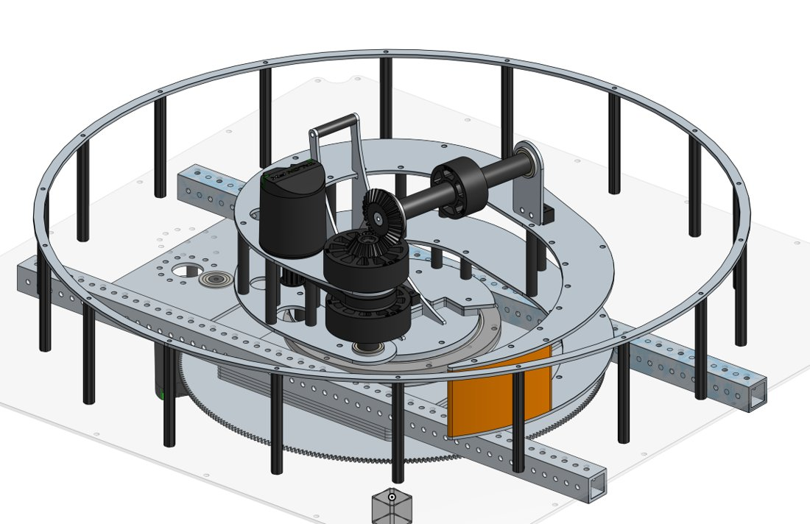

[Exact publisher image](https://2026.team4414.com/binder_assets/PrototypePhotos/RotorV1.webp) · [Gallery](https://2026.team4414.com/#prototyping). Full-resolution local publisher render inspected 2026-11-07; current public gallery labels and image URLs verified in browser.

## RotorV2

### Visible construction

A raised cylindrical cage of rings and uprights now surrounds the center above the horizontal shaft. The curved guide and lower drive remain visible.

### Comparison to previous gallery ordinal

Compared with V1, the conspicuous addition is the elevated central guide cage. V2 is a lower-resolution render, so smaller transmission details are unresolved.

### Engineering interpretation

The cage establishes an upward transport envelope. It creates a new requirement to maintain support between the lower capture and the top outlet; the render alone does not establish ball-column force or clearance.

### Team rationale

Not stated for this individual revision in the verified gallery. The separate current feature overview gives some design rationales, but those cannot be assigned backward to every prototype.

### Reported performance

No version-specific result, BPS, current, accuracy or reliability measurement was established from this render.

### Unknowns

Unscaled single CAD view; hidden contacts, exact gaps, materials, actuator assignments, reasons for change and event use remain unresolved unless separately sourced. Consecutive gallery ordinals do not prove direct hardware ancestry.

### Transfer limit

Historical yaw turret remains excluded for 1833. Capture/feed/contact or compact packaging features may transfer independently only after their interfaces and supports are reconstructed; no exact rotor/shooter pairing is certified.

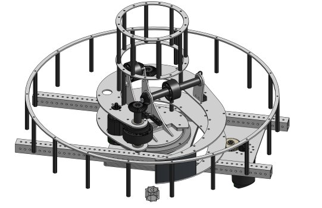

[Exact publisher image](https://2026.team4414.com/binder_assets/PrototypePhotos/RotorV2.webp) · [Gallery](https://2026.team4414.com/#prototyping). Full-resolution local publisher render inspected 2026-11-07; current public gallery labels and image URLs verified in browser.

## RotorV3

### Visible construction

Segmented red-rendered rollers are visible on the horizontal cross-shaft and vertical contact stack. An edge-mounted motor connects to the circular assembly through a short transmission.

### Comparison to previous gallery ordinal

Compared with V2, the upper cross-shaft is populated with a row of roller segments and the outer rotation drive is explicitly shown. Color is a CAD appearance, not a material identification.

### Engineering interpretation

Powered contacts can set incoming velocity before the upward path. Neither roller color nor their apparent size establishes compound, compression or surface speed.

### Team rationale

Not stated for this individual revision in the verified gallery. The separate current feature overview gives some design rationales, but those cannot be assigned backward to every prototype.

### Reported performance

No version-specific result, BPS, current, accuracy or reliability measurement was established from this render.

### Unknowns

Unscaled single CAD view; hidden contacts, exact gaps, materials, actuator assignments, reasons for change and event use remain unresolved unless separately sourced. Consecutive gallery ordinals do not prove direct hardware ancestry.

### Transfer limit

Historical yaw turret remains excluded for 1833. Capture/feed/contact or compact packaging features may transfer independently only after their interfaces and supports are reconstructed; no exact rotor/shooter pairing is certified.

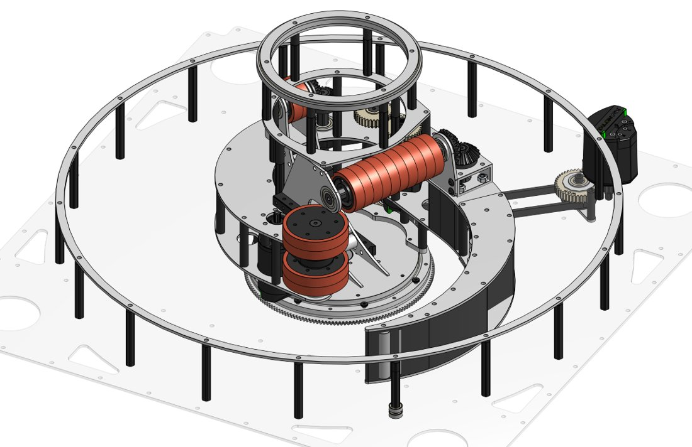

[Exact publisher image](https://2026.team4414.com/binder_assets/PrototypePhotos/RotorV3.webp) · [Gallery](https://2026.team4414.com/#prototyping). Full-resolution local publisher render inspected 2026-11-07; current public gallery labels and image URLs verified in browser.

## RotorV4

### Visible construction

The center retains the upper roller row. The surrounding floor includes additional curved rails, and a separate small vertical contact stack appears beside the central capture region.

### Comparison to previous gallery ordinal

Compared with V3, additional guiding paths and the small side contact stack are visible. V4 resolution limits small-part comparison.

### Engineering interpretation

Additional contacts and guides change how the pile loads the entry. They could guide or resist motion; only observed geometry is established here, not a claim that the change reduced jams.

### Team rationale

Not stated for this individual revision in the verified gallery. The separate current feature overview gives some design rationales, but those cannot be assigned backward to every prototype.

### Reported performance

No version-specific result, BPS, current, accuracy or reliability measurement was established from this render.

### Unknowns

Unscaled single CAD view; hidden contacts, exact gaps, materials, actuator assignments, reasons for change and event use remain unresolved unless separately sourced. Consecutive gallery ordinals do not prove direct hardware ancestry.

### Transfer limit

Historical yaw turret remains excluded for 1833. Capture/feed/contact or compact packaging features may transfer independently only after their interfaces and supports are reconstructed; no exact rotor/shooter pairing is certified.

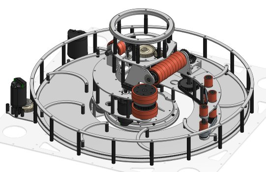

[Exact publisher image](https://2026.team4414.com/binder_assets/PrototypePhotos/RotorV4.webp) · [Gallery](https://2026.team4414.com/#prototyping). Full-resolution local publisher render inspected 2026-11-07; current public gallery labels and image URLs verified in browser.

## RotorV5

### Visible construction

Repeated rectangular paddles or panels are spaced around the outer ring on small mounts, with an orange-rendered connecting element following much of the perimeter. The central cage and roller stacks remain.

### Comparison to previous gallery ordinal

Compared with V4, a repeated perimeter-paddle arrangement is prominently modeled. The exact actuation and installed use of these paddles are not established.

### Engineering interpretation

Distributed pile contacts create different loading from a single inlet. Do not substitute an assumed agitator motor or infer a measured feed improvement from the paddle appearance.

### Team rationale

Not stated for this individual revision in the verified gallery. The separate current feature overview gives some design rationales, but those cannot be assigned backward to every prototype.

### Reported performance

No version-specific result, BPS, current, accuracy or reliability measurement was established from this render.

### Unknowns

Unscaled single CAD view; hidden contacts, exact gaps, materials, actuator assignments, reasons for change and event use remain unresolved unless separately sourced. Consecutive gallery ordinals do not prove direct hardware ancestry.

### Transfer limit

Historical yaw turret remains excluded for 1833. Capture/feed/contact or compact packaging features may transfer independently only after their interfaces and supports are reconstructed; no exact rotor/shooter pairing is certified.

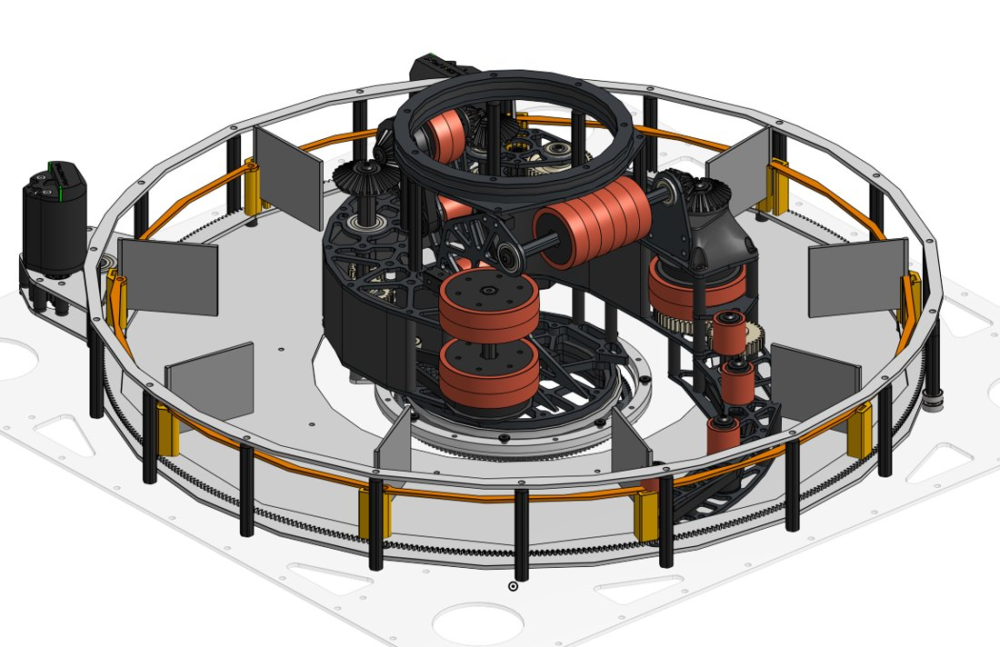

[Exact publisher image](https://2026.team4414.com/binder_assets/PrototypePhotos/RotorV5.webp) · [Gallery](https://2026.team4414.com/#prototyping). Full-resolution local publisher render inspected 2026-11-07; current public gallery labels and image URLs verified in browser.

## RotorV6

### Visible construction

A broad dark floor panel surrounds the center. Short wall segments attach to an outer structural ring, and two motors are grouped at a corner. The center includes curved guide surfaces and an upper ring.

### Comparison to previous gallery ordinal

Compared with V5, the render changes to a more integrated floor-and-outer-frame arrangement. Repeated outer paddles from V5 are not shown in this view; removal from a competed robot is not certified.

### Engineering interpretation

The enclosure and motor mounts are now more explicitly part of the assembly. The wide floor changes where loose fuel can rest and which surfaces need to bring it to the capture point.

### Team rationale

Not stated for this individual revision in the verified gallery. The separate current feature overview gives some design rationales, but those cannot be assigned backward to every prototype.

### Reported performance

No version-specific result, BPS, current, accuracy or reliability measurement was established from this render.

### Unknowns

Unscaled single CAD view; hidden contacts, exact gaps, materials, actuator assignments, reasons for change and event use remain unresolved unless separately sourced. Consecutive gallery ordinals do not prove direct hardware ancestry.

### Transfer limit

Historical yaw turret remains excluded for 1833. Capture/feed/contact or compact packaging features may transfer independently only after their interfaces and supports are reconstructed; no exact rotor/shooter pairing is certified.

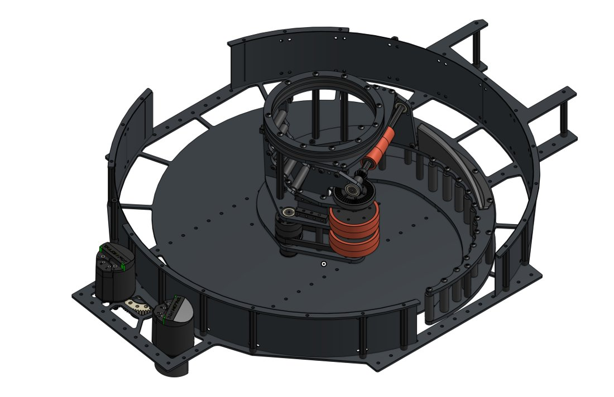

[Exact publisher image](https://2026.team4414.com/binder_assets/PrototypePhotos/RotorV6.webp) · [Gallery](https://2026.team4414.com/#prototyping). Full-resolution local publisher render inspected 2026-11-07; current public gallery labels and image URLs verified in browser.

## RotorV7

### Visible construction

Much of the floor is open or ribbed, exposing transmission and structural members. The central throat retains stacked contacts and its surrounding ring. A red cable/connector assembly appears on an outer bracket.

### Comparison to previous gallery ordinal

Compared with V6, the large solid floor region is opened up in the shown configuration, while the sidewall and perimeter transmission remain visible.

### Engineering interpretation

Opening the modeled floor may change mass, access and support of a later installed surface, but its material and actual inventory-support layers are not established by the render.

### Team rationale

Not stated for this individual revision in the verified gallery. The separate current feature overview gives some design rationales, but those cannot be assigned backward to every prototype.

### Reported performance

No version-specific result, BPS, current, accuracy or reliability measurement was established from this render.

### Unknowns

Unscaled single CAD view; hidden contacts, exact gaps, materials, actuator assignments, reasons for change and event use remain unresolved unless separately sourced. Consecutive gallery ordinals do not prove direct hardware ancestry.

### Transfer limit

Historical yaw turret remains excluded for 1833. Capture/feed/contact or compact packaging features may transfer independently only after their interfaces and supports are reconstructed; no exact rotor/shooter pairing is certified.

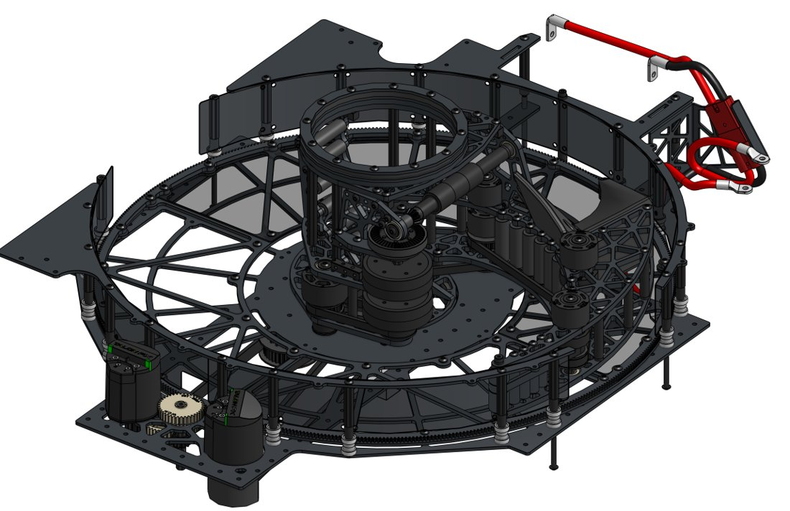

[Exact publisher image](https://2026.team4414.com/binder_assets/PrototypePhotos/RotorV7.webp) · [Gallery](https://2026.team4414.com/#prototyping). Full-resolution local publisher render inspected 2026-11-07; current public gallery labels and image URLs verified in browser.

## RotorV8

### Visible construction

The upper feed region shows a horizontal dark roller/shaft, a raised ring cage and an exposed spoke-like wheel on its side. A group of motors sits along one outer corner, with open floor framing around the center.

### Comparison to previous gallery ordinal

Compared with V7, the central contact and upper shaft arrangement differs, and the ring/cage proportions in the shown model change. Exact dimensions are unmeasured.

### Engineering interpretation

Central vertical feed geometry must be considered together with the upper shaft and side contact. A changed ring or roller arrangement changes the receiving envelope even if the outer bucket remains similar.

### Team rationale

Not stated for this individual revision in the verified gallery. The separate current feature overview gives some design rationales, but those cannot be assigned backward to every prototype.

### Reported performance

No version-specific result, BPS, current, accuracy or reliability measurement was established from this render.

### Unknowns

Unscaled single CAD view; hidden contacts, exact gaps, materials, actuator assignments, reasons for change and event use remain unresolved unless separately sourced. Consecutive gallery ordinals do not prove direct hardware ancestry.

### Transfer limit

Historical yaw turret remains excluded for 1833. Capture/feed/contact or compact packaging features may transfer independently only after their interfaces and supports are reconstructed; no exact rotor/shooter pairing is certified.

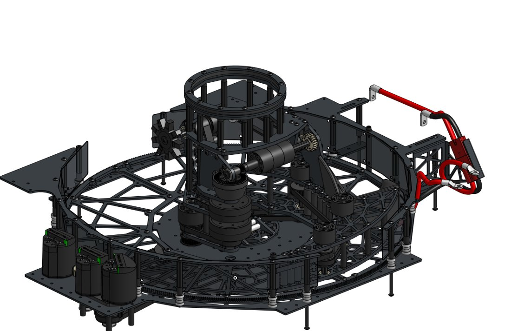

[Exact publisher image](https://2026.team4414.com/binder_assets/PrototypePhotos/RotorV8.webp) · [Gallery](https://2026.team4414.com/#prototyping). Full-resolution local publisher render inspected 2026-11-07; current public gallery labels and image URLs verified in browser.

## RotorV9

### Visible construction

Paneled floor sectors reappear around the central opening. The central capture and guide surfaces are more contoured, with small repeated rolling elements visible along a curved guide on one side.

### Comparison to previous gallery ordinal

Compared with V8, visible floor sectors and a substantially reshaped central guide/contact assembly distinguish this render. The top ring and internal cage also differ.

### Engineering interpretation

This is evidence to inspect where passive contacts replace sliding contact, and where pile support is restored. Reduced friction and reduced current are hypotheses for this revision unless separately attributed.

### Team rationale

Not stated for this individual revision in the verified gallery. The separate current feature overview gives some design rationales, but those cannot be assigned backward to every prototype.

### Reported performance

No version-specific result, BPS, current, accuracy or reliability measurement was established from this render.

### Unknowns

Unscaled single CAD view; hidden contacts, exact gaps, materials, actuator assignments, reasons for change and event use remain unresolved unless separately sourced. Consecutive gallery ordinals do not prove direct hardware ancestry.

### Transfer limit

Historical yaw turret remains excluded for 1833. Capture/feed/contact or compact packaging features may transfer independently only after their interfaces and supports are reconstructed; no exact rotor/shooter pairing is certified.

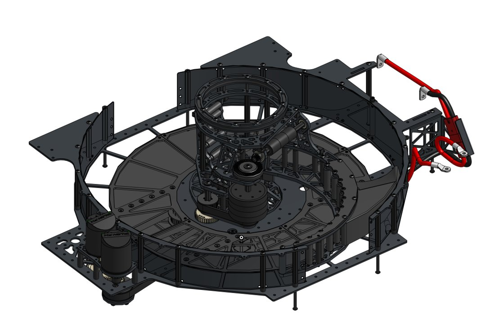

[Exact publisher image](https://2026.team4414.com/binder_assets/PrototypePhotos/RotorV9.webp) · [Gallery](https://2026.team4414.com/#prototyping). Full-resolution local publisher render inspected 2026-11-07; current public gallery labels and image URLs verified in browser.

## RotorV10

### Visible construction

The outer frame and paneled floor remain, with three motor bodies grouped along an outer edge in this view. The central entry shows small rolling elements, shaped guides and a stack with rounded contact surfaces.

### Comparison to previous gallery ordinal

Compared with V9, the rendered motor packaging and central contact shapes differ. Do not identify the exact motor assignment or wheel material from appearance alone.

### Engineering interpretation

The final displayed ordinal is useful for packaging comparisons, but is not automatically the last competition installation. Separate capture geometry, rotation transmission and up-feed drive when evaluating transfer.

### Team rationale

Not stated for this individual revision in the verified gallery. The separate current feature overview gives some design rationales, but those cannot be assigned backward to every prototype.

### Reported performance

No version-specific result, BPS, current, accuracy or reliability measurement was established from this render.

### Unknowns

Unscaled single CAD view; hidden contacts, exact gaps, materials, actuator assignments, reasons for change and event use remain unresolved unless separately sourced. Consecutive gallery ordinals do not prove direct hardware ancestry.

### Transfer limit

Historical yaw turret remains excluded for 1833. Capture/feed/contact or compact packaging features may transfer independently only after their interfaces and supports are reconstructed; no exact rotor/shooter pairing is certified.

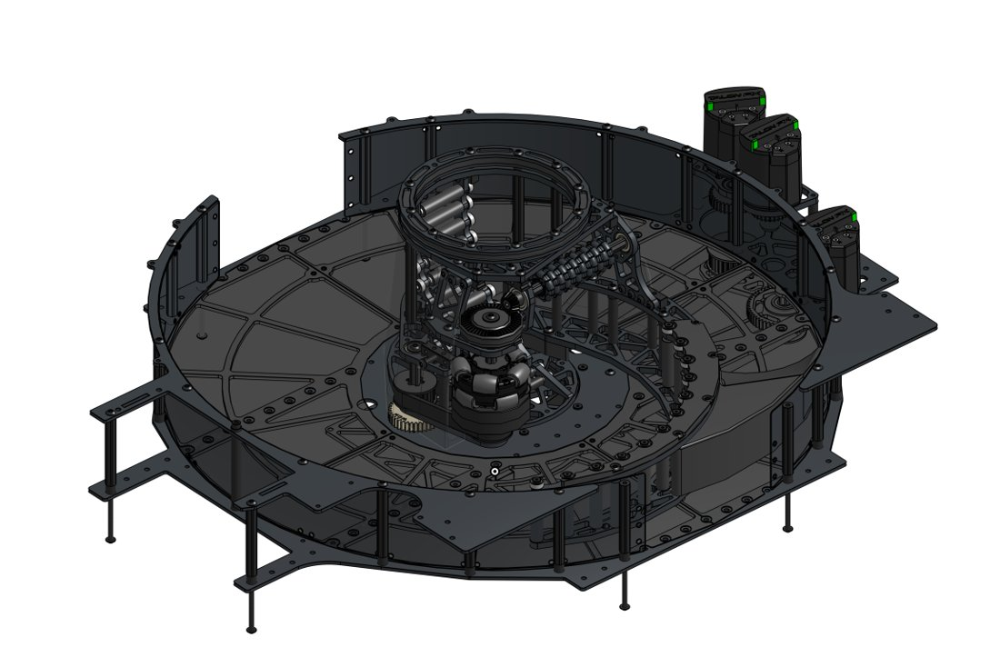

[Exact publisher image](https://2026.team4414.com/binder_assets/PrototypePhotos/RotorV10.webp) · [Gallery](https://2026.team4414.com/#prototyping). Full-resolution local publisher render inspected 2026-11-07; current public gallery labels and image URLs verified in browser.

## ShooterV1

### Visible construction

An offset upper support plate surrounds a central opening and circular yaw gear. Below it, the launch body contains opposed roller regions, side plates, belts and visible motor housings.

### Comparison to previous gallery ordinal

Baseline of the published shooter sequence; no earlier version is supplied.

### Engineering interpretation

The support/yaw envelope and launch contacts are already coupled. This view is not a specification for the later four-X44 feature overview.

### Team rationale

Not stated for this individual revision in the verified gallery. The separate current feature overview gives some design rationales, but those cannot be assigned backward to every prototype.

### Reported performance

No version-specific result, BPS, current, accuracy or reliability measurement was established from this render.

### Unknowns

Unscaled single CAD view; hidden contacts, exact gaps, materials, actuator assignments, reasons for change and event use remain unresolved unless separately sourced. Consecutive gallery ordinals do not prove direct hardware ancestry.

### Transfer limit

Historical yaw turret remains excluded for 1833. Capture/feed/contact or compact packaging features may transfer independently only after their interfaces and supports are reconstructed; no exact rotor/shooter pairing is certified.

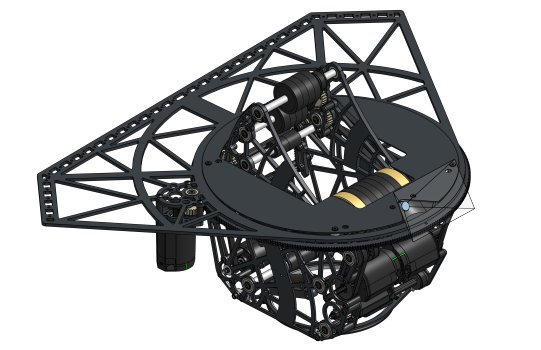

[Exact publisher image](https://2026.team4414.com/binder_assets/PrototypePhotos/ShooterV1.webp) · [Gallery](https://2026.team4414.com/#prototyping). Full-resolution local publisher render inspected 2026-11-07; current public gallery labels and image URLs verified in browser.

## ShooterV2

### Visible construction

A repeated spoke-wheel stack appears below one side of the upper frame, and additional framing surrounds the launch body. The circular gear and offset mounting wing remain.

### Comparison to previous gallery ordinal

Compared with V1, the side spoke-wheel stack and supporting frame are conspicuous additions in the shown assembly.

### Engineering interpretation

A component next to a fuel path may be a guide, tensioner or support. Its exact function is not established by shape alone; do not label it an extra powered feeder without source confirmation.

### Team rationale

Not stated for this individual revision in the verified gallery. The separate current feature overview gives some design rationales, but those cannot be assigned backward to every prototype.

### Reported performance

No version-specific result, BPS, current, accuracy or reliability measurement was established from this render.

### Unknowns

Unscaled single CAD view; hidden contacts, exact gaps, materials, actuator assignments, reasons for change and event use remain unresolved unless separately sourced. Consecutive gallery ordinals do not prove direct hardware ancestry.

### Transfer limit

Historical yaw turret remains excluded for 1833. Capture/feed/contact or compact packaging features may transfer independently only after their interfaces and supports are reconstructed; no exact rotor/shooter pairing is certified.

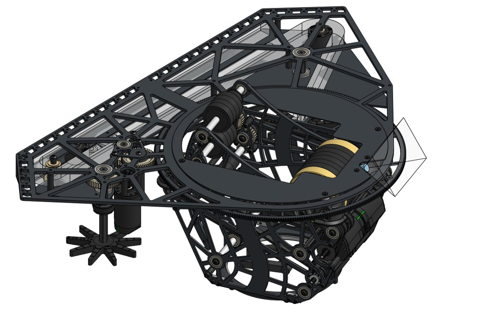

[Exact publisher image](https://2026.team4414.com/binder_assets/PrototypePhotos/ShooterV2.webp) · [Gallery](https://2026.team4414.com/#prototyping). Full-resolution local publisher render inspected 2026-11-07; current public gallery labels and image URLs verified in browser.

## ShooterV3

### Visible construction

Spoke-wheel stacks are shown on both sides of the launch body, supported by long vertical shafts. The upper plate, yaw gear and internal launch contacts remain visible.

### Comparison to previous gallery ordinal

Compared with V2, the opposite-side spoke-wheel stack and its shaft are visible as part of the assembly.

### Engineering interpretation

The added external swept volume matters to hopper clearance. Two visible side assemblies do not by themselves prove two independently driven feed lanes.

### Team rationale

Not stated for this individual revision in the verified gallery. The separate current feature overview gives some design rationales, but those cannot be assigned backward to every prototype.

### Reported performance

No version-specific result, BPS, current, accuracy or reliability measurement was established from this render.

### Unknowns

Unscaled single CAD view; hidden contacts, exact gaps, materials, actuator assignments, reasons for change and event use remain unresolved unless separately sourced. Consecutive gallery ordinals do not prove direct hardware ancestry.

### Transfer limit

Historical yaw turret remains excluded for 1833. Capture/feed/contact or compact packaging features may transfer independently only after their interfaces and supports are reconstructed; no exact rotor/shooter pairing is certified.

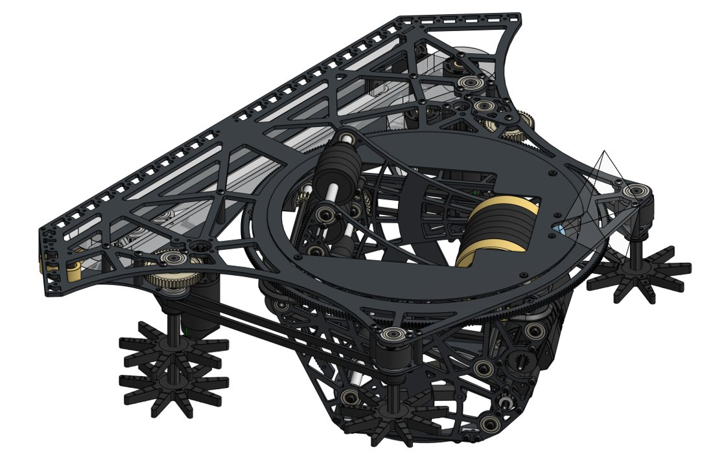

[Exact publisher image](https://2026.team4414.com/binder_assets/PrototypePhotos/ShooterV3.webp) · [Gallery](https://2026.team4414.com/#prototyping). Full-resolution local publisher render inspected 2026-11-07; current public gallery labels and image URLs verified in browser.

## ShooterV4

### Visible construction

The launch body is shown at a steeper orientation with an elevated upper roller and shafts crossing the open throat. The upper frame and side spoke-wheel stacks remain.

### Comparison to previous gallery ordinal

Compared with V3, the displayed launch pose and upper roller/shaft relation differ. A changed pose is not automatically a changed pivot range or new hardware.

### Engineering interpretation

This comparison needs common-pose CAD before attributing a clearance change to redesigned structure. Record the visible pose difference without inventing a performance improvement.

### Team rationale

Not stated for this individual revision in the verified gallery. The separate current feature overview gives some design rationales, but those cannot be assigned backward to every prototype.

### Reported performance

No version-specific result, BPS, current, accuracy or reliability measurement was established from this render.

### Unknowns

Unscaled single CAD view; hidden contacts, exact gaps, materials, actuator assignments, reasons for change and event use remain unresolved unless separately sourced. Consecutive gallery ordinals do not prove direct hardware ancestry.

### Transfer limit

Historical yaw turret remains excluded for 1833. Capture/feed/contact or compact packaging features may transfer independently only after their interfaces and supports are reconstructed; no exact rotor/shooter pairing is certified.

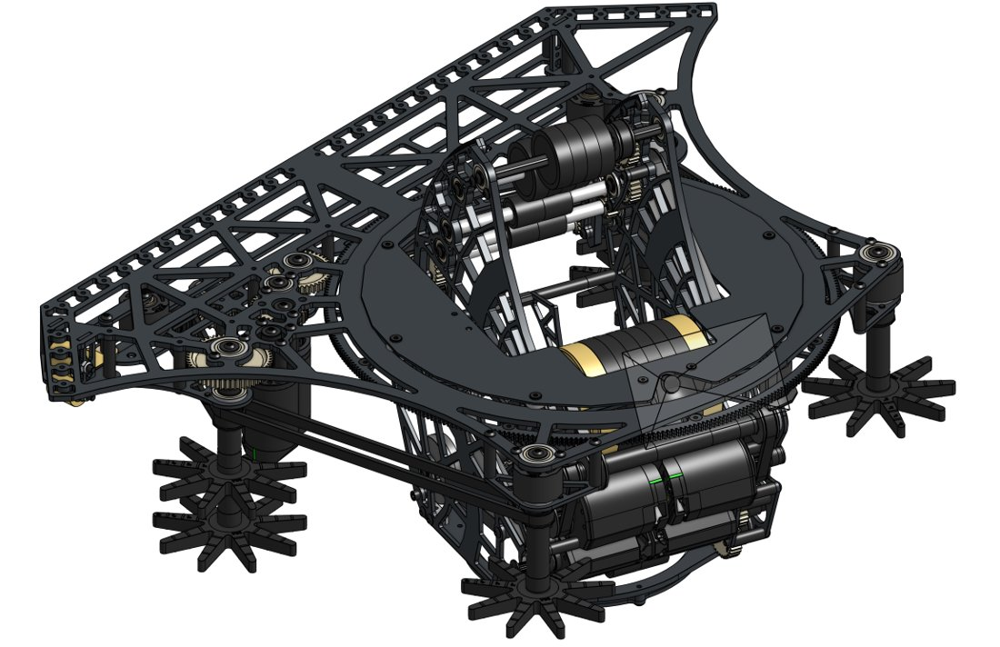

[Exact publisher image](https://2026.team4414.com/binder_assets/PrototypePhotos/ShooterV4.webp) · [Gallery](https://2026.team4414.com/#prototyping). Full-resolution local publisher render inspected 2026-11-07; current public gallery labels and image URLs verified in browser.

## ShooterV5-PreVentura

### Visible construction

The upper roller side structure and local support around the motor/gear region are revised in the displayed model. Long spoke-wheel shafts remain outside the body.

### Comparison to previous gallery ordinal

Publisher filename is ShooterV5-PreVentura. The visible local plate/bracing arrangement differs from V4; no event date or installation is inferred from the filename.

### Engineering interpretation

Treat the label as source navigation. A pre-event model does not establish what ran at the event, and its contact geometry cannot inherit later feature-list compression values.

### Team rationale

Not stated for this individual revision in the verified gallery. The separate current feature overview gives some design rationales, but those cannot be assigned backward to every prototype.

### Reported performance

No version-specific result, BPS, current, accuracy or reliability measurement was established from this render.

### Unknowns

Unscaled single CAD view; hidden contacts, exact gaps, materials, actuator assignments, reasons for change and event use remain unresolved unless separately sourced. Consecutive gallery ordinals do not prove direct hardware ancestry.

### Transfer limit

Historical yaw turret remains excluded for 1833. Capture/feed/contact or compact packaging features may transfer independently only after their interfaces and supports are reconstructed; no exact rotor/shooter pairing is certified.

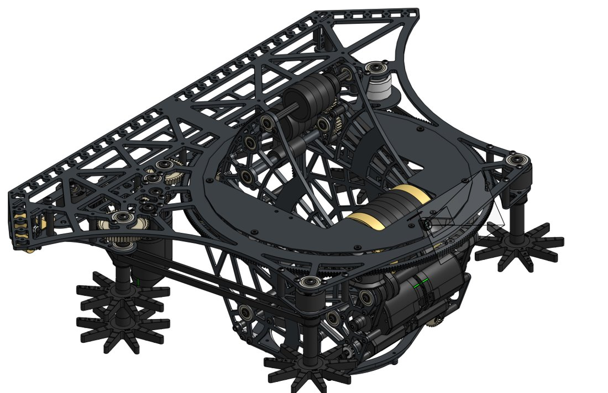

[Exact publisher image](https://2026.team4414.com/binder_assets/PrototypePhotos/ShooterV5-PreVentura.webp) · [Gallery](https://2026.team4414.com/#prototyping). Full-resolution local publisher render inspected 2026-11-07; current public gallery labels and image URLs verified in browser.

## ShooterV6Ventura

### Visible construction

An exposed gear is prominent at the upper roller pivot/shaft region, alongside a revised arrangement of side plates and braces. The opposed lower launch contact region remains.

### Comparison to previous gallery ordinal

Publisher filename is ShooterV6Ventura. The upper gear and adjacent support differ in the depicted configuration from V5. Exact installed event configuration is not certified.

### Engineering interpretation

The output shaft support and drive clearance are decision-relevant. Neither a visible gear nor an event-named asset establishes its ratio, backlash or duty-cycle result.

### Team rationale

Not stated for this individual revision in the verified gallery. The separate current feature overview gives some design rationales, but those cannot be assigned backward to every prototype.

### Reported performance

No version-specific result, BPS, current, accuracy or reliability measurement was established from this render.

### Unknowns

Unscaled single CAD view; hidden contacts, exact gaps, materials, actuator assignments, reasons for change and event use remain unresolved unless separately sourced. Consecutive gallery ordinals do not prove direct hardware ancestry.

### Transfer limit

Historical yaw turret remains excluded for 1833. Capture/feed/contact or compact packaging features may transfer independently only after their interfaces and supports are reconstructed; no exact rotor/shooter pairing is certified.

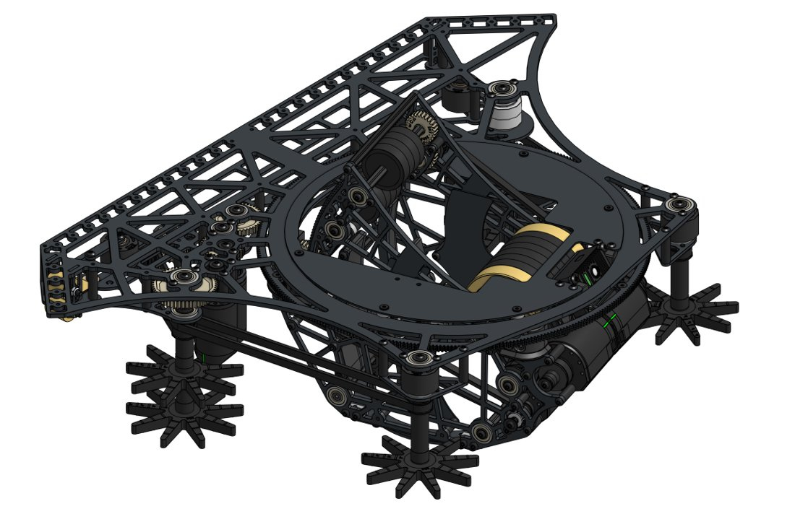

[Exact publisher image](https://2026.team4414.com/binder_assets/PrototypePhotos/ShooterV6Ventura.webp) · [Gallery](https://2026.team4414.com/#prototyping). Full-resolution local publisher render inspected 2026-11-07; current public gallery labels and image URLs verified in browser.

## ShooterV7

### Visible construction

The assembly changes to a narrower hanging body with an open circular lower cage. The large external spoke-wheel stacks visible in earlier images are not shown. The upper mounting wing and circular yaw support remain.

### Comparison to previous gallery ordinal

Compared with V6, the support/body envelope is substantially reorganized and the earlier external spoke-wheel assemblies are no longer depicted.

### Engineering interpretation

This is a whole packaging transition, not a cosmetic plate revision. A smaller depicted sweep can leave more hopper space, but capacity gained and actual adopted hardware remain unmeasured.

### Team rationale

Not stated for this individual revision in the verified gallery. The separate current feature overview gives some design rationales, but those cannot be assigned backward to every prototype.

### Reported performance

No version-specific result, BPS, current, accuracy or reliability measurement was established from this render.

### Unknowns

Unscaled single CAD view; hidden contacts, exact gaps, materials, actuator assignments, reasons for change and event use remain unresolved unless separately sourced. Consecutive gallery ordinals do not prove direct hardware ancestry.

### Transfer limit

Historical yaw turret remains excluded for 1833. Capture/feed/contact or compact packaging features may transfer independently only after their interfaces and supports are reconstructed; no exact rotor/shooter pairing is certified.

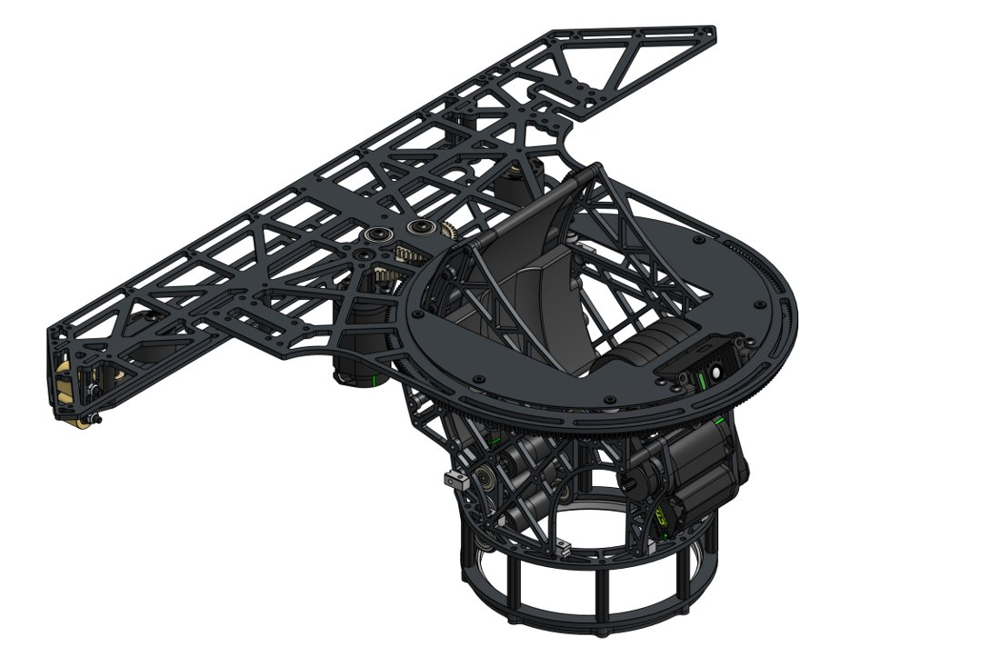

[Exact publisher image](https://2026.team4414.com/binder_assets/PrototypePhotos/ShooterV7.webp) · [Gallery](https://2026.team4414.com/#prototyping). Full-resolution local publisher render inspected 2026-11-07; current public gallery labels and image URLs verified in browser.

## ShooterV8OrangeCounty

### Visible construction

The narrow hanging-body arrangement continues. A transparent polygonal outline is depicted above the mounting wing; the throat has broad guide surfaces between the upper and lower contact regions.

### Comparison to previous gallery ordinal

Publisher filename is ShooterV8OrangeCounty. Compared with V7, the transparent outline and upper mounting detail differ. The outline is not identified as a physical part.

### Engineering interpretation

Keep rendered reference/envelope geometry separate from installed material. Do not turn the transparent outline into a measured trajectory or hardware requirement.

### Team rationale

Not stated for this individual revision in the verified gallery. The separate current feature overview gives some design rationales, but those cannot be assigned backward to every prototype.

### Reported performance

No version-specific result, BPS, current, accuracy or reliability measurement was established from this render.

### Unknowns

Unscaled single CAD view; hidden contacts, exact gaps, materials, actuator assignments, reasons for change and event use remain unresolved unless separately sourced. Consecutive gallery ordinals do not prove direct hardware ancestry.

### Transfer limit

Historical yaw turret remains excluded for 1833. Capture/feed/contact or compact packaging features may transfer independently only after their interfaces and supports are reconstructed; no exact rotor/shooter pairing is certified.

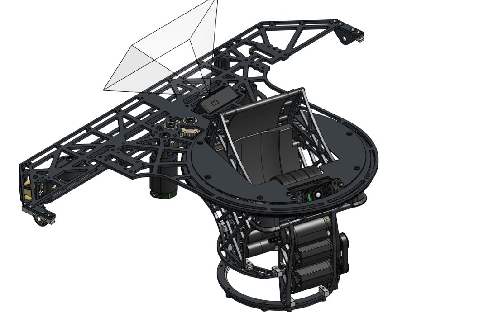

[Exact publisher image](https://2026.team4414.com/binder_assets/PrototypePhotos/ShooterV8OrangeCounty.webp) · [Gallery](https://2026.team4414.com/#prototyping). Full-resolution local publisher render inspected 2026-11-07; current public gallery labels and image URLs verified in browser.

## ShooterV9

### Visible construction

A green-rendered segmented contact row is visible across the lower side of the throat, with a ladder-like row of small horizontal cylinders behind the upper cross-shaft.

### Comparison to previous gallery ordinal

Compared with V8, the visible contact row and backing arrangement differ. Color does not establish roller compound or independently prove powered status.

### Engineering interpretation

This revision directs attention to entry/backing contact history. The important unknown is which surfaces are passive and how their velocity relates to the launch contact, not just the number of visible rollers.

### Team rationale

Not stated for this individual revision in the verified gallery. The separate current feature overview gives some design rationales, but those cannot be assigned backward to every prototype.

### Reported performance

No version-specific result, BPS, current, accuracy or reliability measurement was established from this render.

### Unknowns

Unscaled single CAD view; hidden contacts, exact gaps, materials, actuator assignments, reasons for change and event use remain unresolved unless separately sourced. Consecutive gallery ordinals do not prove direct hardware ancestry.

### Transfer limit

Historical yaw turret remains excluded for 1833. Capture/feed/contact or compact packaging features may transfer independently only after their interfaces and supports are reconstructed; no exact rotor/shooter pairing is certified.

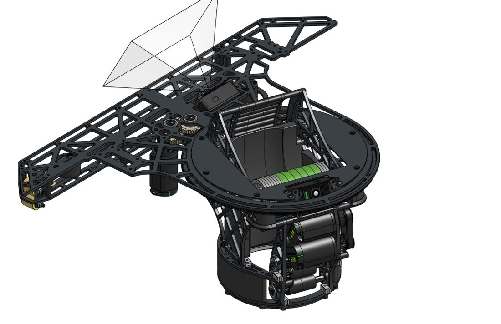

[Exact publisher image](https://2026.team4414.com/binder_assets/PrototypePhotos/ShooterV9.webp) · [Gallery](https://2026.team4414.com/#prototyping). Full-resolution local publisher render inspected 2026-11-07; current public gallery labels and image URLs verified in browser.

## ShooterV10

### Visible construction

A prominent upper dark roller spans the throat. Side supports and shafts around the opening are revised, with motor housings clustered below the upper plate. CAD coordinate markers are visible on the mounting wing.

### Comparison to previous gallery ordinal

Compared with V9, the upper contact and side transmission/support presentation change. CAD coordinate markers are editor annotations, not robot components.

### Engineering interpretation

A comparison of contact spacing requires a common hood pose. The render supports the arrangement of visible shafts but not their material, rotational speed or measured shot consistency.

### Team rationale

Not stated for this individual revision in the verified gallery. The separate current feature overview gives some design rationales, but those cannot be assigned backward to every prototype.

### Reported performance

No version-specific result, BPS, current, accuracy or reliability measurement was established from this render.

### Unknowns

Unscaled single CAD view; hidden contacts, exact gaps, materials, actuator assignments, reasons for change and event use remain unresolved unless separately sourced. Consecutive gallery ordinals do not prove direct hardware ancestry.

### Transfer limit

Historical yaw turret remains excluded for 1833. Capture/feed/contact or compact packaging features may transfer independently only after their interfaces and supports are reconstructed; no exact rotor/shooter pairing is certified.

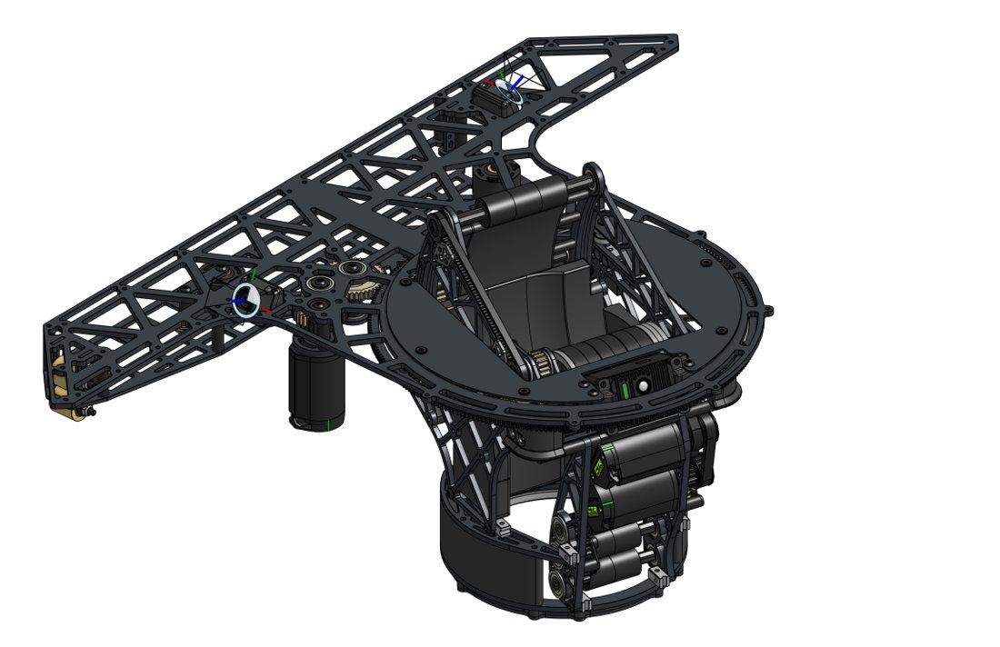

[Exact publisher image](https://2026.team4414.com/binder_assets/PrototypePhotos/ShooterV10.webp) · [Gallery](https://2026.team4414.com/#prototyping). Full-resolution local publisher render inspected 2026-11-07; current public gallery labels and image URLs verified in browser.

## ShooterV11

### Visible construction

The upper throat retains a spanning roller and broad backing surfaces. The lower side-drive assembly shows a revised braced arrangement of motors, rollers, shafts and external belts; the lower cage includes a broad dark panel.

### Comparison to previous gallery ordinal

Compared with V10, local side-drive support and lower enclosure presentation differ. This is the last numbered shooter render in the verified gallery, not a certified final event build.

### Engineering interpretation

Borrow the compact contact-and-support layout only after identifying drives and backing through CAD or the feature overview. Do not pair this shooter with RotorV10 merely because both are the last gallery ordinals.

### Team rationale

Not stated for this individual revision in the verified gallery. The separate current feature overview gives some design rationales, but those cannot be assigned backward to every prototype.

### Reported performance

No version-specific result, BPS, current, accuracy or reliability measurement was established from this render.

### Unknowns

Unscaled single CAD view; hidden contacts, exact gaps, materials, actuator assignments, reasons for change and event use remain unresolved unless separately sourced. Consecutive gallery ordinals do not prove direct hardware ancestry.

### Transfer limit

Historical yaw turret remains excluded for 1833. Capture/feed/contact or compact packaging features may transfer independently only after their interfaces and supports are reconstructed; no exact rotor/shooter pairing is certified.

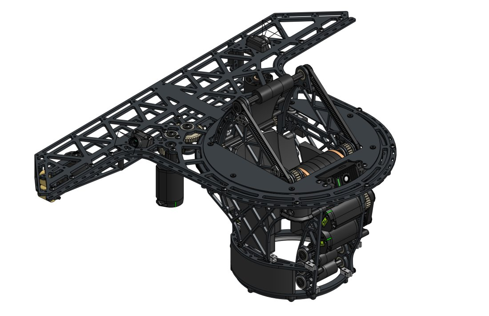

[Exact publisher image](https://2026.team4414.com/binder_assets/PrototypePhotos/ShooterV11.webp) · [Gallery](https://2026.team4414.com/#prototyping). Full-resolution local publisher render inspected 2026-11-07; current public gallery labels and image URLs verified in browser.

