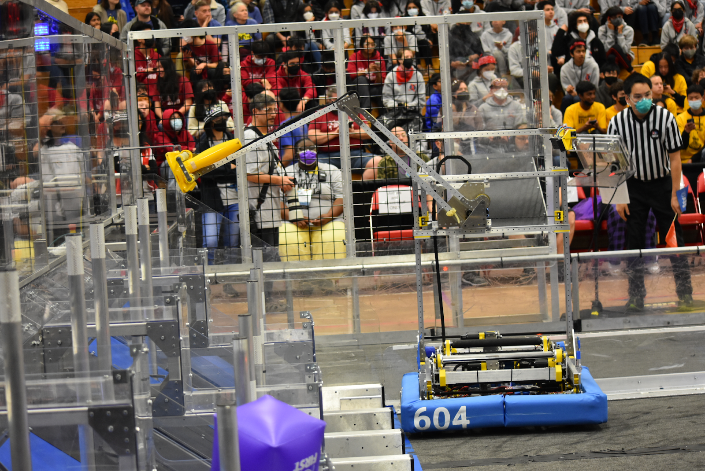

# 2023-604 — Quixilver: 2023 published robot (name not independently confirmed)

Primary source: https://www.chiefdelphi.com/t/team-604-quixilver-presents-our-2023-robot-and-code-release/447255

Reviewed 2026-10-26. This is a source-bounded technical study. Construction, stated intent, interpretation and unresolved evidence are separate.

## 2023 published robot account · intake

### Published construction or code

A pasta-roller intake grips a cone flange and pinches a cube, constraining cones to tip-in or tip-out. A roller reorienter supplies the additional rotational degree of freedom needed for an upright handoff. Rollers are powered coaxially through the reorienter.

### Stated rationale and boundaries

The team wanted ground pickup in arbitrary orientations; human-player throwing could shorten travel by an estimated 40% and reduce loading-zone traffic. Coaxial drive protects motors and reduces mass at the intake edge.

### Engineering interpretation

This is an explicit strategy-to-mechanism chain: changing the pickup source reduces travel only if orientation and handoff remain reliable. The 40% is the team’s route estimate, not an independently measured cycle improvement. A broad capture envelope transfers complexity downstream unless the robot can reduce the resulting pose uncertainty. Compare full acquisition-to-scoring cycles, including difficult orientations, rather than pickup speed alone.

### Validation still required

Verify the installed configuration and interfaces against the original publication/CAD; prototype full acquisition-to-output cycles, recovery and service access under the intended loaded and defended conditions. These tests are proposed, not performed.

## 2023 published robot account · transfer

### Published construction or code

A linear intake slider brings the piece inward and permits frontal compliance. A separate horizontal scoring-arm slider reaches across the intake. A time-of-flight sensor first distinguishes orientation at a fixed location, then locates the piece laterally. The elevator lowers while the intake expels to hand off.

### Stated rationale and boundaries

The team needed handoff despite variable piece position across the intake width.

### Engineering interpretation

Do not collapse the two sliders into a single motion. The intake reduces some uncertainty, then sensing and the receiving mechanism handle what remains. This avoids requiring perfect passive centering, at the cost of coordinated motion, sensor interpretation and collision clearance. Sensor occlusion, flange shape, cone reflectivity and loaded mechanism deflection are plausible validation concerns, not failures established by this publication.

### Validation still required

Verify the installed configuration and interfaces against the original publication/CAD; prototype full acquisition-to-output cycles, recovery and service access under the intended loaded and defended conditions. These tests are proposed, not performed.

## 2023 published robot account · scoring

### Published construction or code

A non-parallel four-bar provides scoring reach. An Everybot-style lightweight gripper squeezes the cone tip and pinches a cube. The release describes scoring all levels.

### Stated rationale and boundaries

The team chose the linkage for low mass and long extension, and judged the high-versus-middle scoring difference sufficient to justify the added capability.

### Engineering interpretation

The linkage choice belongs with the piece acquisition and handoff design. Saving moving mass can reduce the drive and tipping burden, but linkage workspace, joint play and gripper compliance determine the usable placement envelope. A later team using a single-stage elevator should not be read as proof that this four-bar was a failed architecture; the game, interface and required motion differ.

### Validation still required

Verify the installed configuration and interfaces against the original publication/CAD; prototype full acquisition-to-output cycles, recovery and service access under the intended loaded and defended conditions. These tests are proposed, not performed.

## 2023 published robot account · controls

### Published construction or code

Originally the operator selected scoring locations on a driverstation keyboard and the driver triggered automated scoring. The team later reports the driver becoming faster and more consistent than that sequence, reducing the operator role to piece and level selection.

### Stated rationale and boundaries

The control allocation evolved with driver performance.

### Engineering interpretation

Automation should be judged against practiced human operation, including recovery, rather than valued simply because it exists. This is a useful counterexample to treating 604’s later single-driver automation as an unchanging philosophy implemented identically every year. Keep the final software release and its 2024-beta port distinct. Detailed drivetrain specifications and the charge-station balancing mechanism are not established by this reviewed release.

### Validation still required

Verify the installed configuration and interfaces against the original publication/CAD; prototype full acquisition-to-output cycles, recovery and service access under the intended loaded and defended conditions. These tests are proposed, not performed.

## Evidence limits

- Selected primary publications/code reviewed; exact per-event installation and exhaustive intermediate revisions remain unresolved.
- Four previously blocked source originals (2023 robot photo; 2026 serializer, intake and hopper CAD views) were recovered through normal browser downloads on 2026-10-26 and inspected. Whole-robot source views are not exhaustive mechanism or event-version certification.

The reviewed publication does not establish charge-station balance construction or exact drivetrain hardware. FIRST’s carried-forward robot-name field is not treated as authoritative identity for this different-season machine.

## Recovered original source images · 2026-10-26

The earlier direct-download failures are resolved. These are unchanged originals from the team release; the labels below are editorial retrieval aids. Inspect the full view before borrowing packaging ideas. Exact dimensions, hidden construction and match performance require independent source evidence.

### Whole robot / scoring arm

2023-604 · Field photograph of the 2023 robot with blue 604 bumpers and extended scoring arm. A whole-robot view, not an isolated mechanism detail.

[Team release](https://www.chiefdelphi.com/t/447255/1) · [Original image](https://www.chiefdelphi.com/uploads/default/original/3X/c/e/ceea2ea1a4a1ee8c9568398fa6188eee82feefee.png) · Image ID `604-source-2023-robot`.

