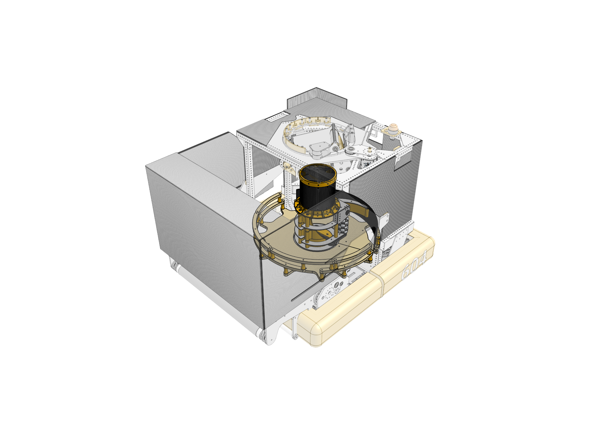
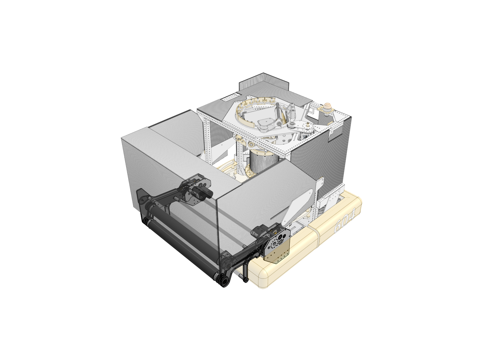
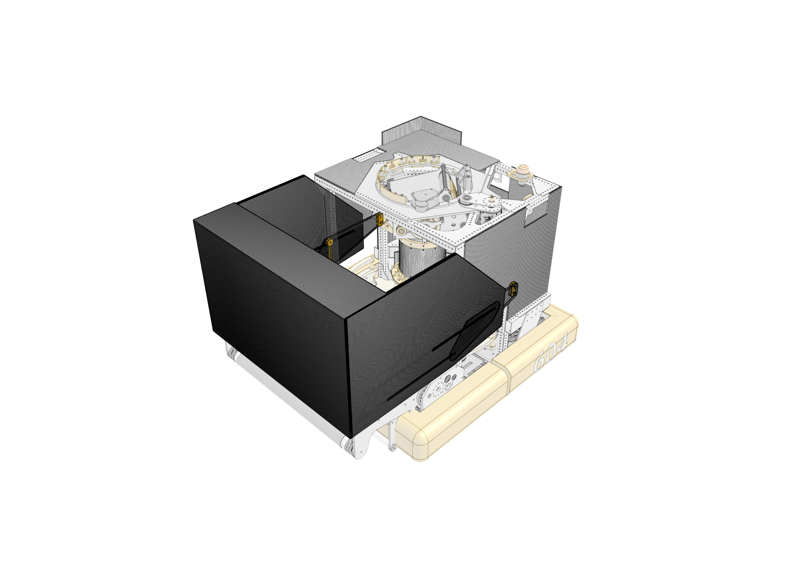

# 2026-604 — Quixilver: Toploader

Primary source: https://www.chiefdelphi.com/t/team-604-quixilver-2026-robot-cad-and-code-release/524289

Reviewed 2026-10-26. This is a source-bounded technical study. Construction, stated intent, interpretation and unresolved evidence are separate.

## Toploader DPC serializer · transfer

### Published construction or code

A rotating capture mechanism scoops fuel from a circular plywood bucket. Rotation and up-feed have separate motors; side rollers use omni wheels. Successive fuel pushes through a corrugated-plastic tube shaped by printed ends. The bucket separates into two sections for service.

### Stated rationale and boundaries

The team identified serialization as the limiting process and designed the robot around it. Independent drives allow software adjustment of rotation versus up-feed.

### Engineering interpretation

The capture point moves to available fuel rather than relying solely on gravity bringing fuel to a stationary throat. Independent feed authority can help tune pile interaction and column delivery separately, but the release does not establish a universal motor-ratio setting. Bucket geometry, turret support and electronics access are part of the same flow system. Prototype rates of about 15 BPS single-stream and 23 BPS full-width are comparison claims, not sustained match scoring rates.

### Validation still required

Verify the installed configuration and interfaces against the original publication/CAD; prototype full acquisition-to-output cycles, recovery and service access under the intended loaded and defended conditions. These tests are proposed, not performed.

## Toploader chassis · drivetrain

### Published construction or code

A 27-inch square frame preserves circular bucket area without custom swerves or chamfered corners. Internal bars protect battery and module compartments; rear bumper mounts integrate armor for serializer protection.

### Stated rationale and boundaries

Maximize the serializer’s available area with manufacturable hardware and protect internal mechanisms.

### Engineering interpretation

This is an explicit packaging choice. It sacrifices some geometric freedom to keep the central circular feed volume useful with standard drive components. Frame perimeter, usable interior area and turret swept volume must be compared together. The team separately describes bump-only autonomous constraints; no unreviewed trench state or chassis specification should be inferred.

### Validation still required

Verify the installed configuration and interfaces against the original publication/CAD; prototype full acquisition-to-output cycles, recovery and service access under the intended loaded and defended conditions. These tests are proposed, not performed.

## Toploader inset turret · scoring

### Published construction or code

The turret is supported from above and packaged to reduce swept volume. Its sliding bearing stacks polycarbonate and aluminum plates; printed PETG spacers set clearance empirically and grease reduces friction.

### Stated rationale and boundaries

Moving scoring and feeding were judged worth a lower single-stream ceiling; small swept volume preserves hopper capacity and flow.

### Engineering interpretation

A turret changes more than aiming. Its supports and swept envelope can obstruct fuel entering the serializer, so a nominal capacity comparison that ignores the moving assembly is incomplete. This release supports a manufacturable impact-tolerant bearing concept, not exact dimensions, a universal bearing preload or independently verified shot accuracy. The team’s rate trade is tied to its intended moving role.

### Validation still required

Verify the installed configuration and interfaces against the original publication/CAD; prototype full acquisition-to-output cycles, recovery and service access under the intended loaded and defended conditions. These tests are proposed, not performed.

## Toploader independently deployed arms · intake

### Published construction or code

Each intake arm uses an X44 deploy motor. Protected motors belt-drive compliant dead-axle polycarbonate rollers with silicone tubing and TPU pulley plugs. TPU belt supports retain the belts during deflection. A one-time kicker deploy uses surgical tubing and flexible plugs/string.

### Stated rationale and boundaries

The team explicitly connects independent deployment to eliminating the mechanically linked 2024 chain failure. Polycarbonate was preferred over SRPP to avoid permanent deformation changing belt centers.

### Engineering interpretation

Compliance must preserve transmission function, not just prevent fracture. A flexible arm changes belt geometry under load; supporting the belt during that motion is an integral part of the architecture. The team reports that TPU replaced brittle PETG roller plugs, with 100% infill and four-wall printing, and that wear still requires replacement every one or two events. Repairable consumables are not maintenance-free hardware.

### Validation still required

Verify the installed configuration and interfaces against the original publication/CAD; prototype full acquisition-to-output cycles, recovery and service access under the intended loaded and defended conditions. These tests are proposed, not performed.

## Toploader linked sliding hopper · intake

### Published construction or code

Intake deployment extends a sliding hopper; surgical tubing retracts it. Two laminated layers of corrugated plastic provide stiffness. Slots are reinforced with 0.090-inch polycarbonate sandwiched between sheets; panels use tape and adhesive for replacement.

### Stated rationale and boundaries

The publication emphasizes low mass, robust sliding and easy manufacture/repair with limited router access.

### Engineering interpretation

This is a specific example of an intake–storage interface, useful to 1833’s morph chart. Linking deployment reduces independent actuation but also links faults and operating states. Slot reinforcement addresses local bearing and deformation loads that a generic corrugated-plastic wall description misses. Capacity, deflection and passage access should be measured in each loaded state; no unverified hopper capacity is assigned here.

### Validation still required

Verify the installed configuration and interfaces against the original publication/CAD; prototype full acquisition-to-output cycles, recovery and service access under the intended loaded and defended conditions. These tests are proposed, not performed.

## Toploader readiness and localization · controls

### Published construction or code

Scoring requires launch velocity, launch angle and turret yaw within tolerance plus a recent image with at least two tags. The serializer pauses when readiness fails. PhotonVision MultiTag selects camera poses using hub/total tag visibility and rejects old or ambiguous poses.

### Stated rationale and boundaries

Single-driver operation reduces communication overhead; automated gating is intended to release fuel only from useful launch states.

### Engineering interpretation

Feed interruption is an intentional interface between aiming and serialization, not automatically a jam. A high mechanical BPS ceiling is useful only while readiness remains true. Logging the reason for each gating interruption would distinguish vision starvation, aim error and actual feed trouble. The release does not demonstrate those duty fractions or an electrical diagnosis of every stop.

### Validation still required

Verify the installed configuration and interfaces against the original publication/CAD; prototype full acquisition-to-output cycles, recovery and service access under the intended loaded and defended conditions. These tests are proposed, not performed.

## Toploader partner-aware bump autonomous · controls

### Published construction or code

The team describes timestamping partner paths, targeting leftover fuel after the trench race, using reusable path partials and adjustable pauses without redeployment. A Pac-Man routine is identified at NorCal DCMP playoff match 1.

### Stated rationale and boundaries

A bump-only robot was expected to reach midfield later; route selection was built around shorter partners rather than competing for the same initial race.

### Engineering interpretation

Architectural limitations can become planning inputs instead of being hidden by an ideal autonomous animation. Preserve the team’s distinction between pre-Champs crossing rules and later rules, and between experiments and actually used routines. A clever path is not proof every prototype routine competed. The release does not establish a tower mechanism; absence from the selected technical sections remains unknown, not certified absence.

### Validation still required

Verify the installed configuration and interfaces against the original publication/CAD; prototype full acquisition-to-output cycles, recovery and service access under the intended loaded and defended conditions. These tests are proposed, not performed.

## Evidence limits

- Selected primary publications/code reviewed; exact per-event installation and exhaustive intermediate revisions remain unresolved.
- Four previously blocked source originals (2023 robot photo; 2026 serializer, intake and hopper CAD views) were recovered through normal browser downloads on 2026-10-26 and inspected. Whole-robot source views are not exhaustive mechanism or event-version certification.

## Recovered original source images · 2026-10-26

The earlier direct-download failures are resolved. These are unchanged originals from the team release; the labels below are editorial retrieval aids. Inspect the full view before borrowing packaging ideas. Exact dimensions, hidden construction and match performance require independent source evidence.

### Serializer / central upfeed

2026-604 · Whole-robot CAD view with ghosted front components exposing the circular bucket, central upfeed tube and upper turret support. The original is retained without cropping.

[Team release](https://www.chiefdelphi.com/t/524289/1) · [Original image](https://www.chiefdelphi.com/uploads/default/original/4X/3/9/3/3934b6a0324e210c03b36434e8a9cd8fd395af3d.png) · Image ID `604-source-2026-serializer`.

### Intake / deployment packaging

2026-604 · Whole-robot CAD view with front intake arms and drivetrain packaging visible through ghosted components. This is a packaging reference, not a complete roller or belt specification.

[Team release](https://www.chiefdelphi.com/t/524289/1) · [Original image](https://www.chiefdelphi.com/uploads/default/original/4X/9/2/f/92fe26de6c188bd4483bbb8ce437dcdebddf71e7.png) · Image ID `604-source-2026-intake`.

### Hopper / sliding wall packaging

2026-604 · Whole-robot CAD view showing front wall, hopper and slot packaging. It does not establish every sliding interface, capacity or material thickness by itself.

[Team release](https://www.chiefdelphi.com/t/524289/1) · [Original image](https://www.chiefdelphi.com/uploads/default/original/4X/a/7/7/a77423f55dc711b1fdffd9e4368a12865950ae67.png) · Image ID `604-source-2026-hopper`.

