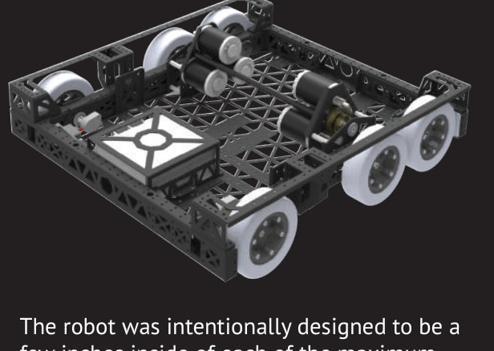
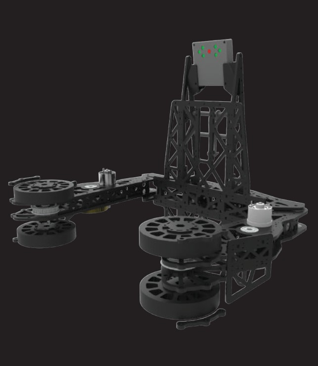
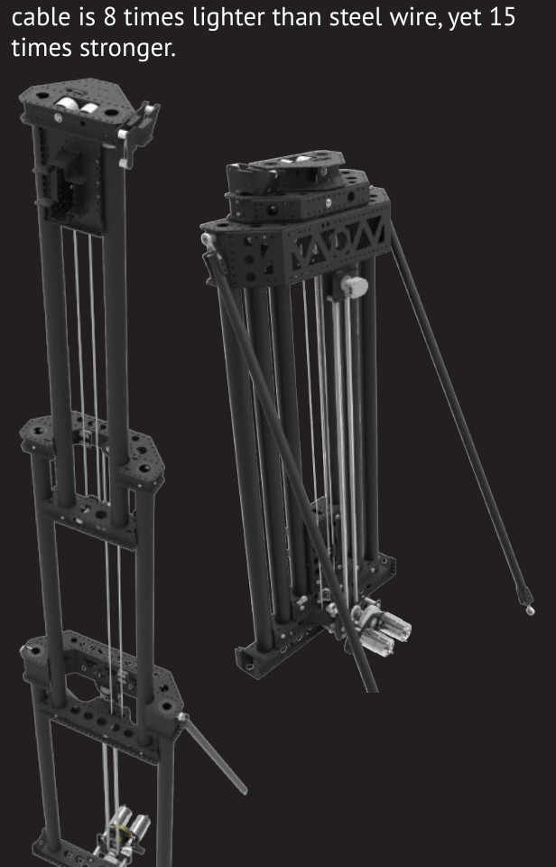
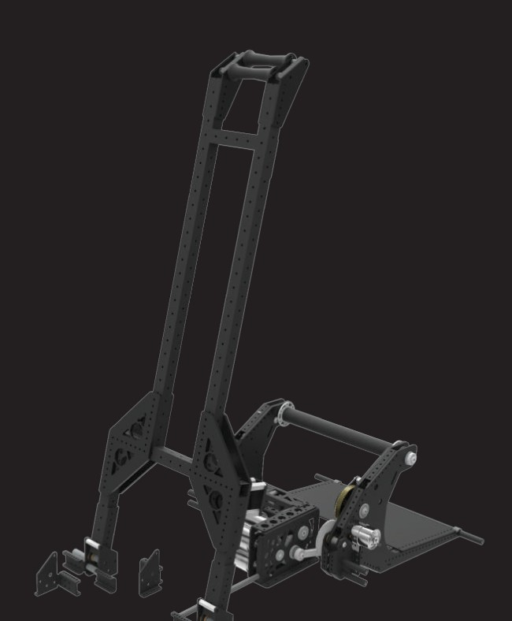
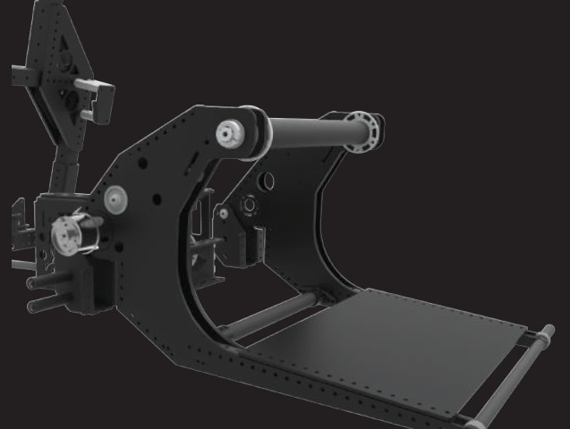

# 2018-148 — Robowranglers: Uppercut

An intentionally undersized, short robot uses a single-speed drive, lightweight cascading elevator and cube-normalizing polycarbonate intake. The elevator collapses below the scale transit height. A separate winch/hook and partner-capture roller/forks support climbing. Major assemblies are removable modules.

## Strategic interpretation

Uppercut’s strategic advantage is a coupled acquisition, orientation and transit package. Collapsed clearance preserves route options while a normalized cube pose helps packing. The publication’s fast lift and climb claims need their original load conditions. Its extensive prototyping resources are historical context, not a cheap-iteration prescription for 1833.

## Undersized frame, scale transit and removable modules

Version: Uppercut judges pamphlet snapshot. Source: https://www.robowranglers148.com/uploads/1/0/5/4/10542658/judges_pamphlet-compressed.pdf. Physical PDF pages: [1, 2].

### Published construction or code

The pamphlet describes a small frame several inches inside the permitted limits, a single-speed drive with stated 18 ft/s top speed, and enough collapsed clearance to travel under the scale regardless of tilt. Subsystems remove as modules. Electronics occupy a compact two-sided panel kept low.

### Team rationale or evidence boundary

Improve agility and cube cycle speed, preserve field routes and permit replacement/upgrade of assemblies through the season.

### Engineering interpretation

Small external dimensions can reduce swept turning area and open routes; small internal dimensions can also make service and wiring harder. The module concept succeeds only when connectors, fasteners and structural interfaces are actually accessible. The under-scale benefit is a game-specific clearance condition and should not be generalized to any new field. A single speed removes shifting hardware but must cover defended drive and transit loads with the chosen motor/wheel system.

### Proposed validation — not performed

Check actual bumper envelope, all stowed protrusions and service removal directions. Compare route time with the robot in its real low state, including the time to lower before entering the route.

### Limits

Team publication and selected figures, not an independent performance test or exhaustive competition chronology. Source dimensions and reported speeds require validation for a new design.

## Boot-mediated cube orientation and lightweight capture

Version: Uppercut judges pamphlet snapshot. Source: https://www.robowranglers148.com/uploads/1/0/5/4/10542658/judges_pamphlet-compressed.pdf. Physical PDF pages: [6, 8].

### Published construction or code

The intake flips a captured cube over a boot into a preferred tall/narrow orientation. The team describes Lexan construction and a passive preload retainer nicknamed the drinking bird. It reports six intake revisions before bagging and explicitly connects orientation control to packing cubes on the scale/switch.

### Team rationale or evidence boundary

Capture cubes in varied orientations while delivering a consistent final pose and keeping the elevator payload light.

### Engineering interpretation

An intake can do useful sorting and reorientation before the scoring mechanism ever moves. The important transformation is entry pose to stable exit pose. Boot geometry, piece inertia, roller contact and the backstop determine whether the cube rolls as intended or wedges. A different box with soft walls or different aspect ratio may not rotate predictably. The historical number of revisions describes what 148 did; for 1833, first reason through geometry and use a bounded contact experiment only if the pose transformation remains uncertain.

### Proposed validation — not performed

Create an entry-pose map including open fabric face, diagonal approach and partial capture. Check whether each pose converges to the desired orientation and whether a reversal can recover a jam without hand intervention.

### Limits

Team publication and selected figures, not an independent performance test or exhaustive competition chronology. Source dimensions and reported speeds require validation for a new design.

## Cascading lift with lightweight stages

Version: Uppercut judges pamphlet snapshot. Source: https://www.robowranglers148.com/uploads/1/0/5/4/10542658/judges_pamphlet-compressed.pdf. Physical PDF pages: [3].

### Published construction or code

The team describes a cascading elevator with two 775pros, a chain-driven bottom stage and Dyneema-coupled upper stages. Thin-wall tubes, printed rollers and constant-force springs reduce the active lifting burden. The pamphlet reports approximately 90-inch maximum height and below-42-inch collapsed height, along with a sub-half-second lift claim.

### Team rationale or evidence boundary

Move a cube rapidly to scoring height while retaining low travel clearance and minimizing carried structural mass.

### Engineering interpretation

The collapsed-to-extended ratio, stage overlap and moving mass are interdependent. A mechanism that looks like a generic elevator may owe its performance to a light intake, careful bearing arrangement, counterbalance and restrained side loads. Cascading kinematics should be derived explicitly; do not copy a published timing into a design target without knowing travel, load and timing endpoints. Rope strength advertising is not an installed safety factor after knots, terminations, wear and small pulleys.

### Proposed validation — not performed

Derive each stage’s speed and cable force, compare deflection at full reach and check the retained cube clearance through every intermediate position. Inspect counterbalance behavior near both travel limits.

### Limits

Team publication and selected figures, not an independent performance test or exhaustive competition chronology. Source dimensions and reported speeds require validation for a new design.

## Independent winch and active partner capture

Version: Uppercut judges pamphlet snapshot. Source: https://www.robowranglers148.com/uploads/1/0/5/4/10542658/judges_pamphlet-compressed.pdf. Physical PDF pages: [4, 5].

### Published construction or code

The hook is carried up by the elevator, detaches from its retained mount at the bar, and remains while a three-775pro winch raises the robot. An A-frame manages the pair’s balance. A one-way roller draws in a partner-deployed strap and positions the partner on supporting forks; the source reports lifting itself plus a full-weight partner in under three seconds.

### Team rationale or evidence boundary

Keep a partner secure and aligned during a fast shared climb rather than rely on the partner simply remaining balanced on a support.

### Engineering interpretation

Partner capture is not the same as partner lift force. The strap/roller controls relative motion while forks support vertical load. Strap availability, deployment, approach and partner compatibility remain dependencies. A separate winch changes the scoring elevator’s load duty but adds motor/gearbox mass and service interfaces. For a new game, compare that whole-system cost with the actual bonus value. Electric-only latching must preserve a safe retained state and a controlled release; no load rating is inferred from the pamphlet photograph.

### Proposed validation — not performed

Specify the partner interface and load cases before detailed winch selection. Evaluate docking error, strap failure, anti-backdrive and the combined CG during the full lift, not just at the final pose.

### Limits

Team publication and selected figures, not an independent performance test or exhaustive competition chronology. Source dimensions and reported speeds require validation for a new design.

## Remaining evidence gaps

- Curated historical mechanism cohort, not a top-25 EPA selection; no EPA/rank fabricated.
- Selected primary publications and figures reviewed; no narrated-video review or exact CAD verification is claimed.
- Historical pneumatic/turret hardware is retained as fact but disallowed in new 1833 recommendations. Adaptation requires new interface/load/holding/recovery analysis.
- No exhaustive every-version certification, new PCH performance benchmark or match-by-match Einstein tactical audit.
