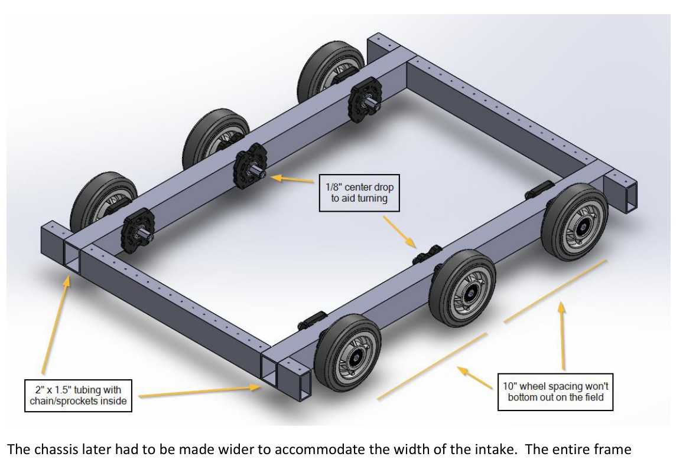
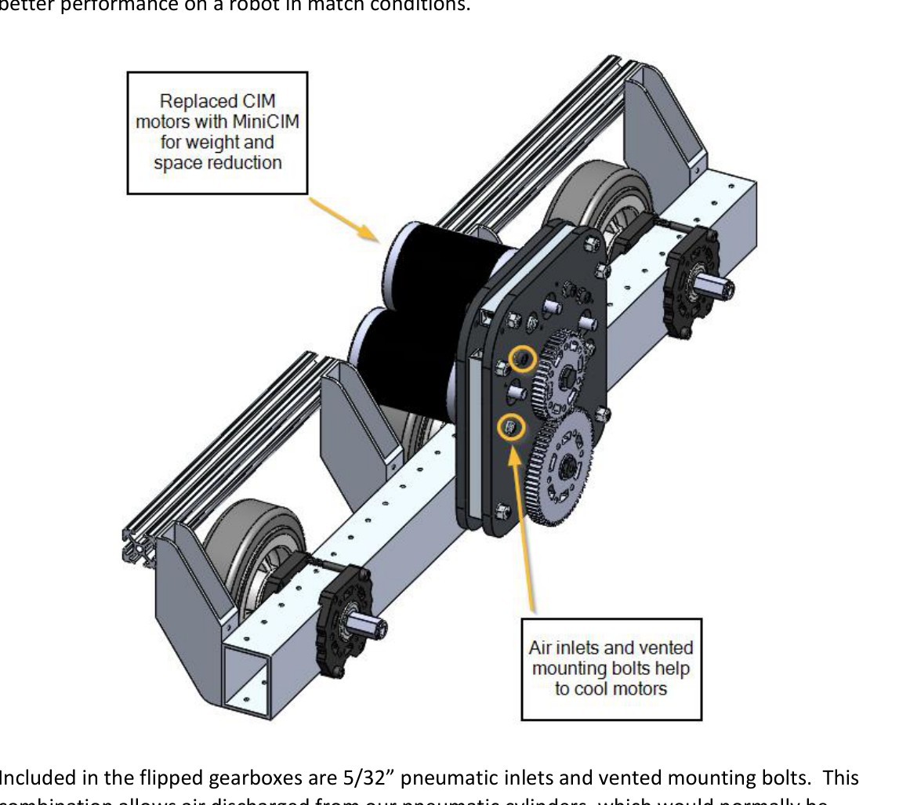
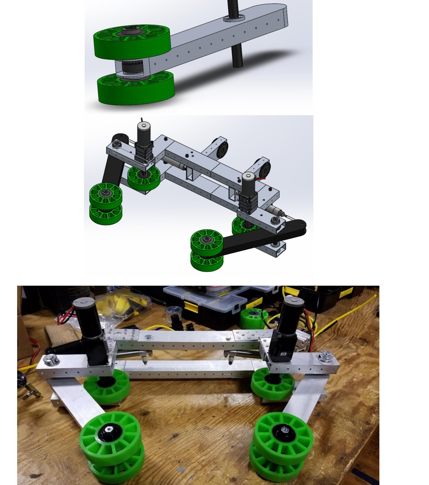
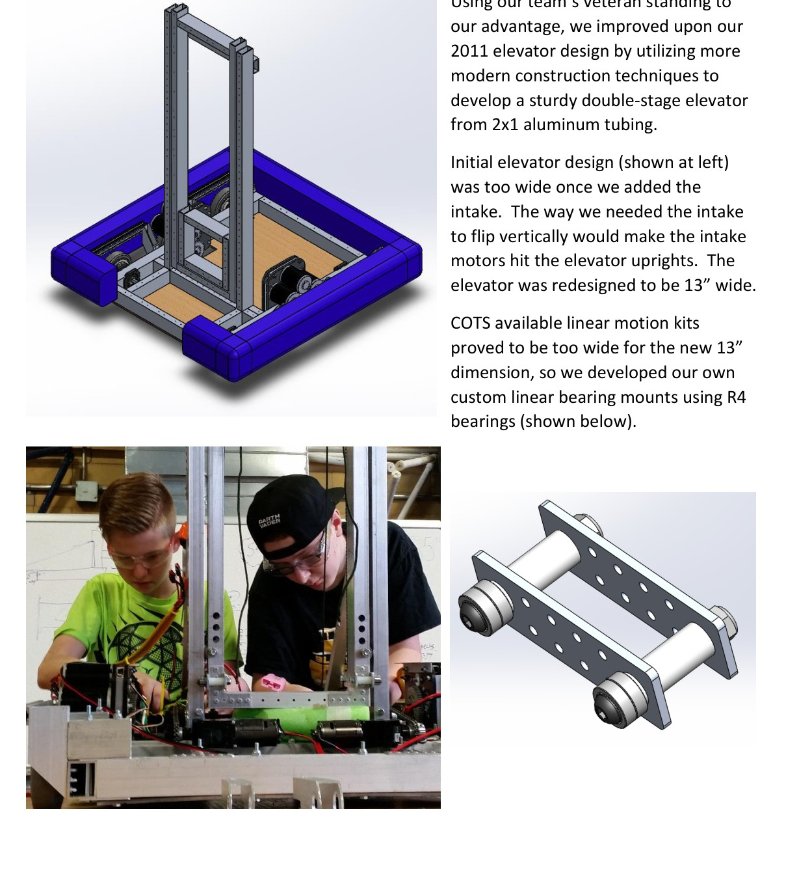
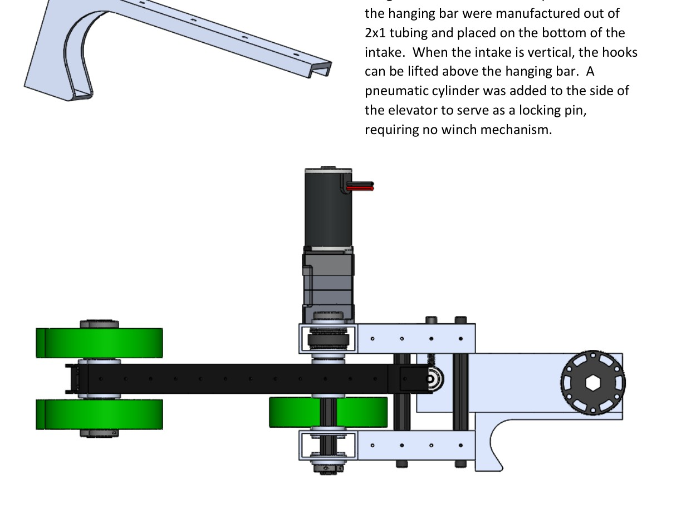

# 2018-1610 — Blackwater Robotics: Cotton J

A six-wheel West Coast drive, compact flipped gearboxes, compliant wheel cube intake and narrow two-stage elevator combine scale reach with a reused elevator climb. The binder records an intake/elevator interference-driven redesign and a weight-constrained choice of climbing mechanism.

## Strategic interpretation

The most useful lesson is interface propagation: a wider intake changed the chassis, then the wrist sweep conflicted with elevator uprights, then the lift needed custom bearing blocks. This is exactly the sort of spatial coupling to expose before 1833 commits expensive CAD/manufacturing time. The team’s historical partner-dependent climb priority is context, not 1833 doctrine.

## Flipped gearboxes reclaim internal frame space

Version: Cotton J Rev 2 binder. Source: https://blackwaterrobotics.org/wp-content/uploads/2018/05/1610_Technical_Binder_2018_Rev_2.pdf. Physical PDF pages: [8, 9].

### Published construction or code

The chassis uses chain inside drive rails and a dropped-center six-wheel arrangement. The binder describes custom flipped gearboxes developed with 2363, positioning MiniCIM motors over the wheels to recover about eight inches of internal room. It also describes exhaust-air motor cooling on the historical pneumatic system.

### Team rationale or evidence boundary

Save interior volume for mechanisms while using a familiar drive architecture.

### Engineering interpretation

The dimension reclaimed at one interface is only useful if motor service, chain access and bumper protection remain viable. The source itself warns that chain-in-tube maintenance requires precision. Do not copy an exhaust-air cooling feature into an electric-only robot, or assume its thermal benefit exists without the original air duty cycle. Compare useful free space, not just frame dimensions, when evaluating how many scoring lanes or a lift can fit.

### Proposed validation — not performed

Draw section views for motor removal and chain tension/service. Account for wiring and guards in the claimed free volume before allocating it to another mechanism.

### Limits

Team publication and selected figures, not an independent performance test or exhaustive competition chronology. Source dimensions and reported speeds require validation for a new design.

## Wheel contact, active clamping and internal belt packaging

Version: Cotton J Rev 2 binder. Source: https://blackwaterrobotics.org/wp-content/uploads/2018/05/1610_Technical_Binder_2018_Rev_2.pdf. Physical PDF pages: [10, 11].

### Published construction or code

The team compared claw and wheel concepts, chose green compliant wheels, and adjusted geometry for wide/narrow cube presentations. The fabric over the open face caused difficulty, so pneumatic arms maintained contact pressure. Belts/pulleys moved inside tubes for a thinner intake; later plastic tubes removed nearly a pound.

### Team rationale or evidence boundary

Maintain grip across different cube faces and orientations while reducing the intake’s size and lifted mass.

### Engineering interpretation

Friction, normal force and entry geometry work together. The trouble with the fabric face shows why a nominal cube dimension is insufficient contact data. An electric jaw would need controlled compliance or a passive spring characteristic instead of assuming cylinder force is reproduced by a rigid motor position. Internal belts protect the drive but can make replacement slower. Added lightness at the end of a wrist reduces joint torque more strongly than the same reduction near the chassis.

### Proposed validation — not performed

Check contact-force and tolerance ranges for actual piece faces; compare a passive compliant jaw and electric adjustment only where the required behavior differs. Preserve belt replacement access.

### Limits

Team publication and selected figures, not an independent performance test or exhaustive competition chronology. Source dimensions and reported speeds require validation for a new design.

## Interference-driven narrow elevator redesign

Version: Cotton J Rev 2 binder. Source: https://blackwaterrobotics.org/wp-content/uploads/2018/05/1610_Technical_Binder_2018_Rev_2.pdf. Physical PDF pages: [12].

### Published construction or code

The initial elevator was too wide for the intake’s required flip: the intake motors hit the uprights. The team narrowed the elevator to 13 inches and designed R4-bearing mounts because available linear kits did not fit the revised space.

### Team rationale or evidence boundary

Allow the intake’s vertical rotation while retaining the necessary scoring reach.

### Engineering interpretation

A statically fitting intake is not a fitting rotating intake. The critical envelope includes motors, pulleys, retained piece and compliance under load. Narrowing a lift can cure an interference while increasing torsional loading or reducing room for cables. This case should trigger an early swept-volume study; it does not justify waiting for a polished complete CAD model before noticing the conflict.

### Proposed validation — not performed

Create a coarse lift/intake/piece swept envelope first. Check bearing spacing, off-axis moment and service access after narrowing; only detail the accepted architecture.

### Limits

Team publication and selected figures, not an independent performance test or exhaustive competition chronology. Source dimensions and reported speeds require validation for a new design.

## Elevator reuse and positive anti-backdrive lock

Version: Cotton J Rev 2 binder. Source: https://blackwaterrobotics.org/wp-content/uploads/2018/05/1610_Technical_Binder_2018_Rev_2.pdf. Physical PDF pages: [13, 14].

### Published construction or code

With little weight margin, the team compared an elevator lift, a carried hook with separate winch and a tape-measure deployment. It selected elevator lifting, added a motor/gearbox and placed hooks under the vertical intake. A pneumatic pin locks the elevator to avoid backdrive. Lift zeroing and encoder limits support normal operation.

### Team rationale or evidence boundary

Reuse existing reach and reduce additional climb hardware under a tight mass budget.

### Engineering interpretation

Reuse can be simple at the architecture level but changes structural loads by orders of magnitude relative to a cube. The intake hooks, carriage, lift bearings, gearing and lock now participate in supporting robot weight. An electric-only adaptation needs a positive holding arrangement appropriate for power loss and release under load; motor stall is not automatically an equivalent lock. The source’s low climb priority cannot be transplanted to another bonus structure.

### Proposed validation — not performed

Recalculate the complete climbing load path and latch reaction, then compare added hardware with marginal match/RP value. Validate release and recovery behavior before approving the shared mechanism.

### Limits

Team publication and selected figures, not an independent performance test or exhaustive competition chronology. Source dimensions and reported speeds require validation for a new design.

## Remaining evidence gaps

- Curated historical mechanism cohort, not a top-25 EPA selection; no EPA/rank fabricated.
- Selected primary publications and figures reviewed; no narrated-video review or exact CAD verification is claimed.
- Historical pneumatic/turret hardware is retained as fact but disallowed in new 1833 recommendations. Adaptation requires new interface/load/holding/recovery analysis.
- No exhaustive every-version certification, new PCH performance benchmark or match-by-match Einstein tactical audit.
