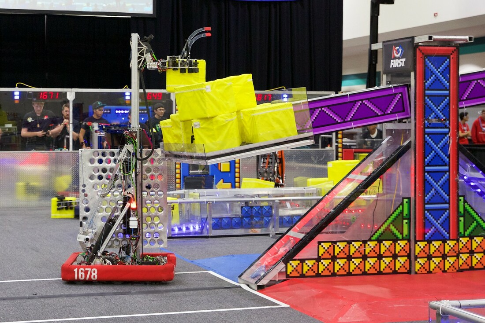

# 2018-1678 — Citrus Circuits: Lemon Zest

A six-wheel drive with front omnis carries a two-stage cascading elevator, rotating wrist and cube intake for front/back scoring. A detachable hook, ramp and cable winch create a buddy climb. The published CAD discussion explicitly separates an earlier horizontal roller intake from a later 1323-derived side-to-side design omitted from the public assembly.

## Strategic interpretation

This is a reference for front/back workspace and for distinguishing published CAD from the installed mechanism. Do not infer missing intake dimensions from its CAD absence. The historical pneumatic jaws, hook and ramp require non-pneumatic adaptation for 1833; front/back motion is still a permitted alternative to a yaw turret.

## Earlier horizontal roller versus shared side-to-side intake

Version: Lemon Zest earlier/later intake distinction. Source: https://www.chiefdelphi.com/t/team-1678-citrus-circuits-2018-cad-release/166149. Physical PDF pages: not applicable; see source locators.

Source locators:

- Post 8: https://www.chiefdelphi.com/t/team-1678-citrus-circuits-2018-cad-release/166149/8
- Post 12: https://www.chiefdelphi.com/t/team-1678-citrus-circuits-2018-cad-release/166149/12

### Published construction or code

In release replies 8 and 12, the team says it switched from its own horizontal roller intake to a modified design based on actual 1323 CAD. It intentionally omitted the later assembly from its public release and added the earlier assembly instead.

### Team rationale or evidence boundary

The author explains the omission as respect for the originating team’s sharing policy. The reviewed replies do not establish a measured performance gain from the swap.

### Engineering interpretation

A CAD download can be authentic yet incomplete, and an included component can be the old version. Retrieval must preserve this distinction before recommending geometry. The intake’s provenance is useful context, but is not permission to reconstruct private details or label an earlier roller as the championship intake. For transfer, identify which visible/published contact arrangement is actually supported, and explicitly leave unavailable dimensions unknown.

### Proposed validation — not performed

Verify the selected assembly against dated source imagery and source text before using any dimensions. Limit a new recommendation to the supported capture function until the intended version’s geometry is available.

### Limits

Team publication and selected figures, not an independent performance test or exhaustive competition chronology. Source dimensions and reported speeds require validation for a new design.

## Pass-through wrist and elevator workspace

Version: Lemon Zest published robot summary. Source: https://www.citruscircuits.org/2018-robot. Physical PDF pages: not applicable; see source locators.

### Published construction or code

The team’s robot page describes a two-stage cascading elevator and a rotating wrist that permit front and rear cube scoring. A camera above the intake improves visibility, and a possession sensor plus lift-related sensors supply feedback. Wiring and air lines run through protected conduit.

### Team rationale or evidence boundary

Reduce driver effort during acquisition and scoring and reach goals from either side of the chassis.

### Engineering interpretation

The wrist/lift combination should be evaluated as a continuous transition path. A rear-scoring pose only helps if the piece can pass the uprights, wires and deployed intake without collision and if it remains retained during reversal. The rear view may also be obscured; the camera is part of the operating system. For 1833 this fixed-plane motion is distinct from a prohibited yaw turret, but its complexity must still repay the removed drive turn.

### Proposed validation — not performed

Check swept piece volume, cable bend radius and the loaded CG along the path. Compare total scoring time including heading, lift travel and escape, rather than wrist speed alone.

### Limits

Team publication and selected figures, not an independent performance test or exhaustive competition chronology. Source dimensions and reported speeds require validation for a new design.

## Sheet-metal ramp and detachable-hook buddy climb

Version: Lemon Zest published CAD discussion. Source: https://www.chiefdelphi.com/t/team-1678-citrus-circuits-2018-cad-release/166149. Physical PDF pages: not applicable; see source locators.

Source locators:

- Post 12: https://www.chiefdelphi.com/t/team-1678-citrus-circuits-2018-cad-release/166149/12

### Published construction or code

Release reply 12 describes a detachable hook, ramp and cable winch developed together. The team used a rough frame/elevator mockup to locate pulleys, then a ribbed 0.025-inch 2024-aluminum ramp. It later pocketed and formed flanges around cutouts. The author says the stamped dimples are absent from CAD/renderings.

### Team rationale or evidence boundary

Reduce ramp mass while preserving strength and establish workable cable/pulley geometry before final construction.

### Engineering interpretation

Thin sheet can gain bending stiffness from section shape, ribs and formed edges instead of thickness alone. The exact alloy, load path and local buckling still matter; the cited thickness is a historical parameter, not a recommendation. A flat CAD pocket is not equivalent to the formed part. The winch path, partner approach and ramp tip support determine forces through deployment and lift.

### Proposed validation — not performed

Model the formed cross section and reaction points, including a partner entering off-center. Use a targeted load/deflection check after the envelope and force diagram, and adapt pneumatic deployments explicitly if borrowing the concept.

### Limits

Team publication and selected figures, not an independent performance test or exhaustive competition chronology. Source dimensions and reported speeds require validation for a new design.

## Remaining evidence gaps

- Curated historical mechanism cohort, not a top-25 EPA selection; no EPA/rank fabricated.
- Selected primary publications and figures reviewed; no narrated-video review or exact CAD verification is claimed.
- Historical pneumatic/turret hardware is retained as fact but disallowed in new 1833 recommendations. Adaptation requires new interface/load/holding/recovery analysis.
- No exhaustive every-version certification, new PCH performance benchmark or match-by-match Einstein tactical audit.
