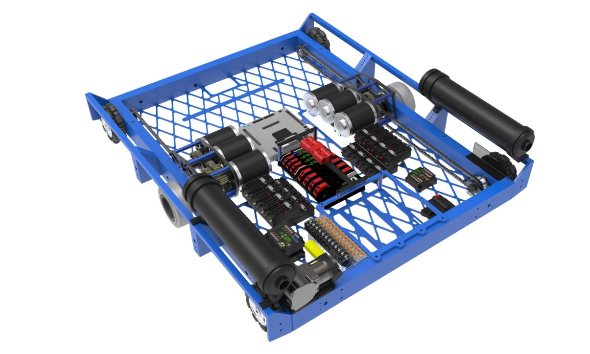
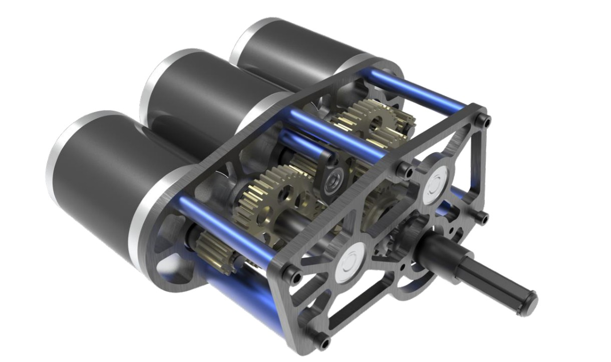
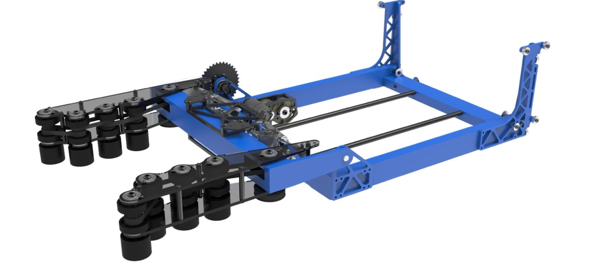
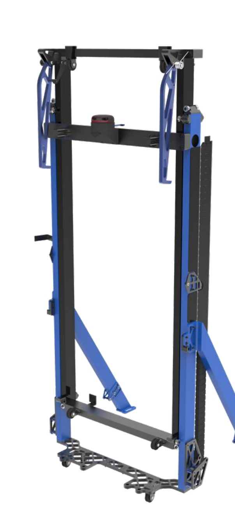
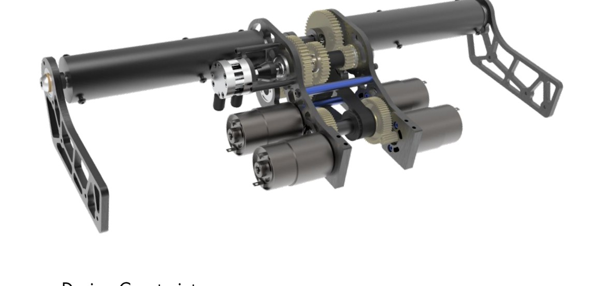
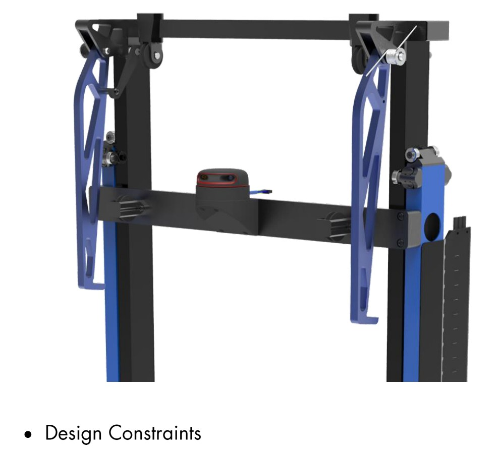
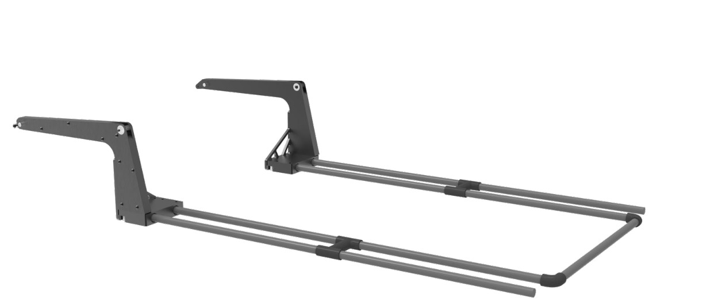
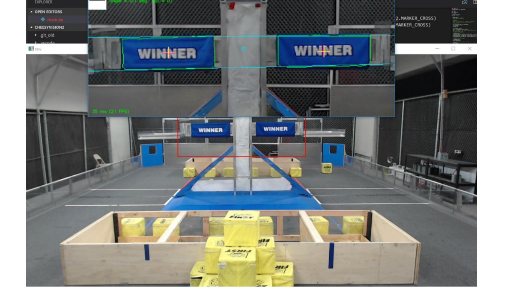

# 2018-254 — The Cheesy Poofs: LOCKDOWN

A compact six-wheel drivebase carries a pass-through, continuously rigged elevator and wristed compliant-wheel cube intake. The elevator changes gearing between rapid scoring travel and lifting two robots. A spring-deployed hook and partner forklift create a shared endgame load path. Motion planning coordinates intake, wrist and elevator; a driver-station camera estimates scale attitude.

## Strategic interpretation

The team explicitly connects world-championship ambition to first seed, low partner dependence, all-target scoring, a multi-cube scale auto and a partner lift. The historical robot shows that broad primary capability can coexist with a matchup-specific switch assignment. For 1833, extract passive/compliant geometry and electric motion architecture; the original pneumatic shifting, hook retention and fork deployment require redesign, and historical sub-second claims are not current acceptance evidence.

## Low-profile sprint chassis and gearbox

Version: LOCKDOWN published 2018 configuration. Source: https://media.team254.com/2018/07/8fda07af-2018-Techbinder.pdf. Physical PDF pages: [10, 11].

### Published construction or code

The binder specifies a six-wheel West Coast layout with center drop, two nitrile traction wheels and four omnis. A flat three-MiniCIM gearbox arrangement lowers the package beneath the intake. The middle pinion receives an additional bearing plate rather than remaining unsupported against the other motors. Two drive ratios are published, along with wheel sizes and nominal speeds.

### Team rationale or evidence boundary

The team lists short-sprint acceleration, maneuverability, platform clearance and resisting defense as design goals, while a wide wheelbase accommodates a raised load and a partner.

### Engineering interpretation

The valuable feature is integration: lowering the gearbox also lowers the intake rest position, which changes acquisition geometry. Moving the pickup upward to clear motors would impose a new lifting/rolling transition on every cube. Omnis can reduce scrub while traction placement still matters for pushing and ramp contact. A new chassis must evaluate the actual support polygon and loaded CG, not copy the wheel count as a performance recipe. Reported high-gear free speed does not establish defended acceleration or stopping distance.

### Proposed validation — not performed

First check intake rest height and field-obstacle breakover in a section view. Then calculate traction/current-limited acceleration and the raised-load tipping boundary; test only the uncertain transition if it can change the layout.

### Limits

Team publication and selected figures, not an independent performance test or exhaustive competition chronology. Source dimensions and reported speeds require validation for a new design.

## Compliant jaws and reversible wrist scoring

Version: LOCKDOWN published 2018 configuration. Source: https://media.team254.com/2018/07/8fda07af-2018-Techbinder.pdf. Physical PDF pages: [14].

### Published construction or code

Opposed wheel groups sit on polycarbonate jaw plates. The binder reports two 775pro intake motors with 5:1 reduction and four sets of 2-inch compliant wheels per side. The wrist has a separate motor, chain reduction, adjustable tensioner, angle encoder and zeroing switch. The stated roller surface speed is approximately 32 ft/s.

### Team rationale or evidence boundary

Acquire either the 13-inch or 11-inch cube presentation quickly, center it with little driver precision, clamp securely during wrist motion, and score from either side.

### Engineering interpretation

The pickup combines tolerance at the contact with control of the retained pose. Wheel compliance accommodates the covered crate while the wrist removes a drivebase reversal. A new piece can have a different friction/elasticity regime: 32 ft/s is not a universal optimum. More surface speed can add bounce or surface damage without reducing approach time. Separate capture authority from holding authority and from the wrist trajectory. The retained piece, jaw opening and lift pass-through must clear at the same time.

### Proposed validation — not performed

Compare a swept volume of the largest allowed piece in skewed poses against the uprights and bumper. If contact uncertainty remains, use one adjustable jaw fixture and measure capture, retained pose and release rather than build competing complete robots.

### Limits

Team publication and selected figures, not an independent performance test or exhaustive competition chronology. Source dimensions and reported speeds require validation for a new design.

## Continuous lift rigging and partner-load structure

Version: LOCKDOWN published 2018 configuration. Source: https://media.team254.com/2018/07/8fda07af-2018-Techbinder.pdf. Physical PDF pages: [12, 13].

### Published construction or code

Pull-up and pull-down Dyneema cable runs act on both sides of the elevator. Spring tensioning addresses changing fleet angle. The binder specifies a 15-inch separation between pull-up runs for cube passage. The elevator gearbox has four 775pros and two ratios; the low ratio serves climbing and the high ratio serves scoring. Bearings react on different tube faces and edges to support moments.

### Team rationale or evidence boundary

Allow cube passage, rapid full-height travel, and the torsional loads associated with lifting two robots, while keeping the intake low when stowed.

### Engineering interpretation

Continuous rigging, stage mass and counterforce determine which mass the motor lifts at each segment. The two-sided arrangement can reduce racking only if stiffness, alignment and tension remain adequate. A spring tensioner is not a generic cure for incorrect spool tracking, excessive stretch or sharp cable edges. The published travel and climb timings are design goals/source claims, not measurements reproduced here. For an electric-only adaptation, fixed gearing or electric shifting must still deliver a credible scoring/climbing torque-speed envelope.

### Proposed validation — not performed

Derive lift kinematics and force through every travel segment. Check overlap, tube-face contact stress, shaft moments, cable bending radius and tension access; evaluate score and climb loads separately before selecting gearing.

### Limits

Team publication and selected figures, not an independent performance test or exhaustive competition chronology. Source dimensions and reported speeds require validation for a new design.

## Hook, forklift and aligned two-robot lift

Version: LOCKDOWN published 2018 configuration. Source: https://media.team254.com/2018/07/8fda07af-2018-Techbinder.pdf. Physical PDF pages: [15, 16].

### Published construction or code

A hook pivots from a retained spring-loaded state to a hard stop. Deployable forks support a partner while the elevator/hanger arrangement raises the pair. The binder discusses keeping the combined CG under the bar and allowing a cube through the fork spacing. Cylinders retain or deploy historical components; they are not permitted actuation for a new 1833 recommendation.

### Team rationale or evidence boundary

Lift a broad range of partners quickly, preserve ordinary scoring passage, and react partner loads without rotating the pair away from the support.

### Engineering interpretation

The partner interface is a structural mechanism, not just two pieces of carbon tube. The load travels from partner underside/bumpers through forks, their pivots and tensile reactions into the elevator/chassis. Docking clearance and partner drive geometry determine whether the “universal” aspiration holds. A no-air redesign needs a positive retained state during violent driving and a repeatable deployed stop. Merely replacing a cylinder with a motor leaves latch release, power loss, backdrive and accidental triggering unresolved.

### Proposed validation — not performed

Draw the complete force diagram and docked support geometry using a worst-case partner envelope. Separate partner approach reliability from winch capacity and test a proof load only after the structural path and safety factors are justified.

### Limits

Team publication and selected figures, not an independent performance test or exhaustive competition chronology. Source dimensions and reported speeds require validation for a new design.

## Coordinated transitions, scale sensing and qualification independence

Version: LOCKDOWN published 2018 configuration. Source: https://media.team254.com/2018/07/8fda07af-2018-Techbinder.pdf. Physical PDF pages: [6, 7, 18, 19, 20].

### Published construction or code

The software section describes spline path generation with pure pursuit, modeled feedforward and a motion planner for intake/wrist/elevator transitions. Gravity and acceleration terms support superstructure control. A driver-station webcam estimates scale angle from the colored arm. The team’s championship report describes selecting combined switch/scale auto when switch scoring by partners was uncertain.

### Team rationale or evidence boundary

Score early, reduce collision risk inside the superstructure, and position at the necessary scale height rather than always lifting blindly to a fixed maximum.

### Engineering interpretation

A game-state objective maps into several engineering requirements: reliable capture preserves the next path; scale attitude changes required height; an early autonomous lead changes the opponent’s teleop catch-up burden. The camera location and contemporary rules matter. The transferable principle is state-informed motion, not permission to reuse an old off-board sensing arrangement under a new manual. All three line crossings remain partner-dependent even when the robot owns switch scoring.

### Proposed validation — not performed

Define legal transition states and rejection/recovery behavior before coding auto sequences. Use logged target age and mechanism readiness; validate uncertain transitions rather than assume a perfect path simulation proves acquisition.

### Limits

Team publication and selected figures, not an independent performance test or exhaustive competition chronology. Source dimensions and reported speeds require validation for a new design.

## Remaining evidence gaps

- Curated historical mechanism cohort, not a top-25 EPA selection; no EPA/rank fabricated.
- Selected primary publications and figures reviewed; no narrated-video review or exact CAD verification is claimed.
- Historical pneumatic/turret hardware is retained as fact but disallowed in new 1833 recommendations. Adaptation requires new interface/load/holding/recovery analysis.
- No exhaustive every-version certification, new PCH performance benchmark or match-by-match Einstein tactical audit.
