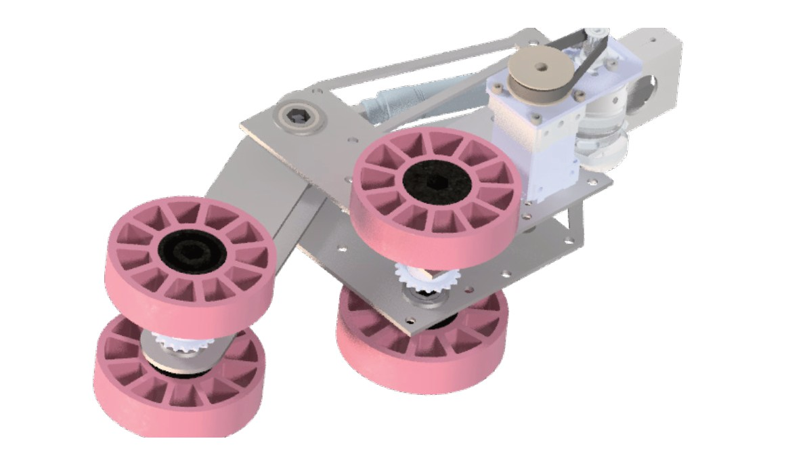
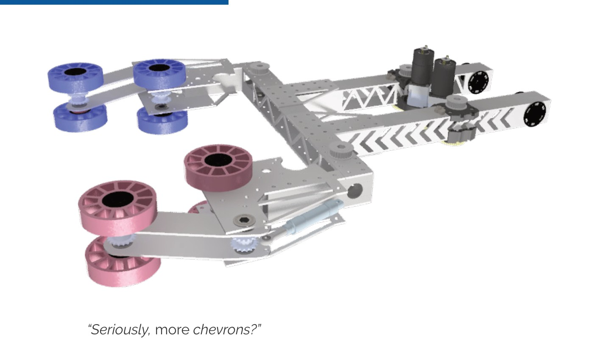
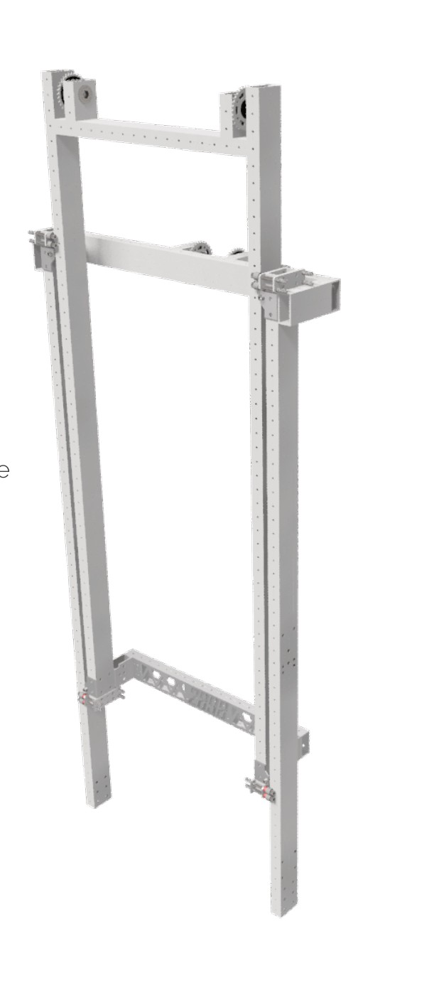
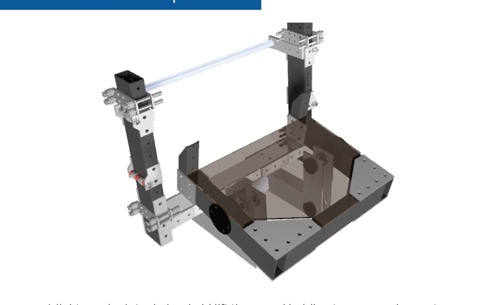
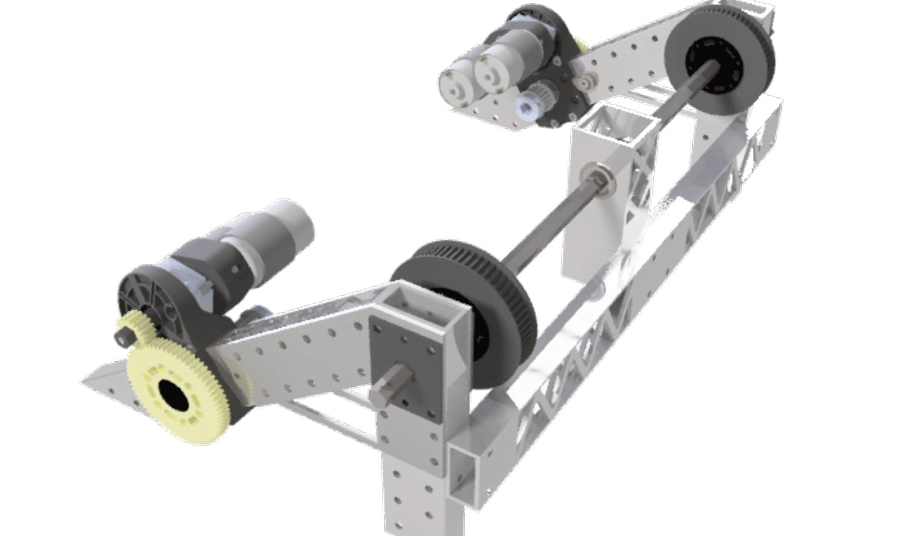
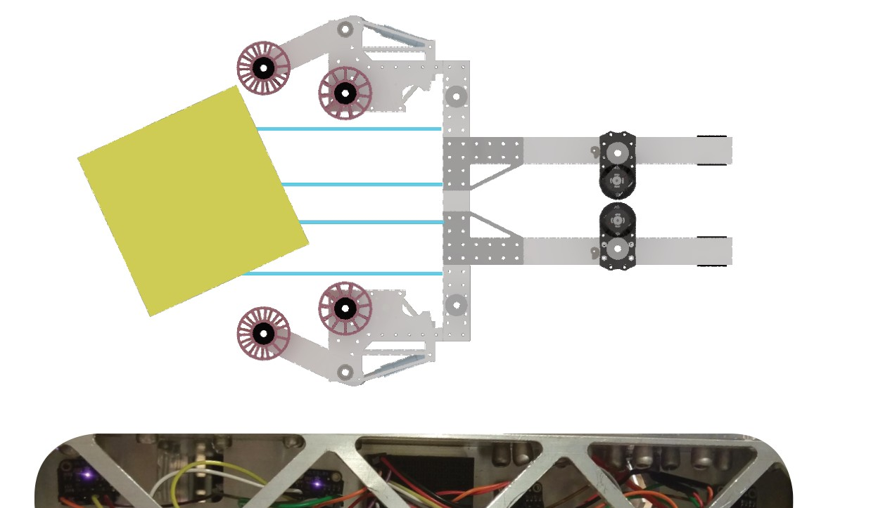

# 2018-2898 — Flying Hedgehogs: V1 scale robot / V2 switch rebuild

The binder separates an initial elevator/tilting-bucket scale robot from a later switch/exchange arm robot. V2 retained the original drivebase and intake while changing reach and controls. Published sections document mechanical faults, manufacturing constraints, sensor assistance and a mapped-arm operator control.

## Strategic interpretation

This is an explicit failure/recovery case, not an elite-primary architecture to copy wholesale. V1’s conceptual coverage failed to become reliable reach; V2 improved the achievable role under severe time constraints. 1833 should borrow evidence about tolerances, interface validation and recoverability while maintaining its primary-contributor objective.

## Offset-pivot capture retained through the rebuild

Version: 2898 V1 intake retained on V2. Source: https://bpsrobotics.github.io/2898/files/2018-Technical-Binder.pdf. Physical PDF pages: [7, 15].

### Published construction or code

The binder describes an offset-pivot compliant-wheel intake, approximately half-inch compression and a 775pro in a flipped 10:1 gearbox. V2 reused the intake with a different wheel durometer to ease alignment.

### Team rationale or evidence boundary

Capture varied 13-inch and diagonal cube poses; retain existing useful hardware during the reconstruction.

### Engineering interpretation

An intake can remain worth using even when the surrounding architecture fails. The pivot offset changes the way the cube opens and closes the contact geometry; wheel stiffness changes both grip and centering. The published surface speed is a historical setting, not evidence that the replacement durometer alone improved match cycles. Treat retained hardware as a candidate with known interfaces, not a reason to force an otherwise poor layout.

### Proposed validation — not performed

Check capture and retained-pose consistency on the real piece surfaces. Confirm whether any changed roller stiffness affects compression, motor current and release.

### Limits

Team publication and selected figures, not an independent performance test or exhaustive competition chronology. Source dimensions and reported speeds require validation for a new design.

## Combination elevator and documented V1 failures

Version: 2898 V1 scale robot. Source: https://bpsrobotics.github.io/2898/files/2018-Technical-Binder.pdf. Physical PDF pages: [8, 9, 10, 11].

### Published construction or code

V1 combined a continuous first stage with a cascading second stage, two 775pros, custom slides and constant-force springs. Its light tilting bucket had a separate pivot. The results page lists elevator problems, inadequate height from the cascading design, manipulator/intake misalignment and sensor failure.

### Team rationale or evidence boundary

Initial intent was scale capability without losing switch/exchange usefulness; the combination lift was intended to provide fast motion and potential future climbing.

### Engineering interpretation

The desired capability set was broader than the delivered mechanism. This is negative evidence against accepting nominal height and an ideal timing calculation without rigging/overlap and tolerance review. The binder lists several coexisting faults, so no single failure should be declared the exclusive cause. A new agent should carry these failure modes into its uncertainty register, not tell a story that every elevator is inherently unreliable.

### Proposed validation — not performed

Before manufacture, verify rigging displacement, available overlap and achievable scoring pose with tolerances. Define sensor fault behavior and mechanical alignment datums; test the uncertainty most likely to invalidate reach.

### Limits

Team publication and selected figures, not an independent performance test or exhaustive competition chronology. Source dimensions and reported speeds require validation for a new design.

## Rebuild into a fixed-plane arm with retained intake

Version: 2898 V2 switch/exchange rebuild. Source: https://bpsrobotics.github.io/2898/files/2018-Technical-Binder.pdf. Physical PDF pages: [11, 13, 14, 15, 19].

### Published construction or code

The team compared repairing V1 with redesigning for switch only on a practice chassis. V2 used four 775 motors, a geared/belted pivot, absolute and relative sensing and an approximately 120-degree arm range. The team reports precision-manufacturing changes and fitting replacement work into the historical withholding/unbag allowances.

### Team rationale or evidence boundary

Recover a fast, robust playable robot under the available time and retain existing drive/intake assets.

### Engineering interpretation

A smaller reachable workspace can lower integration burden, but here it also removed scale capability. That emergency strategic compromise is not authorization for 1833 to start with a support ceiling. The detailed rebuilding cost illustrates why iteration economics must be taken seriously: practice hardware, precision manufacturing and legal work-time constraints were part of the outcome. The arm’s published reduction and motors are not sized for a new high-target game by analogy.

### Proposed validation — not performed

Use the case to identify early warning signs and fallback interfaces. For a new arm derive full workspace, gravity torque, inertia and output backlash before making any high-reach claim.

### Limits

Team publication and selected figures, not an independent performance test or exhaustive competition chronology. Source dimensions and reported speeds require validation for a new design.

## LIDAR-assisted capture and operator arm mirroring

Version: 2898 V2 published controls. Source: https://bpsrobotics.github.io/2898/files/2018-Technical-Binder.pdf. Physical PDF pages: [22, 23, 24, 25, 26, 27].

### Published construction or code

Four range sensors feed a Jetson model fit that estimates cube orientation and modulates intake speeds. A miniature arm controller with an absolute encoder sends an operator pose command. The binder also describes feedforward/trajectory control and reactive subsystem diagnostics.

### Team rationale or evidence boundary

Reduce acquisition alignment burden and make arm placement intuitive for the operator.

### Engineering interpretation

These are source descriptions of implemented methods, not independent evidence that every added computer or state-space controller was necessary. More sensing adds calibration and fault states. The high-value function is an unambiguous retained-piece state and smooth control that the driver can use. For 1833, prefer the simplest sensing sufficient to resolve consequential uncertainty; a four-sensor model is not required merely because it appears in a technical binder.

### Proposed validation — not performed

Define what each sensor disambiguates and what happens on disagreement, timeout or blockage. Compare recovery and operator workload with a simple baseline before adopting the richer scheme.

### Limits

Team publication and selected figures, not an independent performance test or exhaustive competition chronology. Source dimensions and reported speeds require validation for a new design.

## Remaining evidence gaps

- Curated historical mechanism cohort, not a top-25 EPA selection; no EPA/rank fabricated.
- Selected primary publications and figures reviewed; no narrated-video review or exact CAD verification is claimed.
- Historical pneumatic/turret hardware is retained as fact but disallowed in new 1833 recommendations. Adaptation requires new interface/load/holding/recovery analysis.
- No exhaustive every-version certification, new PCH performance benchmark or match-by-match Einstein tactical audit.
