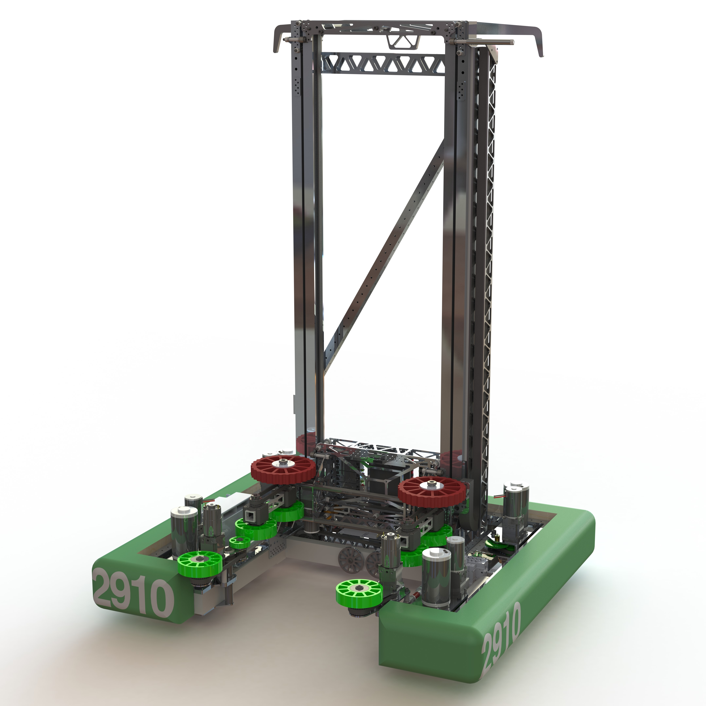

# 2018-2910 — Jack in the Bot: Kayla

A swerve robot with a cube elevator is documented by its CAD release and technical team replies. The strongest reviewed details concern protected internal belt rigging, separate shift/lock functions, absolute azimuth sensing and auxiliary traversal wheels. Public render geometry is a reference; complete CAD dimensions and every intake revision are not audited here.

## Strategic interpretation

Kayla illustrates the distinction between elegant packaging and service cost. A hidden belt run protects against snagging yet the team estimated a substantial replacement procedure. The source also gives a precise material/failure sequence rather than a generic claim that belts always survive climbing.

## Protected belt-in-tube elevator and failure correction

Version: Kayla released 2018 CAD discussion. Source: https://www.chiefdelphi.com/t/pic-2910-cad-release-2018/167095. Physical PDF pages: not applicable; see source locators.

Source locators:

- Post 6: https://www.chiefdelphi.com/t/pic-2910-cad-release-2018/167095/6
- Post 13: https://www.chiefdelphi.com/t/pic-2910-cad-release-2018/167095/13

### Published construction or code

Team replies describe a belt routed inside elevator tubes. A build-season fiberglass-cord belt failed at a sharp carriage attachment during a hard-stop event. The team removed the edge and changed to steel tensile cord, reporting no further such failure at the time. A replacement was estimated at about 45 minutes. Separate cylinders shift lift gearing and lock the elevator after climbing.

### Team rationale or evidence boundary

Protect the drive path from snagging and avoid managing cable tracking on a spool; the author also says the initial CAD arrangement seemed workable and was built.

### Engineering interpretation

Do not rewrite this as a fully optimized belt selection study. Two changes occurred together, so the failure account does not isolate belt material from the eliminated cut edge. Service labor is part of architecture cost even if replacement is mechanically straightforward. For 1833, the useful geometric routing does not permit copying pneumatic shift/lock actuation. Derive whether one fixed electric reduction plus a positive latch can cover both duties, or whether a separate climb drive is warranted.

### Proposed validation — not performed

Inspect terminations, bend radii, hard-stop control and access for threading replacement. Estimate a realistic recovery time and verify the new load/actuation envelope.

### Limits

Team publication and selected figures, not an independent performance test or exhaustive competition chronology. Source dimensions and reported speeds require validation for a new design.

## Sideways platform traversal and absolute module position

Version: Kayla released 2018 CAD discussion. Source: https://www.chiefdelphi.com/t/pic-2910-cad-release-2018/167095. Physical PDF pages: not applicable; see source locators.

Source locators:

- Post 6: https://www.chiefdelphi.com/t/pic-2910-cad-release-2018/167095/6
- Post 8: https://www.chiefdelphi.com/t/pic-2910-cad-release-2018/167095/8
- Post 18: https://www.chiefdelphi.com/t/pic-2910-cad-release-2018/167095/18
- Post 19: https://www.chiefdelphi.com/t/pic-2910-cad-release-2018/167095/19

### Published construction or code

The team identifies water-jetted 6061-T6 auxiliary wheels intended to reduce bottoming when moving sideways across the platform. It confirms absolute azimuth encoders and discusses module bearing selection. The release does not supply a complete, independently checked obstacle-success rate.

### Team rationale or evidence boundary

Avoid getting stranded during sideways travel and retain known module position between matches.

### Engineering interpretation

Swerve enables lateral motion but does not erase chassis breakover geometry. A belly support that works in one direction may expose another edge or reduce traction when loaded. Absolute position also needs a valid physical offset and a detectable sensor fault; it is not proof calibration is unnecessary. The transferable decision is to check the motion direction against field obstacles and preserve known heading at startup.

### Proposed validation — not performed

Use coarse contact geometry for every traversal orientation and the expected lift state. Validate the uncertain high-centering case; verify sensor offset and failure recovery separately from the mechanical bearing design.

### Limits

Team publication and selected figures, not an independent performance test or exhaustive competition chronology. Source dimensions and reported speeds require validation for a new design.

## Remaining evidence gaps

- Curated historical mechanism cohort, not a top-25 EPA selection; no EPA/rank fabricated.
- Selected primary publications and figures reviewed; no narrated-video review or exact CAD verification is claimed.
- Historical pneumatic/turret hardware is retained as fact but disallowed in new 1833 recommendations. Adaptation requires new interface/load/holding/recovery analysis.
- No exhaustive every-version certification, new PCH performance benchmark or match-by-match Einstein tactical audit.
