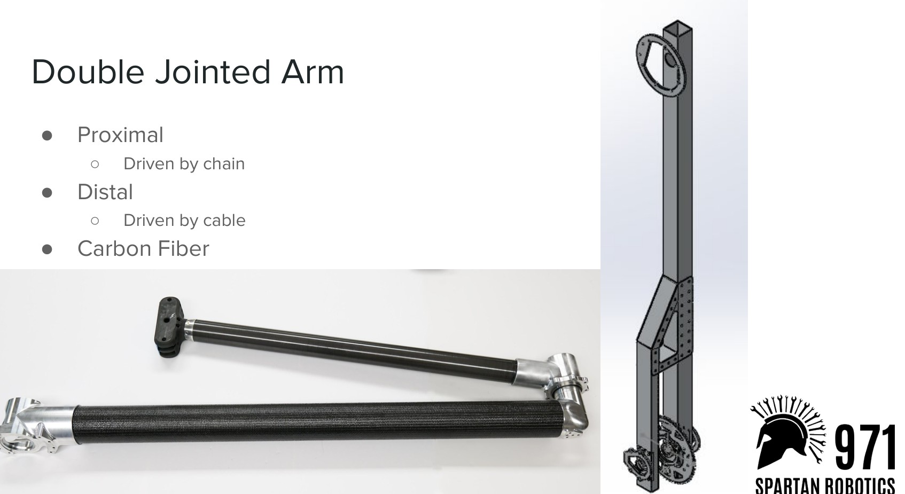
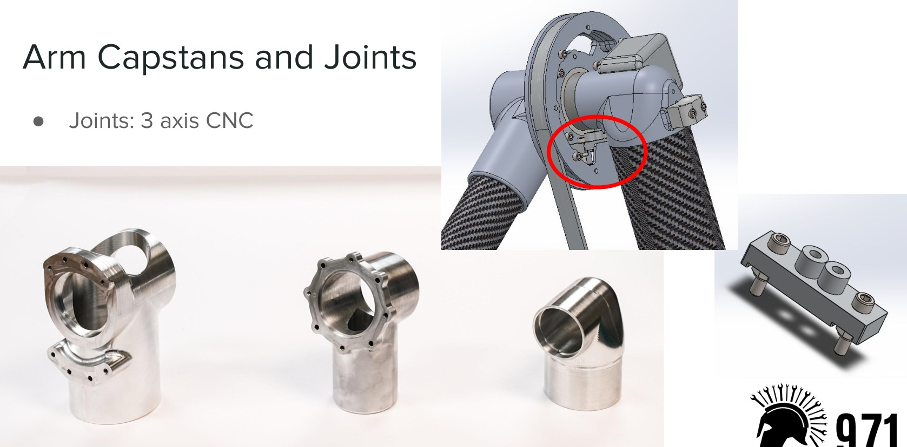
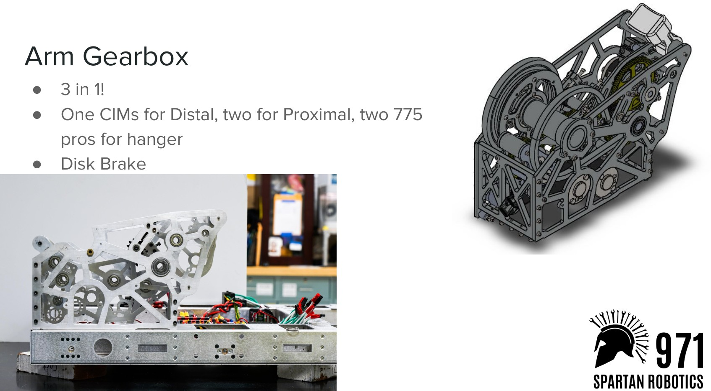
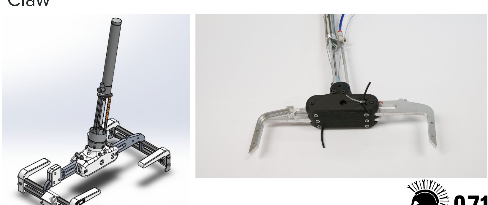
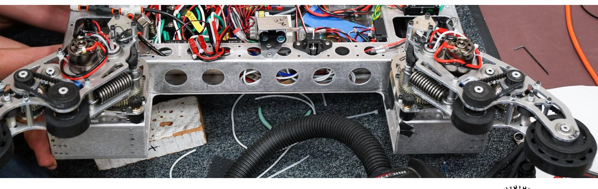
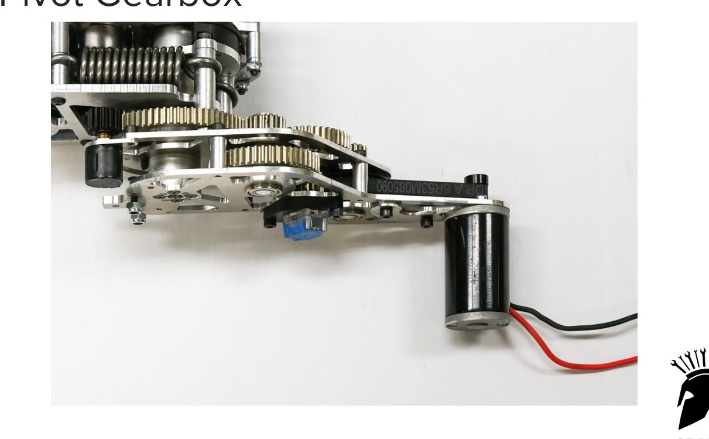
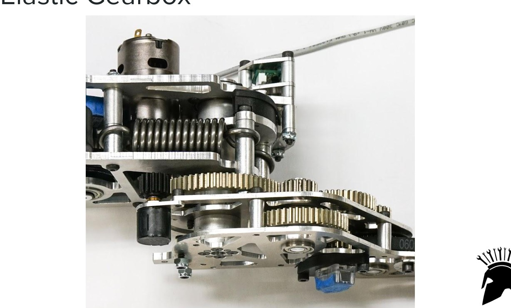
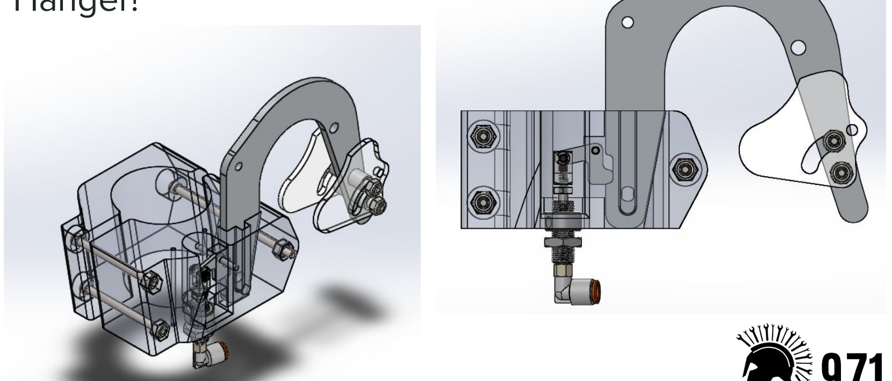
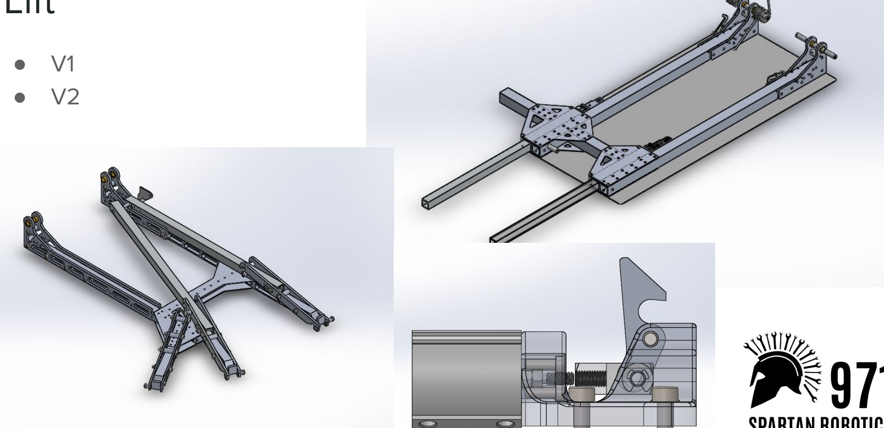

# 2018-971 — Spartan Robotics: Curiosity

The team’s 25-slide overview presents a six-wheel drive, double-jointed carbon-fiber arm, separate ground intake, claw, hanger and partner lift versions. The intake pivot uses series elasticity and several sensors. Slides identify two lift versions but do not narrate their dates or fully establish why each changed.

## Strategic interpretation

This is an alternative to the elevator-centric reference set. A drive-mounted pickup can control the floor interface while an articulated arm positions a light gripper. The reach benefit brings coupled joint control and handoff risks. Do not infer hidden linkage dimensions, a completed simulation or successful every-pose operation from renders.

## Carbon-fiber double-jointed arm and drive-mounted gearing

Version: Curiosity 2018 workshop slides. Source: https://www.spartanrobotics.org/_files/ugd/00c1f8_8ddb7c2844de4500b0e2fb88ebab7742.pdf. Physical PDF pages: [11, 12, 13, 15, 17].

### Published construction or code

The slides identify a chain-driven proximal joint and cable-driven distal joint, carbon-fiber links, machined joint interfaces and a combined gearbox with different motor groups for arm and hanger. The printed claw body uses remote pulley/string actuation; historical pistons are hidden in the distal arm.

### Team rationale or evidence boundary

The reviewed slides identify construction, not a complete statement of the team’s choice among all possible arm/elevator architectures.

### Engineering interpretation

A two-link arm can provide horizontal and vertical workspace without a tall elevator, but inertia, singular regions and stiffness vary with pose. Drive-mounted mass can reduce distal inertia while introducing transmission compliance and tension requirements. Carbon fiber is not automatically a light assembled system after bonded inserts and joint reinforcement. A no-air claw adaptation must consider retained force, linkage travel and recovery, rather than replace a remote cylinder with a heavy wrist motor by default.

### Proposed validation — not performed

Calculate a workspace and joint torque envelope for actual source/goal poses, then include sag, backlash and collision zones. Choose a small structural/contact check only for uncertainty that could change the architecture.

### Limits

Team publication and selected figures, not an independent performance test or exhaustive competition chronology. Source dimensions and reported speeds require validation for a new design.

## Separate acquisition and series-elastic intake pivot

Version: Curiosity 2018 workshop slides. Source: https://www.spartanrobotics.org/_files/ugd/00c1f8_8ddb7c2844de4500b0e2fb88ebab7742.pdf. Physical PDF pages: [19, 20, 21, 22, 23].

### Published construction or code

Photos show a separate opposed-wheel floor intake. The slides describe a series-elastic pivot gearbox with measured spring deflection integrated into control. Encoders, potentiometer, beam breaks and LIDAR are listed; one beam break identifies a centered/rearward cube state and others help avoid stuck conditions.

### Team rationale or evidence boundary

The source identifies feedback functions and the spring-deflection measurement, but does not provide a quantified cycle-time advantage.

### Engineering interpretation

Intentional compliance can absorb contact and expose force-related information, provided the spring, sensing and controller are treated as one system. This differs from an accidentally flexible plate. It also costs complexity. The handoff between floor intake and claw needs a defined retained-pose tolerance; a position sensor alone does not prove the claw owns the cube. For 1833 the question is whether passive compliance and simpler sensing can meet the same required tolerance before copying a series-elastic gearbox.

### Proposed validation — not performed

Define safe force/travel limits and a confirmed-handoff state. Inspect the effect of one failed or blocked sensor and compare a simpler passive compliant pivot where appropriate.

### Limits

Team publication and selected figures, not an independent performance test or exhaustive competition chronology. Source dimensions and reported speeds require validation for a new design.

## Hanger and distinct lift versions

Version: Curiosity 2018 workshop slides. Source: https://www.spartanrobotics.org/_files/ugd/00c1f8_8ddb7c2844de4500b0e2fb88ebab7742.pdf. Physical PDF pages: [14, 24].

### Published construction or code

The slide deck shows a hanger assembly and a lift slide explicitly labeled V1 and V2, with different structural layouts. It also identifies hanger motors in the combined gearbox. The selected deck does not give a complete event installation chronology or reproduce a load qualification.

### Team rationale or evidence boundary

A team-stated comparative reason for the two lift versions is not established in the reviewed slide text.

### Engineering interpretation

The correct response to sparse version evidence is to preserve the alternatives and the unknown timeline. Similar-looking lift pictures are not permission to merge load paths or declare the later variant universally better. A gripper arm and a climb can share gearing or structure while imposing very different loads and locking requirements. No 1833 recommendation should inherit pneumatic braking merely because it appears in an old gearbox.

### Proposed validation — not performed

Retrieve the intended version’s complete load path before borrowing it. State partner footprint, support geometry, latch behavior and safe release conditions; leave unreviewed chronology unknown.

### Limits

Team publication and selected figures, not an independent performance test or exhaustive competition chronology. Source dimensions and reported speeds require validation for a new design.

## Remaining evidence gaps

- Curated historical mechanism cohort, not a top-25 EPA selection; no EPA/rank fabricated.
- Selected primary publications and figures reviewed; no narrated-video review or exact CAD verification is claimed.
- Historical pneumatic/turret hardware is retained as fact but disallowed in new 1833 recommendations. Adaptation requires new interface/load/holding/recovery analysis.
- No exhaustive every-version certification, new PCH performance benchmark or match-by-match Einstein tactical audit.
