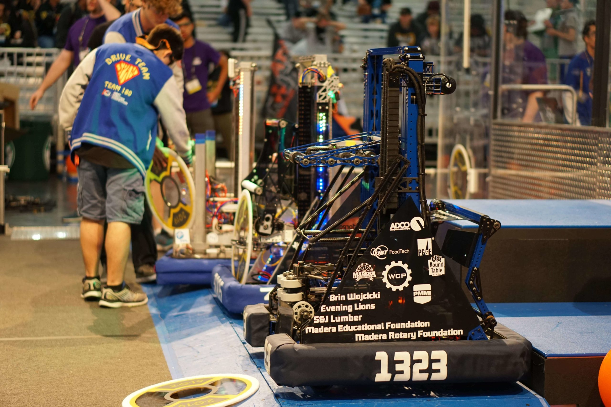

# 2019-1323 — MadTown Robotics: 2019 competition robot (name sources conflict)

The published system includes swerve drive, a three-stage internally rigged continuous elevator, wristed ball intake/transfer into a carriage, separate disk intake/scorer, and jack climbing with a shared power source. The elevator discussion supplies physical construction and tensioning rationale; a pinned public code revision supplies state sequences. Code presence is not event installation evidence. The official season page and FIRST event record disagree on the robot name, so the entry does not silently select one.

## Strategic interpretation

The strongest transferable mechanism is a compact lift with explicit tension control on both up and return runs. Do not turn a preliminary holding-current estimate into a verified specification, or mislabel a 3310 picture in the same discussion as 1323. Source-name disagreement is retained rather than silently resolved. The selected code demonstrates that raw roller speed is only one part of output: acquisition, feeding, confirmed carriage possession, vision approach and ejection are explicitly sequenced. The power takeoff couples hatch-intake and jack duties; simplification by motor reuse also introduces a mutually exclusive operating state. The late public code snapshot is not certified as the exact championship binary.

## Four independently tensioned cable runs and opposed spools

Version: MadTown 2019 elevator primary discussion. Source: https://www.chiefdelphi.com/t/1323-elevator/358379. Physical PDF pages: not applicable; see source locators.

Source locators:

- Post 17: https://www.chiefdelphi.com/t/1323-elevator/358379/17

### Published construction or code

Reply 17 describes two pull-up and two return string runs, four ratchet wrenches used for individual tension adjustment, and two bottom spools geared to turn oppositely. Initially tensioning only the pull side allowed loose return runs over time. Three stages provide travel plus adequate overlap at high rocket poses.

### Team rationale or evidence boundary

Maintain both directions of the cable path and preserve the overlap/travel needed for level-3 scoring; the author prefers this to the team’s earlier cascading lifts.

### Engineering interpretation

Return-run slack is a different problem from ultimate rope strength. Controlled bidirectional tension affects lost motion, tracking and the ability to command a consistent carriage position. More stages can provide travel and overlap but add interfaces and termination details. Internal routing protects the mechanism while making inspection and replacement access important. This is not a complete dimensioned rigging diagram and does not establish which spool geometry fits another frame.

### Proposed validation — not performed

Draw the complete rope topology and derive carriage displacement for spool rotation. Check preload across travel, termination access, fleet angle, effective spool radius and slack after repeated reversals.

### Limits

Team publication and selected figures, not an independent performance test or exhaustive competition chronology. Source dimensions and reported speeds require validation for a new design.

## Holding-current correction and source identity traps

Version: MadTown 2019 elevator discussion and later reply. Source: https://www.chiefdelphi.com/t/1323-elevator/358379?page=3. Physical PDF pages: not applicable; see source locators.

Source locators:

- Post 45: https://www.chiefdelphi.com/t/1323-elevator/358379/45
- Post 52: https://www.chiefdelphi.com/t/1323-elevator/358379/52

### Published construction or code

Reply 45 reports two 775pros, continuous rigging and no constant-force springs, while explicitly treating about five amps holding current as something to confirm. Reply 52 later reports one amp per motor, two total. A picture in the first page is explicitly corrected by another participant as 3310’s 2018 robot.

### Team rationale or evidence boundary

The team author explains a preference to avoid repeatedly engaging/disengaging a brake; the reviewed discussion does not provide a current trace, load state or thermal test.

### Engineering interpretation

Preserve the tentative estimate and subsequent correction instead of averaging them. Even the later two-amp statement is a reported operating condition, not a universal design value. Motor current at hold depends on geometry, mass, transmission friction and control. The misidentified picture illustrates why thread membership does not establish depicted robot identity. A retrieval system must keep author, post and year attached to images and numeric claims.

### Proposed validation — not performed

Treat hold current as source-reported with unprovided conditions. Size a new lift from force/torque and duty cycle; verify the chosen load case and source identity before using either a photo or parameter.

### Limits

Team publication and selected figures, not an independent performance test or exhaustive competition chronology. Source dimensions and reported speeds require validation for a new design.

## Ball acquisition, confirmed handoff and hatch recovery states

Version: MadTown public 2019 code snapshot 13d5d4ac56c2. Source: https://github.com/Team1323/2019DeepSpace/blob/13d5d4ac56c2da11d112ab9ab84241c8b6878018/src/main/java/com/team1323/frc2019/subsystems/Superstructure.java. Physical PDF pages: not applicable; see source locators.

Source locators:

- Code Superstructure.java, revision 13d5d4ac56c2da11d112ab9ab84241c8b6878018
- Code BallIntake.java, revision 13d5d4ac56c2da11d112ab9ab84241c8b6878018
- Code BallCarriage.java, revision 13d5d4ac56c2da11d112ab9ab84241c8b6878018
- Code DiskIntake.java, revision 13d5d4ac56c2da11d112ab9ab84241c8b6878018
- Code DiskScorer.java, revision 13d5d4ac56c2da11d112ab9ab84241c8b6878018

### Published construction or code

The ball acquisition state coordinates lift/wrist pose, starts the floor intake and waits for ball ownership. The feeding state runs the carriage receiver with intake feed until the carriage’s ball condition is met, then stops the intake/receiver. Disk handling separately sequences ground capture, delivery, scorer detection, lift movement and holding. Sensor-based and timed transitions are both present.

### Team rationale or evidence boundary

Published code establishes requested behavior and state dependencies. It does not establish the authors’ full mechanical design rationale or prove competition execution.

### Engineering interpretation

A mechanism recommendation must specify which assembly owns the piece at each transition. A fast collector that only works when a carriage is in a narrow pose can bottleneck the cycle despite excellent pickup video. The code also exposes distinct ball and disk pathways, so no single generic “intake works” claim is adequate. Some methods or constants can remain from earlier hardware; this review does not equate every declared state with a competed feature. A new electric-only layout needs its own collision and possession-safe sequencing.

### Proposed validation — not performed

Make a state table with ownership, permitted motions, timeout and reverse/recovery conditions. Validate only the uncertain handoff or sensor discrimination after checking the geometry and legal possession limit.

### Limits

Selected published source code reviewed, not executed. Branch snapshot may include late/offseason changes, disabled paths or hardware variants. Exact event hardware, timing reliability and performance remain unverified.

## Swerve approach, vision-visible lift height and gated ejection

Version: MadTown public 2019 code snapshot 13d5d4ac56c2. Source: https://github.com/Team1323/2019DeepSpace/blob/13d5d4ac56c2da11d112ab9ab84241c8b6878018/src/main/java/com/team1323/frc2019/subsystems/Superstructure.java. Physical PDF pages: not applicable; see source locators.

Source locators:

- Code Superstructure.java, revision 13d5d4ac56c2da11d112ab9ab84241c8b6878018
- Code Swerve.java, revision 13d5d4ac56c2da11d112ab9ab84241c8b6878018
- Code Elevator.java, revision 13d5d4ac56c2da11d112ab9ab84241c8b6878018

### Published construction or code

The ball-tracking state first requests a lift height within named vision-visible ranges, starts swerve target tracking, then adjusts toward a scoring height and waits for tracking before issuing the final lift/ejection sequence. Disk scoring includes an eject request and a backing trajectory. These are code-level requests, not a match success count.

### Team rationale or evidence boundary

Published code establishes requested behavior and state dependencies. It does not establish the authors’ full mechanical design rationale or prove competition execution.

### Engineering interpretation

Mechanism pose changes camera visibility, which can change alignment time. That relationship can matter more than a slightly faster bare elevator. A no-turret robot can use chassis pose control and a fixed-plane scorer, but only if the approach geometry and target visibility remain valid. A wait-for-track condition needs failure/timeout semantics; a nicely named method does not prove the robot always reaches its target under defense. Do not interpret code trajectory constants as measured cycle time or fabrication dimensions.

### Proposed validation — not performed

Derive the required alignment tolerance and camera coverage over the scoring path. Check what a lost target or stalled mechanism does to the request queue before adopting an equivalent control architecture.

### Limits

Selected published source code reviewed, not executed. Branch snapshot may include late/offseason changes, disabled paths or hardware variants. Exact event hardware, timing reliability and performance remain unverified.

## Shared disk-intake motor and jack power takeoff

Version: MadTown public 2019 code snapshot 13d5d4ac56c2. Source: https://github.com/Team1323/2019DeepSpace/blob/13d5d4ac56c2da11d112ab9ab84241c8b6878018/src/main/java/com/team1323/frc2019/subsystems/Jacks.java. Physical PDF pages: not applicable; see source locators.

Source locators:

- Code Jacks.java, revision 13d5d4ac56c2da11d112ab9ab84241c8b6878018
- Code DiskIntake.java, revision 13d5d4ac56c2da11d112ab9ab84241c8b6878018
- Code Superstructure.java, revision 13d5d4ac56c2da11d112ab9ab84241c8b6878018

### Published construction or code

Jacks obtains its motor controller from DiskIntake and uses a solenoid-controlled power takeoff. Shifting changes which subsystem may use the motor and reconfigures control/feedback. Jack position requests require available power and a connected sensor. Climb sequences coordinate wrist gearing/angle, intake climb/pull states, lift position and chassis motion.

### Team rationale or evidence boundary

Published code establishes requested behavior and state dependencies. It does not establish the authors’ full mechanical design rationale or prove competition execution.

### Engineering interpretation

Sharing motor power can reduce installed hardware while increasing state coordination and load-path requirements. It does not eliminate the mass or complexity of the PTO, support structure, sensing and safe holding. The historical shift is pneumatic and prohibited in an 1833 recommendation; replacing it may erase the original simplicity advantage. The selected code contains multiple climb paths and commented alternatives, so it cannot establish which one competed or certify a speed.

### Proposed validation — not performed

Compare a dedicated electric climb drive with a permitted shared-power arrangement using total mass, controls, service and failure recovery. Check mechanical support/locking separately from whether software authorizes a motor command.

### Limits

Selected published source code reviewed, not executed. Branch snapshot may include late/offseason changes, disabled paths or hardware variants. Exact event hardware, timing reliability and performance remain unverified.

## Remaining evidence gaps

- Curated historical mechanism cohort, not a top-25 EPA selection; no EPA/rank fabricated.
- Selected primary publications and figures reviewed; no narrated-video review or exact CAD verification is claimed.
- Historical pneumatic/turret hardware is retained as fact but disallowed in new 1833 recommendations. Adaptation requires new interface/load/holding/recovery analysis.
- No exhaustive every-version certification, new PCH performance benchmark or match-by-match Einstein tactical audit.
