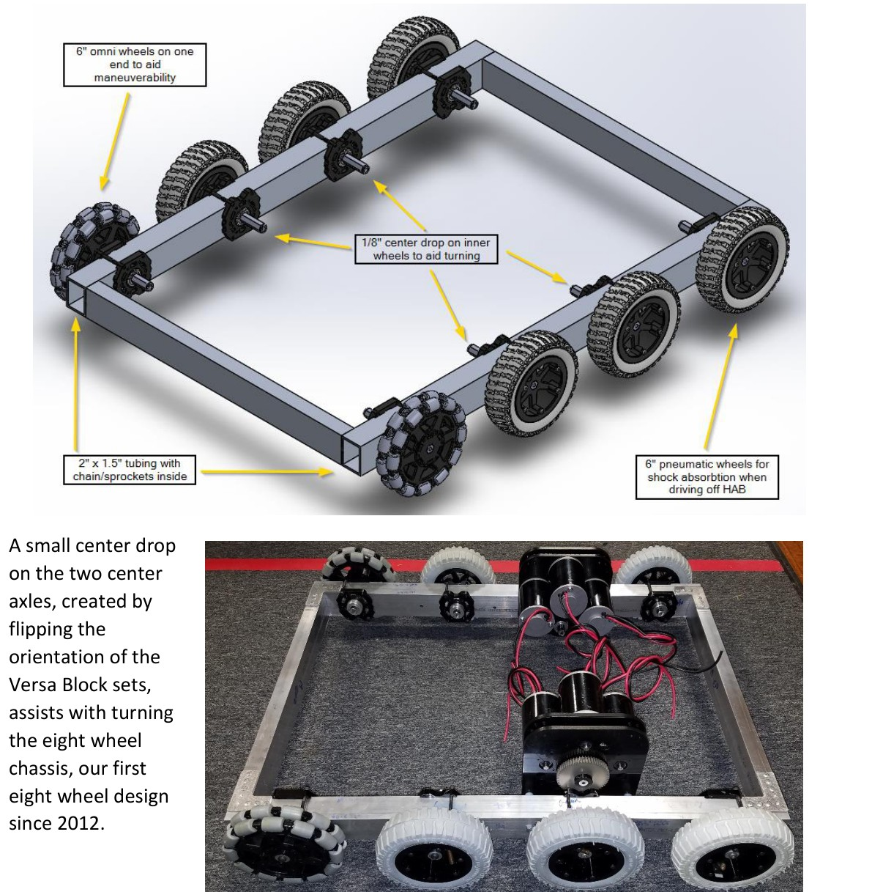
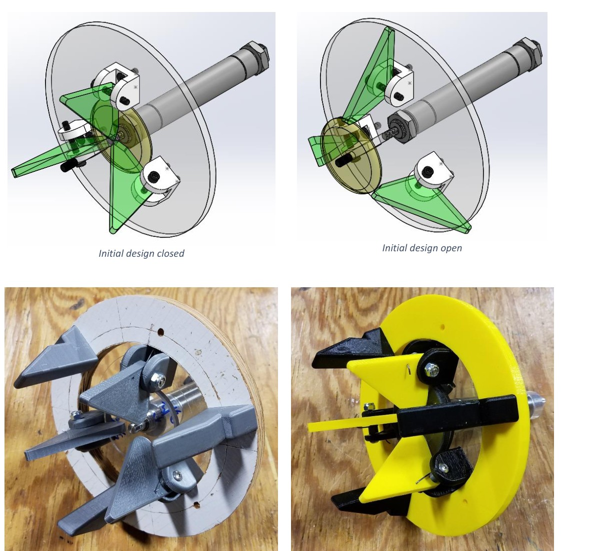
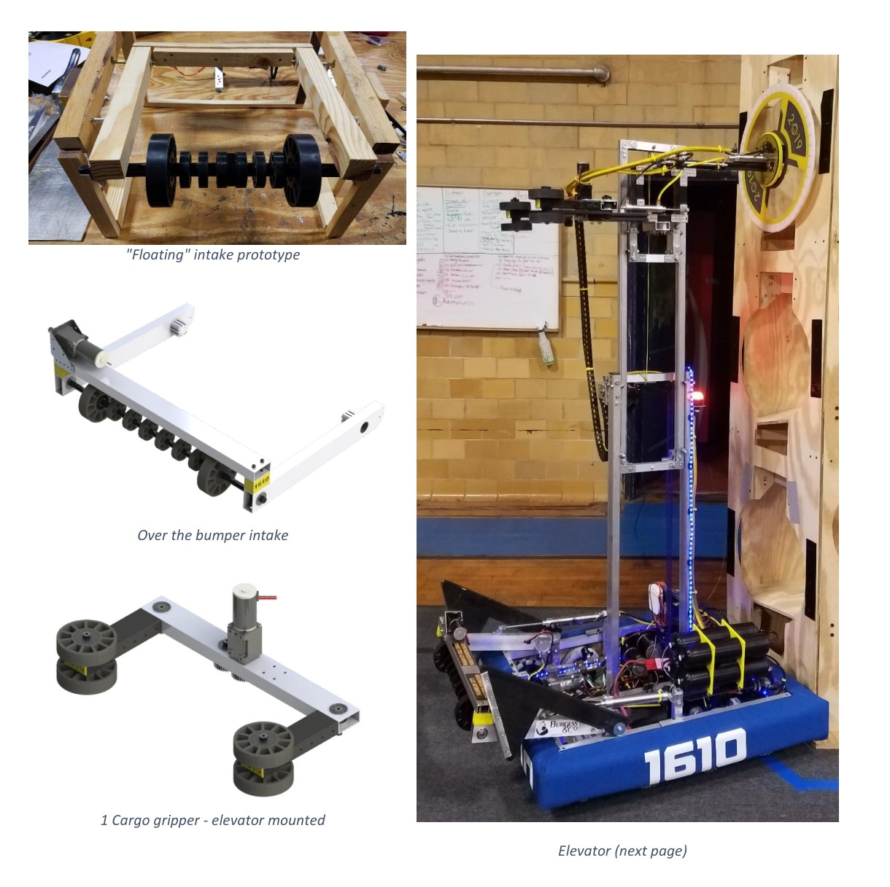
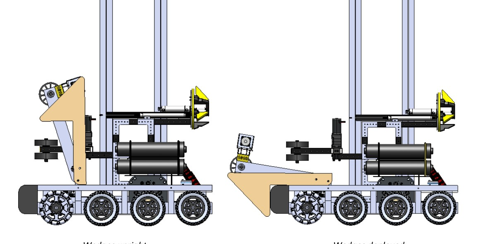

# 2019-1610 — Blackwater Robotics: Tuscarora

An eight-wheel drivebase supports a lighter elevator, separate over-bumper cargo collector and carriage gripper, plus a center-hole hatch mechanism. Deployed wedges allow the leading wheels to reach HAB2. The team consciously omitted HAB3 to prioritize full rocket scoring, and documented the resulting partner dependence.

## Strategic interpretation

This is a strong tradeoff and manufacturing reference, not an endorsed 1833 role ceiling. Its separate floor collector reduces lift payload at the cost of a handoff. Its HAB2 wedges solve bumper/step contact geometry before drive force can become useful. Historical pneumatic hardware remains accurately described but ineligible for direct 1833 use.

## Eight-wheel chassis and space-saving gearboxes

Version: Tuscarora Rev 2 binder. Source: https://blackwaterrobotics.org/wp-content/uploads/2019/05/1610_Technical_Binder_2019_rev2.pdf. Physical PDF pages: [8, 9].

### Published construction or code

The binder describes chain inside rails, two dropped center axles on an eight-wheel chassis and custom MiniCIM gearboxes developed with 2363. It retains exhaust-air motor cooling from the historical pneumatic arrangement. The team distinguishes precision construction and limited chain maintenance access.

### Team rationale or evidence boundary

Use a familiar strong drive while preserving packaging and the ability to drive once the HAB step can be engaged.

### Engineering interpretation

Traction power cannot pull the robot up a step if the bumper or belly prevents the first wheel from contacting it. A dropped center changes turning and contact distribution; eight wheels alone do not prove improved climbing. The cooling arrangement depends on air usage and is not part of an electric-only adaptation. A new design should compare actual route geometry and service exposure against standard modern drive options.

### Proposed validation — not performed

Check contact sequence at steps, breakover and bumper clearance before motor sizing. Include chain replacement/tension access and the proposed mechanism’s occupied interior volume.

### Limits

Team publication and selected figures, not an independent performance test or exhaustive competition chronology. Source dimensions and reported speeds require validation for a new design.

## Printed expanding-finger hatch manipulator

Version: Tuscarora Rev 2 binder. Source: https://blackwaterrobotics.org/wp-content/uploads/2019/05/1610_Technical_Binder_2019_rev2.pdf. Physical PDF pages: [10].

### Published construction or code

After suction tests fell short for the team, it developed a plunger-actuated triangular-finger mechanism inspired by an earlier internal grasp. A pneumatic cylinder opens pivoting fingers and torsion springs retract them. The binder shows successive printed prototypes and a physical hatch interface.

### Team rationale or evidence boundary

Retain the panel securely through its center opening after an unsatisfactory suction prototype.

### Engineering interpretation

Positive geometric capture avoids dependence on a sealed flat surface, but introduces alignment, finger travel and release interference. The historical prototype sequence is not a controlled conclusion that suction universally fails. For 1833, the source’s pre-2015 antecedent is historical provenance only, not eligible inspiration; use this documented 2019 implementation and a newly calculated electric/passive actuator. Confirm release against target hook/loop before declaring positive capture superior.

### Proposed validation — not performed

Use a small panel-center fixture to check approach tolerance, retention under moment and clean retraction. Calculate electric cam/link travel and failure state; avoid copying the cylinder as the actuation solution.

### Limits

Team publication and selected figures, not an independent performance test or exhaustive competition chronology. Source dimensions and reported speeds require validation for a new design.

## Separate floor collector and elevator gripper

Version: Tuscarora Rev 2 binder. Source: https://blackwaterrobotics.org/wp-content/uploads/2019/05/1610_Technical_Binder_2019_rev2.pdf. Physical PDF pages: [11, 12].

### Published construction or code

A deployed over-bumper roller intake hands cargo to a smaller carriage-mounted gripper. The team explicitly says the arrangement adds initial mechanism weight but reduces moving elevator payload. Thinner/smaller tubing reduced the reported lift mechanism weight by nearly half relative to its previous design. Cylinders extend scoring mechanisms beyond the bumper.

### Team rationale or evidence boundary

Keep the floor pickup effective without carrying the whole collector up the lift, and lower lift mass to improve motion.

### Engineering interpretation

The mass trade is plausible but creates another interface that can consume saved lift time. Measure successful ownership transfer, not roller motion. The handoff needs a valid final ball pose, appropriate compression and reliable stow/raise sequencing. The reported weight reduction is source-specific, not proof the new structure has half the deflection or that wall thickness can be halved elsewhere. Electric extension needs a complete retained/retracted load case.

### Proposed validation — not performed

Draw the acquisition-to-gripper contact sequence, including skewed and partially captured balls. Calculate stiffness and lift torque with the actual moving assembly, then target the unresolved handoff or structural boundary.

### Limits

Team publication and selected figures, not an independent performance test or exhaustive competition chronology. Source dimensions and reported speeds require validation for a new design.

## HAB2 wedges establish the first wheel contact

Version: Tuscarora Rev 2 binder. Source: https://blackwaterrobotics.org/wp-content/uploads/2019/05/1610_Technical_Binder_2019_rev2.pdf. Physical PDF pages: [6, 12].

### Published construction or code

The team chose HAB2 rather than HAB3. It rejected an initial multi-cylinder lift approach over bending concerns and used two wedges that drop ahead of the intake. Pins retain them during driving and redeploy into their working position; the wedges allow bumper/frame clearance until a front wheel contacts the six-inch step.

### Team rationale or evidence boundary

Overcome the step geometry and use drivetrain traction instead of asking a vulnerable cylinder to carry the principal lifting load.

### Engineering interpretation

The wedge redirects the problem from pure vertical actuation to an inclined contact path, but reaction loads still pass through its pivots/retainers and chassis. The no-air adaptation should use an electric or passive retained deployment, and account for rollback and misalignment. The source openly states reliance on partners for bonuses; that strategic decision belongs to this team/year and must not become 1833’s baseline.

### Proposed validation — not performed

Analyze support and reaction through the entire drive-up sequence, including asymmetric entry. Compare saved hardware with the lost climb/RP contribution and define recovery if the wedges deploy early or fail to latch.

### Limits

Team publication and selected figures, not an independent performance test or exhaustive competition chronology. Source dimensions and reported speeds require validation for a new design.

## Remaining evidence gaps

- Curated historical mechanism cohort, not a top-25 EPA selection; no EPA/rank fabricated.
- Selected primary publications and figures reviewed; no narrated-video review or exact CAD verification is claimed.
- Historical pneumatic/turret hardware is retained as fact but disallowed in new 1833 recommendations. Adaptation requires new interface/load/holding/recovery analysis.
- No exhaustive every-version certification, new PCH performance benchmark or match-by-match Einstein tactical audit.
