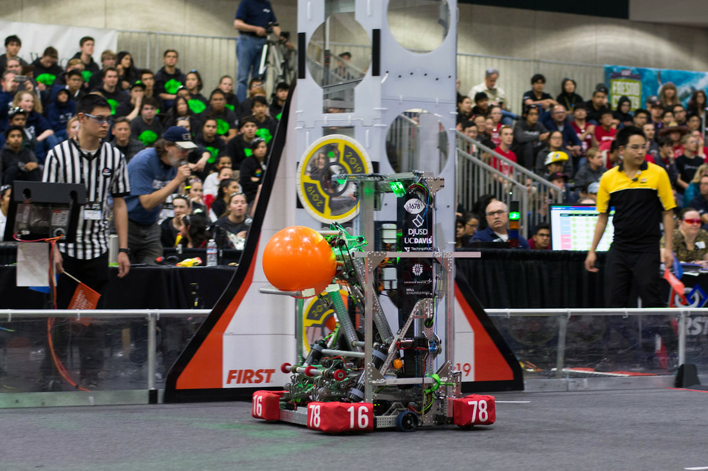

# 2019-1678 — Citrus Circuits: Buzz Lime-year

A six-wheel drive carries a pass-through elevator/wrist system for cargo and hatch panels at all rocket levels. A center-hole hatch device uses an arrowhead lead-in and expanding retention. The team reports a triple-robot HAB3 capability. Its CAD discussion clarifies rope tensioning, lift sensing and a brake that was modeled but never installed.

## Strategic interpretation

The reference is valuable for fixed-plane front/back scoring and for distinguishing a public model from competition hardware. A partner lift may own more of a bonus’s engineering work yet still requires partner docking and geometry. The team’s uniqueness/success claim is attributed, not independently certified here.

## Arrowhead hatch retention and cargo capture

Version: Buzz Lime-year published robot description. Source: https://www.citruscircuits.org/2019-robot. Physical PDF pages: not applicable; see source locators.

### Published construction or code

The robot page describes an arrowhead lead-in passing through the hatch center and two double-acting cylinders that extend retention features. Separate cargo acquisition uses possession sensing. The reviewed page describes function, not full dimensions, force settings or cycle statistics.

### Team rationale or evidence boundary

Engage loading-station hatches quickly, hold them in transit and release at the scoring target; detect acquired cargo for operator feedback.

### Engineering interpretation

A lead-in can enlarge approach tolerance before positive retention. The force path after capture is distinct from the geometry that guides initial insertion. For 1833, an electric cam or justified passive retention could preserve the function, but needs explicit compliance, latch travel, force and release analysis. The presence of two pieces does not permit simultaneous carriage under the game’s one-piece rule.

### Proposed validation — not performed

Check disk-center tolerance, legal possession transitions and release onto a representative hook/loop target. Validate the worst skewed approach and recovery if only one retaining element engages.

### Limits

Team publication and selected figures, not an independent performance test or exhaustive competition chronology. Source dimensions and reported speeds require validation for a new design.

## Pass-through lift with tension adjustment and position reference

Version: Buzz Lime-year published CAD discussion. Source: https://www.chiefdelphi.com/t/1678-citrus-circuits-2019-cad-release/359101/. Physical PDF pages: not applicable; see source locators.

Source locators:

- Post 4: https://www.chiefdelphi.com/t/1678-citrus-circuits-2019-cad-release/359101/4
- Post 7: https://www.chiefdelphi.com/t/1678-citrus-circuits-2019-cad-release/359101/7
- Post 15: https://www.chiefdelphi.com/t/1678-citrus-circuits-2019-cad-release/359101/15
- Post 17: https://www.chiefdelphi.com/t/1678-citrus-circuits-2019-cad-release/359101/17

### Published construction or code

The official robot summary describes a pass-through elevator for front/back scoring. In CAD replies, the team identifies Spectra cable, threaded looped-bolt tension adjustment and a hall switch/magnet zero reference. The round wrist tube uses inserted connecting nuts. The release also describes significant use of printed components.

### Team rationale or evidence boundary

The team identifies the functions of the tensioner and zero sensor. The selected replies do not provide a complete measured lift performance comparison.

### Engineering interpretation

A pass-through is a workspace requirement spanning the frame, lift, wrist and piece. Rope adjustment must preserve appropriate tension across travel rather than just at the bottom. A bottom reference addresses accumulated position error but cannot diagnose every rope slip or stage jam. Printed mounts and tube inserts need load-specific design; a vendor part number is not proof of capacity in a new high-moment joint.

### Proposed validation — not performed

Check swept cargo/panel/end-effector clearance and actual cable routing. Derive stage travel and tension, inspect termination access and define recovery from an inconsistent encoder/zero sensor state.

### Limits

Team publication and selected figures, not an independent performance test or exhaustive competition chronology. Source dimensions and reported speeds require validation for a new design.

## Triple-climb claim and non-installed elevator brake

Version: Buzz Lime-year competition robot versus modeled brake. Source: https://www.chiefdelphi.com/t/1678-citrus-circuits-2019-cad-release/359101/. Physical PDF pages: not applicable; see source locators.

Source locators:

- Post 16: https://www.chiefdelphi.com/t/1678-citrus-circuits-2019-cad-release/359101/16

### Published construction or code

The robot page reports lifting two other robots to the highest HAB level. CAD reply 16 says the elevator brake was considered for that load but scrapped because the elevator held adequately; it never reached the competition robot. The source’s “only successful” phrasing is a team claim, not a comparative census.

### Team rationale or evidence boundary

Hold the combined load without unnecessary brake hardware and preserve the published multi-robot climb capability.

### Engineering interpretation

A CAD feature can represent an abandoned design. Treat this as explicit negative installation evidence, not an invitation to erase the historical concept. Removing a brake depends on torque, thermal load, gearing, controller behavior and the duration/state of holding. The lesson is to prove necessity and margins, not to remove every positive lock from a future climb. For 1833, any current system still needs a justified load/power-loss response under the actual rules.

### Proposed validation — not performed

Verify the chosen installed version, partner load and supporting geometry before adaptation. Calculate hold current and thermal duty, then establish the safe behavior for loss of power or sensor feedback.

### Limits

Team publication and selected figures, not an independent performance test or exhaustive competition chronology. Source dimensions and reported speeds require validation for a new design.

## Remaining evidence gaps

- Curated historical mechanism cohort, not a top-25 EPA selection; no EPA/rank fabricated.
- Selected primary publications and figures reviewed; no narrated-video review or exact CAD verification is claimed.
- Historical pneumatic/turret hardware is retained as fact but disallowed in new 1833 recommendations. Adaptation requires new interface/load/holding/recovery analysis.
- No exhaustive every-version certification, new PCH performance benchmark or match-by-match Einstein tactical audit.
