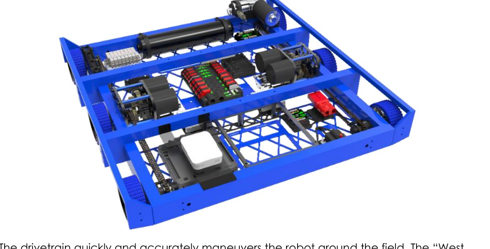
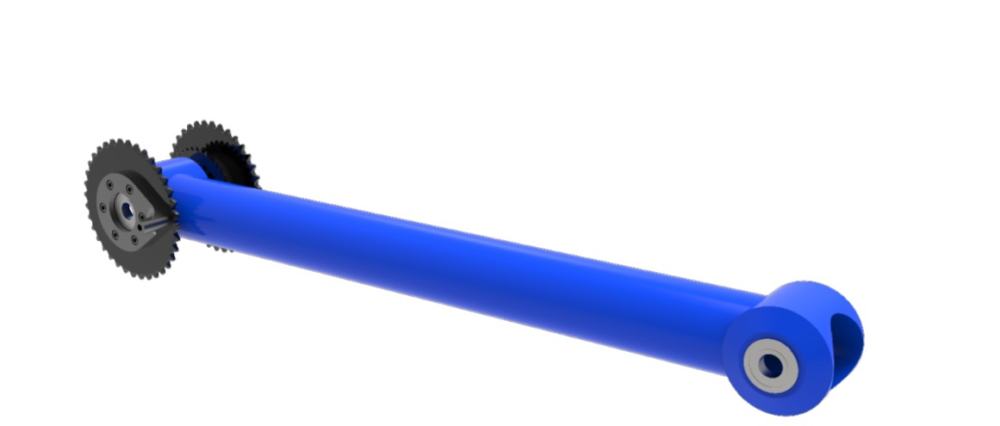
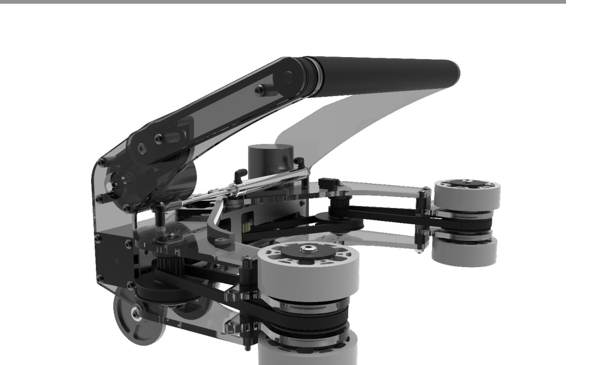
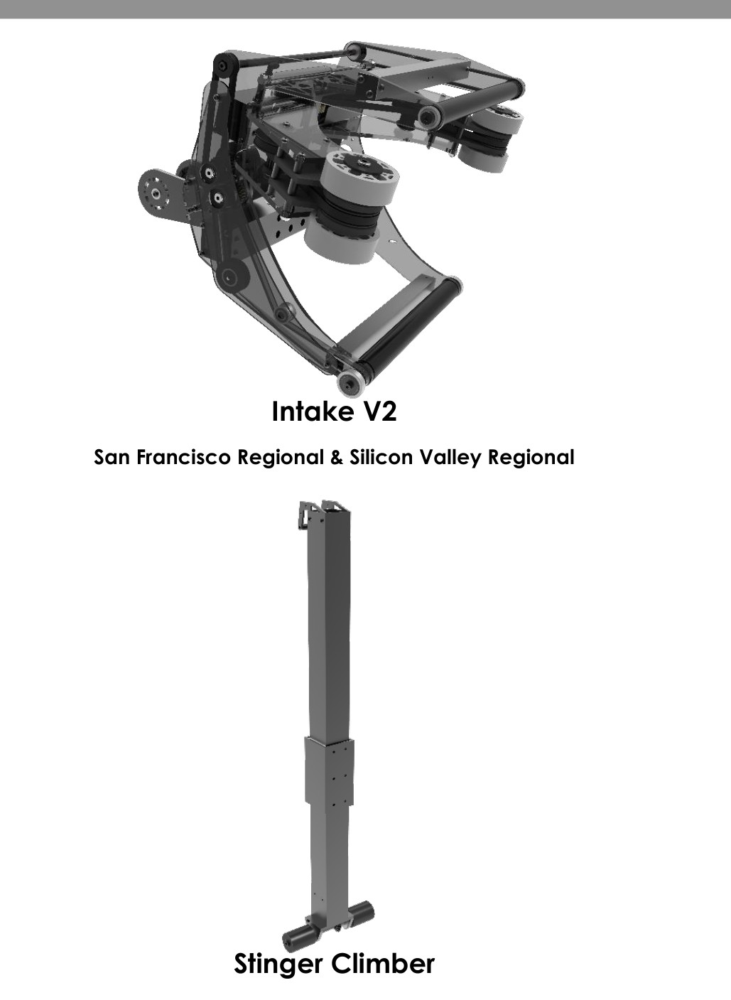
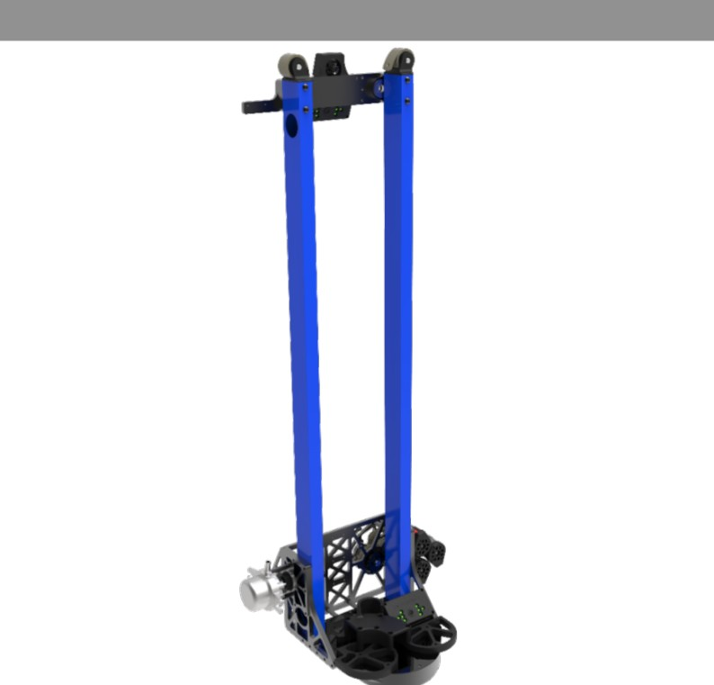
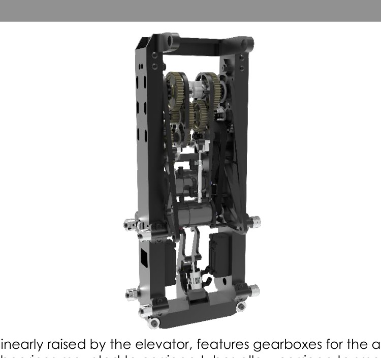
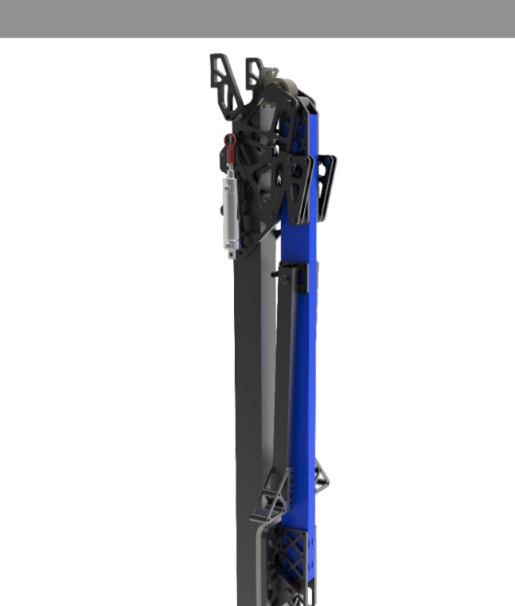
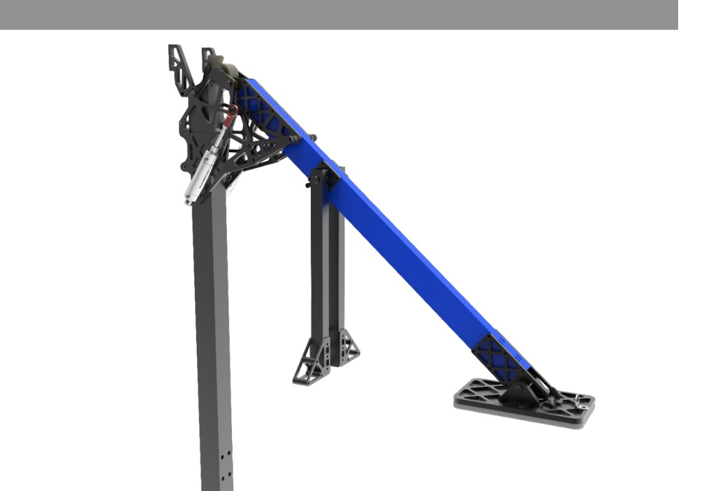

# 2019-254 — The Cheesy Poofs: BACKLASH

Backlash combines a compact six-wheel drive with a yawing superstructure, single-stage elevator, shoulder/wrist arm and dual-piece end effector. The binder distinguishes larger regional intake/short arm/stinger climbing hardware from the lighter championship intake/longer arm/suction climber. Software coordinates the four moving axes and target tracking.

## Strategic interpretation

The robot is a strong historical example of designing for solo rocket completion and reducing approach/aim overhead. Its turret is prohibited for a new 1833 design. Extract selected interfaces and mechanisms without silently retaining yaw capability or the historical pneumatic actuation. The published changes show that intake size, arm current, swept volume and climb load path are one architecture decision.

## Compact traction chassis and sprint acceleration

Version: Backlash published championship configuration. Source: https://media.team254.com/resources/Team_254_Tech_Binder_2019.pdf. Physical PDF pages: [17, 18].

### Published construction or code

The binder specifies a roughly 28 by 27.5-inch six-wheel dropped-center West Coast chassis on 4-inch nitrile wheels, with two NEOs per side and two-speed gearboxes. Published ratios and nominal speeds distinguish low-gear control/defense from high-gear travel. Optical shaft encoders are placed on front axles after gearbox/chain backlash.

### Team rationale or evidence boundary

Accelerate over short loading-station/rocket distances, push through defense, preserve interior space and occupy little HAB platform area.

### Engineering interpretation

A chassis can support independent ranking output by minimizing repeated travel and alignment losses; the same package also affects endgame coexistence. Sensor placement after drivetrain transmission play improves what wheel rotation is measured, but it does not eliminate tire slip or field-pose error. A new electric-only robot need not inherit pneumatic dog shifting. Compare fixed gearing with actual torque/current/route requirements before adding an actuator.

### Proposed validation — not performed

Use identical short-sprint routes and defended cases when comparing gearing. Include braking, loaded CG, wheel slip, sensor placement and climb edge contact in the spatial/power model.

### Limits

Team publication and selected figures, not an independent performance test or exhaustive competition chronology. Source dimensions and reported speeds require validation for a new design.

## Regional versus championship arm and intake coupling

Version: Backlash pre-Champs versus championship revision. Source: https://media.team254.com/resources/Team_254_Tech_Binder_2019.pdf. Physical PDF pages: [22, 23, 24, 25, 28].

### Published construction or code

The team describes a 16.5-inch shoulder-to-wrist arm before Champs and a later 21-inch arm with thinner tube wall and about one pound less mass. A larger dual-roller intake became a more compact unit, reported as 10.2 instead of 15.7 pounds. The longer arm changed which scoring poses needed inversion. The source links the changes to current/torque issues, reach and piece containment during yaw motion.

### Team rationale or evidence boundary

Reduce load on the arm transmission, fit the piece/end effector within the swept perimeter and improve top-level cargo reach.

### Engineering interpretation

The arm length increase and intake mass reduction must be evaluated together. Torque depends on mass times distance, and reflected inertia can rise with distance squared; a lighter longer arm is not automatically easier in every dynamic pose. The final intake’s compactness also removed a geometric restriction on scoring from multiple sides. For 1833 the yaw benefit is unavailable by policy, so compare whether the lighter end effector still earns the same packaging benefit on a fixed-plane design.

### Proposed validation — not performed

Compute static/dynamic torque over required poses with the correct intake mass/version. Check all inversion paths, stage overlap, legal extension and collision-free recovery before committing to the arm length.

### Limits

Team publication and selected figures, not an independent performance test or exhaustive competition chronology. Source dimensions and reported speeds require validation for a new design.

## One end effector for cargo and center-hole hatch capture

Version: Backlash championship compact intake. Source: https://media.team254.com/resources/Team_254_Tech_Binder_2019.pdf. Physical PDF pages: [24, 25].

### Published construction or code

A horizontal top roller brings cargo into horizontal compliant wheels on pivoting polycarbonate jaws. With jaws closed the flex wheels engage a hatch through its center opening; with jaws open they center and retain cargo. A retroreflective sensor detects cargo for automatic stow. Two NEO motors drive the roller systems; the historic jaw cylinder is pneumatic.

### Team rationale or evidence boundary

Provide rapid dual-piece acquisition, shock tolerance, compact geometry and lower moving mass.

### Engineering interpretation

The design reuses contact elements for two distinct objects, reducing dedicated mechanisms while creating coupled tuning. Cargo needs controlled compression without expulsion, while a hatch needs center-hole engagement and release without disturbing hook/loop retention. Polycarbonate compliance can absorb hits but also change contact alignment. A current no-air adaptation must deliver a useful jaw force/compliance law and a known retained state for both piece types. Do not assume the same wheel compression works on a new foam cube or thin disk.

### Proposed validation — not performed

Map pickup, retained and scoring poses for both pieces. If geometry cannot resolve the friction/release uncertainty, use a single adjustable end-effector fixture and test the worst off-axis poses.

### Limits

Team publication and selected figures, not an independent performance test or exhaustive competition chronology. Source dimensions and reported speeds require validation for a new design.

## Single-stage lift, remote motors and chain-coupled wrist

Version: Backlash published championship configuration. Source: https://media.team254.com/resources/Team_254_Tech_Binder_2019.pdf. Physical PDF pages: [20, 21, 22, 23].

### Published construction or code

A single chain-loop elevator driven by three 775pros positions a carriage carrying shoulder/wrist gearboxes. The wrist drive remains on the carriage rather than at the arm tip. A tensioned chain creates a virtual four-bar relation and absorbs shock. Gas springs counterbalance joints. Some arm/wrist brake hardware is explicitly labeled former design because the later climb does not load those joints.

### Team rationale or evidence boundary

Simplify elevator routing, reduce distal mass, maintain reach with the arm and reduce gravity current.

### Engineering interpretation

Remote actuation exchanges moving mass for transmission routing, compliance and backlash. A coupled wrist changes its relative motion as the shoulder moves, so software must track actual kinematics. Gas-spring moment is pose-dependent; it can assist in one region and oppose another. 1833’s no-pneumatics policy should prompt explicit review of pressure-based hardware rather than silently treating a historical gas spring as an approved choice; use a permitted counterbalance or accept/recalculate motor holding load.

### Proposed validation — not performed

Calculate joint torques with the actual counterbalance force-versus-position and transmission relationship. Verify safe transitions and retaining behavior after power loss; distinguish lift loads from obsolete stinger loads.

### Limits

Team publication and selected figures, not an independent performance test or exhaustive competition chronology. Source dimensions and reported speeds require validation for a new design.

## Stinger replaced by edge suction climb

Version: Backlash regional stinger / later suction climber. Source: https://media.team254.com/resources/Team_254_Tech_Binder_2019.pdf. Physical PDF pages: [21, 26, 27, 28].

### Published construction or code

The regional stinger used a powered roller at the arm tip. The later mechanism anchors a suction pad at a HAB edge, deploys through an overcenter linkage and uses elevator power to raise the robot. A ratchet prevents descent. A pressure transducer and check valve support climb initialization. The pad uses a closed-cell foam seal; several deployments and locks in the historical assembly are pneumatic.

### Team rationale or evidence boundary

Climb late while leaving more HAB top surface for partners and remove climb loads from the scoring arm/wrist.

### Engineering interpretation

The new climb changed both platform occupancy and structural load path. Those gains cannot be assessed as a standalone cup swap. Vacuum force depends on seal area, leak rate, substrate and peel moments; a check valve cannot compensate forever for a leak. An electric-only 1833 baseline must not inherit pneumatic deployment or pressure-actuated locks. A practical alternative may be mechanically different, and the available game bonus must justify its full integration cost.

### Proposed validation — not performed

Draw reactions through pad, foot, carriage, elevator and chassis for every state. Compare available anchoring force with moments, leakage, loss of power and release requirements; establish a permitted actuator arrangement before detail design.

### Limits

Team publication and selected figures, not an independent performance test or exhaustive competition chronology. Source dimensions and reported speeds require validation for a new design.

## Solo-rocket objective, target memory and safe motion planning

Version: Backlash technical strategy and controls. Source: https://media.team254.com/resources/Team_254_Tech_Binder_2019.pdf. Physical PDF pages: [9, 10, 11, 12, 29, 30].

### Published construction or code

The team explicitly designed around completing the rocket RP without requiring partners to supply the piece scoring. The binder distinguishes rocket work in qualifications from faster cargo-ship routes in eliminations. It describes target tracking, a motion planner that coordinates turret/lift/arm/wrist collisions, and a tuned autonomous sandstorm routine by championship.

### Team rationale or evidence boundary

Improve ranking control, shorten acquisition/score transitions and reduce the driver alignment burden.

### Engineering interpretation

Solo rocket does not mean solo HAB Docking: a level-3 climb alone is only 12 points. Target memory also requires uncertainty/age handling; an old target estimate is not a current guarantee of alignment. For 1833, preserve the ranking objective while replacing the disallowed yaw solution with a coherent chassis-aimed or pass-through architecture. The historical planner reveals the real complexity price of four degrees of freedom, not a reason to add axes without a measured need.

### Proposed validation — not performed

Budget all twelve rocket placements including panel prerequisites and retries under weak-partner conditions. Compare complete routes for permitted architectures and define stale-vision and blocked-transition behavior.

### Limits

Team publication and selected figures, not an independent performance test or exhaustive competition chronology. Source dimensions and reported speeds require validation for a new design.

## Remaining evidence gaps

- Curated historical mechanism cohort, not a top-25 EPA selection; no EPA/rank fabricated.
- Selected primary publications and figures reviewed; no narrated-video review or exact CAD verification is claimed.
- Historical pneumatic/turret hardware is retained as fact but disallowed in new 1833 recommendations. Adaptation requires new interface/load/holding/recovery analysis.
- No exhaustive every-version certification, new PCH performance benchmark or match-by-match Einstein tactical audit.
