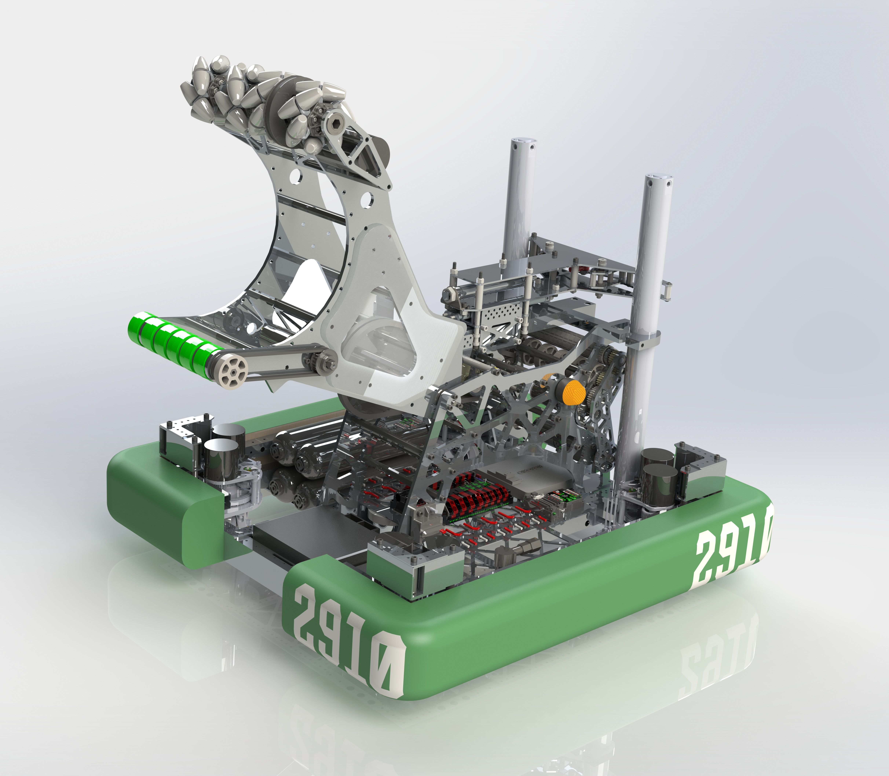

# 2019-2910 — Jack in the Bot: Jordan

Jordan’s CAD release documents a swerve robot with cargo arm/roller handling and a HAB climb arrangement. Team replies supply unusually useful details about collision damage, output-stage backlash, low-power cargo holding and platform supports added for sharing HAB3. Complete CAD geometry and every seasonal version are not certified by the discussion review.

## Strategic interpretation

The case is useful because performance depends on survivable packaging and controlled interfaces as much as nominal mechanism speed. A climb developed to share space with 1323 in practice does not make them a 2019 championship alliance; 2910’s own report records a different division/alliance and quarterfinal exit.

## Module protection after early motor damage

Version: Jordan early damage / added guards. Source: https://www.chiefdelphi.com/t/2910-cad-release-2019/357461. Physical PDF pages: not applicable; see source locators.

Source locators:

- Post 5: https://www.chiefdelphi.com/t/2910-cad-release-2019/357461/5

### Published construction or code

A team reply reports approximately seven NEO motors damaged by clipping at the first event, followed by no further clipping failures after protective structure was added. The publication identifies these as motor-protection features rather than decorative frame members.

### Team rationale or evidence boundary

Protect exposed drive components from the contact paths opened by bumper cutouts.

### Engineering interpretation

The source report is an important before/after account but is not a universal failure-rate estimate or a measured causal isolation. A cutout creates a collision envelope beyond the normal bumper face. Protection needs a reaction path into structure and clearance from moving components; a thin guard that simply transfers impact into the motor does not solve the problem. Small guard mass can preserve far more match output than a nominal speed improvement.

### Proposed validation — not performed

Trace likely opponent/field contact through bumper openings. Check guard deflection and attachment loads with all module orientations, then verify access to replace the protected component.

### Limits

Team publication and selected figures, not an independent performance test or exhaustive competition chronology. Source dimensions and reported speeds require validation for a new design.

## Cargo holding is a distinct low-power state

Version: Jordan published cargo control discussion. Source: https://www.chiefdelphi.com/t/2910-cad-release-2019/357461. Physical PDF pages: not applicable; see source locators.

Source locators:

- Post 5: https://www.chiefdelphi.com/t/2910-cad-release-2019/357461/5
- Post 9: https://www.chiefdelphi.com/t/2910-cad-release-2019/357461/9

### Published construction or code

The team says the upper roller runs for intake/release commands or when beam breaks indicate cargo should be retained. While stalled holding a ball it uses low power to limit current. A narrow compliant wheel fills a location where the pulley prevents another full-width wheel.

### Team rationale or evidence boundary

Retain cargo without unnecessary electrical load and fit useful contact into constrained roller packaging.

### Engineering interpretation

Capture speed and retained force are different control objectives. A continuously high roller command can waste current or deform a ball without improving possession. Conversely, too little holding force allows defense to eject it. The packaging detail is not evidence that an arbitrary missing wheel is harmless: the contact distribution still must resist off-axis loads. A sensor-confirmed state requires timeout and fault behavior when the beam is blocked without a ball.

### Proposed validation — not performed

Specify intake, hold, eject and recovery commands separately. Check ball compression, sensor ambiguity and current/thermal load with the actual contact arrangement.

### Limits

Team publication and selected figures, not an independent performance test or exhaustive competition chronology. Source dimensions and reported speeds require validation for a new design.

## Output-stage backlash and chain-tension access

Version: Jordan released cargo arm discussion. Source: https://www.chiefdelphi.com/t/2910-cad-release-2019/357461. Physical PDF pages: not applicable; see source locators.

Source locators:

- Post 18: https://www.chiefdelphi.com/t/2910-cad-release-2019/357461/18

### Published construction or code

The author describes an inline chain tensioner and a chain run deliberately long enough to accommodate it. A bolted/keyed sprocket-hub connection carries a high-torque interface. The explanation distinguishes backlash near gearbox output from equal angular play near the input.

### Team rationale or evidence boundary

Reduce effective arm play where it most affects endpoint position and avoid transmitting that interface’s torque only through a clearance hex fit.

### Engineering interpretation

An output angular error creates endpoint displacement proportional to reach; it cannot be tuned away by a controller that does not observe load-side motion. Tensioning can reduce slack but excessive tension loads bearings and shafts. The correct transfer is to allocate backlash and stiffness through the full chain of joints, with a maintainable tensioner, rather than copy a hub part number or claim zero play.

### Proposed validation — not performed

Calculate endpoint error from each output clearance and elastic element, inspect load-side sensing and preserve tension-adjustment access in the envelope.

### Limits

Team publication and selected figures, not an independent performance test or exhaustive competition chronology. Source dimensions and reported speeds require validation for a new design.

## HAB edge support and partner coexistence

Version: Jordan original support / championship sharing revision. Source: https://www.chiefdelphi.com/t/2910-cad-release-2019/357461. Physical PDF pages: not applicable; see source locators.

Source locators:

- Post 7: https://www.chiefdelphi.com/t/2910-cad-release-2019/357461/7
- Post 12: https://www.chiefdelphi.com/t/2910-cad-release-2019/357461/12

### Published construction or code

Team replies explain support cylinders under the robot that keep bumpers above HAB3 when rear wheels hang off. Additional support points allow another robot to rest on the front region, developed for a shared climb with 1323 in practice at championship. The author distinguishes the four-wheel chassis contact issue from generic platform capacity.

### Team rationale or evidence boundary

Occupy less HAB top area while satisfying bumper/support conditions and avoiding rearward tipping.

### Engineering interpretation

Footprint on the platform is not identical to frame footprint. A valid support polygon can use overhang if the complete loading condition remains stable and legal. Partner contact adds a changing vertical force and moment. This is a historical pneumatic arrangement, prohibited as recommended actuation for 1833; a replacement must retain positive support under the full load and address deployment timing/recovery. A practice demonstration is not evidence the pair played Einstein together.

### Proposed validation — not performed

Draw the support polygon with and without the partner load, check contact pressures and load transfer during entry, and verify a permitted deployed/retained state before borrowing the geometry.

### Limits

Team publication and selected figures, not an independent performance test or exhaustive competition chronology. Source dimensions and reported speeds require validation for a new design.

## Remaining evidence gaps

- Curated historical mechanism cohort, not a top-25 EPA selection; no EPA/rank fabricated.
- Selected primary publications and figures reviewed; no narrated-video review or exact CAD verification is claimed.
- Historical pneumatic/turret hardware is retained as fact but disallowed in new 1833 recommendations. Adaptation requires new interface/load/holding/recovery analysis.
- No exhaustive every-version certification, new PCH performance benchmark or match-by-match Einstein tactical audit.
