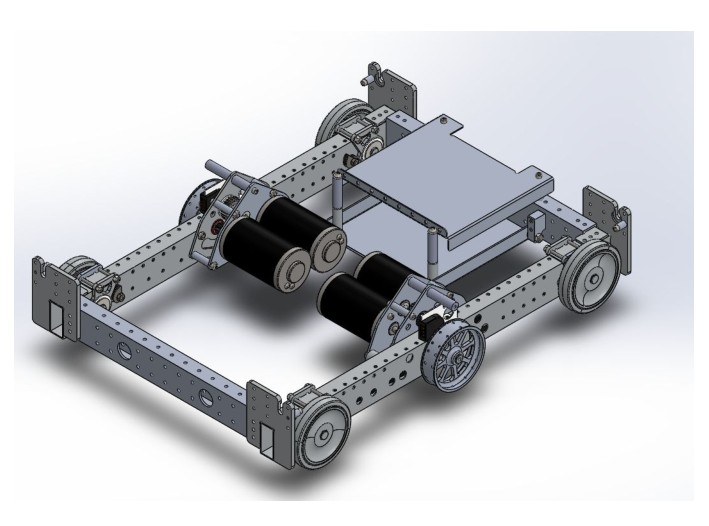
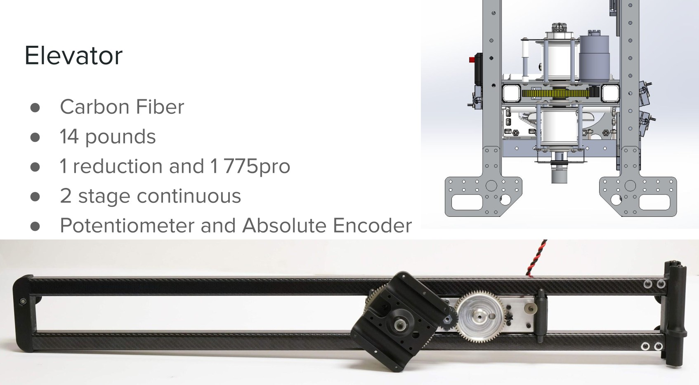
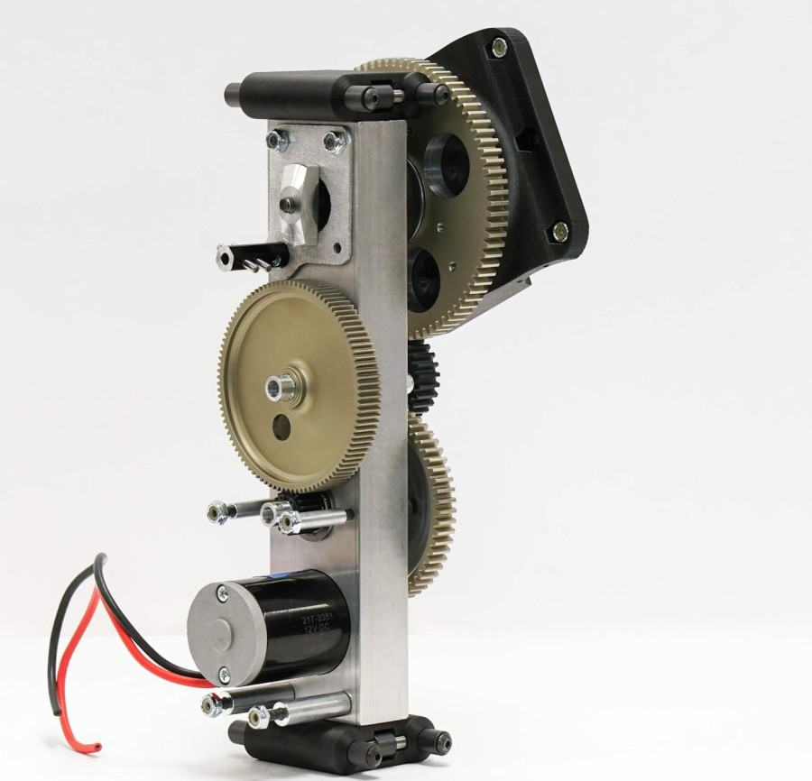
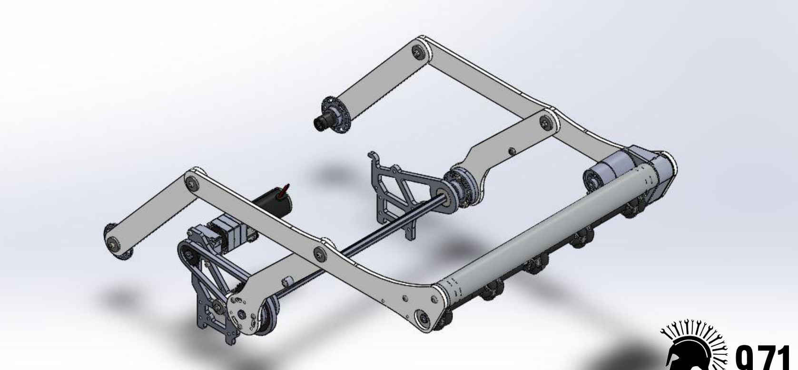
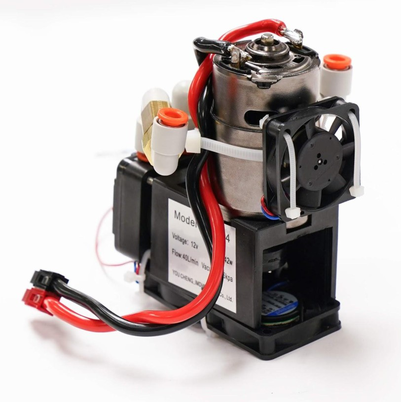
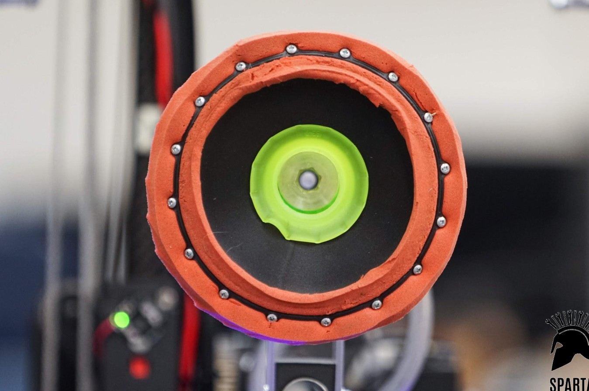
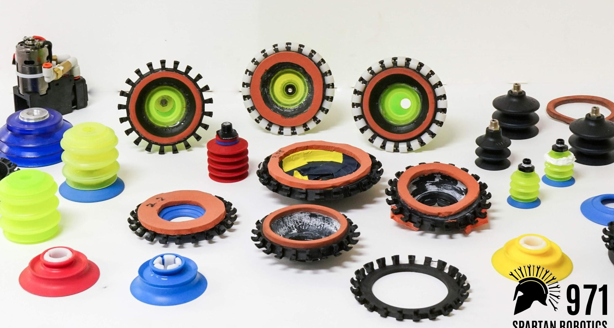
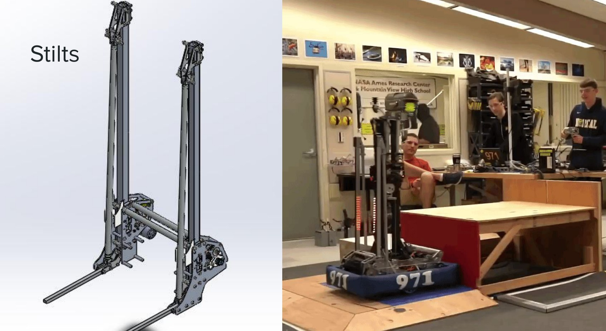
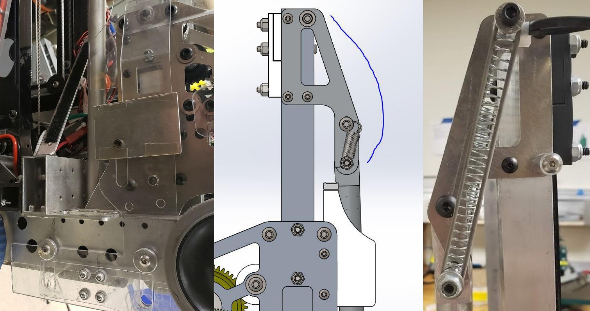
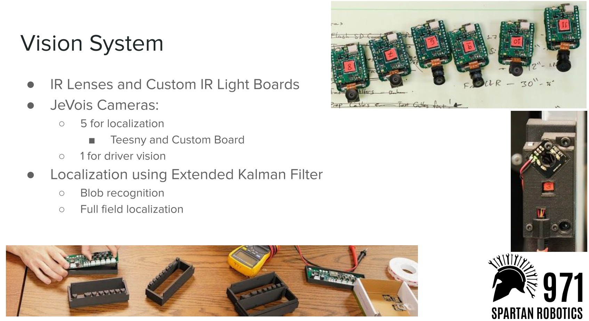

# 2019-971 — Spartan Robotics: Tachyon

The 2019 workshop slides show a narrow six-wheel West Coast chassis, lightweight carbon-fiber continuous elevator, compact wrist, floor roller intake, suction end effector/pump and stilts. Vision uses multiple cameras and a state estimator. The slide-only review establishes visible components and labels, not the full narration or every internal feature.

## Strategic interpretation

Tachyon is an example of packaging the same required game functions with very low carried mass and small swept footprint. The suction method is coupled to acquisition and retention, and should be contrasted with documented rejected vacuum prototypes rather than treated as an effortless universal gripper.

## Narrow single-speed drive and mass accounting

Version: Tachyon 2019 workshop/reveal snapshot. Source: https://www.spartanrobotics.org/_files/ugd/00c1f8_39beba9b690d48febf9f90fa267cdf93.pdf. Physical PDF pages: [4].

### Published construction or code

The slide specifies a 25 by 19-inch frame without bumpers, six wheels with center drop, outer Colsons and central tread wheels, and a single-speed transmission. Reveal reply 8 reports approximately 92 pounds including battery and bumpers. The dimensions and weight therefore use different but explicitly stated boundaries.

### Team rationale or evidence boundary

The slides provide construction, not a complete quantified decision study for this exact footprint.

### Engineering interpretation

A narrow frame helps route and turning clearance but reduces lateral support width. Lightweight upper mechanisms can make that trade workable without proving every tall narrow robot is stable. A battery-included weight cannot be compared directly with an inspection weight that excludes the battery/bumper. Single-speed architecture simplifies actuation; short-route acceleration and defended traction still need calculation.

### Proposed validation — not performed

Use one consistent mass/bumper convention in comparisons. Calculate raised-load stability and swept route envelope with the actual wheel contact points and moving mass.

### Limits

Workshop slide facts plus primary team replies; no independent weigh-in, dimensions measurement or defended cycle test.

## Light continuous elevator and compact wrist

Version: Tachyon 2019 workshop slides. Source: https://www.spartanrobotics.org/_files/ugd/00c1f8_39beba9b690d48febf9f90fa267cdf93.pdf. Physical PDF pages: [7, 8, 9, 10].

### Published construction or code

The lift slide identifies carbon fiber, a reported 14-pound assembly, a single 775pro, two-stage continuous rigging and potentiometer/absolute-encoder sensing. Photographs and a wrist rendering show compact joints and routing; the slides do not provide every dimension, reduction or bonded-joint detail.

### Team rationale or evidence boundary

The reviewed source establishes construction; a complete team-stated comparison of lift alternatives is not available from the slide text.

### Engineering interpretation

Low moving mass can reduce motor force, gravity current and tipping burden. That benefit must include gripper, piece, wire management and joints, not just bare carbon tubes. Continuous rigging changes travel and force relationships; no general motor-count rule follows. Carbon-fiber inserts, termination stresses and damage inspection become part of service. The wrist still needs torque, stiffness and sensor observability through all load directions.

### Proposed validation — not performed

Derive moving-mass and force-versus-travel estimates, check joint/termination loads and make the service envelope explicit. Do not recommend exact tube/adhesive details absent source or new analysis.

### Limits

Team publication and selected figures, not an independent performance test or exhaustive competition chronology. Source dimensions and reported speeds require validation for a new design.

## Floor roller, compliant cup and vacuum retention

Version: Tachyon 2019 workshop slides. Source: https://www.spartanrobotics.org/_files/ugd/00c1f8_39beba9b690d48febf9f90fa267cdf93.pdf. Physical PDF pages: [11, 12, 13, 14, 15, 16].

### Published construction or code

The slides show a deployable floor roller assembly, a compact motor-driven pump package and a broad compliant suction face. The cup development slide shows several candidate cups; it does not state a controlled comparison outcome. A team author in the vacuum discussion says 971 did not use a conventional pneumatics system and used electrically actuated valves.

### Team rationale or evidence boundary

The slides establish the acquisition and suction components; detailed selection rationale and all settings are not narrated in the reviewed material.

### Engineering interpretation

The floor pickup and cup are two interfaces: acquiring a rolling ball does not prove a reliable seal, and a stable seal does not prove a fast handoff. Cup compliance can reduce peeling during lateral loads but must survive impacts and release promptly. Distinguish a motor-driven vacuum system from compressed-air cylinders when describing history. For 1833 it remains a flagged pressure-system example, not automatic permission to bypass the no-pneumatics baseline.

### Proposed validation — not performed

Compare acquisition-to-release reliability, including imperfect seal, voltage sag, loss of power and defended peeling loads. Model leak-flow capacity and contact moments before any cup-area force estimate is used.

### Limits

Team publication and selected figures, not an independent performance test or exhaustive competition chronology. Source dimensions and reported speeds require validation for a new design.

## Stilt geometry in the workshop record

Version: Tachyon 2019 workshop slides. Source: https://www.spartanrobotics.org/_files/ugd/00c1f8_39beba9b690d48febf9f90fa267cdf93.pdf. Physical PDF pages: [17, 18].

### Published construction or code

The slide labeled Stilts shows extended supports and a robot on a mock HAB step. A following slide shows details of a supporting/latching region. The deck does not give a complete load rating or demonstrate every state transition in text.

### Team rationale or evidence boundary

A complete stated rationale or event revision history is not established in the reviewed slides.

### Engineering interpretation

Retain visible geometry without inventing a demonstration. Platform climbs require staged support transitions: lifting the chassis changes the wheel contacts, stability and clearance until the robot reaches the top. Hidden locks or transmission details cannot be inferred from a still. A current design should prove bumper elevation/support legality, a stable path through intermediate states and recovery if one side stalls.

### Proposed validation — not performed

Retrieve the complete assembly or narrated explanation before copying exact geometry. Use a coarse support/clearance model to reject unstable states; specify independent holding and safe recovery behavior.

### Limits

Team publication and selected figures, not an independent performance test or exhaustive competition chronology. Source dimensions and reported speeds require validation for a new design.

## Camera coverage and full-field localization

Version: Tachyon 2019 workshop slides. Source: https://www.spartanrobotics.org/_files/ugd/00c1f8_39beba9b690d48febf9f90fa267cdf93.pdf. Physical PDF pages: [19].

### Published construction or code

The vision slide identifies IR lenses/light boards, five JeVois cameras for localization, another driver camera, custom electronics and extended-Kalman-filter localization using recognized blobs. These are named historical components, not a current recommended software stack.

### Team rationale or evidence boundary

The slide identifies localization and driver visibility functions but does not report a reproduced accuracy distribution.

### Engineering interpretation

Multiple views can reduce occlusion while increasing calibration and synchronization work. Pose estimates should carry uncertainty and age, especially when used to coordinate a precise approach under defense. Cameras cannot recover a physically unstable grip. The modern transfer is coverage, time alignment and state estimation tied to a required placement tolerance; the old camera count is not itself a design requirement.

### Proposed validation — not performed

Derive required pose accuracy from target geometry and verify camera coverage at relevant mechanism poses. Define calibration, stale-data gating and manual recovery before adding sensing complexity.

### Limits

Team publication and selected figures, not an independent performance test or exhaustive competition chronology. Source dimensions and reported speeds require validation for a new design.

## Remaining evidence gaps

- Curated historical mechanism cohort, not a top-25 EPA selection; no EPA/rank fabricated.
- Selected primary publications and figures reviewed; no narrated-video review or exact CAD verification is claimed.
- Historical pneumatic/turret hardware is retained as fact but disallowed in new 1833 recommendations. Adaptation requires new interface/load/holding/recovery analysis.
- No exhaustive every-version certification, new PCH performance benchmark or match-by-match Einstein tactical audit.
