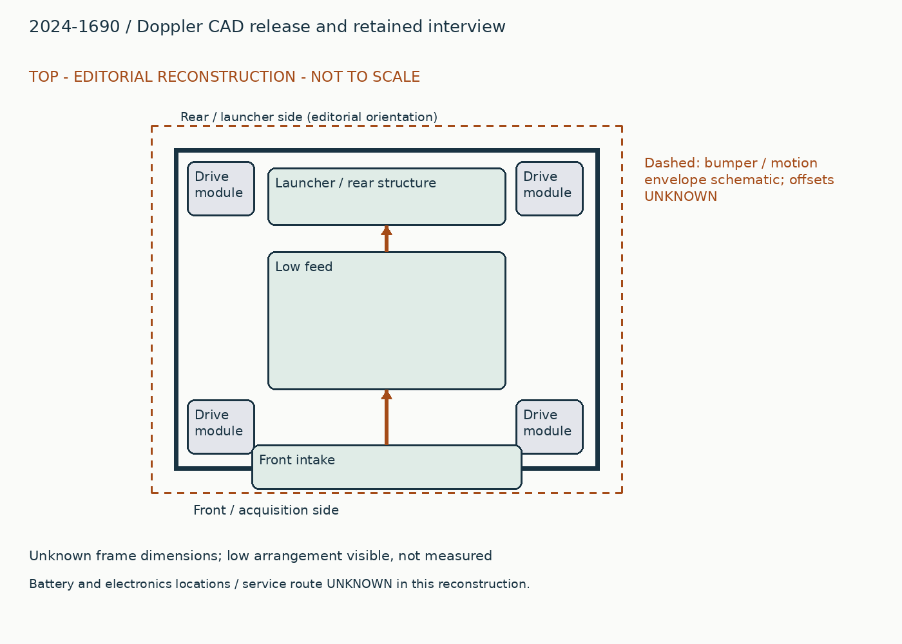
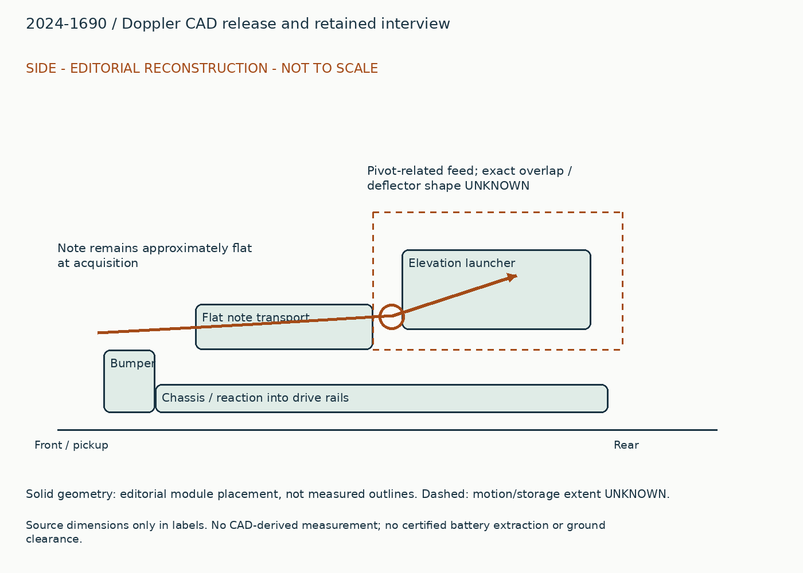
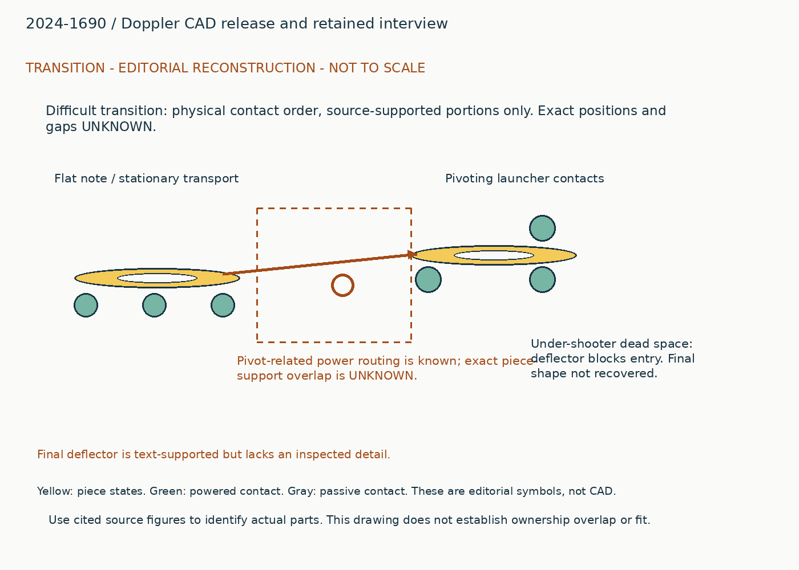
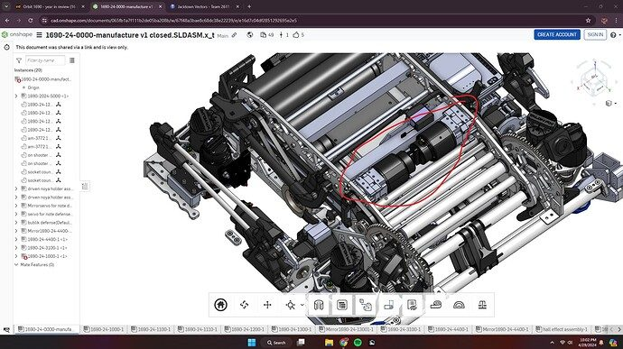
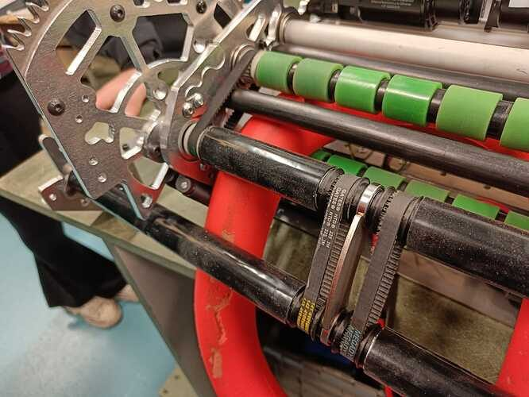
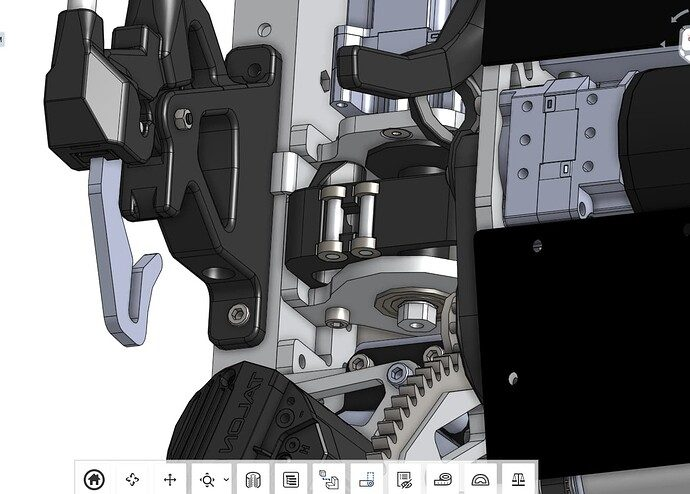
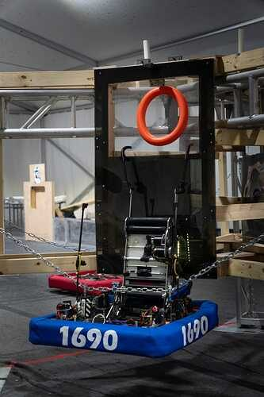
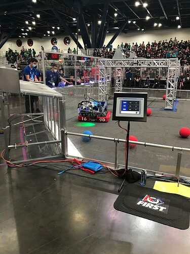

# 2024-1690: Doppler CAD release and retained interview

Generated from `data/physical_studies.jsonl`; edit that authoritative record.

## Whole robot and packaging

Four corner drive modules surround a very low transport and launcher assembly. The inspected CAD screenshot shows wide transverse rollers and launcher motors packed into the central space between modules. The launcher changes elevation instead of yawing independently of the chassis. Its feed transmission is organized around the elevation pivot so a ring can pass into the launcher across its angle range. A raised climb/trap pose shown in another source image is not the everyday driving envelope. Battery location and removal path cannot be established from these images, and are deliberately omitted from the layout.

## Piece flow

A floor note reaches the pickup mouth and is pulled inward while lying approximately flat. Rollers move it through the low transport path to the pivot-related feed region. Launcher contacts then accelerate and release it at the selected elevation. A later deflector keeps a note from entering the space under the shooter. That deflector prevents an unwanted alternative route; it is not another powered feed stage. Climb/trap operation reuses moving hardware but introduces a separate lifted geometry and dynamic timing problem.

## Annotated views

Editorial reconstruction. Not to scale; only explicit dimension labels are source dimensions. No CAD-derived measurements. Dashed envelopes are schematic and not clearance certification.

## Compact intake and pivot-related transport

### Published construction

The retained interview describes pivot-concentric transmission elements; the inspected overhead CAD view shows the closely packed central rollers and motors.

### Team rationale / attribution boundary

Read cited historical note for team rationale; the operating reconstruction below is editorial and does not establish additional team intent.

### Editorial operating reconstruction

The note must remain held while its center passes from the low pickup into the launcher. Pivoting changes the location of the launcher relative to fixed structure; the feed must continue to bridge that gap.

### Engineering interpretation

Concentric power routing can keep belt-center relationships stable while a launcher pivots. It does not alone prove the note remains constrained. That requires actual overlap of driving and supporting contacts through the worst angle.

### Transfer and compatibility limits

Borrow the pivot-related routing principle; retain actual support across the moving handoff. Low height alone does not demonstrate easy packaging or manufacturing.

### Unknowns

Exact roller diameters, note compression, trigger sensing and feed overlap through the full angle range remain unknown.

### Proposed validation, not performed

First inspect the missing source interface or CAD; only then test the specific capture/transfer failure that could change the architecture. No hardware experiment was performed in this upgrade.

Figure `acc77b02772fe9efed`. [Source](https://www.chiefdelphi.com/t/464838/29). Visible scope only; hidden geometry, precise dimensions and event installation are not established.

Figure `33ed084647fb83a0f1`. [Source](https://www.chiefdelphi.com/t/455350/34). Visible scope only; hidden geometry, precise dimensions and event installation are not established.

### Evidence coverage

| Evidence | State | Reason |
|---|---|---|
| synopsis | supported | Identified function and exact source snapshot retained. |
| construction | partial | Selected contacts and drives explained; no fabrication completeness claimed. |
| operating_sequence | partial | Editorial sequence identifies a physical route; sensing/recovery and hidden transitions remain unresolved. |
| interfaces | partial | Physical dependency explained; not a dimensionally certified interface. |
| packaging | partial | Annotated source-bounded schematic, not scaled CAD. |
| useful_image_inspected | supported | Referenced source figures visually inspected for the stated visible feature; hidden geometry unresolved. |
| parameters | partial | See selected robot parameters and version labels; complete dimensions, loads and operating conditions unavailable. |
| version | partial | Publication snapshot established, exact per-event installation unknown. |
| source_locator | supported | Existing note IDs retain page/time locators; new URLs retain section or post references. |
| remaining_unknowns | supported | Explicit evidence gap; does not assert absent hardware. |

## Horizontal contacts and rack-based elevation

### Published construction

The retained study describes four horizontal launcher contacts and rack angle actuation. The team CAD-release reply explains pinions made from two plates with steel pins acting as teeth.

### Team rationale / attribution boundary

Read cited historical note for team rationale; the operating reconstruction below is editorial and does not establish additional team intent.

### Editorial operating reconstruction

The launcher is brought to the intended elevation before feeding. The contacts accelerate the note; chassis heading supplies azimuth. A feed pause while aiming is normal operation, not automatically a jam.

### Engineering interpretation

A lantern-style pinion can be manufactured from plates and pins, but tooth contact, backlash and rack support remain output-angle error sources. Compactness trades away some shot range and individual mechanism advantages according to the team discussion.

### Transfer and compatibility limits

Electric elevation and chassis aim suit current constraints. Replicate only after checking the contact and bearing load path; do not borrow an unspecified gear ratio.

### Unknowns

The new review did not measure rack geometry, output stiffness or competition speed. No released control binary is certified.

### Proposed validation, not performed

First inspect the missing source interface or CAD; only then test the specific capture/transfer failure that could change the architecture. No hardware experiment was performed in this upgrade.

Figure `acc77b02772fe9efed`. [Source](https://www.chiefdelphi.com/t/464838/29). Visible scope only; hidden geometry, precise dimensions and event installation are not established.

Figure `f2b622697722523a10`. [Source](https://www.chiefdelphi.com/t/464838/57). Visible scope only; hidden geometry, precise dimensions and event installation are not established.

### Evidence coverage

| Evidence | State | Reason |
|---|---|---|
| synopsis | supported | Identified function and exact source snapshot retained. |
| construction | partial | Selected contacts and drives explained; no fabrication completeness claimed. |
| operating_sequence | partial | Editorial sequence identifies a physical route; sensing/recovery and hidden transitions remain unresolved. |
| interfaces | partial | Physical dependency explained; not a dimensionally certified interface. |
| packaging | partial | Annotated source-bounded schematic, not scaled CAD. |
| useful_image_inspected | supported | Referenced source figures visually inspected for the stated visible feature; hidden geometry unresolved. |
| parameters | partial | See selected robot parameters and version labels; complete dimensions, loads and operating conditions unavailable. |
| version | partial | Publication snapshot established, exact per-event installation unknown. |
| source_locator | supported | Existing note IDs retain page/time locators; new URLs retain section or post references. |
| remaining_unknowns | supported | Explicit evidence gap; does not assert absent hardware. |

## Exclude the under-shooter note trap

### Published construction

The retained interview says a deflector was added after two disabling note captures below the shooter.

### Team rationale / attribution boundary

Read cited historical note for team rationale; the operating reconstruction below is editorial and does not establish additional team intent.

### Editorial operating reconstruction

A loose or badly oriented note is blocked from entering the dead space. It must remain outside or return to the intended pickup path instead of becoming trapped under moving shooter hardware.

### Engineering interpretation

A guard is valuable because it removes a bad configuration, not because it adds another command. It must clear the launcher sweep, drive module steering, and legitimate note path.

### Transfer and compatibility limits

Transfer the failure-prevention requirement, not a fictional deflector drawing. Inspect final CAD or a dated detail before adopting geometry.

### Unknowns

The currently inspected figures do not isolate the final deflector. Exact shape, attachment and final-event version remain unresolved; visual coverage is explicitly unknown for this feature.

### Proposed validation, not performed

First inspect the missing source interface or CAD; only then test the specific capture/transfer failure that could change the architecture. No hardware experiment was performed in this upgrade.

### Evidence coverage

| Evidence | State | Reason |
|---|---|---|
| synopsis | supported | Identified function and exact source snapshot retained. |
| construction | partial | Selected contacts and drives explained; no fabrication completeness claimed. |
| operating_sequence | partial | Editorial sequence identifies a physical route; sensing/recovery and hidden transitions remain unresolved. |
| interfaces | partial | Physical dependency explained; not a dimensionally certified interface. |
| packaging | partial | Annotated source-bounded schematic, not scaled CAD. |
| useful_image_inspected | unknown | Final deflector detail not recovered. |
| parameters | unknown | No dimensions for final guard recovered. |
| version | partial | Publication snapshot established, exact per-event installation unknown. |
| source_locator | supported | Existing note IDs retain page/time locators; new URLs retain section or post references. |
| remaining_unknowns | supported | Explicit evidence gap; does not assert absent hardware. |

## Roll correction and trap timing

### Published construction

The retained interview describes roll correction and trap release coordinated with swing; source discussion records concerns about trap robustness.

### Team rationale / attribution boundary

Read cited historical note for team rationale; the operating reconstruction below is editorial and does not establish additional team intent.

### Editorial operating reconstruction

Climb capture, tensioning, leveling and trap release occur in a different pose from ordinary transport. Ring release must happen in the usable window rather than merely at an encoder target.

### Engineering interpretation

A low scoring package may still require demanding endgame control. Source opinions differ about whether trap pursuit was the best compromise; preserve those as individual assessments.

### Transfer and compatibility limits

Roll feedback can transfer as a control idea. The complete historical climb is not certified or recommended; new structure must independently support suspension.

### Unknowns

Hooks, load retention, power-off support, sensor assignments and release timing are not fully reconstructed.

### Proposed validation, not performed

First inspect the missing source interface or CAD; only then test the specific capture/transfer failure that could change the architecture. No hardware experiment was performed in this upgrade.

Figure `e2a353d98ecdf53a82`. [Source](https://www.chiefdelphi.com/t/455350/1). Visible scope only; hidden geometry, precise dimensions and event installation are not established.

Figure `708323a4dfa44cdd0a`. [Source](https://www.chiefdelphi.com/t/455350/23). Visible scope only; hidden geometry, precise dimensions and event installation are not established.

### Evidence coverage

| Evidence | State | Reason |
|---|---|---|
| synopsis | supported | Identified function and exact source snapshot retained. |
| construction | partial | Selected contacts and drives explained; no fabrication completeness claimed. |
| operating_sequence | partial | Editorial sequence identifies a physical route; sensing/recovery and hidden transitions remain unresolved. |
| interfaces | partial | Physical dependency explained; not a dimensionally certified interface. |
| packaging | partial | Annotated source-bounded schematic, not scaled CAD. |
| useful_image_inspected | supported | Referenced source figures visually inspected for the stated visible feature; hidden geometry unresolved. |
| parameters | partial | See selected robot parameters and version labels; complete dimensions, loads and operating conditions unavailable. |
| version | partial | Publication snapshot established, exact per-event installation unknown. |
| source_locator | supported | Existing note IDs retain page/time locators; new URLs retain section or post references. |
| remaining_unknowns | supported | Explicit evidence gap; does not assert absent hardware. |

## Interface records

### physical-2024-1690-low-feed-output

| Field | State | Value / limitation |
|---|---|---|
| piece | supported | note_2024. Original game and piece; no cross-year equivalence implied. |
| orientation | partial | approximately flat foam ring at moving handoff. Concentric transmission does not certify continuous piece-contact overlap. |
| direction | partial | toward pivoting launcher. Qualitative path only; local coordinate transform not measured. |
| entry_exit_height | unknown | Unknown. No local datum or source dimension recovered. |
| effective_feed_width | unknown | Unknown. Overall chassis / plate spacing is not usable contact width. |
| velocity | unknown | Unknown. No measured interface velocity under stated load. |
| compression | unknown | Unknown. Contact gap not established at this port. |
| ownership_readiness | partial | Concentric transmission does not certify continuous piece-contact overlap.. Must verify sensor definitions, delays, timeout, reversal and release authority. |
| occupied_swept_space | partial | Four corner drive modules surround a very low transport and launcher assembly. The inspected CAD screenshot shows wide transverse rollers and launcher motors packed into the central space between modules. The launcher changes elevation instead of yawing independently of the chassis. Its feed transmission is organized around the elevation pivot so a ring can pass into the launcher across its angle range. A raised climb/trap pose shown in another source image is not the everyday driving envelope. Battery location and removal path cannot be established from these images, and are deliberately omitted from the layout.. Layout is editorial; dimensions and interfering motions unverified. |
| structural_loads | partial | Concentric power routing can keep belt-center relationships stable while a launcher pivots. It does not alone prove the note remains constrained. That requires actual overlap of driving and supporting contacts through the worst angle.. Load path described without verified force magnitudes or attachment sizing. |
| electrical_simultaneity | unknown | Unknown. Motor counts do not establish bus voltage, current limits or simultaneous duty. |
| jam_recovery_service | partial | Exact roller diameters, note compression, trigger sensing and feed overlap through the full angle range remain unknown.. Exact powered-off recovery and disassembly order unresolved. |

Borrow the pivot-related routing principle; retain actual support across the moving handoff. Low height alone does not demonstrate easy packaging or manufacturing.

### physical-2024-1690-launcher-input

| Field | State | Value / limitation |
|---|---|---|
| piece | supported | note_2024. Original game and piece; no cross-year equivalence implied. |
| orientation | partial | ring at selected launcher angle. Contact overlap across angle range unknown; guard must exclude underside trap. |
| direction | partial | through launch contacts. Qualitative path only; local coordinate transform not measured. |
| entry_exit_height | unknown | Unknown. No local datum or source dimension recovered. |
| effective_feed_width | unknown | Unknown. Overall chassis / plate spacing is not usable contact width. |
| velocity | unknown | Unknown. No measured interface velocity under stated load. |
| compression | unknown | Unknown. Contact gap not established at this port. |
| ownership_readiness | partial | Contact overlap across angle range unknown; guard must exclude underside trap.. Must verify sensor definitions, delays, timeout, reversal and release authority. |
| occupied_swept_space | partial | Four corner drive modules surround a very low transport and launcher assembly. The inspected CAD screenshot shows wide transverse rollers and launcher motors packed into the central space between modules. The launcher changes elevation instead of yawing independently of the chassis. Its feed transmission is organized around the elevation pivot so a ring can pass into the launcher across its angle range. A raised climb/trap pose shown in another source image is not the everyday driving envelope. Battery location and removal path cannot be established from these images, and are deliberately omitted from the layout.. Layout is editorial; dimensions and interfering motions unverified. |
| structural_loads | partial | A lantern-style pinion can be manufactured from plates and pins, but tooth contact, backlash and rack support remain output-angle error sources. Compactness trades away some shot range and individual mechanism advantages according to the team discussion.. Load path described without verified force magnitudes or attachment sizing. |
| electrical_simultaneity | unknown | Unknown. Motor counts do not establish bus voltage, current limits or simultaneous duty. |
| jam_recovery_service | partial | The new review did not measure rack geometry, output stiffness or competition speed. No released control binary is certified.. Exact powered-off recovery and disassembly order unresolved. |

Electric elevation and chassis aim suit current constraints. Replicate only after checking the contact and bearing load path; do not borrow an unspecified gear ratio.

## Remaining whole-robot gaps

- Final deflector is text-supported but lacks an inspected detail.
- Exact stationary-to-pivoting note overlap and every sensing state require CAD/controls evidence.
- Battery/electronics positions, start envelope and suspended-load path remain unknown.

## Sources

- https://youtu.be/jB7OqueRYf0
- https://www.chiefdelphi.com/t/frc-orbit-1690-2024-robot-cad-release/464838
- https://www.chiefdelphi.com/t/frc-orbit-1690-2024-robot-cad-release/464838?page=2
