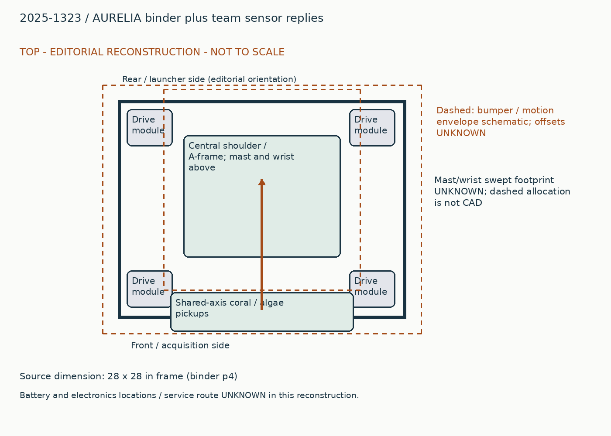
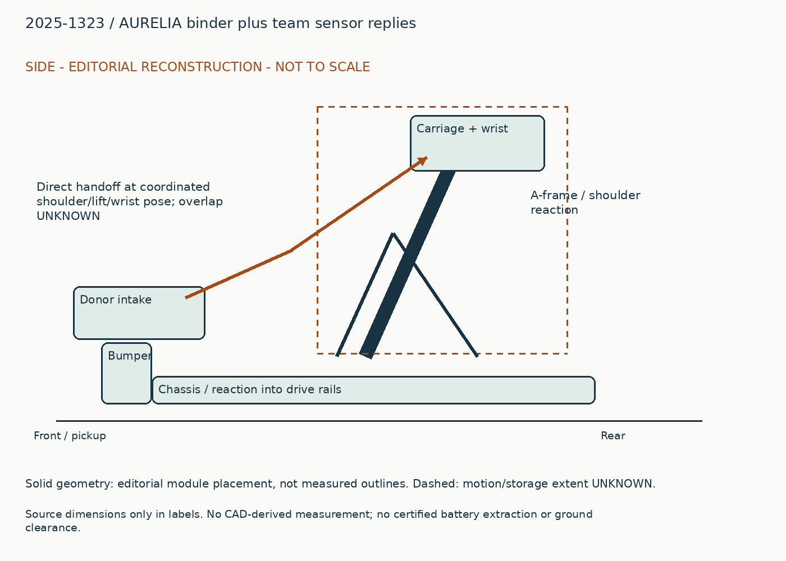
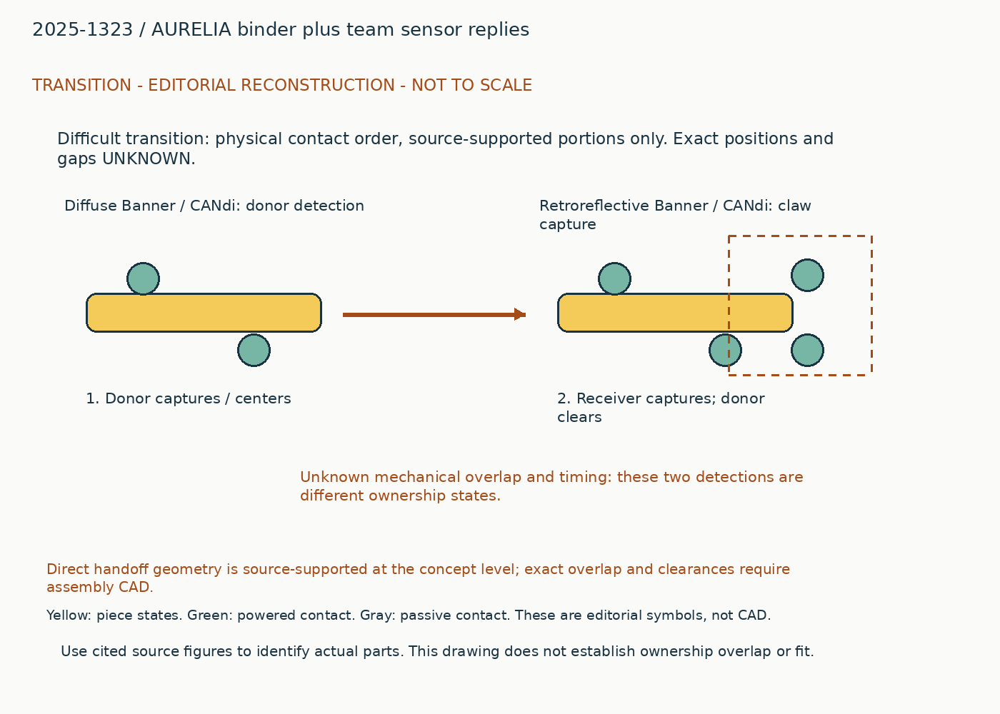
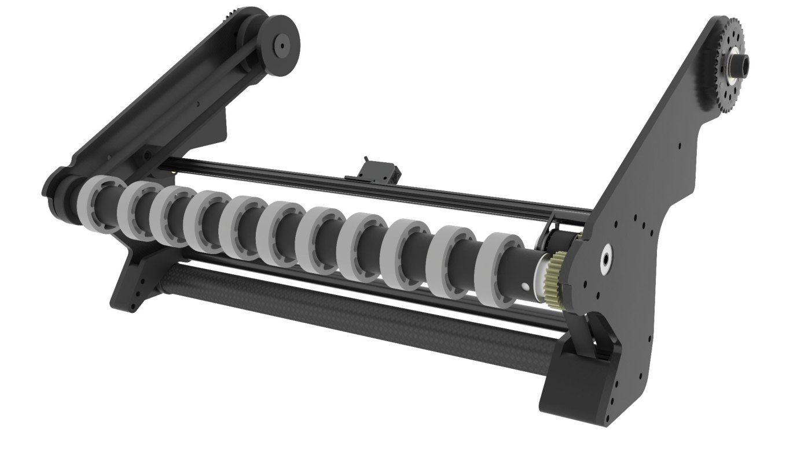
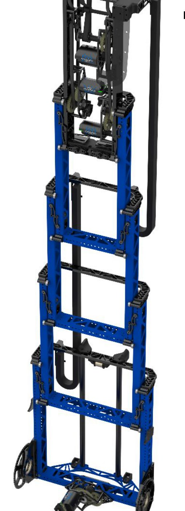
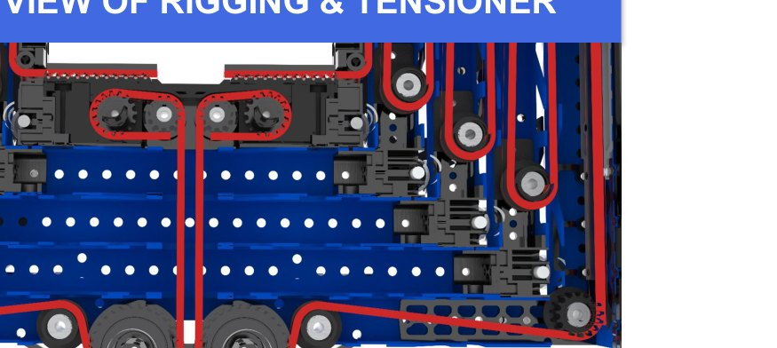
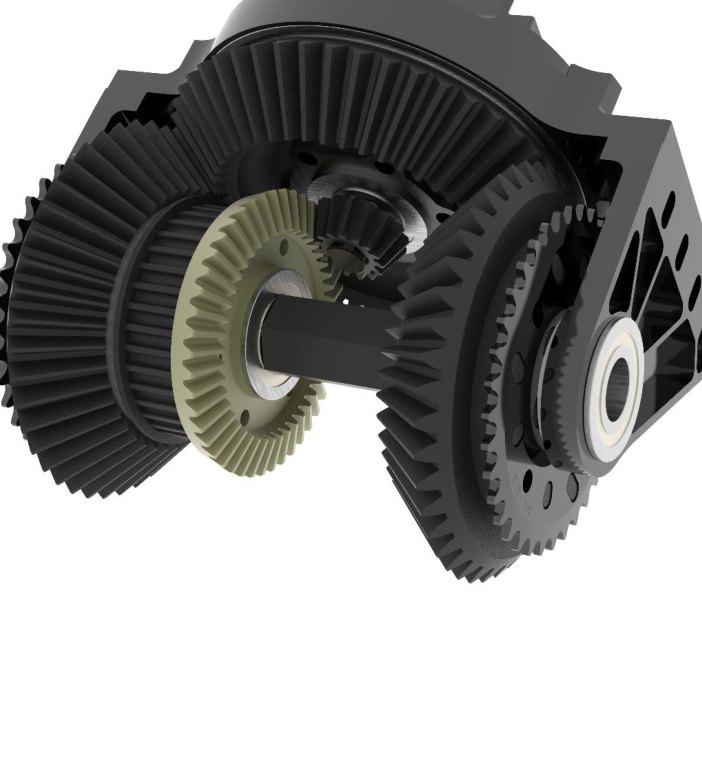
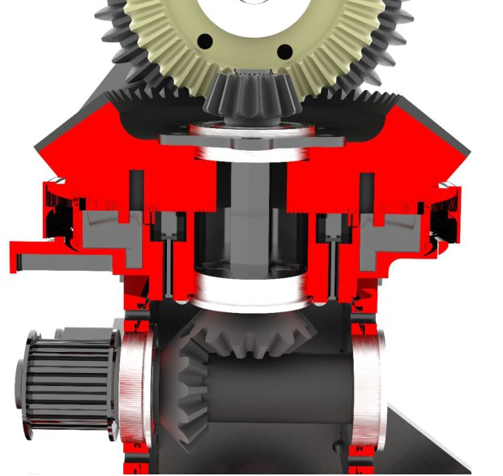
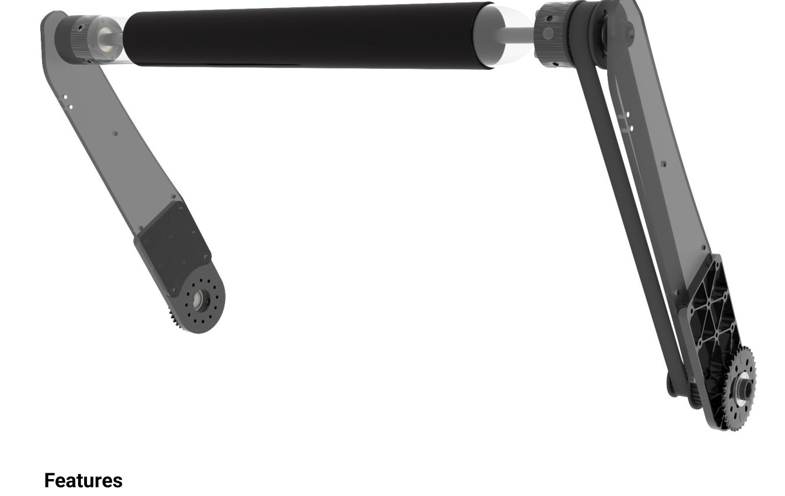
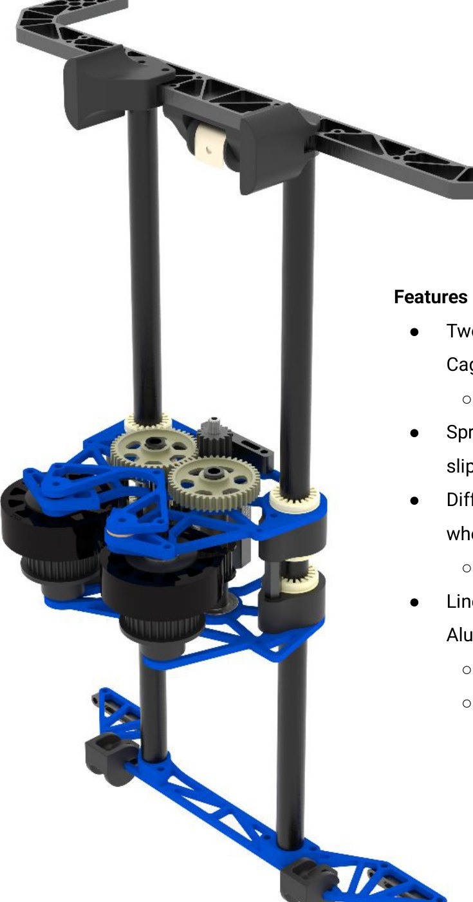

# 2025-1323: AURELIA binder plus team sensor replies

Generated from `data/physical_studies.jsonl`; edit that authoritative record.

## Whole robot and packaging

The ground pickup spans the front of the base. Coral and algae mechanisms share an axis but have distinct contacts and drives. A central shoulder turns a four-stage elevator supported by an A-frame tied into the base; the carriage carries a compact differential wrist and two-piece end effector. The elevator changes both height and fore-aft position because its whole mast pivots. High scoring therefore sweeps a volume above and across the base, while ground intake deployment occupies the front. The base uses different module clearances fore and aft. Published stage and shoulder renders establish subassembly construction, but battery location, complete wire routing and removal operations remain incomplete.

## Piece flow

For coral, floor rollers catch and center the tube, then lift it into a direct handoff. The receiving end effector must be positioned before the donor releases its constraint. The elevator/shoulder move the retained tube to height; the differential reorients it while separate rollers manage placement and release. Algae follows its own intake contacts into the shared end effector, or is acquired from the reef. Climbing changes the force path: cage capture and support contacts allow the shoulder to lift the chassis rather than just a piece.

## Annotated views

Editorial reconstruction. Not to scale; only explicit dimension labels are source dimensions. No CAD-derived measurements. Dashed envelopes are schematic and not clearance certification.

## Ground capture, orientation and direct handoff

### Published construction

The binder describes flex upper contacts, grippy lower rollers and roughly 0.125-inch coral compression. The original figure shows the wheel row, lower tube, side supports and deployment transmission.

### Team rationale / attribution boundary

Read cited historical note for team rationale; the operating reconstruction below is editorial and does not establish additional team intent.

### Editorial operating reconstruction

Catch the floor tube, center it between the contact regions, lift the intake, and meet the receiving wrist. The team reply identifies a diffuse Banner sensor with CANdi for intake detection and a retroreflective Banner/CANdi arrangement at the claw.

### Engineering interpretation

Donor detection is not the same as receiver ownership. A state machine needs to distinguish contact at the pickup, receiver capture and complete clearance before moving the mast. The new sensor reply supplies the missing signal locations; it does not supply exact timeout or debounce settings.

### Transfer and compatibility limits

Transfer centering plus sensor-confirmed direct handoff. A receiving wrist must match the donor pose, not merely be capable of holding coral.

### Unknowns

Exact contact overlap, allowable incoming tube poses and source code transfer timeout remain unknown.

### Proposed validation, not performed

First inspect the missing source interface or CAD; only then test the specific capture/transfer failure that could change the architecture. No hardware experiment was performed in this upgrade.

Figure `binder-6054858ce2266dbdc2-p9-1`. [Source](https://drive.google.com/file/d/1Y2ooTZMBNoViMZ6R4wYOkom1mhIIqF-R/view?usp=sharing#page=9). Visible scope only; hidden geometry, precise dimensions and event installation are not established.

### Evidence coverage

| Evidence | State | Reason |
|---|---|---|
| synopsis | supported | Identified function and exact source snapshot retained. |
| construction | supported | Selected contacts and drives explained; no fabrication completeness claimed. |
| operating_sequence | partial | Editorial sequence identifies a physical route; sensing/recovery and hidden transitions remain unresolved. |
| interfaces | partial | Physical dependency explained; not a dimensionally certified interface. |
| packaging | partial | Annotated source-bounded schematic, not scaled CAD. |
| useful_image_inspected | supported | Referenced source figures visually inspected for the stated visible feature; hidden geometry unresolved. |
| parameters | partial | See selected robot parameters and version labels; complete dimensions, loads and operating conditions unavailable. |
| version | partial | Publication snapshot established, exact per-event installation unknown. |
| source_locator | supported | Existing note IDs retain page/time locators; new URLs retain section or post references. |
| remaining_unknowns | supported | Explicit evidence gap; does not assert absent hardware. |

## Four-stage elevator, rotating shoulder and A-frame

### Published construction

A shoulder-supported continuous lift uses internal HTD belts and extended-stage interlocking stops. The binder gives one X60 lift motor, 6.875:1 and two 18-mm belts.

### Team rationale / attribution boundary

Read cited historical note for team rationale; the operating reconstruction below is editorial and does not establish additional team intent.

### Editorial operating reconstruction

After handoff, shoulder rotation and lift extension move the piece into scoring position. Stops stiffen fully extended stages; during partial extension the guide overlap and bearings carry the moving load.

### Engineering interpretation

The load runs from end effector through carriage and stage guides into shoulder bearings, A-frame and chassis. Stops do not eliminate bending at intermediate heights. Shoulder motion also shifts the moving center of mass and changes cable travel.

### Transfer and compatibility limits

The compact lift and front/back workspace may transfer. Full mast sweep, power cable bend radius and shared climb loads must be rechecked for the new piece.

### Unknowns

Complete belt routing, stage travel, output deflection and service order are not certified.

### Proposed validation, not performed

First inspect the missing source interface or CAD; only then test the specific capture/transfer failure that could change the architecture. No hardware experiment was performed in this upgrade.

Figure `binder-6054858ce2266dbdc2-p10-1`. [Source](https://drive.google.com/file/d/1Y2ooTZMBNoViMZ6R4wYOkom1mhIIqF-R/view?usp=sharing#page=10). Visible scope only; hidden geometry, precise dimensions and event installation are not established.

Figure `binder-6054858ce2266dbdc2-p11-3`. [Source](https://drive.google.com/file/d/1Y2ooTZMBNoViMZ6R4wYOkom1mhIIqF-R/view?usp=sharing#page=11). Visible scope only; hidden geometry, precise dimensions and event installation are not established.

### Evidence coverage

| Evidence | State | Reason |
|---|---|---|
| synopsis | supported | Identified function and exact source snapshot retained. |
| construction | supported | Selected contacts and drives explained; no fabrication completeness claimed. |
| operating_sequence | partial | Editorial sequence identifies a physical route; sensing/recovery and hidden transitions remain unresolved. |
| interfaces | partial | Physical dependency explained; not a dimensionally certified interface. |
| packaging | partial | Annotated source-bounded schematic, not scaled CAD. |
| useful_image_inspected | supported | Referenced source figures visually inspected for the stated visible feature; hidden geometry unresolved. |
| parameters | partial | See selected robot parameters and version labels; complete dimensions, loads and operating conditions unavailable. |
| version | partial | Publication snapshot established, exact per-event installation unknown. |
| source_locator | supported | Existing note IDs retain page/time locators; new URLs retain section or post references. |
| remaining_unknowns | supported | Explicit evidence gap; does not assert absent hardware. |

## Differential orientation with separate piece rollers

### Published construction

Printed bevel gears combine paired wrist drives; the source gives 61.6:1 per drive and #25H output chain. Separate roller drives handle the piece.

### Team rationale / attribution boundary

Read cited historical note for team rationale; the operating reconstruction below is editorial and does not establish additional team intent.

### Editorial operating reconstruction

Two motor coordinates set wrist orientation. Retained coral can then be rolled or ejected; front pinch contacts manage algae. Receiver detection should remain valid through the move or trigger recovery.

### Engineering interpretation

Sharing two motors across two output motions couples available speed and torque. Independently driving piece rollers does not remove that coupling in the orientation transmission. Bearings and gear alignment must hold under piece and tool loads.

### Transfer and compatibility limits

Borrow compact orientation only with its drive mixing and structural support. A new end effector changes inertia and tooth loads even if the same gear ratio is retained.

### Unknowns

Motor mixing signs, backlash, exact bearing fits and simultaneous axis limits need code/CAD confirmation.

### Proposed validation, not performed

First inspect the missing source interface or CAD; only then test the specific capture/transfer failure that could change the architecture. No hardware experiment was performed in this upgrade.

Figure `binder-6054858ce2266dbdc2-p12-1`. [Source](https://drive.google.com/file/d/1Y2ooTZMBNoViMZ6R4wYOkom1mhIIqF-R/view?usp=sharing#page=12). Visible scope only; hidden geometry, precise dimensions and event installation are not established.

Figure `binder-6054858ce2266dbdc2-p13-2`. [Source](https://drive.google.com/file/d/1Y2ooTZMBNoViMZ6R4wYOkom1mhIIqF-R/view?usp=sharing#page=13). Visible scope only; hidden geometry, precise dimensions and event installation are not established.

### Evidence coverage

| Evidence | State | Reason |
|---|---|---|
| synopsis | supported | Identified function and exact source snapshot retained. |
| construction | supported | Selected contacts and drives explained; no fabrication completeness claimed. |
| operating_sequence | partial | Editorial sequence identifies a physical route; sensing/recovery and hidden transitions remain unresolved. |
| interfaces | partial | Physical dependency explained; not a dimensionally certified interface. |
| packaging | partial | Annotated source-bounded schematic, not scaled CAD. |
| useful_image_inspected | supported | Referenced source figures visually inspected for the stated visible feature; hidden geometry unresolved. |
| parameters | partial | See selected robot parameters and version labels; complete dimensions, loads and operating conditions unavailable. |
| version | partial | Publication snapshot established, exact per-event installation unknown. |
| source_locator | supported | Existing note IDs retain page/time locators; new URLs retain section or post references. |
| remaining_unknowns | supported | Explicit evidence gap; does not assert absent hardware. |

## Algae contacts and shared-joint cage support

### Published construction

Separate algae pickup contacts share an axis with the coral mechanism. Cage capture, passive latches and a sliding support cooperate with the shoulder; the algae intake supplies a support contact.

### Team rationale / attribution boundary

Read cited historical note for team rationale; the operating reconstruction below is editorial and does not establish additional team intent.

### Editorial operating reconstruction

Acquire algae through its own contacts and hand it to the claw. For climb, capture the cage, establish support, then use the shoulder to raise the chassis. The reaction points change as the cage moves.

### Engineering interpretation

A shared axis does not make the two pickups interchangeable. In climb, the intake can become a structural reaction point and must carry a different load from ordinary ball contact. A damaged pickup may therefore remove endgame capability.

### Transfer and compatibility limits

Transfer separate contacts for separate pieces; do not delete the algae assembly while claiming to preserve the complete climb. Any pneumatic historical detail needs an explicit electric redesign under 1833 policy.

### Unknowns

Exact latch release, power-off retention, cage-contact geometry and fault recovery are unresolved.

### Proposed validation, not performed

First inspect the missing source interface or CAD; only then test the specific capture/transfer failure that could change the architecture. No hardware experiment was performed in this upgrade.

Figure `binder-6054858ce2266dbdc2-p8-1`. [Source](https://drive.google.com/file/d/1Y2ooTZMBNoViMZ6R4wYOkom1mhIIqF-R/view?usp=sharing#page=8). Visible scope only; hidden geometry, precise dimensions and event installation are not established.

Figure `binder-6054858ce2266dbdc2-p14-1`. [Source](https://drive.google.com/file/d/1Y2ooTZMBNoViMZ6R4wYOkom1mhIIqF-R/view?usp=sharing#page=14). Visible scope only; hidden geometry, precise dimensions and event installation are not established.

### Evidence coverage

| Evidence | State | Reason |
|---|---|---|
| synopsis | supported | Identified function and exact source snapshot retained. |
| construction | supported | Selected contacts and drives explained; no fabrication completeness claimed. |
| operating_sequence | partial | Editorial sequence identifies a physical route; sensing/recovery and hidden transitions remain unresolved. |
| interfaces | partial | Physical dependency explained; not a dimensionally certified interface. |
| packaging | partial | Annotated source-bounded schematic, not scaled CAD. |
| useful_image_inspected | supported | Referenced source figures visually inspected for the stated visible feature; hidden geometry unresolved. |
| parameters | partial | See selected robot parameters and version labels; complete dimensions, loads and operating conditions unavailable. |
| version | partial | Publication snapshot established, exact per-event installation unknown. |
| source_locator | supported | Existing note IDs retain page/time locators; new URLs retain section or post references. |
| remaining_unknowns | supported | Explicit evidence gap; does not assert absent hardware. |

## Interface records

### physical-2025-1323-coral-output

| Field | State | Value / limitation |
|---|---|---|
| piece | supported | coral_2025. Original game and piece; no cross-year equivalence implied. |
| orientation | partial | centered coral in raised donor intake. Donor Banner/CANdi detection does not establish receiver ownership. |
| direction | partial | into receiving end effector. Qualitative path only; local coordinate transform not measured. |
| entry_exit_height | unknown | Unknown. No local datum or source dimension recovered. |
| effective_feed_width | unknown | Unknown. Overall chassis / plate spacing is not usable contact width. |
| velocity | unknown | Unknown. No measured interface velocity under stated load. |
| compression | unknown | Unknown. Contact gap not established at this port. |
| ownership_readiness | partial | Donor Banner/CANdi detection does not establish receiver ownership.. Must verify sensor definitions, delays, timeout, reversal and release authority. |
| occupied_swept_space | partial | The ground pickup spans the front of the base. Coral and algae mechanisms share an axis but have distinct contacts and drives. A central shoulder turns a four-stage elevator supported by an A-frame tied into the base; the carriage carries a compact differential wrist and two-piece end effector. The elevator changes both height and fore-aft position because its whole mast pivots. High scoring therefore sweeps a volume above and across the base, while ground intake deployment occupies the front. The base uses different module clearances fore and aft. Published stage and shoulder renders establish subassembly construction, but battery location, complete wire routing and removal operations remain incomplete.. Layout is editorial; dimensions and interfering motions unverified. |
| structural_loads | partial | Donor detection is not the same as receiver ownership. A state machine needs to distinguish contact at the pickup, receiver capture and complete clearance before moving the mast. The new sensor reply supplies the missing signal locations; it does not supply exact timeout or debounce settings.. Load path described without verified force magnitudes or attachment sizing. |
| electrical_simultaneity | unknown | Unknown. Motor counts do not establish bus voltage, current limits or simultaneous duty. |
| jam_recovery_service | partial | Exact contact overlap, allowable incoming tube poses and source code transfer timeout remain unknown.. Exact powered-off recovery and disassembly order unresolved. |

Transfer centering plus sensor-confirmed direct handoff. A receiving wrist must match the donor pose, not merely be capable of holding coral.

### physical-2025-1323-wrist-input

| Field | State | Value / limitation |
|---|---|---|
| piece | supported | coral_2025. Original game and piece; no cross-year equivalence implied. |
| orientation | partial | coral at handoff pose. Receiver retroreflective Banner/CANdi signal, pose alignment and donor clearance must be coordinated. |
| direction | partial | into end-effector rollers. Qualitative path only; local coordinate transform not measured. |
| entry_exit_height | unknown | Unknown. No local datum or source dimension recovered. |
| effective_feed_width | unknown | Unknown. Overall chassis / plate spacing is not usable contact width. |
| velocity | unknown | Unknown. No measured interface velocity under stated load. |
| compression | unknown | Unknown. Contact gap not established at this port. |
| ownership_readiness | partial | Receiver retroreflective Banner/CANdi signal, pose alignment and donor clearance must be coordinated.. Must verify sensor definitions, delays, timeout, reversal and release authority. |
| occupied_swept_space | partial | The ground pickup spans the front of the base. Coral and algae mechanisms share an axis but have distinct contacts and drives. A central shoulder turns a four-stage elevator supported by an A-frame tied into the base; the carriage carries a compact differential wrist and two-piece end effector. The elevator changes both height and fore-aft position because its whole mast pivots. High scoring therefore sweeps a volume above and across the base, while ground intake deployment occupies the front. The base uses different module clearances fore and aft. Published stage and shoulder renders establish subassembly construction, but battery location, complete wire routing and removal operations remain incomplete.. Layout is editorial; dimensions and interfering motions unverified. |
| structural_loads | partial | Sharing two motors across two output motions couples available speed and torque. Independently driving piece rollers does not remove that coupling in the orientation transmission. Bearings and gear alignment must hold under piece and tool loads.. Load path described without verified force magnitudes or attachment sizing. |
| electrical_simultaneity | unknown | Unknown. Motor counts do not establish bus voltage, current limits or simultaneous duty. |
| jam_recovery_service | partial | Motor mixing signs, backlash, exact bearing fits and simultaneous axis limits need code/CAD confirmation.. Exact powered-off recovery and disassembly order unresolved. |

Borrow compact orientation only with its drive mixing and structural support. A new end effector changes inertia and tooth loads even if the same gear ratio is retained.

## Remaining whole-robot gaps

- Direct handoff geometry is source-supported at the concept level; exact overlap and clearances require assembly CAD.
- Sensor replies establish detection hardware, not verified control latency or match failure rates.
- Climb support and battery service are partial, not fully dimensioned reconstructions.

## Sources

- https://drive.google.com/file/d/1Y2ooTZMBNoViMZ6R4wYOkom1mhIIqF-R/view?usp=sharing
- https://www.chiefdelphi.com/t/1323-2025-tech-binder/500435
