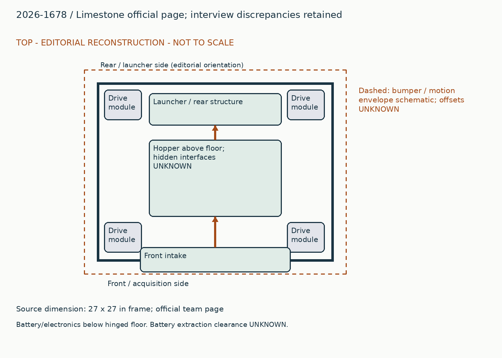
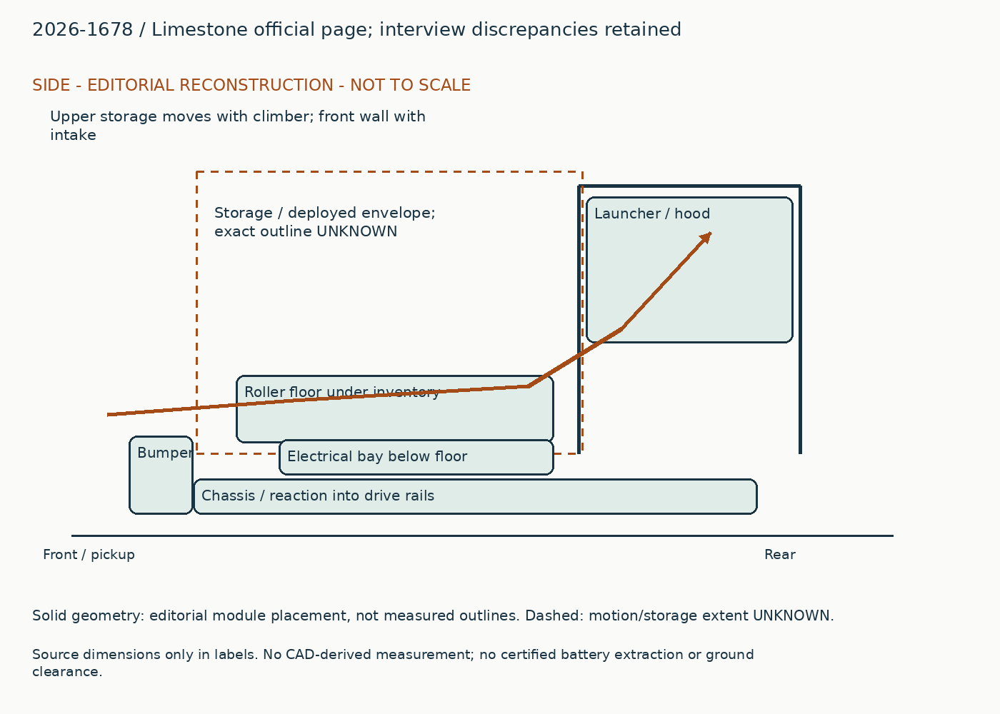
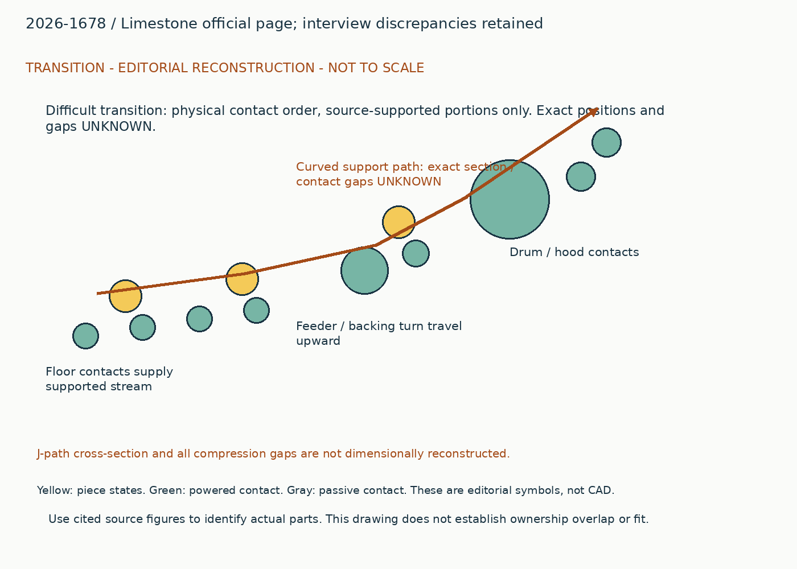
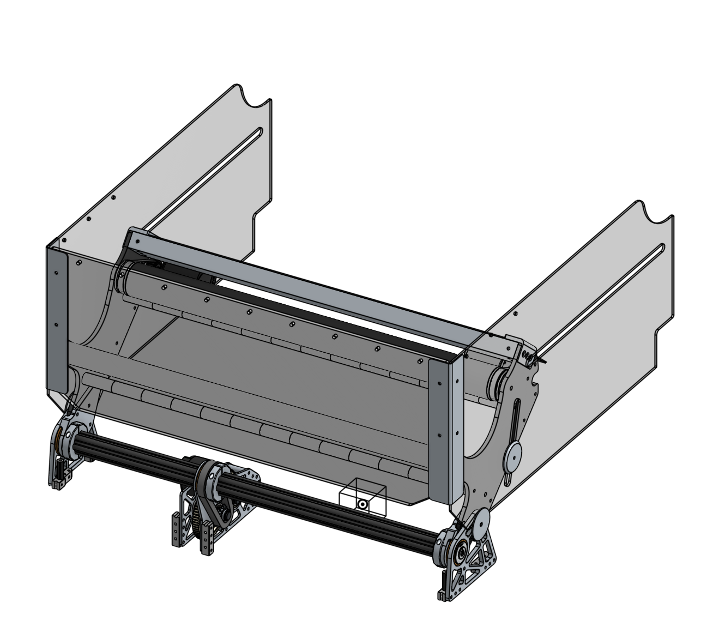
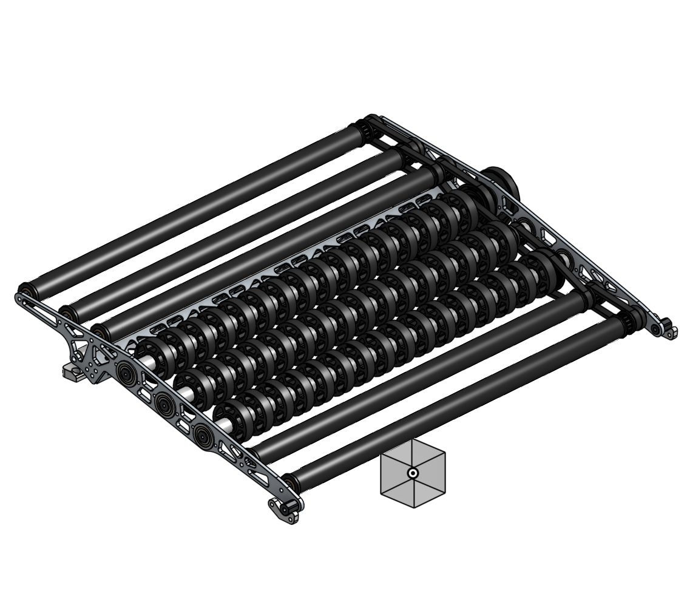
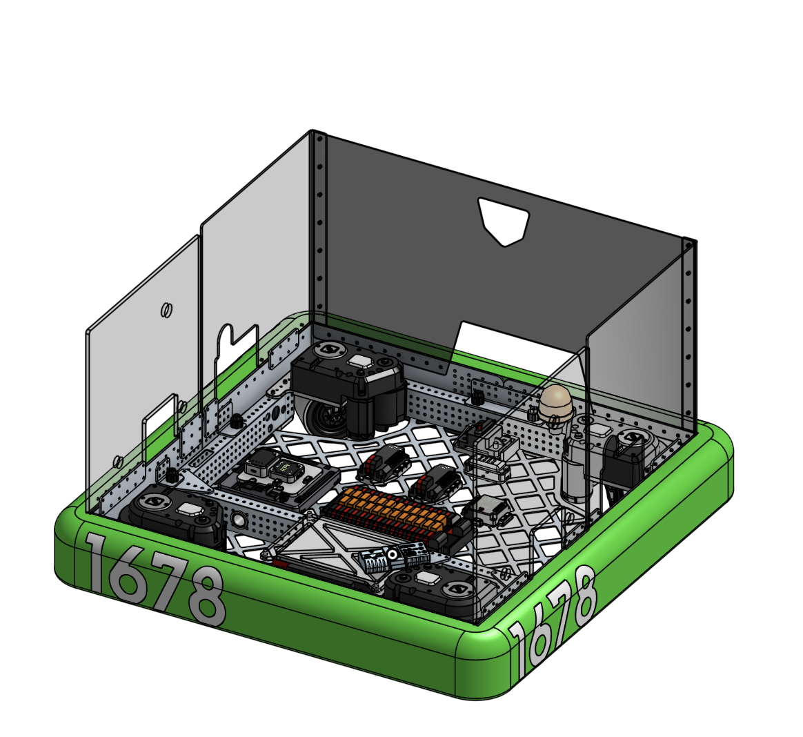
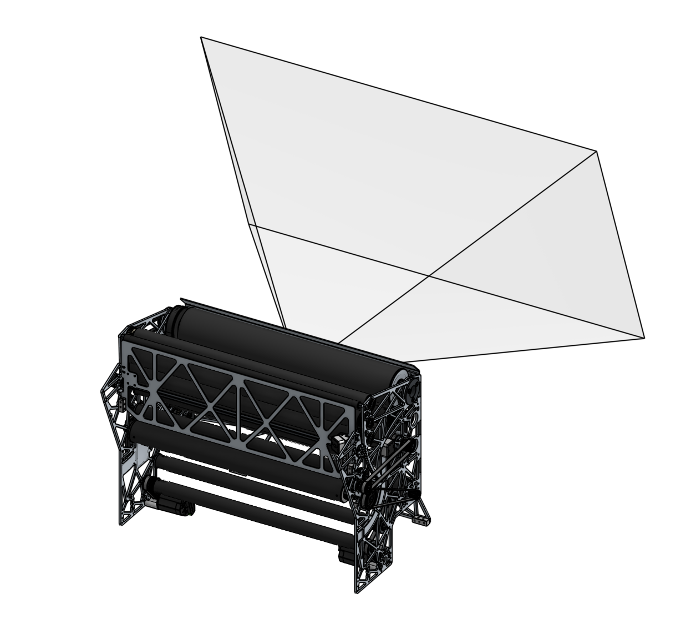
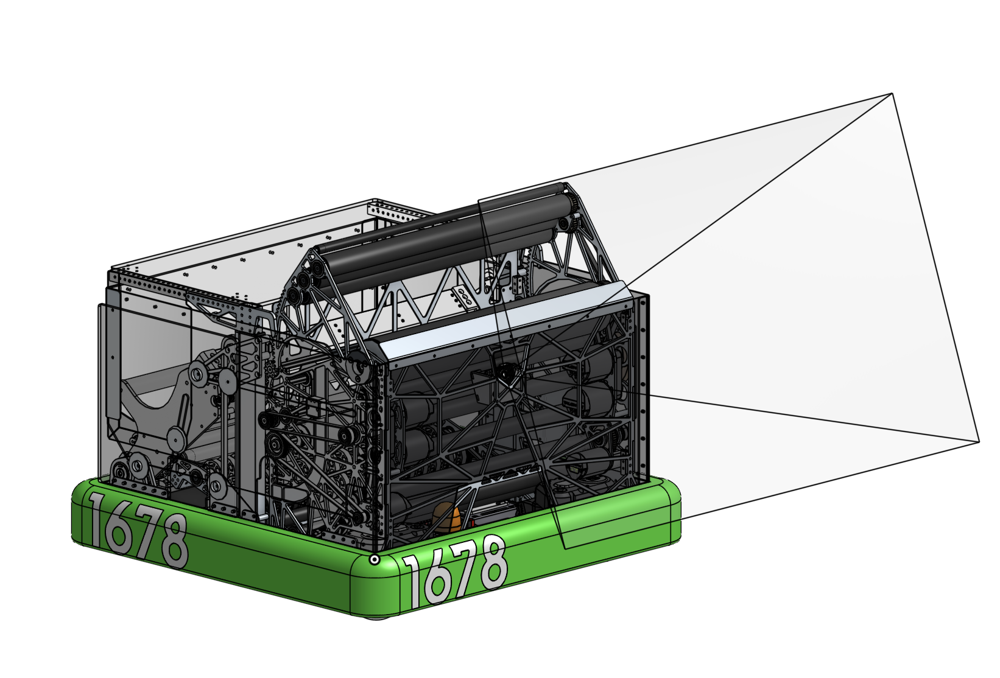

# 2026-1678: Limestone official page; interview discrepancies retained

Generated from `data/physical_studies.jsonl`; edit that authoritative record.

## Whole robot and packaging

A front collector and horizontally sliding wall feed a broad floor inside a square drivebase. The launcher stands across the rear; the floor hinges upward from its rear attachment to expose the electrical bay beneath. Intake-end floor supports rest on module-mounted hard stops and a retaining pin prevents unintended lifting. The hopper grows horizontally with the intake and vertically with a climber-linked upper enclosure. The whole render establishes the front-to-rear arrangement but does not establish every swept clearance. The battery and electronics are low, below the transport floor; the inspected electrical render shows component placement with the floor removed, not a complete battery-change sequence.

## Piece flow

Fuel enters the front rollers, passes over the collector pivot and onto a floor with tube rollers and flex-wheel rollers. The floor feeds a curved tunnel, which turns travel upward toward the drum. Feeder, accelerating backing contacts, drum and hood share responsibility for the final entry state. The earlier interview calls the later path J-shaped and reports abandoning an S path; the new page is a separate publication snapshot. It names a different drum material from the retained interview, so do not fuse both descriptions into one certified build.

## Annotated views

Editorial reconstruction. Not to scale; only explicit dimension labels are source dimensions. No CAD-derived measurements. Dashed envelopes are schematic and not clearance certification.

## Protected roller and post-acquisition guides

### Published construction

The retained account describes a carbon roller behind an aluminum crash member. The inspected team CAD render shows the collector transmission, deployment hardware and slotted hopper side plates.

### Team rationale / attribution boundary

Read cited historical note for team rationale; the operating reconstruction below is editorial and does not establish additional team intent.

### Editorial operating reconstruction

The main powered contact lifts fuel inward; downstream guides must stop it from touching the pickup roller again. Opening the collector also moves the hopper wall, so successful deployment is a prerequisite for the intended acquisition volume.

### Engineering interpretation

A crash member needs to intercept the expected collision before a fragile roller does. Its position relative to the ground mouth is therefore as important as its section. A guard that is too low could push fuel away; a guard too far behind the roller could fail to protect it.

### Transfer and compatibility limits

Transfer the protection and supported bumper crossing together. Do not copy lightweight roller construction without the protective load path.

### Unknowns

Exact crash deflection, ground clearance, compression and stage-specific source chronology remain unresolved.

### Proposed validation, not performed

First inspect the missing source interface or CAD; only then test the specific capture/transfer failure that could change the architecture. No hardware experiment was performed in this upgrade.

Figure `physical-1678-intake`. [Source](https://www.citruscircuits.org/2026-robot). Published CAD render, not certified as a particular event installation; hidden geometry and scale unresolved.

### Evidence coverage

| Evidence | State | Reason |
|---|---|---|
| synopsis | supported | Identified function and exact source snapshot retained. |
| construction | supported | Selected contacts and drives explained; no fabrication completeness claimed. |
| operating_sequence | partial | Editorial sequence identifies a physical route; sensing/recovery and hidden transitions remain unresolved. |
| interfaces | partial | Physical dependency explained; not a dimensionally certified interface. |
| packaging | partial | Annotated source-bounded schematic, not scaled CAD. |
| useful_image_inspected | supported | Referenced source figures visually inspected for the stated visible feature; hidden geometry unresolved. |
| parameters | partial | See selected robot parameters and version labels; complete dimensions, loads and operating conditions unavailable. |
| version | partial | Publication snapshot established, exact per-event installation unknown. |
| source_locator | supported | Existing note IDs retain page/time locators; new URLs retain section or post references. |
| remaining_unknowns | supported | Explicit evidence gap; does not assert absent hardware. |

## Hinged mixed-contact floor and service access

### Published construction

The official page specifies five 1-inch tube rollers and three 2-inch flex-wheel rollers. It gives floor reductions of 1.5:1 and 3:1 respectively and describes pivot-up electrical access.

### Team rationale / attribution boundary

Read cited historical note for team rationale; the operating reconstruction below is editorial and does not establish additional team intent.

### Editorial operating reconstruction

The floor receives fuel at the intake edge, advances it through the steeper wheel region, and supplies the rear tunnel. For maintenance, release the retainer and pivot the floor upward rather than dismantling the launcher.

### Engineering interpretation

Different shaft speeds can yield the same nominal surface speed when diameter doubles. That is a useful check, not a measured ball-speed result: under the usual reduction convention, 1/1.5 equals 2/3. Slip, grip and compression can still differ. This arrangement also keeps electrical service space out of the operating inventory path.

### Transfer and compatibility limits

Borrow the mixed contact sequence with its diameter/speed relationship and access hinge. Recheck pinch regions, hinge supports and harness slack under the new arrangement.

### Unknowns

Driver/driven convention, loaded speeds, hinge cable slack and battery extraction clearance need CAD or source confirmation.

### Proposed validation, not performed

First inspect the missing source interface or CAD; only then test the specific capture/transfer failure that could change the architecture. No hardware experiment was performed in this upgrade.

Figure `physical-1678-floor`. [Source](https://www.citruscircuits.org/2026-robot). Published CAD render, not certified as a particular event installation; hidden geometry and scale unresolved.

Figure `physical-1678-electrical`. [Source](https://www.citruscircuits.org/2026-robot). Published CAD render, not certified as a particular event installation; hidden geometry and scale unresolved.

### Evidence coverage

| Evidence | State | Reason |
|---|---|---|
| synopsis | supported | Identified function and exact source snapshot retained. |
| construction | supported | Selected contacts and drives explained; no fabrication completeness claimed. |
| operating_sequence | partial | Editorial sequence identifies a physical route; sensing/recovery and hidden transitions remain unresolved. |
| interfaces | partial | Physical dependency explained; not a dimensionally certified interface. |
| packaging | partial | Annotated source-bounded schematic, not scaled CAD. |
| useful_image_inspected | supported | Referenced source figures visually inspected for the stated visible feature; hidden geometry unresolved. |
| parameters | partial | See selected robot parameters and version labels; complete dimensions, loads and operating conditions unavailable. |
| version | partial | Publication snapshot established, exact per-event installation unknown. |
| source_locator | supported | Existing note IDs retain page/time locators; new URLs retain section or post references. |
| remaining_unknowns | supported | Explicit evidence gap; does not assert absent hardware. |

## J-path feed, drum and independently supported hood

### Published construction

The interview describes a separate feeder and independently supported hood pivot. The official page specifies a 3.5-inch aluminum drum and a 25-inch spacing between shooter side plates; it describes a 2-inch feeder and 1.25-inch backing contacts.

### Team rationale / attribution boundary

Read cited historical note for team rationale; the operating reconstruction below is editorial and does not establish additional team intent.

### Editorial operating reconstruction

Floor delivery enters the rising curve; successive powered surfaces accelerate it before the drum/hood release. Hood adjustment changes launch geometry while feed remains aligned with the entry.

### Engineering interpretation

A gradual turn can avoid undoing upstream velocity, but only if piece support and compression persist around the curve. Independent hood support keeps hood loads from depending entirely on drum bearings; it does not make drum-to-hood clearance constant automatically.

### Transfer and compatibility limits

Transfer continuous supported acceleration and independent hood structure. The new hood range, power and stiffness must preserve the same feed constraint; no turret is required for those features.

### Unknowns

Material conflict: retained interview says steel; official page says aluminum. Exact revision, compression over hood travel and live electrical budget are unresolved.

### Proposed validation, not performed

First inspect the missing source interface or CAD; only then test the specific capture/transfer failure that could change the architecture. No hardware experiment was performed in this upgrade.

Figure `physical-1678-shooter`. [Source](https://www.citruscircuits.org/2026-robot). Published CAD render, not certified as a particular event installation; hidden geometry and scale unresolved.

### Evidence coverage

| Evidence | State | Reason |
|---|---|---|
| synopsis | supported | Identified function and exact source snapshot retained. |
| construction | supported | Selected contacts and drives explained; no fabrication completeness claimed. |
| operating_sequence | partial | Editorial sequence identifies a physical route; sensing/recovery and hidden transitions remain unresolved. |
| interfaces | partial | Physical dependency explained; not a dimensionally certified interface. |
| packaging | partial | Annotated source-bounded schematic, not scaled CAD. |
| useful_image_inspected | supported | Referenced source figures visually inspected for the stated visible feature; hidden geometry unresolved. |
| parameters | partial | See selected robot parameters and version labels; complete dimensions, loads and operating conditions unavailable. |
| version | partial | Publication snapshot established, exact per-event installation unknown. |
| source_locator | supported | Existing note IDs retain page/time locators; new URLs retain section or post references. |
| remaining_unknowns | supported | Explicit evidence gap; does not assert absent hardware. |

## Horizontal storage tied to intake, vertical storage tied to climb

### Published construction

The official page describes slotted sliding side panels and a separate vertical extension tied to the climber. Inspected renders show both panel overlap and tall rear structure.

### Team rationale / attribution boundary

Read cited historical note for team rationale; the operating reconstruction below is editorial and does not establish additional team intent.

### Editorial operating reconstruction

Collector deployment draws the lower wall outward; the upper enclosure changes height through the separate lift. Containment must remain continuous where those motions meet.

### Engineering interpretation

These are two degrees of storage change, not one generic expanding hopper. A substitute fixed roof may remove vertical motion but also reduce volume and change retention. Low-fill evacuation depends on where the floor remains exposed after retraction.

### Transfer and compatibility limits

Horizontal storage can transfer independently only after separating the vertical enclosure support. A climber-linked roof cannot be removed without redesigning its support and retention.

### Unknowns

Loaded capacity, exact mesh management and motion interlocks are not established. No climb load path is certified by the storage drawing.

### Proposed validation, not performed

First inspect the missing source interface or CAD; only then test the specific capture/transfer failure that could change the architecture. No hardware experiment was performed in this upgrade.

Figure `physical-1678-intake`. [Source](https://www.citruscircuits.org/2026-robot). Published CAD render, not certified as a particular event installation; hidden geometry and scale unresolved.

Figure `physical-1678-whole`. [Source](https://www.citruscircuits.org/2026-robot). Published CAD render, not certified as a particular event installation; hidden geometry and scale unresolved.

### Evidence coverage

| Evidence | State | Reason |
|---|---|---|
| synopsis | supported | Identified function and exact source snapshot retained. |
| construction | supported | Selected contacts and drives explained; no fabrication completeness claimed. |
| operating_sequence | partial | Editorial sequence identifies a physical route; sensing/recovery and hidden transitions remain unresolved. |
| interfaces | partial | Physical dependency explained; not a dimensionally certified interface. |
| packaging | partial | Annotated source-bounded schematic, not scaled CAD. |
| useful_image_inspected | supported | Referenced source figures visually inspected for the stated visible feature; hidden geometry unresolved. |
| parameters | partial | See selected robot parameters and version labels; complete dimensions, loads and operating conditions unavailable. |
| version | partial | Publication snapshot established, exact per-event installation unknown. |
| source_locator | supported | Existing note IDs retain page/time locators; new URLs retain section or post references. |
| remaining_unknowns | supported | Explicit evidence gap; does not assert absent hardware. |

## Interface records

### physical-2026-1678-intake-output

| Field | State | Value / limitation |
|---|---|---|
| piece | supported | fuel_2026. Original game and piece; no cross-year equivalence implied. |
| orientation | partial | captured fuel crossing intake pivot. Post-pickup guides prevent recontact with main roller; missing support gap dimension. |
| direction | partial | front to rear. Qualitative path only; local coordinate transform not measured. |
| entry_exit_height | unknown | Unknown. No local datum or source dimension recovered. |
| effective_feed_width | unknown | Unknown. Overall chassis / plate spacing is not usable contact width. |
| velocity | unknown | Unknown. No measured interface velocity under stated load. |
| compression | unknown | Unknown. Contact gap not established at this port. |
| ownership_readiness | partial | Post-pickup guides prevent recontact with main roller; missing support gap dimension.. Must verify sensor definitions, delays, timeout, reversal and release authority. |
| occupied_swept_space | partial | A front collector and horizontally sliding wall feed a broad floor inside a square drivebase. The launcher stands across the rear; the floor hinges upward from its rear attachment to expose the electrical bay beneath. Intake-end floor supports rest on module-mounted hard stops and a retaining pin prevents unintended lifting. The hopper grows horizontally with the intake and vertically with a climber-linked upper enclosure. The whole render establishes the front-to-rear arrangement but does not establish every swept clearance. The battery and electronics are low, below the transport floor; the inspected electrical render shows component placement with the floor removed, not a complete battery-change sequence.. Layout is editorial; dimensions and interfering motions unverified. |
| structural_loads | partial | A crash member needs to intercept the expected collision before a fragile roller does. Its position relative to the ground mouth is therefore as important as its section. A guard that is too low could push fuel away; a guard too far behind the roller could fail to protect it.. Load path described without verified force magnitudes or attachment sizing. |
| electrical_simultaneity | unknown | Unknown. Motor counts do not establish bus voltage, current limits or simultaneous duty. |
| jam_recovery_service | partial | Exact crash deflection, ground clearance, compression and stage-specific source chronology remain unresolved.. Exact powered-off recovery and disassembly order unresolved. |

Transfer the protection and supported bumper crossing together. Do not copy lightweight roller construction without the protective load path.

### physical-2026-1678-floor-input

| Field | State | Value / limitation |
|---|---|---|
| piece | supported | fuel_2026. Original game and piece; no cross-year equivalence implied. |
| orientation | partial | fuel across pivot into low floor. Crossing must clear the collector pivot while supporting fuel. |
| direction | partial | front to rear. Qualitative path only; local coordinate transform not measured. |
| entry_exit_height | unknown | Unknown. No local datum or source dimension recovered. |
| effective_feed_width | unknown | Unknown. Overall chassis / plate spacing is not usable contact width. |
| velocity | unknown | Unknown. No measured interface velocity under stated load. |
| compression | unknown | Unknown. Contact gap not established at this port. |
| ownership_readiness | partial | Crossing must clear the collector pivot while supporting fuel.. Must verify sensor definitions, delays, timeout, reversal and release authority. |
| occupied_swept_space | partial | A front collector and horizontally sliding wall feed a broad floor inside a square drivebase. The launcher stands across the rear; the floor hinges upward from its rear attachment to expose the electrical bay beneath. Intake-end floor supports rest on module-mounted hard stops and a retaining pin prevents unintended lifting. The hopper grows horizontally with the intake and vertically with a climber-linked upper enclosure. The whole render establishes the front-to-rear arrangement but does not establish every swept clearance. The battery and electronics are low, below the transport floor; the inspected electrical render shows component placement with the floor removed, not a complete battery-change sequence.. Layout is editorial; dimensions and interfering motions unverified. |
| structural_loads | partial | Different shaft speeds can yield the same nominal surface speed when diameter doubles. That is a useful check, not a measured ball-speed result: under the usual reduction convention, 1/1.5 equals 2/3. Slip, grip and compression can still differ. This arrangement also keeps electrical service space out of the operating inventory path.. Load path described without verified force magnitudes or attachment sizing. |
| electrical_simultaneity | unknown | Unknown. Motor counts do not establish bus voltage, current limits or simultaneous duty. |
| jam_recovery_service | partial | Driver/driven convention, loaded speeds, hinge cable slack and battery extraction clearance need CAD or source confirmation.. Exact powered-off recovery and disassembly order unresolved. |

Borrow the mixed contact sequence with its diameter/speed relationship and access hinge. Recheck pinch regions, hinge supports and harness slack under the new arrangement.

### physical-2026-1678-floor-output

| Field | State | Value / limitation |
|---|---|---|
| piece | supported | fuel_2026. Original game and piece; no cross-year equivalence implied. |
| orientation | partial | wide floor supply to curved tunnel. Mixed roller surface speed relationship is a check, not a measured exit velocity. |
| direction | partial | rearward into upward turn. Qualitative path only; local coordinate transform not measured. |
| entry_exit_height | unknown | Unknown. No local datum or source dimension recovered. |
| effective_feed_width | unknown | Unknown. Overall chassis / plate spacing is not usable contact width. |
| velocity | unknown | Unknown. No measured interface velocity under stated load. |
| compression | unknown | Unknown. Contact gap not established at this port. |
| ownership_readiness | partial | Mixed roller surface speed relationship is a check, not a measured exit velocity.. Must verify sensor definitions, delays, timeout, reversal and release authority. |
| occupied_swept_space | partial | A front collector and horizontally sliding wall feed a broad floor inside a square drivebase. The launcher stands across the rear; the floor hinges upward from its rear attachment to expose the electrical bay beneath. Intake-end floor supports rest on module-mounted hard stops and a retaining pin prevents unintended lifting. The hopper grows horizontally with the intake and vertically with a climber-linked upper enclosure. The whole render establishes the front-to-rear arrangement but does not establish every swept clearance. The battery and electronics are low, below the transport floor; the inspected electrical render shows component placement with the floor removed, not a complete battery-change sequence.. Layout is editorial; dimensions and interfering motions unverified. |
| structural_loads | partial | Different shaft speeds can yield the same nominal surface speed when diameter doubles. That is a useful check, not a measured ball-speed result: under the usual reduction convention, 1/1.5 equals 2/3. Slip, grip and compression can still differ. This arrangement also keeps electrical service space out of the operating inventory path.. Load path described without verified force magnitudes or attachment sizing. |
| electrical_simultaneity | unknown | Unknown. Motor counts do not establish bus voltage, current limits or simultaneous duty. |
| jam_recovery_service | partial | Driver/driven convention, loaded speeds, hinge cable slack and battery extraction clearance need CAD or source confirmation.. Exact powered-off recovery and disassembly order unresolved. |

Borrow the mixed contact sequence with its diameter/speed relationship and access hinge. Recheck pinch regions, hinge supports and harness slack under the new arrangement.

### physical-2026-1678-tunnel-input

| Field | State | Value / limitation |
|---|---|---|
| piece | supported | fuel_2026. Original game and piece; no cross-year equivalence implied. |
| orientation | partial | fuel entering supported accelerating curve. 25-inch side-plate spacing is not a certified useful feed width. |
| direction | partial | turn toward vertical. Qualitative path only; local coordinate transform not measured. |
| entry_exit_height | unknown | Unknown. No local datum or source dimension recovered. |
| effective_feed_width | unknown | Unknown. Overall chassis / plate spacing is not usable contact width. |
| velocity | unknown | Unknown. No measured interface velocity under stated load. |
| compression | unknown | Unknown. Contact gap not established at this port. |
| ownership_readiness | partial | 25-inch side-plate spacing is not a certified useful feed width.. Must verify sensor definitions, delays, timeout, reversal and release authority. |
| occupied_swept_space | partial | A front collector and horizontally sliding wall feed a broad floor inside a square drivebase. The launcher stands across the rear; the floor hinges upward from its rear attachment to expose the electrical bay beneath. Intake-end floor supports rest on module-mounted hard stops and a retaining pin prevents unintended lifting. The hopper grows horizontally with the intake and vertically with a climber-linked upper enclosure. The whole render establishes the front-to-rear arrangement but does not establish every swept clearance. The battery and electronics are low, below the transport floor; the inspected electrical render shows component placement with the floor removed, not a complete battery-change sequence.. Layout is editorial; dimensions and interfering motions unverified. |
| structural_loads | partial | A gradual turn can avoid undoing upstream velocity, but only if piece support and compression persist around the curve. Independent hood support keeps hood loads from depending entirely on drum bearings; it does not make drum-to-hood clearance constant automatically.. Load path described without verified force magnitudes or attachment sizing. |
| electrical_simultaneity | unknown | Unknown. Motor counts do not establish bus voltage, current limits or simultaneous duty. |
| jam_recovery_service | partial | Material conflict: retained interview says steel; official page says aluminum. Exact revision, compression over hood travel and live electrical budget are unresolved.. Exact powered-off recovery and disassembly order unresolved. |

Transfer continuous supported acceleration and independent hood structure. The new hood range, power and stiffness must preserve the same feed constraint; no turret is required for those features.

## Remaining whole-robot gaps

- J-path cross-section and all compression gaps are not dimensionally reconstructed.
- Current official page and earlier interview are not an audited season revision history.
- Vertical extension used for storage is not evidence of a validated suspended robot load path.

## Sources

- https://www.youtube.com/watch?v=wsAJGi3yxSk
- https://www.citruscircuits.org/2026-robot
