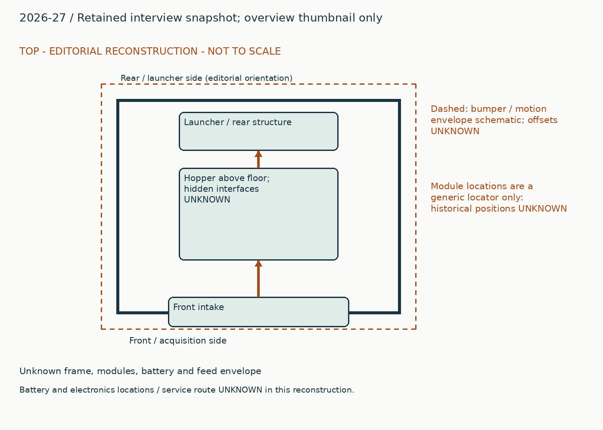
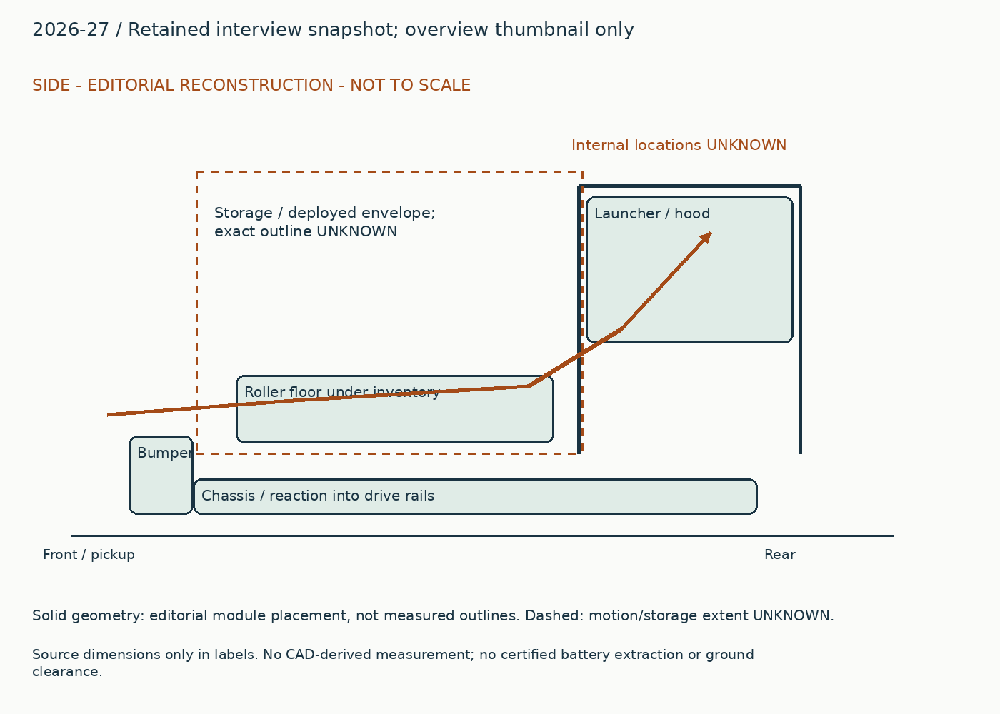
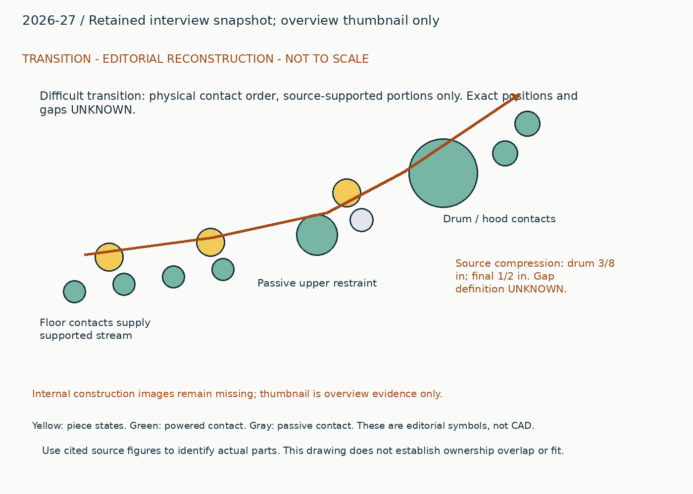
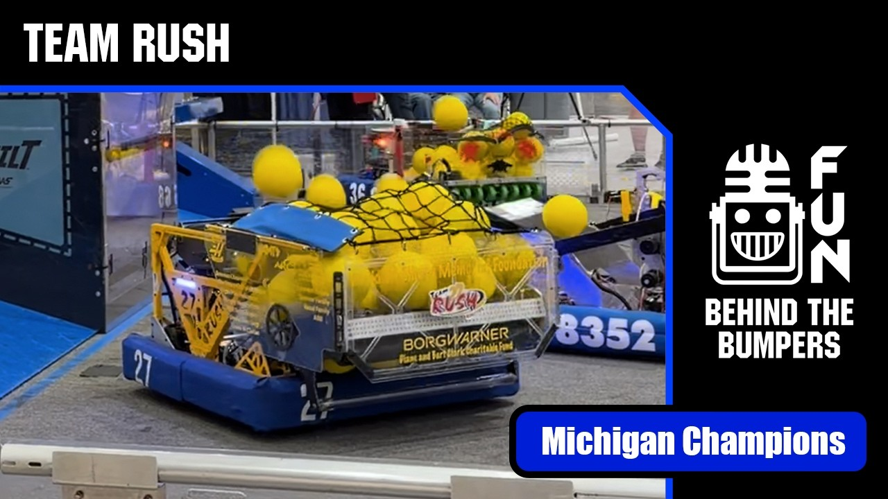

# 2026-27: Retained interview snapshot; overview thumbnail only

Generated from `data/physical_studies.jsonl`; edit that authoritative record.

## Whole robot and packaging

The retained interview describes an intake, roller floor and replacement drum shooter constrained by the existing chassis. The newly inspected publisher thumbnail establishes the exterior hopper walls, top mesh and exposed upper roller area on the numbered robot. It cannot establish the internal feed geometry. The side reconstruction below therefore shows only a functional contact order from the interview, with all distances, bumper crossing and module/electronics locations marked unknown. This is an honest partial reconstruction rather than a measured robot layout.

## Piece flow

The intake sends fuel to a roller floor. Upstream contacts accelerate it toward a 3-inch steel drum with powered hood rollers. The upper restraint became passive after its powered form drove balls downward into jams. Reported compression differs between drum and final roller; those values describe the retrofit contact regions, not universal spacing recommendations.

## Annotated views

Editorial reconstruction. Not to scale; only explicit dimension labels are source dimensions. No CAD-derived measurements. Dashed envelopes are schematic and not clearance certification.

## Intake drive, floor and agitation ownership

### Published construction

The retained interview reports two X44 intake motors at 2.5:1 and a floor transmission labeled 17:19.

### Team rationale / attribution boundary

Read cited historical note for team rationale; the operating reconstruction below is editorial and does not establish additional team intent.

### Editorial operating reconstruction

Acquire into the hopper, then use floor transport to supply the replacement shooter. Intake deployment and automatic shooting agitation compete in a command priority hierarchy.

### Engineering interpretation

A control system must decide which command owns deploy motion. Simultaneous desired actions cannot be assumed to occur independently just because they appear in different subsystem lists.

### Transfer and compatibility limits

Transfer the command-ownership requirement. Preserve ambiguous 17:19 notation until driver and driven are established; the thumbnail does not establish the transmission.

### Unknowns

Ratio direction, floor roller dimensions, sensor mapping and exact command priorities need original code/CAD confirmation.

### Proposed validation, not performed

First inspect the missing source interface or CAD; only then test the specific capture/transfer failure that could change the architecture. No hardware experiment was performed in this upgrade.

Figure `physical-27-overview`. [Source](https://www.youtube.com/watch?v=p9H80uFyuu8). Cannot establish drum material, ratios, internal roller contact, dimensions, or event version.

### Evidence coverage

| Evidence | State | Reason |
|---|---|---|
| synopsis | supported | Identified function and exact source snapshot retained. |
| construction | partial | Selected contacts and drives explained; no fabrication completeness claimed. |
| operating_sequence | partial | Editorial sequence identifies a physical route; sensing/recovery and hidden transitions remain unresolved. |
| interfaces | partial | Physical dependency explained; not a dimensionally certified interface. |
| packaging | partial | Annotated source-bounded schematic, not scaled CAD. |
| useful_image_inspected | partial | Team 27 thumbnail establishes exterior only. |
| parameters | partial | See selected robot parameters and version labels; complete dimensions, loads and operating conditions unavailable. |
| version | partial | Publication snapshot established, exact per-event installation unknown. |
| source_locator | supported | Existing note IDs retain page/time locators; new URLs retain section or post references. |
| remaining_unknowns | supported | Explicit evidence gap; does not assert absent hardware. |

## Passive restraint and stepped-compression retrofit

### Published construction

The interview reports a passive carbon upper restraint, a four-X60 3-inch steel drum, powered hood rollers, 3/8-inch drum-region compression and 1/2-inch final compression.

### Team rationale / attribution boundary

Read cited historical note for team rationale; the operating reconstruction below is editorial and does not establish additional team intent.

### Editorial operating reconstruction

Preaccelerated fuel reaches the drum while the passive upper contact supports/restraints it without actively pushing it downward. Final roller contact increases the reported compression before exit.

### Engineering interpretation

The relevant transfer is a sequence that avoids driving fuel into an occupied region. Changing an active contact to passive alters both velocity and reaction force. A different incoming speed or path length can reverse the benefit of the same nominal compression.

### Transfer and compatibility limits

Use passive versus powered restraint as a design question. Do not fabricate the original cross-section or transplant compression without defining free diameter, compressed gap and support direction.

### Unknowns

No inspected internal detail or video frame supports the contact locations. Compression definition, fuel condition, measured rate and electrical headroom remain unresolved.

### Proposed validation, not performed

First inspect the missing source interface or CAD; only then test the specific capture/transfer failure that could change the architecture. No hardware experiment was performed in this upgrade.

Figure `physical-27-overview`. [Source](https://www.youtube.com/watch?v=p9H80uFyuu8). Cannot establish drum material, ratios, internal roller contact, dimensions, or event version.

### Evidence coverage

| Evidence | State | Reason |
|---|---|---|
| synopsis | supported | Identified function and exact source snapshot retained. |
| construction | partial | Selected contacts and drives explained; no fabrication completeness claimed. |
| operating_sequence | partial | Editorial sequence identifies a physical route; sensing/recovery and hidden transitions remain unresolved. |
| interfaces | partial | Physical dependency explained; not a dimensionally certified interface. |
| packaging | partial | Annotated source-bounded schematic, not scaled CAD. |
| useful_image_inspected | partial | Team 27 thumbnail establishes exterior only. |
| parameters | partial | See selected robot parameters and version labels; complete dimensions, loads and operating conditions unavailable. |
| version | partial | Publication snapshot established, exact per-event installation unknown. |
| source_locator | supported | Existing note IDs retain page/time locators; new URLs retain section or post references. |
| remaining_unknowns | supported | Explicit evidence gap; does not assert absent hardware. |

## Interface records

### physical-2026-27-pickup-floor-output

| Field | State | Value / limitation |
|---|---|---|
| piece | supported | fuel_2026. Original game and piece; no cross-year equivalence implied. |
| orientation | partial | preaccelerated fuel from roller floor. Unverified 17:19 ratio order; no internal frame inspected. |
| direction | partial | toward replacement shooter. Qualitative path only; local coordinate transform not measured. |
| entry_exit_height | unknown | Unknown. No local datum or source dimension recovered. |
| effective_feed_width | unknown | Unknown. Overall chassis / plate spacing is not usable contact width. |
| velocity | unknown | Unknown. No measured interface velocity under stated load. |
| compression | partial | 3/8 in drum region; 1/2 in final region. Reported region values with unresolved compression definition. |
| ownership_readiness | partial | Unverified 17:19 ratio order; no internal frame inspected.. Must verify sensor definitions, delays, timeout, reversal and release authority. |
| occupied_swept_space | partial | The retained interview describes an intake, roller floor and replacement drum shooter constrained by the existing chassis. The newly inspected publisher thumbnail establishes the exterior hopper walls, top mesh and exposed upper roller area on the numbered robot. It cannot establish the internal feed geometry. The side reconstruction below therefore shows only a functional contact order from the interview, with all distances, bumper crossing and module/electronics locations marked unknown. This is an honest partial reconstruction rather than a measured robot layout.. Layout is editorial; dimensions and interfering motions unverified. |
| structural_loads | partial | A control system must decide which command owns deploy motion. Simultaneous desired actions cannot be assumed to occur independently just because they appear in different subsystem lists.. Load path described without verified force magnitudes or attachment sizing. |
| electrical_simultaneity | unknown | Unknown. Motor counts do not establish bus voltage, current limits or simultaneous duty. |
| jam_recovery_service | partial | Ratio direction, floor roller dimensions, sensor mapping and exact command priorities need original code/CAD confirmation.. Exact powered-off recovery and disassembly order unresolved. |

Transfer the command-ownership requirement. Preserve ambiguous 17:19 notation until driver and driven are established; the thumbnail does not establish the transmission.

### physical-2026-27-restraint-launch-input

| Field | State | Value / limitation |
|---|---|---|
| piece | supported | fuel_2026. Original game and piece; no cross-year equivalence implied. |
| orientation | partial | fuel at passive upper restraint. Reported compression depends on unknown gap definition and incoming support. |
| direction | partial | to drum then hood exit. Qualitative path only; local coordinate transform not measured. |
| entry_exit_height | unknown | Unknown. No local datum or source dimension recovered. |
| effective_feed_width | unknown | Unknown. Overall chassis / plate spacing is not usable contact width. |
| velocity | unknown | Unknown. No measured interface velocity under stated load. |
| compression | partial | 3/8 in drum region; 1/2 in final region. Reported region values with unresolved compression definition. |
| ownership_readiness | partial | Reported compression depends on unknown gap definition and incoming support.. Must verify sensor definitions, delays, timeout, reversal and release authority. |
| occupied_swept_space | partial | The retained interview describes an intake, roller floor and replacement drum shooter constrained by the existing chassis. The newly inspected publisher thumbnail establishes the exterior hopper walls, top mesh and exposed upper roller area on the numbered robot. It cannot establish the internal feed geometry. The side reconstruction below therefore shows only a functional contact order from the interview, with all distances, bumper crossing and module/electronics locations marked unknown. This is an honest partial reconstruction rather than a measured robot layout.. Layout is editorial; dimensions and interfering motions unverified. |
| structural_loads | partial | The relevant transfer is a sequence that avoids driving fuel into an occupied region. Changing an active contact to passive alters both velocity and reaction force. A different incoming speed or path length can reverse the benefit of the same nominal compression.. Load path described without verified force magnitudes or attachment sizing. |
| electrical_simultaneity | unknown | Unknown. Motor counts do not establish bus voltage, current limits or simultaneous duty. |
| jam_recovery_service | partial | No inspected internal detail or video frame supports the contact locations. Compression definition, fuel condition, measured rate and electrical headroom remain unresolved.. Exact powered-off recovery and disassembly order unresolved. |

Use passive versus powered restraint as a design question. Do not fabricate the original cross-section or transplant compression without defining free diameter, compressed gap and support direction.

## Remaining whole-robot gaps

- Internal construction images remain missing; thumbnail is overview evidence only.
- No frame, battery, electrical, drive module or feed envelope dimensions were recovered.
- Reported compression and ratios are structured interview claims, not new measurements.

## Sources

- https://www.youtube.com/watch?v=p9H80uFyuu8
