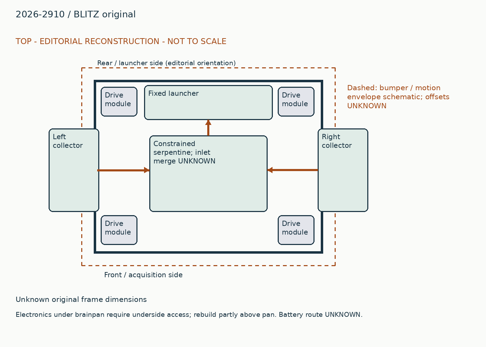
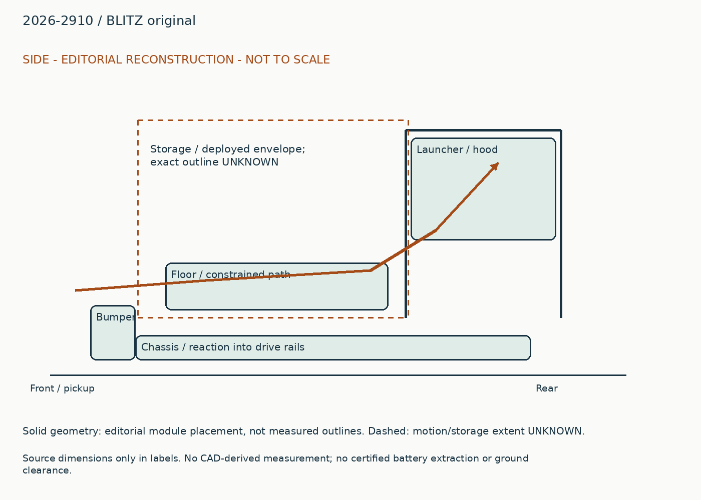
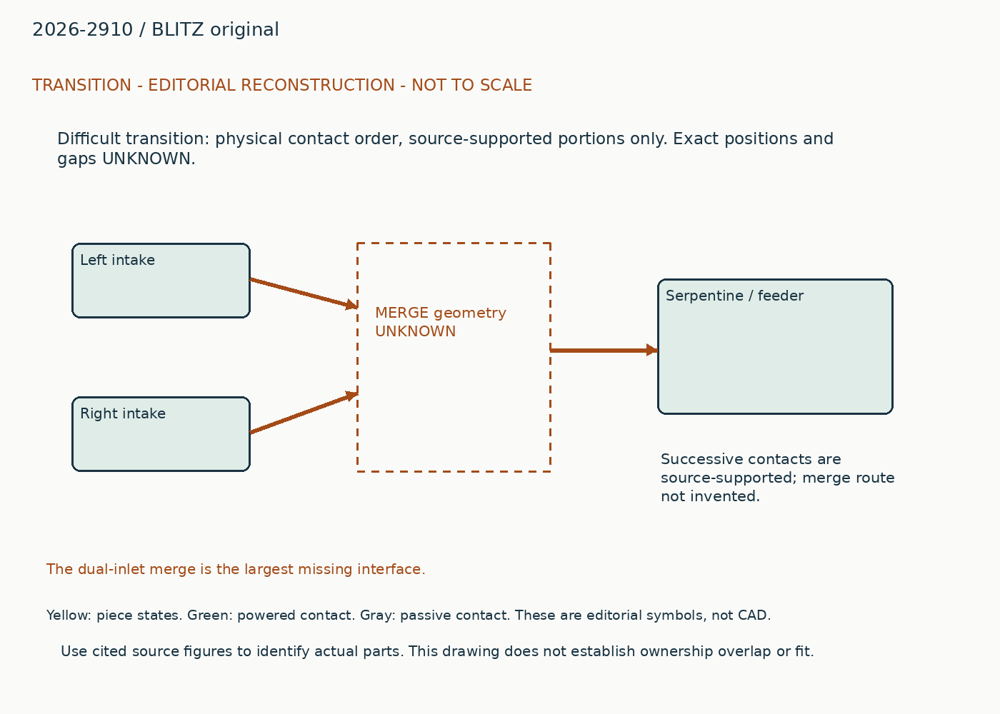
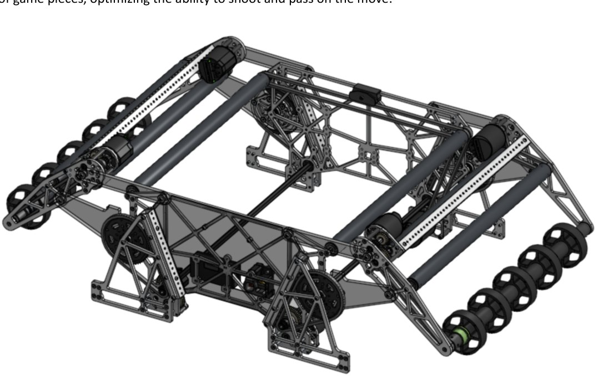
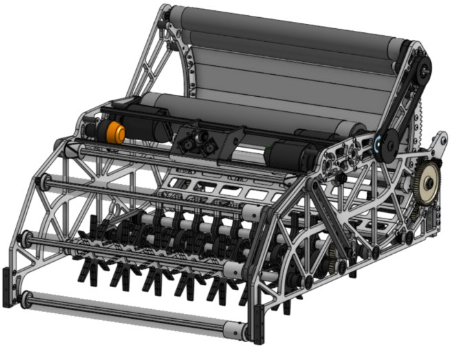

# 2026-2910: BLITZ original

Generated from `data/physical_studies.jsonl`; edit that authoritative record.

## Whole robot and packaging

Two collectors approach the chassis from opposite sides. They feed a constrained serpentine path and a fixed-yaw launcher rather than a deep open bulk hopper. The launcher structure occupies one end of the base, while the four-bar links occupy side deployment space. The binder base image shows four corner drive modules and a lightened pan. Electronics under the pan require turning the robot over and removing its protective belly sheet according to the team release; do not draw those electronics as accessible through the ball path. Battery removal direction is not established. A fixed launcher can aim with the chassis while the side collectors sweep laterally, but that is a control and route advantage, not unrestricted acquisition in every heading.

## Piece flow

Fuel meets either powered collector, crosses its bumper-side transition, enters the constrained conveyor, follows successive direction changes and reaches the feeder/variable-hood launcher. The exact merge of the two intake streams into the serpentine is not reconstructed by the isolated binder renders. Treat that merge as a critical unknown, not a straight connection invented in CAD.

## Annotated views

Editorial reconstruction. Not to scale; only explicit dimension labels are source dimensions. No CAD-derived measurements. Dashed envelopes are schematic and not clearance certification.

## Mirrored four-bar collectors

### Published construction

Separate roller motors turn the exposed collecting surfaces. Deployment motors move multi-link arms; the linkage carries the roller across the frame boundary. The original binder reports X44 deployment at 79.37:1 and X60 roller drives.

### Team rationale / attribution boundary

Read cited historical note for team rationale; the operating reconstruction below is editorial and does not establish additional team intent.

### Editorial operating reconstruction

Deployment sets the mouth outside the bumper; rollers catch fuel from either side and move it inward. The piece must remain supported as it leaves the collector. A collector reaching its angle target is not proof a ball entered the conveyor.

### Engineering interpretation

A four-bar can change roller height and fore-aft position together. Impact accommodation requires the whole linkage, transmission and hard stops to permit the intended motion. A flexible plate alone does not establish a reliable collapse mode. Two mouths also require a merge that does not oppose incoming streams.

### Transfer and compatibility limits

Transfer lateral acquisition only with the merge, support contact and deploy load path. Two-sided collection is not authorization for a partner-dependent passing architecture.

### Unknowns

Exact impact hard-stop geometry, capture sensor, merge gap and roller surface speed remain unknown. Later team replies report original intake fractures and chain faults.

### Proposed validation, not performed

First inspect the missing source interface or CAD; only then test the specific capture/transfer failure that could change the architecture. No hardware experiment was performed in this upgrade.

Figure `binder-75601cba410631181a-p8-1`. [Source](https://drive.google.com/file/d/1jPf-aOGhz0dntoAgahFBgRhJiJv9rGpj/view?usp=sharing#page=8). Visible scope only; hidden geometry, precise dimensions and event installation are not established.

### Evidence coverage

| Evidence | State | Reason |
|---|---|---|
| synopsis | supported | Identified function and exact source snapshot retained. |
| construction | supported | Selected contacts and drives explained; no fabrication completeness claimed. |
| operating_sequence | partial | Editorial sequence identifies a physical route; sensing/recovery and hidden transitions remain unresolved. |
| interfaces | partial | Physical dependency explained; not a dimensionally certified interface. |
| packaging | partial | Annotated source-bounded schematic, not scaled CAD. |
| useful_image_inspected | supported | Referenced source figures visually inspected for the stated visible feature; hidden geometry unresolved. |
| parameters | partial | See selected robot parameters and version labels; complete dimensions, loads and operating conditions unavailable. |
| version | partial | Publication snapshot established, exact per-event installation unknown. |
| source_locator | supported | Existing note IDs retain page/time locators; new URLs retain section or post references. |
| remaining_unknowns | supported | Explicit evidence gap; does not assert absent hardware. |

## Constrained inventory, feeder and fixed launcher

### Published construction

The binder depicts multiple successive powered contacts below the elevated launcher and a variable hood; two X60 feeder motors and three X60 launch motors are reported.

### Team rationale / attribution boundary

Read cited historical note for team rationale; the operating reconstruction below is editorial and does not establish additional team intent.

### Editorial operating reconstruction

The conveyor carries fuel through successive bends; feeder delivery must stop when the launcher is not ready. Release leaves the chassis at the hood-defined angle, while chassis yaw provides aim.

### Engineering interpretation

Each bend changes which surface supports the ball. Long controlled paths can preserve ownership but consume inventory volume and create opportunities for drag. A quoted 25-fuel/s feed capability does not demonstrate the complete route can sustain that rate while acquiring and scoring.

### Transfer and compatibility limits

Borrow constrained transport only where its contact history suits the new piece. Keep the original passing hypothesis separate from the later bulk-storage redesign.

### Unknowns

Exact routing cross-section, sensors at each bend, reverse sequence and usable retained inventory are unverified.

### Proposed validation, not performed

First inspect the missing source interface or CAD; only then test the specific capture/transfer failure that could change the architecture. No hardware experiment was performed in this upgrade.

Figure `binder-75601cba410631181a-p9-1`. [Source](https://drive.google.com/file/d/1jPf-aOGhz0dntoAgahFBgRhJiJv9rGpj/view?usp=sharing#page=9). Visible scope only; hidden geometry, precise dimensions and event installation are not established.

### Evidence coverage

| Evidence | State | Reason |
|---|---|---|
| synopsis | supported | Identified function and exact source snapshot retained. |
| construction | supported | Selected contacts and drives explained; no fabrication completeness claimed. |
| operating_sequence | partial | Editorial sequence identifies a physical route; sensing/recovery and hidden transitions remain unresolved. |
| interfaces | partial | Physical dependency explained; not a dimensionally certified interface. |
| packaging | partial | Annotated source-bounded schematic, not scaled CAD. |
| useful_image_inspected | supported | Referenced source figures visually inspected for the stated visible feature; hidden geometry unresolved. |
| parameters | partial | See selected robot parameters and version labels; complete dimensions, loads and operating conditions unavailable. |
| version | partial | Publication snapshot established, exact per-event installation unknown. |
| source_locator | supported | Existing note IDs retain page/time locators; new URLs retain section or post references. |
| remaining_unknowns | supported | Explicit evidence gap; does not assert absent hardware. |

## Interface records

### physical-2026-2910-original-collectors-output

| Field | State | Value / limitation |
|---|---|---|
| piece | supported | fuel_2026. Original game and piece; no cross-year equivalence implied. |
| orientation | partial | loose fuel into two-stream merge. Merge must keep both collector streams controlled; merge geometry unknown. |
| direction | partial | inward from opposing sides. Qualitative path only; local coordinate transform not measured. |
| entry_exit_height | unknown | Unknown. No local datum or source dimension recovered. |
| effective_feed_width | unknown | Unknown. Overall chassis / plate spacing is not usable contact width. |
| velocity | unknown | Unknown. No measured interface velocity under stated load. |
| compression | unknown | Unknown. Contact gap not established at this port. |
| ownership_readiness | partial | Merge must keep both collector streams controlled; merge geometry unknown.. Must verify sensor definitions, delays, timeout, reversal and release authority. |
| occupied_swept_space | partial | Two collectors approach the chassis from opposite sides. They feed a constrained serpentine path and a fixed-yaw launcher rather than a deep open bulk hopper. The launcher structure occupies one end of the base, while the four-bar links occupy side deployment space. The binder base image shows four corner drive modules and a lightened pan. Electronics under the pan require turning the robot over and removing its protective belly sheet according to the team release; do not draw those electronics as accessible through the ball path. Battery removal direction is not established. A fixed launcher can aim with the chassis while the side collectors sweep laterally, but that is a control and route advantage, not unrestricted acquisition in every heading.. Layout is editorial; dimensions and interfering motions unverified. |
| structural_loads | partial | A four-bar can change roller height and fore-aft position together. Impact accommodation requires the whole linkage, transmission and hard stops to permit the intended motion. A flexible plate alone does not establish a reliable collapse mode. Two mouths also require a merge that does not oppose incoming streams.. Load path described without verified force magnitudes or attachment sizing. |
| electrical_simultaneity | unknown | Unknown. Motor counts do not establish bus voltage, current limits or simultaneous duty. |
| jam_recovery_service | partial | Exact impact hard-stop geometry, capture sensor, merge gap and roller surface speed remain unknown. Later team replies report original intake fractures and chain faults.. Exact powered-off recovery and disassembly order unresolved. |

Transfer lateral acquisition only with the merge, support contact and deploy load path. Two-sided collection is not authorization for a partner-dependent passing architecture.

### physical-2026-2910-original-serpentine-input

| Field | State | Value / limitation |
|---|---|---|
| piece | supported | fuel_2026. Original game and piece; no cross-year equivalence implied. |
| orientation | partial | fuel admitted to constrained conveyor. No exact merge section available. |
| direction | partial | successive turns. Qualitative path only; local coordinate transform not measured. |
| entry_exit_height | unknown | Unknown. No local datum or source dimension recovered. |
| effective_feed_width | unknown | Unknown. Overall chassis / plate spacing is not usable contact width. |
| velocity | unknown | Unknown. No measured interface velocity under stated load. |
| compression | unknown | Unknown. Contact gap not established at this port. |
| ownership_readiness | partial | No exact merge section available.. Must verify sensor definitions, delays, timeout, reversal and release authority. |
| occupied_swept_space | partial | Two collectors approach the chassis from opposite sides. They feed a constrained serpentine path and a fixed-yaw launcher rather than a deep open bulk hopper. The launcher structure occupies one end of the base, while the four-bar links occupy side deployment space. The binder base image shows four corner drive modules and a lightened pan. Electronics under the pan require turning the robot over and removing its protective belly sheet according to the team release; do not draw those electronics as accessible through the ball path. Battery removal direction is not established. A fixed launcher can aim with the chassis while the side collectors sweep laterally, but that is a control and route advantage, not unrestricted acquisition in every heading.. Layout is editorial; dimensions and interfering motions unverified. |
| structural_loads | partial | Each bend changes which surface supports the ball. Long controlled paths can preserve ownership but consume inventory volume and create opportunities for drag. A quoted 25-fuel/s feed capability does not demonstrate the complete route can sustain that rate while acquiring and scoring.. Load path described without verified force magnitudes or attachment sizing. |
| electrical_simultaneity | unknown | Unknown. Motor counts do not establish bus voltage, current limits or simultaneous duty. |
| jam_recovery_service | partial | Exact routing cross-section, sensors at each bend, reverse sequence and usable retained inventory are unverified.. Exact powered-off recovery and disassembly order unresolved. |

Borrow constrained transport only where its contact history suits the new piece. Keep the original passing hypothesis separate from the later bulk-storage redesign.

## Remaining whole-robot gaps

- The dual-inlet merge is the largest missing interface.
- Battery location, complete power routing, deployed dimensions and exact event chronology are unknown.

## Sources

- https://drive.google.com/file/d/1jPf-aOGhz0dntoAgahFBgRhJiJv9rGpj/view?usp=sharing
