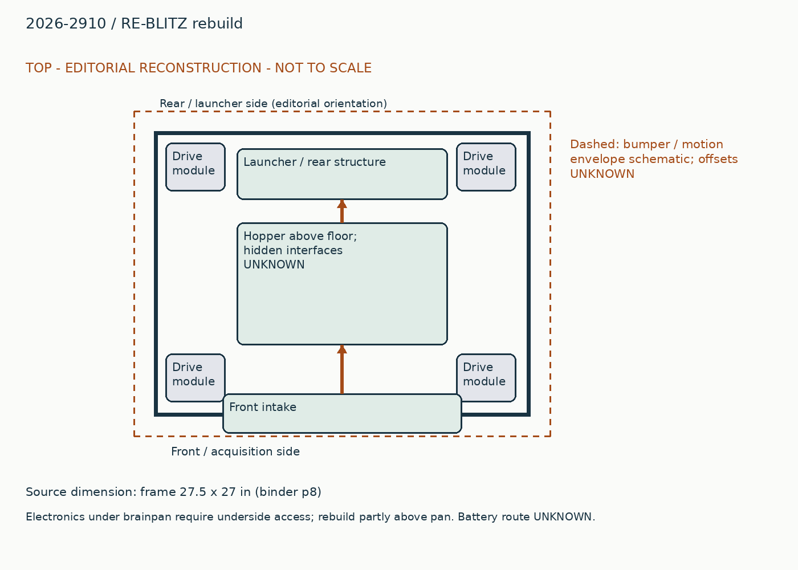
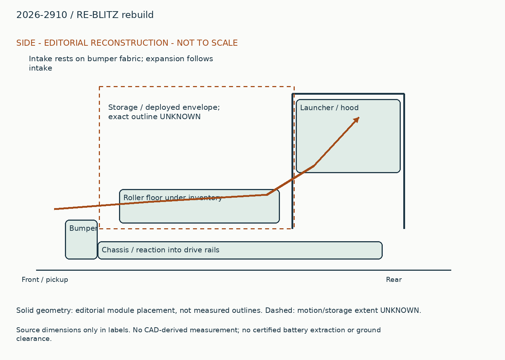
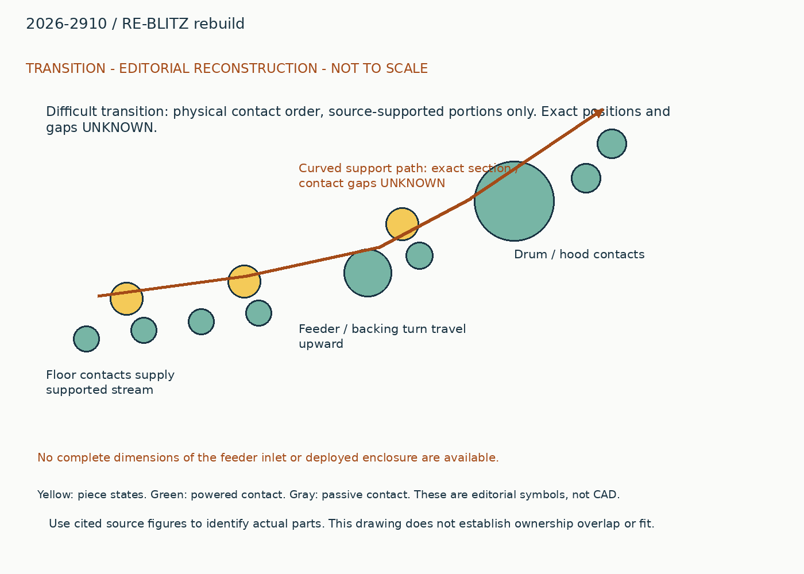
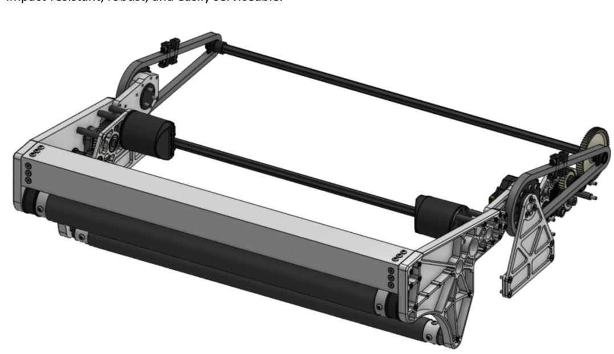
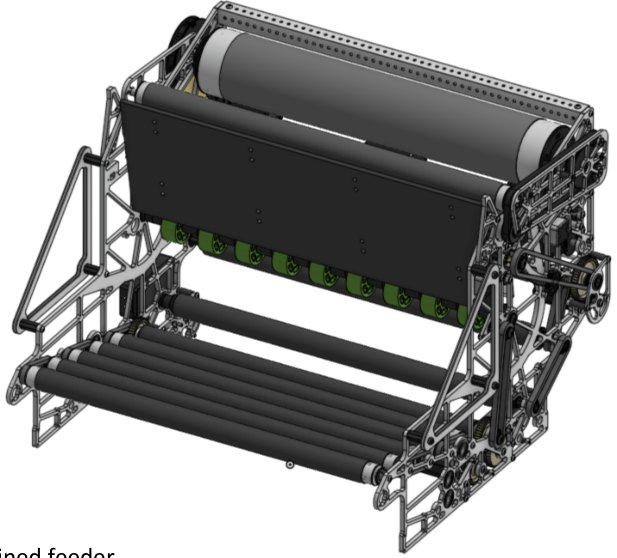
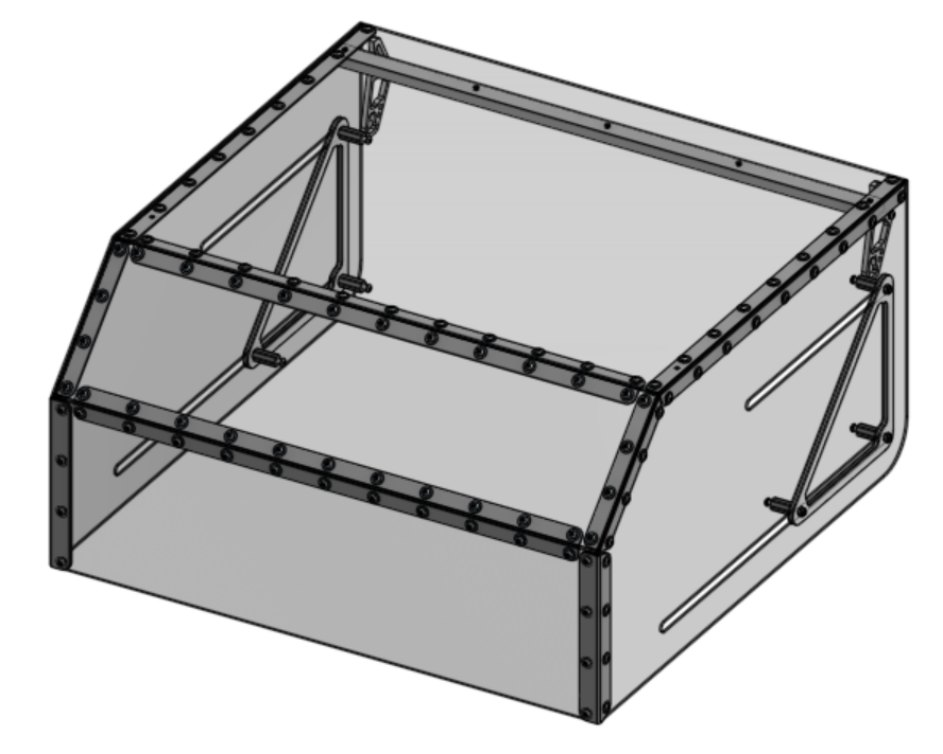

# 2026-2910: RE-BLITZ rebuild

Generated from `data/physical_studies.jsonl`; edit that authoritative record.

## Whole robot and packaging

The rebuild uses a single front slapdown collector, an expanding storage enclosure over an inclined roller floor, and a full-width raised shooter at the opposite end. Corner swerve modules sit below this path; the launcher side structure carries the drum and hood and attaches down toward the drive rails. Source dimensions give a 27.5 by 27-inch frame. The hopper panels and their joints surround the ball path, so screw heads on the hood can rub a sliding wall. A source reply specifically explains using flathead screws there. Some electronics moved above the brainpan, but under-pan equipment still needs underside access. Preserve that service split. Do not infer battery removal without its source view.

## Piece flow

The front collector lifts fuel across the bumper into the expanded hopper. Ten inclined rollers keep a broad stream moving toward the feeder. The backing panel returns piled fuel toward the shooter entry instead of allowing it to remain above the active floor. Feeder contacts lift and accelerate the stream; drum and powered hood contacts launch it. The full path must preserve width, not merely have a wide drum at the end. The same intake motion deploys storage, so acquisition and containment are mechanically coupled.

## Annotated views

Editorial reconstruction. Not to scale; only explicit dimension labels are source dimensions. No CAD-derived measurements. Dashed envelopes are schematic and not clearance certification.

## Impact-bearing collector and bumper stop

### Published construction

A single-pivot arm uses thick plates, #35 deployment chain and powered lower contact. The source reports 2-inch and 1.25-inch rollers and a 40:1 later deployment ratio.

### Team rationale / attribution boundary

Read cited historical note for team rationale; the operating reconstruction below is editorial and does not establish additional team intent.

### Editorial operating reconstruction

Lowering the arm opens the mouth and deploys storage. The leading roller pulls fuel toward the lower powered contact; that contact carries it beyond the bumper into the floor. The team release says the deployed collector rests on bumper fabric.

### Engineering interpretation

Impact loads run through arm, pivot attachment and the deployed stop. Using the bumper as a stop makes fabric thickness and bumper installation part of the collector geometry. A stronger chain cannot correct a mouth held too high by the bumper.

### Transfer and compatibility limits

The powered lower contact and simple arm are independently useful. Retain a deliberate load-bearing stop and check new bumper geometry; copying plate thickness alone does not validate impact survival.

### Unknowns

Roller-floor gap, actual fabric compression and impact load capacity are not measured here.

### Proposed validation, not performed

First inspect the missing source interface or CAD; only then test the specific capture/transfer failure that could change the architecture. No hardware experiment was performed in this upgrade.

Figure `binder-6d8168bcbb62d71a38-p9-1`. [Source](https://drive.google.com/file/d/1r-6zR4afbr_BpeZfWwcM5XL1N74FjScI/view?usp=sharing#page=9). Visible scope only; hidden geometry, precise dimensions and event installation are not established.

### Evidence coverage

| Evidence | State | Reason |
|---|---|---|
| synopsis | supported | Identified function and exact source snapshot retained. |
| construction | supported | Selected contacts and drives explained; no fabrication completeness claimed. |
| operating_sequence | partial | Editorial sequence identifies a physical route; sensing/recovery and hidden transitions remain unresolved. |
| interfaces | partial | Physical dependency explained; not a dimensionally certified interface. |
| packaging | partial | Annotated source-bounded schematic, not scaled CAD. |
| useful_image_inspected | supported | Referenced source figures visually inspected for the stated visible feature; hidden geometry unresolved. |
| parameters | partial | See selected robot parameters and version labels; complete dimensions, loads and operating conditions unavailable. |
| version | partial | Publication snapshot established, exact per-event installation unknown. |
| source_locator | supported | Existing note IDs retain page/time locators; new URLs retain section or post references. |
| remaining_unknowns | supported | Explicit evidence gap; does not assert absent hardware. |

## Broad roller floor and return backing

### Published construction

Ten inclined rollers drive fuel toward a four-motor feeder. A low-friction backing panel redirects loose inventory toward the entry. The team later combined feeder and floor powertrains.

### Team rationale / attribution boundary

Read cited historical note for team rationale; the operating reconstruction below is editorial and does not establish additional team intent.

### Editorial operating reconstruction

A ball can arrive anywhere across the floor; successive rollers push it to the rising feeder. Balls hitting the front backing slide back toward the pickup region. During a pause the system must avoid packing fuel harder into an unavailable launcher.

### Engineering interpretation

The panel changes where gravity returns balls. A rate gain attributed to its addition is evidence of a whole-path bottleneck, not proof that every hopper benefits from the same slope. The rear launcher and front enclosure form one flow volume.

### Transfer and compatibility limits

Preserve width from storage to feeder and inspect low-fill starvation. Different roller floors cannot be joined by matching nominal ball diameter alone.

### Unknowns

Effective lane width, roller gaps, queue depth, compression distribution and reverse command order remain unresolved.

### Proposed validation, not performed

First inspect the missing source interface or CAD; only then test the specific capture/transfer failure that could change the architecture. No hardware experiment was performed in this upgrade.

Figure `binder-6d8168bcbb62d71a38-p10-1`. [Source](https://drive.google.com/file/d/1r-6zR4afbr_BpeZfWwcM5XL1N74FjScI/view?usp=sharing#page=10). Visible scope only; hidden geometry, precise dimensions and event installation are not established.

### Evidence coverage

| Evidence | State | Reason |
|---|---|---|
| synopsis | supported | Identified function and exact source snapshot retained. |
| construction | supported | Selected contacts and drives explained; no fabrication completeness claimed. |
| operating_sequence | partial | Editorial sequence identifies a physical route; sensing/recovery and hidden transitions remain unresolved. |
| interfaces | partial | Physical dependency explained; not a dimensionally certified interface. |
| packaging | partial | Annotated source-bounded schematic, not scaled CAD. |
| useful_image_inspected | supported | Referenced source figures visually inspected for the stated visible feature; hidden geometry unresolved. |
| parameters | partial | See selected robot parameters and version labels; complete dimensions, loads and operating conditions unavailable. |
| version | partial | Publication snapshot established, exact per-event installation unknown. |
| source_locator | supported | Existing note IDs retain page/time locators; new URLs retain section or post references. |
| remaining_unknowns | supported | Explicit evidence gap; does not assert absent hardware. |

## Drum, powered hood and removed-contact trap

### Published construction

The binder reports a 4-inch drum, 1.5-inch hood rollers and an overdriven flywheel. Team release replies identify three apparent internal rollers as stationary backing supports after active contacts were removed.

### Team rationale / attribution boundary

Read cited historical note for team rationale; the operating reconstruction below is editorial and does not establish additional team intent.

### Editorial operating reconstruction

The feeder accelerates incoming fuel before drum and hood set its release state. Readiness gates control permission to feed; wheel-speed recovery and aim matter through the volley.

### Engineering interpretation

A cylindrical shape visible in CAD is not evidence it is powered or even contacts the piece. Extra driven contacts can inject unwanted velocity or compression. Treat the backing supports as supports, not additional feed stages.

### Transfer and compatibility limits

The width-preserving feed and readiness contract can transfer to a chassis-aimed launcher. Do not turn a reported peak into sustained scored throughput.

### Unknowns

Exact event installation of the removed rollers, current traces, loaded accuracy and rate timing windows are not certified.

### Proposed validation, not performed

First inspect the missing source interface or CAD; only then test the specific capture/transfer failure that could change the architecture. No hardware experiment was performed in this upgrade.

Figure `binder-6d8168bcbb62d71a38-p10-1`. [Source](https://drive.google.com/file/d/1r-6zR4afbr_BpeZfWwcM5XL1N74FjScI/view?usp=sharing#page=10). Visible scope only; hidden geometry, precise dimensions and event installation are not established.

### Evidence coverage

| Evidence | State | Reason |
|---|---|---|
| synopsis | supported | Identified function and exact source snapshot retained. |
| construction | supported | Selected contacts and drives explained; no fabrication completeness claimed. |
| operating_sequence | partial | Editorial sequence identifies a physical route; sensing/recovery and hidden transitions remain unresolved. |
| interfaces | partial | Physical dependency explained; not a dimensionally certified interface. |
| packaging | partial | Annotated source-bounded schematic, not scaled CAD. |
| useful_image_inspected | supported | Referenced source figures visually inspected for the stated visible feature; hidden geometry unresolved. |
| parameters | partial | See selected robot parameters and version labels; complete dimensions, loads and operating conditions unavailable. |
| version | partial | Publication snapshot established, exact per-event installation unknown. |
| source_locator | supported | Existing note IDs retain page/time locators; new URLs retain section or post references. |
| remaining_unknowns | supported | Explicit evidence gap; does not assert absent hardware. |

## Intake-linked storage and sliding clearances

### Published construction

Expansion follows intake movement; smooth sheet joints and deployed catchers retain inventory.

### Team rationale / attribution boundary

Read cited historical note for team rationale; the operating reconstruction below is editorial and does not establish additional team intent.

### Editorial operating reconstruction

Walls must extend before a large load arrives. Retraction changes the available volume and must not squeeze trapped fuel between overlaps. During service, walls and shooter hardware must clear each other.

### Engineering interpretation

Storage catches and wall supports should react inventory and contact loads rather than continuous deploy motor torque. Sliding clearance includes fastener heads, panel deflection and bumper fit.

### Transfer and compatibility limits

Linking states saves a separate actuator but couples recovery. Transfer only after the new start envelope, wall overlap and loaded retraction are checked.

### Unknowns

Capacity, emptying residual, catch loads and loaded interrupted-deployment behavior remain unknown.

### Proposed validation, not performed

First inspect the missing source interface or CAD; only then test the specific capture/transfer failure that could change the architecture. No hardware experiment was performed in this upgrade.

Figure `binder-6d8168bcbb62d71a38-p11-1`. [Source](https://drive.google.com/file/d/1r-6zR4afbr_BpeZfWwcM5XL1N74FjScI/view?usp=sharing#page=11). Visible scope only; hidden geometry, precise dimensions and event installation are not established.

### Evidence coverage

| Evidence | State | Reason |
|---|---|---|
| synopsis | supported | Identified function and exact source snapshot retained. |
| construction | supported | Selected contacts and drives explained; no fabrication completeness claimed. |
| operating_sequence | partial | Editorial sequence identifies a physical route; sensing/recovery and hidden transitions remain unresolved. |
| interfaces | partial | Physical dependency explained; not a dimensionally certified interface. |
| packaging | partial | Annotated source-bounded schematic, not scaled CAD. |
| useful_image_inspected | supported | Referenced source figures visually inspected for the stated visible feature; hidden geometry unresolved. |
| parameters | partial | See selected robot parameters and version labels; complete dimensions, loads and operating conditions unavailable. |
| version | partial | Publication snapshot established, exact per-event installation unknown. |
| source_locator | supported | Existing note IDs retain page/time locators; new URLs retain section or post references. |
| remaining_unknowns | supported | Explicit evidence gap; does not assert absent hardware. |

## Interface records

### physical-2026-2910-rebuild-slapdown-output

| Field | State | Value / limitation |
|---|---|---|
| piece | supported | fuel_2026. Original game and piece; no cross-year equivalence implied. |
| orientation | partial | fuel across bumper onto broad floor. Deployed stop rests on bumper fabric; effective mouth height depends on bumper installation. |
| direction | partial | front to rear. Qualitative path only; local coordinate transform not measured. |
| entry_exit_height | unknown | Unknown. No local datum or source dimension recovered. |
| effective_feed_width | unknown | Unknown. Overall chassis / plate spacing is not usable contact width. |
| velocity | unknown | Unknown. No measured interface velocity under stated load. |
| compression | unknown | Unknown. Contact gap not established at this port. |
| ownership_readiness | partial | Deployed stop rests on bumper fabric; effective mouth height depends on bumper installation.. Must verify sensor definitions, delays, timeout, reversal and release authority. |
| occupied_swept_space | partial | The rebuild uses a single front slapdown collector, an expanding storage enclosure over an inclined roller floor, and a full-width raised shooter at the opposite end. Corner swerve modules sit below this path; the launcher side structure carries the drum and hood and attaches down toward the drive rails. Source dimensions give a 27.5 by 27-inch frame. The hopper panels and their joints surround the ball path, so screw heads on the hood can rub a sliding wall. A source reply specifically explains using flathead screws there. Some electronics moved above the brainpan, but under-pan equipment still needs underside access. Preserve that service split. Do not infer battery removal without its source view.. Layout is editorial; dimensions and interfering motions unverified. |
| structural_loads | partial | Impact loads run through arm, pivot attachment and the deployed stop. Using the bumper as a stop makes fabric thickness and bumper installation part of the collector geometry. A stronger chain cannot correct a mouth held too high by the bumper.. Load path described without verified force magnitudes or attachment sizing. |
| electrical_simultaneity | unknown | Unknown. Motor counts do not establish bus voltage, current limits or simultaneous duty. |
| jam_recovery_service | partial | Roller-floor gap, actual fabric compression and impact load capacity are not measured here.. Exact powered-off recovery and disassembly order unresolved. |

The powered lower contact and simple arm are independently useful. Retain a deliberate load-bearing stop and check new bumper geometry; copying plate thickness alone does not validate impact survival.

### physical-2026-2910-rebuild-floor-input

| Field | State | Value / limitation |
|---|---|---|
| piece | supported | fuel_2026. Original game and piece; no cross-year equivalence implied. |
| orientation | partial | loose distributed inventory. Match collector exit height and full floor supply width. |
| direction | partial | front to rear. Qualitative path only; local coordinate transform not measured. |
| entry_exit_height | unknown | Unknown. No local datum or source dimension recovered. |
| effective_feed_width | unknown | Unknown. Overall chassis / plate spacing is not usable contact width. |
| velocity | unknown | Unknown. No measured interface velocity under stated load. |
| compression | unknown | Unknown. Contact gap not established at this port. |
| ownership_readiness | partial | Match collector exit height and full floor supply width.. Must verify sensor definitions, delays, timeout, reversal and release authority. |
| occupied_swept_space | partial | The rebuild uses a single front slapdown collector, an expanding storage enclosure over an inclined roller floor, and a full-width raised shooter at the opposite end. Corner swerve modules sit below this path; the launcher side structure carries the drum and hood and attaches down toward the drive rails. Source dimensions give a 27.5 by 27-inch frame. The hopper panels and their joints surround the ball path, so screw heads on the hood can rub a sliding wall. A source reply specifically explains using flathead screws there. Some electronics moved above the brainpan, but under-pan equipment still needs underside access. Preserve that service split. Do not infer battery removal without its source view.. Layout is editorial; dimensions and interfering motions unverified. |
| structural_loads | partial | The panel changes where gravity returns balls. A rate gain attributed to its addition is evidence of a whole-path bottleneck, not proof that every hopper benefits from the same slope. The rear launcher and front enclosure form one flow volume.. Load path described without verified force magnitudes or attachment sizing. |
| electrical_simultaneity | unknown | Unknown. Motor counts do not establish bus voltage, current limits or simultaneous duty. |
| jam_recovery_service | partial | Effective lane width, roller gaps, queue depth, compression distribution and reverse command order remain unresolved.. Exact powered-off recovery and disassembly order unresolved. |

Preserve width from storage to feeder and inspect low-fill starvation. Different roller floors cannot be joined by matching nominal ball diameter alone.

### physical-2026-2910-rebuild-floor-output

| Field | State | Value / limitation |
|---|---|---|
| piece | supported | fuel_2026. Original game and piece; no cross-year equivalence implied. |
| orientation | partial | broad stream toward rising feeder. Backing panel returns pile to feeder; low-fill starvation remains possible. |
| direction | partial | inward then upward. Qualitative path only; local coordinate transform not measured. |
| entry_exit_height | unknown | Unknown. No local datum or source dimension recovered. |
| effective_feed_width | unknown | Unknown. Overall chassis / plate spacing is not usable contact width. |
| velocity | unknown | Unknown. No measured interface velocity under stated load. |
| compression | unknown | Unknown. Contact gap not established at this port. |
| ownership_readiness | partial | Backing panel returns pile to feeder; low-fill starvation remains possible.. Must verify sensor definitions, delays, timeout, reversal and release authority. |
| occupied_swept_space | partial | The rebuild uses a single front slapdown collector, an expanding storage enclosure over an inclined roller floor, and a full-width raised shooter at the opposite end. Corner swerve modules sit below this path; the launcher side structure carries the drum and hood and attaches down toward the drive rails. Source dimensions give a 27.5 by 27-inch frame. The hopper panels and their joints surround the ball path, so screw heads on the hood can rub a sliding wall. A source reply specifically explains using flathead screws there. Some electronics moved above the brainpan, but under-pan equipment still needs underside access. Preserve that service split. Do not infer battery removal without its source view.. Layout is editorial; dimensions and interfering motions unverified. |
| structural_loads | partial | The panel changes where gravity returns balls. A rate gain attributed to its addition is evidence of a whole-path bottleneck, not proof that every hopper benefits from the same slope. The rear launcher and front enclosure form one flow volume.. Load path described without verified force magnitudes or attachment sizing. |
| electrical_simultaneity | unknown | Unknown. Motor counts do not establish bus voltage, current limits or simultaneous duty. |
| jam_recovery_service | partial | Effective lane width, roller gaps, queue depth, compression distribution and reverse command order remain unresolved.. Exact powered-off recovery and disassembly order unresolved. |

Preserve width from storage to feeder and inspect low-fill starvation. Different roller floors cannot be joined by matching nominal ball diameter alone.

### physical-2026-2910-rebuild-launch-input

| Field | State | Value / limitation |
|---|---|---|
| piece | supported | fuel_2026. Original game and piece; no cross-year equivalence implied. |
| orientation | partial | accelerating fuel into launch contacts. No certified compression, arrival speed or clearance across width. |
| direction | partial | upward to release. Qualitative path only; local coordinate transform not measured. |
| entry_exit_height | unknown | Unknown. No local datum or source dimension recovered. |
| effective_feed_width | unknown | Unknown. Overall chassis / plate spacing is not usable contact width. |
| velocity | unknown | Unknown. No measured interface velocity under stated load. |
| compression | unknown | Unknown. Contact gap not established at this port. |
| ownership_readiness | partial | No certified compression, arrival speed or clearance across width.. Must verify sensor definitions, delays, timeout, reversal and release authority. |
| occupied_swept_space | partial | The rebuild uses a single front slapdown collector, an expanding storage enclosure over an inclined roller floor, and a full-width raised shooter at the opposite end. Corner swerve modules sit below this path; the launcher side structure carries the drum and hood and attaches down toward the drive rails. Source dimensions give a 27.5 by 27-inch frame. The hopper panels and their joints surround the ball path, so screw heads on the hood can rub a sliding wall. A source reply specifically explains using flathead screws there. Some electronics moved above the brainpan, but under-pan equipment still needs underside access. Preserve that service split. Do not infer battery removal without its source view.. Layout is editorial; dimensions and interfering motions unverified. |
| structural_loads | partial | A cylindrical shape visible in CAD is not evidence it is powered or even contacts the piece. Extra driven contacts can inject unwanted velocity or compression. Treat the backing supports as supports, not additional feed stages.. Load path described without verified force magnitudes or attachment sizing. |
| electrical_simultaneity | unknown | Unknown. Motor counts do not establish bus voltage, current limits or simultaneous duty. |
| jam_recovery_service | partial | Exact event installation of the removed rollers, current traces, loaded accuracy and rate timing windows are not certified.. Exact powered-off recovery and disassembly order unresolved. |

The width-preserving feed and readiness contract can transfer to a chassis-aimed launcher. Do not turn a reported peak into sustained scored throughput.

## Remaining whole-robot gaps

- No complete dimensions of the feeder inlet or deployed enclosure are available.
- The team release supplies post-DCMP revision detail, not a timestamped installation log.

## Sources

- https://drive.google.com/file/d/1r-6zR4afbr_BpeZfWwcM5XL1N74FjScI/view?usp=sharing
- https://www.chiefdelphi.com/t/2910-cad-and-tech-binder-release-2026/521705
- https://www.chiefdelphi.com/t/2910-cad-and-tech-binder-release-2026/521705?page=2
