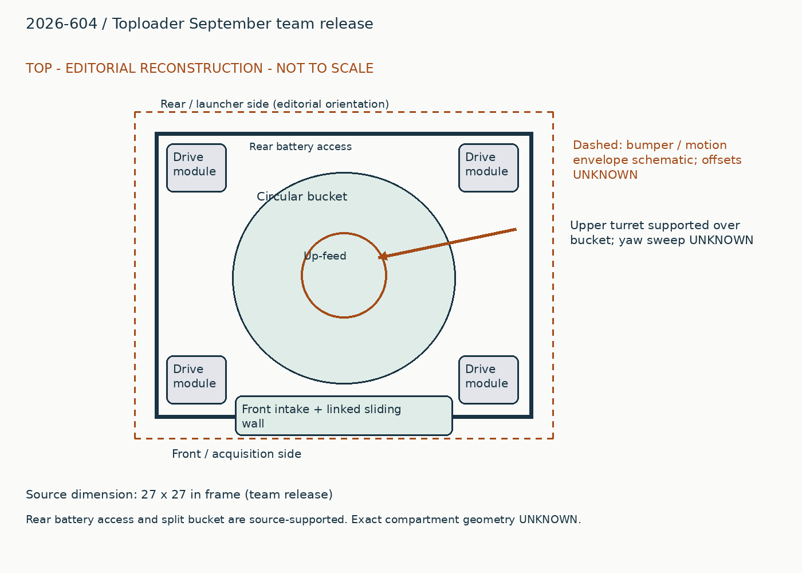
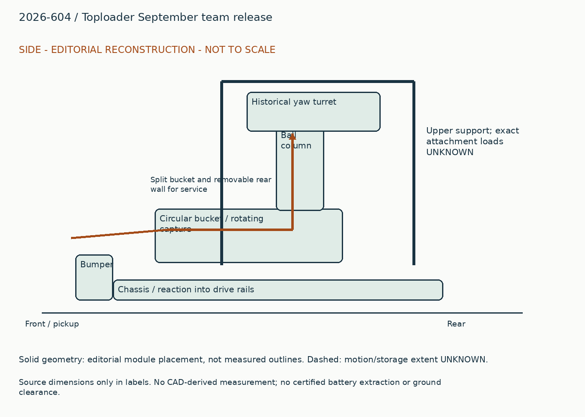
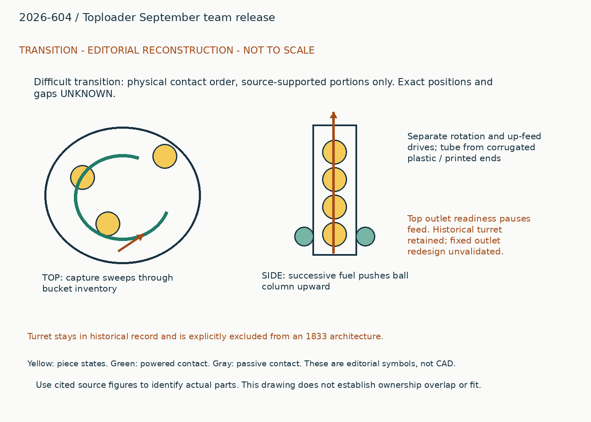
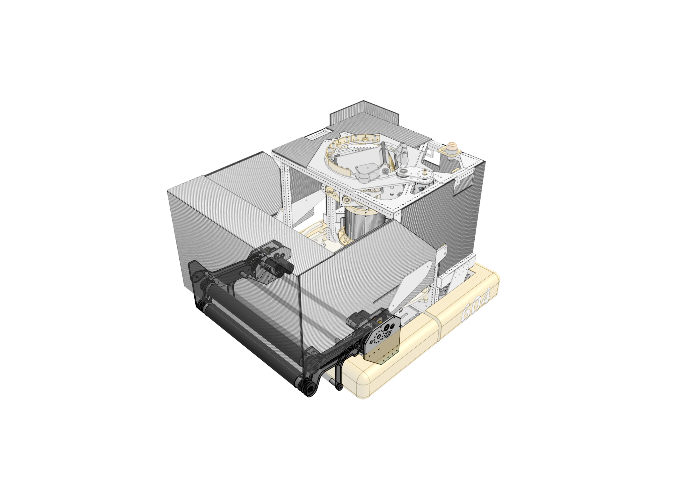
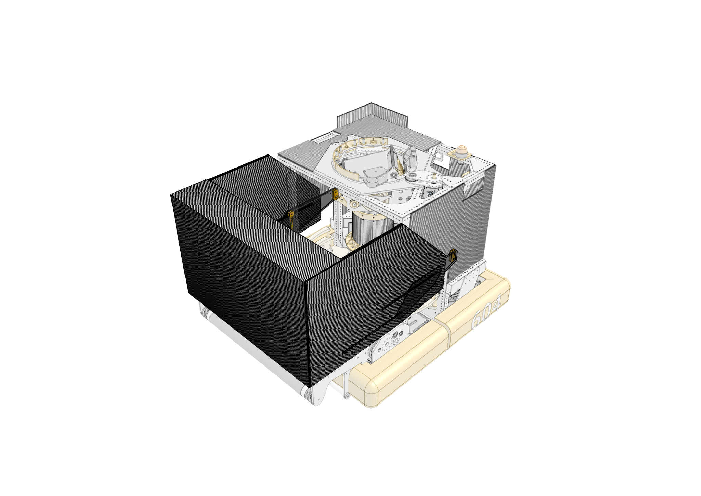
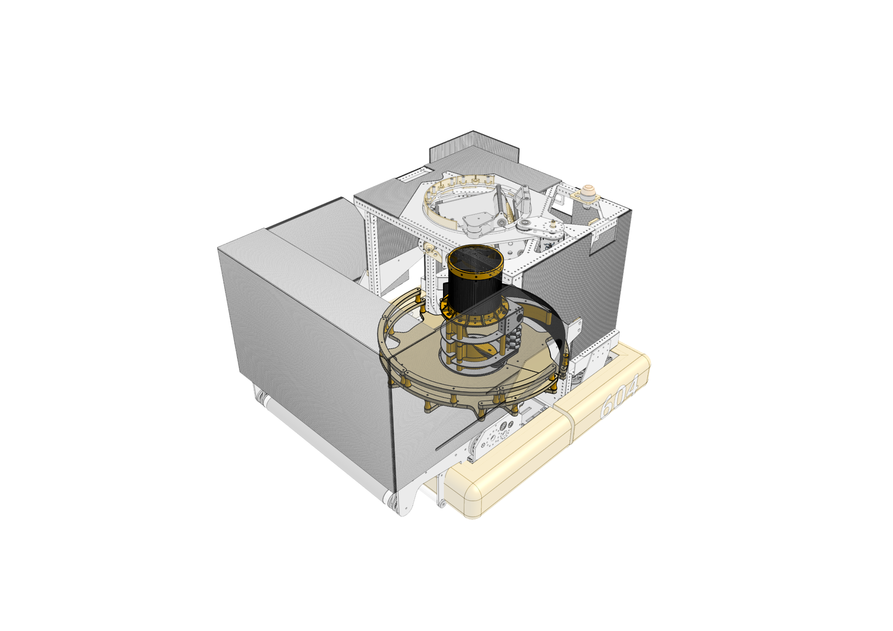

# 2026-604: Toploader September team release

Generated from `data/physical_studies.jsonl`; edit that authoritative record.

## Whole robot and packaging

A circular bucket fills much of the square chassis between standard corner modules. A rotating capture assembly sits inside it and pushes fuel up a central tube to an inset turret. The turret hangs from structure above, keeping supports out of the approaching fuel stream; its yaw envelope consumes space that would otherwise store or guide fuel. The bucket splits into two pieces, and a removable rear panel provides battery access. Separate intake arms at the front deploy a sliding hopper. Internal bars protect the battery/module compartments, and rear bumper hardware carries serializer armor. The inspected ghosted source view shows bucket, column and upper support relationships, but does not dimension the complete electrical compartment.

## Piece flow

Front rollers bring loose fuel into storage and the circular bucket. The capture assembly rotates through the available pile rather than waiting for balls to find one stationary throat. Independent up-feed rollers push captured fuel into the corrugated tube. Successive balls push the column upward into the turret; release is enabled only when launch and localization readiness are valid. The physical queue can remain occupied when the software pauses feeding.

## Annotated views

Editorial reconstruction. Not to scale; only explicit dimension labels are source dimensions. No CAD-derived measurements. Dashed envelopes are schematic and not clearance certification.

## Independent arms and mechanically linked sliding walls

### Published construction

Each arm deploys with its own X44. Belt-driven dead-axle rollers use compliant construction; sliding corrugated walls deploy with the intake and retract under surgical tubing. Slots include 0.090-inch polycarbonate reinforcement.

### Team rationale / attribution boundary

Read cited historical note for team rationale; the operating reconstruction below is editorial and does not establish additional team intent.

### Editorial operating reconstruction

Deploy both arms and allow the walls to extend. Rollers capture fuel over the bumper into the bucket. Side-to-side compliance must preserve belt engagement even when the arms deflect differently.

### Engineering interpretation

Separate arm motors remove a rigid cross-side deployment constraint. Linking the walls still couples acquisition and storage state. Slot reinforcement carries local sliding contact instead of expecting soft wall material to hold the bearing geometry.

### Transfer and compatibility limits

This intake and low-mass wall construction can transfer independently of the turret. Keep the belt supports and wall load path; surgical tubing is a passive spring, not pneumatic actuation.

### Unknowns

Exact slot loads, belt tension across deflection and loaded retraction limits remain unknown.

### Proposed validation, not performed

First inspect the missing source interface or CAD; only then test the specific capture/transfer failure that could change the architecture. No hardware experiment was performed in this upgrade.

Figure `604-source-2026-intake`. [Source](https://www.chiefdelphi.com/t/524289/1). Visible scope only; hidden geometry, precise dimensions and event installation are not established.

Figure `604-source-2026-hopper`. [Source](https://www.chiefdelphi.com/t/524289/1). Visible scope only; hidden geometry, precise dimensions and event installation are not established.

### Evidence coverage

| Evidence | State | Reason |
|---|---|---|
| synopsis | supported | Identified function and exact source snapshot retained. |
| construction | supported | Selected contacts and drives explained; no fabrication completeness claimed. |
| operating_sequence | partial | Editorial sequence identifies a physical route; sensing/recovery and hidden transitions remain unresolved. |
| interfaces | partial | Physical dependency explained; not a dimensionally certified interface. |
| packaging | partial | Annotated source-bounded schematic, not scaled CAD. |
| useful_image_inspected | supported | Referenced source figures visually inspected for the stated visible feature; hidden geometry unresolved. |
| parameters | partial | See selected robot parameters and version labels; complete dimensions, loads and operating conditions unavailable. |
| version | partial | Publication snapshot established, exact per-event installation unknown. |
| source_locator | supported | Existing note IDs retain page/time locators; new URLs retain section or post references. |
| remaining_unknowns | supported | Explicit evidence gap; does not assert absent hardware. |

## Moving capture point, circular bucket and column

### Published construction

Rotation and up-feed have separate motors; side feed rollers use omni wheels. The bucket is plywood in two serviceable segments and the column is corrugated plastic held by printed ends.

### Team rationale / attribution boundary

Read cited historical note for team rationale; the operating reconstruction below is editorial and does not establish additional team intent.

### Editorial operating reconstruction

A capture feature sweeps toward loose fuel, puts it between feed contacts, and adds it to the bottom of an occupied tube. Each new ball advances the column. A ball cannot exit the top when the launcher is unavailable.

### Engineering interpretation

Rotation controls encounter rate while up-feed controls progression. Changing their ratio changes pile interaction, queue loading and the force transmitted through the ball column. That distinction is lost if both are modeled as a single feeder speed.

### Transfer and compatibility limits

The moving-capture principle can serve a fixed launcher, but changing the top outlet changes the column support and feed alignment. That adaptation is an unvalidated redesign, not a drop-in turret removal.

### Unknowns

Pocket geometry, tube clearance, compression, column force and jam reversal order are unresolved.

### Proposed validation, not performed

First inspect the missing source interface or CAD; only then test the specific capture/transfer failure that could change the architecture. No hardware experiment was performed in this upgrade.

Figure `604-source-2026-serializer`. [Source](https://www.chiefdelphi.com/t/524289/1). Visible scope only; hidden geometry, precise dimensions and event installation are not established.

### Evidence coverage

| Evidence | State | Reason |
|---|---|---|
| synopsis | supported | Identified function and exact source snapshot retained. |
| construction | supported | Selected contacts and drives explained; no fabrication completeness claimed. |
| operating_sequence | partial | Editorial sequence identifies a physical route; sensing/recovery and hidden transitions remain unresolved. |
| interfaces | partial | Physical dependency explained; not a dimensionally certified interface. |
| packaging | partial | Annotated source-bounded schematic, not scaled CAD. |
| useful_image_inspected | supported | Referenced source figures visually inspected for the stated visible feature; hidden geometry unresolved. |
| parameters | partial | See selected robot parameters and version labels; complete dimensions, loads and operating conditions unavailable. |
| version | partial | Publication snapshot established, exact per-event installation unknown. |
| source_locator | supported | Existing note IDs retain page/time locators; new URLs retain section or post references. |
| remaining_unknowns | supported | Explicit evidence gap; does not assert absent hardware. |

## Historical inset turret and shot-readiness gate

### Published construction

The upper structure supports an inset turret with sliding plate bearing. Launch velocity, angle, yaw and recent multi-tag localization gate feed; the serializer pauses when readiness fails.

### Team rationale / attribution boundary

Read cited historical note for team rationale; the operating reconstruction below is editorial and does not establish additional team intent.

### Editorial operating reconstruction

The capture system supplies a queue, but the controller grants release only in an acceptable launch state. Loss of localization should pause release rather than be recorded as a mechanical blockage.

### Engineering interpretation

Queue control, aiming and readiness must share ownership of the next ball. A paused up-feed motor can be correct while the bucket still contains fuel; logs need a pause reason separate from jam detection.

### Transfer and compatibility limits

The yaw turret is ineligible for 1833. Velocity/angle/localization gating can transfer with chassis heading replacing turret yaw, but heading dynamics and fixed outlet geometry must be revalidated.

### Unknowns

Readiness thresholds, hysteresis, actual gate duty fraction and every feed sensor remain unknown.

### Proposed validation, not performed

First inspect the missing source interface or CAD; only then test the specific capture/transfer failure that could change the architecture. No hardware experiment was performed in this upgrade.

Figure `604-source-2026-serializer`. [Source](https://www.chiefdelphi.com/t/524289/1). Visible scope only; hidden geometry, precise dimensions and event installation are not established.

### Evidence coverage

| Evidence | State | Reason |
|---|---|---|
| synopsis | supported | Identified function and exact source snapshot retained. |
| construction | supported | Selected contacts and drives explained; no fabrication completeness claimed. |
| operating_sequence | partial | Editorial sequence identifies a physical route; sensing/recovery and hidden transitions remain unresolved. |
| interfaces | partial | Physical dependency explained; not a dimensionally certified interface. |
| packaging | partial | Annotated source-bounded schematic, not scaled CAD. |
| useful_image_inspected | supported | Referenced source figures visually inspected for the stated visible feature; hidden geometry unresolved. |
| parameters | partial | See selected robot parameters and version labels; complete dimensions, loads and operating conditions unavailable. |
| version | partial | Publication snapshot established, exact per-event installation unknown. |
| source_locator | supported | Existing note IDs retain page/time locators; new URLs retain section or post references. |
| remaining_unknowns | supported | Explicit evidence gap; does not assert absent hardware. |

## Bucket segmentation and protected access compartments

### Published construction

The circular bucket separates into two parts; a rear wall section removes for battery access. Cross-bars isolate the battery/modules and rear bumper mounts include armor.

### Team rationale / attribution boundary

Read cited historical note for team rationale; the operating reconstruction below is editorial and does not establish additional team intent.

### Editorial operating reconstruction

Unload inventory, open the designated rear access, and remove only the relevant bucket section for deeper service. The source does not establish every fastener or cable disconnection step.

### Engineering interpretation

A central serializer that works well on the field can be costly to maintain if it traps power equipment below it. Segmentation makes access a deliberate design feature; it does not prove a particular repair time.

### Transfer and compatibility limits

Borrow modular access while preserving structure that supports the capture assembly. Do not convert a source service claim into a measured pit-time saving.

### Unknowns

Battery extraction envelope, locking hardware and full serializer removal time remain unknown.

### Proposed validation, not performed

First inspect the missing source interface or CAD; only then test the specific capture/transfer failure that could change the architecture. No hardware experiment was performed in this upgrade.

Figure `604-source-2026-serializer`. [Source](https://www.chiefdelphi.com/t/524289/1). Visible scope only; hidden geometry, precise dimensions and event installation are not established.

Figure `604-source-2026-hopper`. [Source](https://www.chiefdelphi.com/t/524289/1). Visible scope only; hidden geometry, precise dimensions and event installation are not established.

### Evidence coverage

| Evidence | State | Reason |
|---|---|---|
| synopsis | supported | Identified function and exact source snapshot retained. |
| construction | supported | Selected contacts and drives explained; no fabrication completeness claimed. |
| operating_sequence | partial | Editorial sequence identifies a physical route; sensing/recovery and hidden transitions remain unresolved. |
| interfaces | partial | Physical dependency explained; not a dimensionally certified interface. |
| packaging | partial | Annotated source-bounded schematic, not scaled CAD. |
| useful_image_inspected | supported | Referenced source figures visually inspected for the stated visible feature; hidden geometry unresolved. |
| parameters | partial | See selected robot parameters and version labels; complete dimensions, loads and operating conditions unavailable. |
| version | partial | Publication snapshot established, exact per-event installation unknown. |
| source_locator | supported | Existing note IDs retain page/time locators; new URLs retain section or post references. |
| remaining_unknowns | supported | Explicit evidence gap; does not assert absent hardware. |

## Interface records

### physical-2026-604-intake-hopper-output

| Field | State | Value / limitation |
|---|---|---|
| piece | supported | fuel_2026. Original game and piece; no cross-year equivalence implied. |
| orientation | partial | loose inventory into circular bucket. Compliant arms and linked walls change retained volume through deployment. |
| direction | partial | toward rotating capture. Qualitative path only; local coordinate transform not measured. |
| entry_exit_height | unknown | Unknown. No local datum or source dimension recovered. |
| effective_feed_width | unknown | Unknown. Overall chassis / plate spacing is not usable contact width. |
| velocity | unknown | Unknown. No measured interface velocity under stated load. |
| compression | unknown | Unknown. Contact gap not established at this port. |
| ownership_readiness | partial | Compliant arms and linked walls change retained volume through deployment.. Must verify sensor definitions, delays, timeout, reversal and release authority. |
| occupied_swept_space | partial | A circular bucket fills much of the square chassis between standard corner modules. A rotating capture assembly sits inside it and pushes fuel up a central tube to an inset turret. The turret hangs from structure above, keeping supports out of the approaching fuel stream; its yaw envelope consumes space that would otherwise store or guide fuel. The bucket splits into two pieces, and a removable rear panel provides battery access. Separate intake arms at the front deploy a sliding hopper. Internal bars protect the battery/module compartments, and rear bumper hardware carries serializer armor. The inspected ghosted source view shows bucket, column and upper support relationships, but does not dimension the complete electrical compartment.. Layout is editorial; dimensions and interfering motions unverified. |
| structural_loads | partial | Separate arm motors remove a rigid cross-side deployment constraint. Linking the walls still couples acquisition and storage state. Slot reinforcement carries local sliding contact instead of expecting soft wall material to hold the bearing geometry.. Load path described without verified force magnitudes or attachment sizing. |
| electrical_simultaneity | unknown | Unknown. Motor counts do not establish bus voltage, current limits or simultaneous duty. |
| jam_recovery_service | partial | Exact slot loads, belt tension across deflection and loaded retraction limits remain unknown.. Exact powered-off recovery and disassembly order unresolved. |

This intake and low-mass wall construction can transfer independently of the turret. Keep the belt supports and wall load path; surgical tubing is a passive spring, not pneumatic actuation.

### physical-2026-604-serializer-input

| Field | State | Value / limitation |
|---|---|---|
| piece | supported | fuel_2026. Original game and piece; no cross-year equivalence implied. |
| orientation | partial | loose fuel around capture sweep. Bucket wall, turret support and intake approach constrain pile flow. |
| direction | partial | circumferential collection. Qualitative path only; local coordinate transform not measured. |
| entry_exit_height | unknown | Unknown. No local datum or source dimension recovered. |
| effective_feed_width | unknown | Unknown. Overall chassis / plate spacing is not usable contact width. |
| velocity | unknown | Unknown. No measured interface velocity under stated load. |
| compression | unknown | Unknown. Contact gap not established at this port. |
| ownership_readiness | partial | Bucket wall, turret support and intake approach constrain pile flow.. Must verify sensor definitions, delays, timeout, reversal and release authority. |
| occupied_swept_space | partial | A circular bucket fills much of the square chassis between standard corner modules. A rotating capture assembly sits inside it and pushes fuel up a central tube to an inset turret. The turret hangs from structure above, keeping supports out of the approaching fuel stream; its yaw envelope consumes space that would otherwise store or guide fuel. The bucket splits into two pieces, and a removable rear panel provides battery access. Separate intake arms at the front deploy a sliding hopper. Internal bars protect the battery/module compartments, and rear bumper hardware carries serializer armor. The inspected ghosted source view shows bucket, column and upper support relationships, but does not dimension the complete electrical compartment.. Layout is editorial; dimensions and interfering motions unverified. |
| structural_loads | partial | Rotation controls encounter rate while up-feed controls progression. Changing their ratio changes pile interaction, queue loading and the force transmitted through the ball column. That distinction is lost if both are modeled as a single feeder speed.. Load path described without verified force magnitudes or attachment sizing. |
| electrical_simultaneity | unknown | Unknown. Motor counts do not establish bus voltage, current limits or simultaneous duty. |
| jam_recovery_service | partial | Pocket geometry, tube clearance, compression, column force and jam reversal order are unresolved.. Exact powered-off recovery and disassembly order unresolved. |

The moving-capture principle can serve a fixed launcher, but changing the top outlet changes the column support and feed alignment. That adaptation is an unvalidated redesign, not a drop-in turret removal.

### physical-2026-604-serializer-output

| Field | State | Value / limitation |
|---|---|---|
| piece | supported | fuel_2026. Original game and piece; no cross-year equivalence implied. |
| orientation | partial | occupied single-file ball column. Successive balls transmit force through column; compression and tube dimensions unknown. |
| direction | partial | vertical up-feed. Qualitative path only; local coordinate transform not measured. |
| entry_exit_height | unknown | Unknown. No local datum or source dimension recovered. |
| effective_feed_width | unknown | Unknown. Overall chassis / plate spacing is not usable contact width. |
| velocity | unknown | Unknown. No measured interface velocity under stated load. |
| compression | unknown | Unknown. Contact gap not established at this port. |
| ownership_readiness | partial | Successive balls transmit force through column; compression and tube dimensions unknown.. Must verify sensor definitions, delays, timeout, reversal and release authority. |
| occupied_swept_space | partial | A circular bucket fills much of the square chassis between standard corner modules. A rotating capture assembly sits inside it and pushes fuel up a central tube to an inset turret. The turret hangs from structure above, keeping supports out of the approaching fuel stream; its yaw envelope consumes space that would otherwise store or guide fuel. The bucket splits into two pieces, and a removable rear panel provides battery access. Separate intake arms at the front deploy a sliding hopper. Internal bars protect the battery/module compartments, and rear bumper hardware carries serializer armor. The inspected ghosted source view shows bucket, column and upper support relationships, but does not dimension the complete electrical compartment.. Layout is editorial; dimensions and interfering motions unverified. |
| structural_loads | partial | Rotation controls encounter rate while up-feed controls progression. Changing their ratio changes pile interaction, queue loading and the force transmitted through the ball column. That distinction is lost if both are modeled as a single feeder speed.. Load path described without verified force magnitudes or attachment sizing. |
| electrical_simultaneity | unknown | Unknown. Motor counts do not establish bus voltage, current limits or simultaneous duty. |
| jam_recovery_service | partial | Pocket geometry, tube clearance, compression, column force and jam reversal order are unresolved.. Exact powered-off recovery and disassembly order unresolved. |

The moving-capture principle can serve a fixed launcher, but changing the top outlet changes the column support and feed alignment. That adaptation is an unvalidated redesign, not a drop-in turret removal.

### physical-2026-604-turret-ready-input

| Field | State | Value / limitation |
|---|---|---|
| piece | supported | fuel_2026. Original game and piece; no cross-year equivalence implied. |
| orientation | partial | ball column at turret entry. Turret prohibited for 1833; a fixed launcher changes top support and outlet geometry. |
| direction | partial | up into historical turret. Qualitative path only; local coordinate transform not measured. |
| entry_exit_height | unknown | Unknown. No local datum or source dimension recovered. |
| effective_feed_width | unknown | Unknown. Overall chassis / plate spacing is not usable contact width. |
| velocity | unknown | Unknown. No measured interface velocity under stated load. |
| compression | unknown | Unknown. Contact gap not established at this port. |
| ownership_readiness | partial | Turret prohibited for 1833; a fixed launcher changes top support and outlet geometry.. Must verify sensor definitions, delays, timeout, reversal and release authority. |
| occupied_swept_space | partial | A circular bucket fills much of the square chassis between standard corner modules. A rotating capture assembly sits inside it and pushes fuel up a central tube to an inset turret. The turret hangs from structure above, keeping supports out of the approaching fuel stream; its yaw envelope consumes space that would otherwise store or guide fuel. The bucket splits into two pieces, and a removable rear panel provides battery access. Separate intake arms at the front deploy a sliding hopper. Internal bars protect the battery/module compartments, and rear bumper hardware carries serializer armor. The inspected ghosted source view shows bucket, column and upper support relationships, but does not dimension the complete electrical compartment.. Layout is editorial; dimensions and interfering motions unverified. |
| structural_loads | partial | Queue control, aiming and readiness must share ownership of the next ball. A paused up-feed motor can be correct while the bucket still contains fuel; logs need a pause reason separate from jam detection.. Load path described without verified force magnitudes or attachment sizing. |
| electrical_simultaneity | unknown | Unknown. Motor counts do not establish bus voltage, current limits or simultaneous duty. |
| jam_recovery_service | partial | Readiness thresholds, hysteresis, actual gate duty fraction and every feed sensor remain unknown.. Exact powered-off recovery and disassembly order unresolved. |

The yaw turret is ineligible for 1833. Velocity/angle/localization gating can transfer with chassis heading replacing turret yaw, but heading dynamics and fixed outlet geometry must be revalidated.

## Remaining whole-robot gaps

- Turret stays in historical record and is explicitly excluded from an 1833 architecture.
- A fixed-launcher adaptation has not been drawn or tested here.
- No usable hopper capacity or sustained match BPS is certified.

## Sources

- https://www.chiefdelphi.com/t/team-604-quixilver-2026-robot-cad-and-code-release/524289
