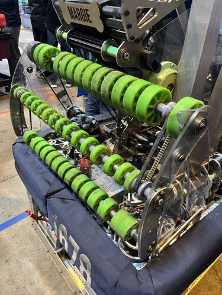
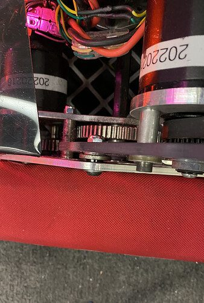
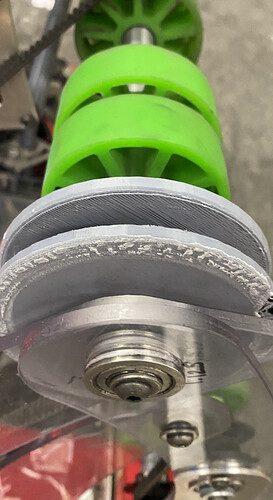

# 2022 · 1678 Citrus Circuits — Margie

EPA rank 1, snapshot EPA 69.09. Provisional reference dossier.

Low-center-of-gravity shooter with early color rejection and alternating telescopic traversal climb.

## Drivetrain

Swerve; heavy motors deliberately kept low.

Coverage: documented synopsis.

## Intake

Unequal four-bar collector with compliant plates; later winglets/belts improve edge acquisition.

Coverage: documented synopsis.

## Transfer

Sensor-tracked slots and independent ejector roller choose storage versus rear rejection.

Coverage: documented synopsis.

## Scoring

Adjustable hood derived from 2910 lineage; flywheel and back rollers suppress unwanted spin.

Coverage: documented synopsis.

## Endgame

Telescopic arms alternate bars; passive gas-spring/stop geometry controls robot pitch.

Coverage: documented synopsis.

## Controls

Color-ratio sorting, current-based homing, vision-assisted targeting and gyro-relative automated climb.

Coverage: documented synopsis.

## Changes and versions

- Pneumatics removed early. Rejected conventional and 125-inspired climb concepts before final passive-angle telescope design. Intake edge guides added later.

## Strategic interpretation — analyst inference

The simpler ball path freed controls effort for automatic sorting and robust climb logic. Opponent-cargo rejection speed was chosen to place balls deliberately, not just expel them.

## Limits

- Reported performance and prototype history are attributed to the source; not every intermediate revision is recoverable.

Bounded source review; exhaustive intermediate-version history not certified

## Reviewed primary source bundle

- https://youtu.be/ijiDMVvGc_E
- https://www.chiefdelphi.com/t/404113
- https://github.com/frc1678/C2022-Public

## Season context

Read [the full 2022 game/context chapter](../docs/game_2022.md) before transferring this architecture to another role or season.

## Technical image references

Images are source-associated technical figures or robot views, not dimensionally certified drawings. Follow each source for version and figure context.

2022 team 1678 — source image from post 61 (2022-05-02). Context tags identify the discussion, not a verified component label. [Original source](https://www.chiefdelphi.com/t/404113/61). Source-linked extraction; mechanism identity not individually visually audited

2022 team 1678 — source image from post 66 (2022-05-02). Context tags identify the discussion, not a verified component label. [Original source](https://www.chiefdelphi.com/t/404113/66). Source-linked extraction; mechanism identity not individually visually audited

2022 team 1678 — source image from post 66 (2022-05-02). Context tags identify the discussion, not a verified component label. [Original source](https://www.chiefdelphi.com/t/404113/66). Source-linked extraction; mechanism identity not individually visually audited

## Dated research locators — navigation, not reviewed claims

A tag describes words in the source, not a validated engineering fact. Discussion replies may concern comparison robots.

- 2022-02-27 · Michael_Corsetto · [post 2](https://www.chiefdelphi.com/t/404113/2) · climb
- 2022-03-02 · Gregory78 · [post 22](https://www.chiefdelphi.com/t/404113/22) · belt, intake
- 2022-03-02 · Michael_Corsetto · [post 23](https://www.chiefdelphi.com/t/404113/23) · belt
- 2022-03-09 · Michael_Corsetto · [post 37](https://www.chiefdelphi.com/t/404113/37) · code
- 2022-03-09 · s-neff · [post 38](https://www.chiefdelphi.com/t/404113/38) · code
- 2022-03-09 · Michael_Corsetto · [post 42](https://www.chiefdelphi.com/t/404113/42) · intake
- 2022-03-14 · Jacob_Banooni · [post 43](https://www.chiefdelphi.com/t/404113/43) · climb
- 2022-03-22 · Spaceturtle · [post 44](https://www.chiefdelphi.com/t/404113/44) · climb
- 2022-05-02 · tedang · [post 61](https://www.chiefdelphi.com/t/404113/61) · intake
- 2022-05-02 · davepowers · [post 62](https://www.chiefdelphi.com/t/404113/62) · intake, rebuild
- 2022-05-02 · davepowers · [post 66](https://www.chiefdelphi.com/t/404113/66) · bearing, intake
- 2022-05-02 · RoboChair · [post 67](https://www.chiefdelphi.com/t/404113/67) · intake
- 2022-05-03 · Alex_Y · [post 68](https://www.chiefdelphi.com/t/404113/68) · intake
- 2022-05-03 · mdurrani834 · [post 69](https://www.chiefdelphi.com/t/404113/69) · intake
- 2022-05-03 · davepowers · [post 70](https://www.chiefdelphi.com/t/404113/70) · chain, intake
- 2022-05-03 · davepowers · [post 73](https://www.chiefdelphi.com/t/404113/73) · intake
- 2022-05-03 · jjsessa · [post 76](https://www.chiefdelphi.com/t/404113/76) · pivot
- 2022-05-03 · chadr03 · [post 77](https://www.chiefdelphi.com/t/404113/77) · intake
- 2022-05-04 · Tom_Line · [post 86](https://www.chiefdelphi.com/t/404113/86) · belt, intake
- 2022-05-04 · RoboChair · [post 88](https://www.chiefdelphi.com/t/404113/88) · belt
- 2022-05-06 · davepowers · [post 89](https://www.chiefdelphi.com/t/404113/89) · bearing, belt, intake
- 2022-05-07 · barkinvar · [post 90](https://www.chiefdelphi.com/t/404113/90) · intake
- 2022-05-08 · davepowers · [post 91](https://www.chiefdelphi.com/t/404113/91) · cad, indexer, intake
- 2022-05-09 · waialua359 · [post 92](https://www.chiefdelphi.com/t/404113/92) · belt, intake
- 2022-05-10 · davepowers · [post 95](https://www.chiefdelphi.com/t/404113/95) · shooter
- 2022-05-10 · Tom_Line · [post 97](https://www.chiefdelphi.com/t/404113/97) · shooter
- 2022-05-11 · pryland · [post 99](https://www.chiefdelphi.com/t/404113/99) · cad
- 2022-05-11 · cad321 · [post 100](https://www.chiefdelphi.com/t/404113/100) · intake
- 2022-05-11 · ArmourDuck · [post 101](https://www.chiefdelphi.com/t/404113/101) · shooter
- 2022-05-11 · cad321 · [post 102](https://www.chiefdelphi.com/t/404113/102) · shooter
- 2022-05-11 · Henry_Mahnke · [post 103](https://www.chiefdelphi.com/t/404113/103) · shooter
- 2022-05-11 · s-neff · [post 104](https://www.chiefdelphi.com/t/404113/104) · belt, shooter
- 2022-05-11 · davepowers · [post 105](https://www.chiefdelphi.com/t/404113/105) · shooter
- 2022-05-12 · Alex_Y · [post 113](https://www.chiefdelphi.com/t/404113/113) · shooter
- 2022-05-12 · RoboChair · [post 114](https://www.chiefdelphi.com/t/404113/114) · shooter
- 2022-05-12 · Tom_Line · [post 117](https://www.chiefdelphi.com/t/404113/117) · shooter
- 2022-05-12 · RoboChair · [post 118](https://www.chiefdelphi.com/t/404113/118) · belt, chain, shooter
- 2022-05-12 · Alex_Y · [post 119](https://www.chiefdelphi.com/t/404113/119) · shooter
- 2022-05-12 · Andrew_L · [post 121](https://www.chiefdelphi.com/t/404113/121) · shooter
- 2022-05-12 · RoboChair · [post 122](https://www.chiefdelphi.com/t/404113/122) · shooter
- 2022-05-12 · davepowers · [post 124](https://www.chiefdelphi.com/t/404113/124) · cad, camera, code, hopper, shooter
- 2022-05-13 · RonnieS · [post 126](https://www.chiefdelphi.com/t/404113/126) · climb
- 2022-05-14 · Frff · [post 129](https://www.chiefdelphi.com/t/404113/129) · cad
- 2022-05-14 · davepowers · [post 130](https://www.chiefdelphi.com/t/404113/130) · cad
- 2022-05-16 · RoboChair · [post 131](https://www.chiefdelphi.com/t/404113/131) · camera
- 2022-05-24 · davepowers · [post 136](https://www.chiefdelphi.com/t/404113/136) · cad, hopper
- 2022-05-25 · tedang · [post 137](https://www.chiefdelphi.com/t/404113/137) · cad
- 2022-05-26 · davepowers · [post 141](https://www.chiefdelphi.com/t/404113/141) · cad, climb, hopper, prototype, rebuild, shooter
- 2022-05-26 · BordomBeThyName · [post 142](https://www.chiefdelphi.com/t/404113/142) · prototype
- 2022-05-26 · topgun · [post 144](https://www.chiefdelphi.com/t/404113/144) · prototype
- 2022-05-26 · mrwright · [post 146](https://www.chiefdelphi.com/t/404113/146) · intake
- 2022-05-27 · mendax1234 · [post 147](https://www.chiefdelphi.com/t/404113/147) · cad, code
- 2022-05-27 · jedgar6 · [post 148](https://www.chiefdelphi.com/t/404113/148) · cad
- 2022-05-27 · Michael_Corsetto · [post 154](https://www.chiefdelphi.com/t/404113/154) · cad, code
- 2022-05-28 · Michael_Corsetto · [post 155](https://www.chiefdelphi.com/t/404113/155) · cad, code
- 2022-05-28 · Michael_Corsetto · [post 157](https://www.chiefdelphi.com/t/404113/157) · autonomous, code
- 2022-05-29 · Apurva.Mishra · [post 158](https://www.chiefdelphi.com/t/404113/158) · code, vision
- 2022-05-30 · Ken_Bone · [post 160](https://www.chiefdelphi.com/t/404113/160) · indexer
- 2022-05-31 · topgun · [post 162](https://www.chiefdelphi.com/t/404113/162) · vision
- 2022-05-31 · calcmogul · [post 164](https://www.chiefdelphi.com/t/404113/164) · code, vision
- 2022-06-04 · Brendan_Rockwell · [post 168](https://www.chiefdelphi.com/t/404113/168) · bearing
- 2022-06-11 · Henry_Mahnke · [post 170](https://www.chiefdelphi.com/t/404113/170) · code
- 2022-06-14 · Yuvraj_Dhadwal · [post 171](https://www.chiefdelphi.com/t/404113/171) · climb
- 2022-06-22 · wgorgen · [post 176](https://www.chiefdelphi.com/t/404113/176) · arm, cad, climb
- 2022-06-24 · Brendan_Rockwell · [post 177](https://www.chiefdelphi.com/t/404113/177) · arm, climb
- 2022-06-30 · davepowers · [post 181](https://www.chiefdelphi.com/t/404113/181) · climb
- 2022-07-19 · Backlash · [post 186](https://www.chiefdelphi.com/t/404113/186) · cad
- 2022-09-13 · davepowers · [post 201](https://www.chiefdelphi.com/t/404113/201) · camera

## Integrated focused technical study

[Construction, reasoning, failure modes and limits](../docs/research_continuation/2022-1678.md). This supplement is a focused interview/source-bundle study, not an exhaustive binder or competition-version certification.
