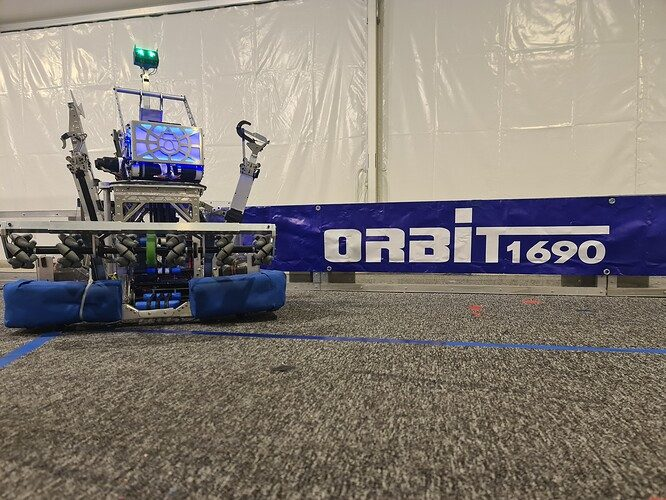
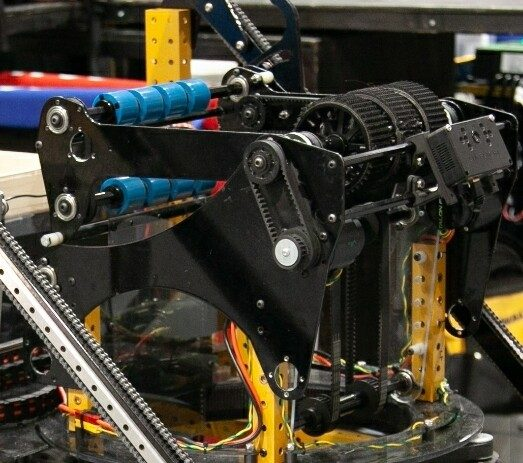

# 2022 · 1690 Orbit — Parker

EPA rank 3, snapshot EPA 64.95. Provisional reference dossier.

Turreted shooter with physics-based moving shots and truss-reacting traversal climb.

## Drivetrain

Custom swerve; slip detection reduces trust in wheel odometry.

Coverage: documented synopsis.

## Intake

Rigid collector with elastic linkage that yields inward on impact.

Coverage: documented synopsis.

## Transfer

Separate horizontal and vertical conveyors; infrared/color sensors track cargo.

Coverage: documented synopsis.

## Scoring

Low-mounted two-motor turret transmission; adjustable hood and later top roller.

Coverage: documented synopsis.

## Endgame

Telescopic hook plus truss-reaction structure reaches traversal with few active steps; deployable line camera improves alignment.

Coverage: documented synopsis.

## Controls

Shot simulation selects trajectories insensitive to error; fused pose and radial/tangential velocity compensation support moving shots.

Coverage: documented synopsis.

## Changes and versions

- Shooter rebuilt after first Israeli event to add top roller and reduce bounce-outs. Alignment camera added after approach time became a climb bottleneck.

## Strategic interpretation — analyst inference

Their advantage is the combined localization, shot model and mechanically repeatable feeder. A turret alone does not create accurate moving shots; alignment time can dominate an otherwise fast climber.

## Limits

- Reported performance and prototype history are attributed to the source; not every intermediate revision is recoverable.

Bounded source review; exhaustive intermediate-version history not certified

## Reviewed primary source bundle

- https://youtu.be/rnpB8KXTd7U
- https://www.chiefdelphi.com/t/403533

## Season context

Read [the full 2022 game/context chapter](../docs/game_2022.md) before transferring this architecture to another role or season.

## Technical image references

Images are source-associated technical figures or robot views, not dimensionally certified drawings. Follow each source for version and figure context.

2022 team 1690 — source image from post 1 (2022-02-21). Context tags identify the discussion, not a verified component label. [Original source](https://www.chiefdelphi.com/t/403533/1). Source-linked extraction; mechanism identity not individually visually audited

2022 team 1690 — source image from post 80 (2022-03-23). Context tags identify the discussion, not a verified component label. [Original source](https://www.chiefdelphi.com/t/403533/80). Source-linked extraction; mechanism identity not individually visually audited

## Dated research locators — navigation, not reviewed claims

A tag describes words in the source, not a validated engineering fact. Discussion replies may concern comparison robots.

- 2022-02-21 · emmaworley · [post 5](https://www.chiefdelphi.com/t/403533/5) · vision
- 2022-02-21 · Tomker · [post 28](https://www.chiefdelphi.com/t/403533/28) · vision
- 2022-02-21 · Nick_Coussens · [post 31](https://www.chiefdelphi.com/t/403533/31) · shooter
- 2022-02-21 · KingOfDemise · [post 32](https://www.chiefdelphi.com/t/403533/32) · climb
- 2022-02-21 · Joe_Ross · [post 33](https://www.chiefdelphi.com/t/403533/33) · climb
- 2022-02-22 · mendax1234 · [post 36](https://www.chiefdelphi.com/t/403533/36) · shooter
- 2022-02-23 · UnofficialForth · [post 39](https://www.chiefdelphi.com/t/403533/39) · prototype
- 2022-02-23 · troy_dietz · [post 41](https://www.chiefdelphi.com/t/403533/41) · cad
- 2022-02-25 · wolly_efendi · [post 44](https://www.chiefdelphi.com/t/403533/44) · arm, climb
- 2022-02-26 · BriFRC · [post 49](https://www.chiefdelphi.com/t/403533/49) · shooter
- 2022-02-27 · Nick_Coussens · [post 55](https://www.chiefdelphi.com/t/403533/55) · bearing
- 2022-02-27 · Korny · [post 59](https://www.chiefdelphi.com/t/403533/59) · shooter
- 2022-02-27 · 13spangs · [post 63](https://www.chiefdelphi.com/t/403533/63) · shooter
- 2022-02-27 · Tomker · [post 64](https://www.chiefdelphi.com/t/403533/64) · shooter
- 2022-02-28 · Bpk9p4 · [post 65](https://www.chiefdelphi.com/t/403533/65) · shooter
- 2022-02-28 · Korny · [post 66](https://www.chiefdelphi.com/t/403533/66) · shooter
- 2022-03-01 · Gregory78 · [post 67](https://www.chiefdelphi.com/t/403533/67) · shooter
- 2022-03-23 · 13spangs · [post 80](https://www.chiefdelphi.com/t/403533/80) · shooter
- 2022-03-25 · JohnFogarty · [post 82](https://www.chiefdelphi.com/t/403533/82) · shooter
- 2022-04-16 · anon47200102 · [post 89](https://www.chiefdelphi.com/t/403533/89) · shooter
- 2022-04-16 · Korny · [post 90](https://www.chiefdelphi.com/t/403533/90) · belt, intake, shooter
- 2022-04-25 · wolly_efendi · [post 97](https://www.chiefdelphi.com/t/403533/97) · code
- 2022-04-26 · Noam_Prag · [post 101](https://www.chiefdelphi.com/t/403533/101) · encoder
- 2022-04-26 · dan · [post 102](https://www.chiefdelphi.com/t/403533/102) · shooter
- 2022-12-13 · hage-043 · [post 109](https://www.chiefdelphi.com/t/403533/109) · encoder, vision
- 2023-01-01 · kornblau · [post 110](https://www.chiefdelphi.com/t/403533/110) · camera

## Integrated focused technical study

[Construction, reasoning, failure modes and limits](../docs/research_continuation/2022-1690.md). This supplement is a focused interview/source-bundle study, not an exhaustive binder or competition-version certification.
