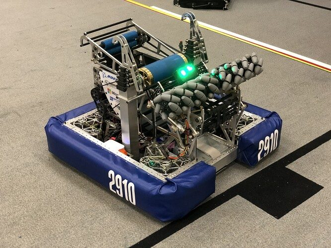
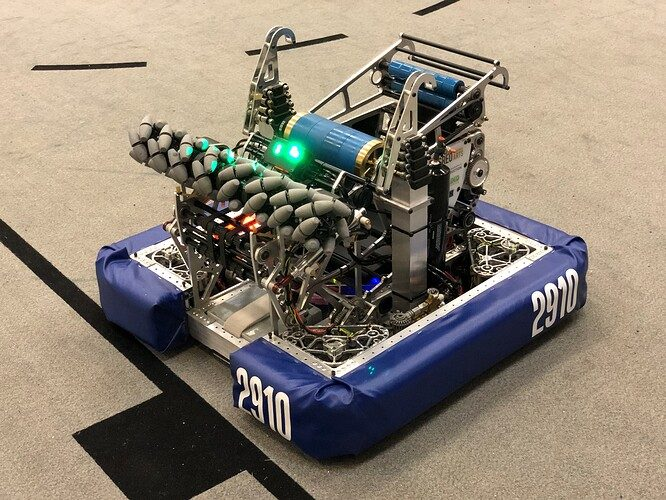
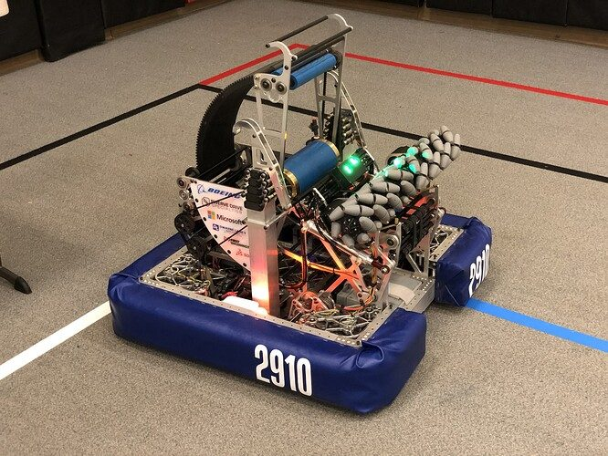

# 2022 · 2910 Jack in the Bot — Thor

EPA rank 11, snapshot EPA 55.59. Provisional reference dossier.

Compact low-motor swerve, mecanum collector and high-inertia adjustable-hood shooter.

## Drivetrain

Inverted modules move motors down into frame volume.

Coverage: documented synopsis.

## Intake

Pneumatic mecanum pickup; larger commercial wheels outperformed smaller printed candidates.

Coverage: documented synopsis.

## Transfer

Top-driven path runs over the battery to save space; long belts locate feeder motor where packaging permits.

Coverage: documented synopsis.

## Scoring

Large flywheel and long wrap preserve energy for two rapid shots; printed adjustable hood.

Coverage: documented synopsis.

## Endgame

Two telescopic climbers; external gearboxes improve service access but exposed tubes required reinforcement.

Coverage: documented synopsis.

## Controls

Single-driver automated climb with an operator confirmation before committing to the full sequence.

Coverage: documented synopsis.

## Changes and versions

- Climber tubes dented at Sundome and were replaced with thicker stock. Lightweight/no-inertia shooter experiment rejected.

## Strategic interpretation — analyst inference

Flywheel inertia answers recovery under the actual ball wrap and firing cadence. Minimum mass is not the goal if the second shot loses required energy.

## Limits

- Only published/reviewed configurations are established; further intermediate changes may be undocumented.

Bounded source review; exhaustive intermediate-version history not certified

## Reviewed primary source bundle

- https://youtu.be/hP9RhZaW5fA
- https://www.chiefdelphi.com/t/404659

## Season context

Read [the full 2022 game/context chapter](../docs/game_2022.md) before transferring this architecture to another role or season.

## Technical image references

Images are source-associated technical figures or robot views, not dimensionally certified drawings. Follow each source for version and figure context.

2022 team 2910 — source image from post 1 (2022-03-04). Context tags identify the discussion, not a verified component label. [Original source](https://www.chiefdelphi.com/t/404659/1). Source-linked extraction; mechanism identity not individually visually audited

2022 team 2910 — source image from post 1 (2022-03-04). Context tags identify the discussion, not a verified component label. [Original source](https://www.chiefdelphi.com/t/404659/1). Source-linked extraction; mechanism identity not individually visually audited

2022 team 2910 — source image from post 1 (2022-03-04). Context tags identify the discussion, not a verified component label. [Original source](https://www.chiefdelphi.com/t/404659/1). Source-linked extraction; mechanism identity not individually visually audited

## Dated research locators — navigation, not reviewed claims

A tag describes words in the source, not a validated engineering fact. Discussion replies may concern comparison robots.

- 2022-03-04 · PatrickW · [post 1](https://www.chiefdelphi.com/t/404659/1) · autonomous, climb, intake, shooter
- 2022-03-04 · Skyehawk · [post 2](https://www.chiefdelphi.com/t/404659/2) · climb
- 2022-03-04 · PatrickW · [post 5](https://www.chiefdelphi.com/t/404659/5) · climb, shooter
- 2022-03-04 · Korny · [post 6](https://www.chiefdelphi.com/t/404659/6) · climb
- 2022-03-04 · wolly_efendi · [post 9](https://www.chiefdelphi.com/t/404659/9) · shooter
- 2022-03-04 · JohnFogarty · [post 10](https://www.chiefdelphi.com/t/404659/10) · climb
- 2022-03-04 · PatrickW · [post 11](https://www.chiefdelphi.com/t/404659/11) · climb
- 2022-03-04 · Alex_Y · [post 12](https://www.chiefdelphi.com/t/404659/12) · shooter
- 2022-03-04 · PatrickW · [post 13](https://www.chiefdelphi.com/t/404659/13) · climb
- 2022-03-04 · Alex_Y · [post 14](https://www.chiefdelphi.com/t/404659/14) · climb
- 2022-03-04 · UnofficialForth · [post 15](https://www.chiefdelphi.com/t/404659/15) · climb
- 2022-03-04 · Tinnittin · [post 18](https://www.chiefdelphi.com/t/404659/18) · climb
- 2022-03-09 · PatrickW · [post 24](https://www.chiefdelphi.com/t/404659/24) · climb
- 2022-03-09 · Alex_Y · [post 26](https://www.chiefdelphi.com/t/404659/26) · climb
- 2022-03-14 · PatrickW · [post 28](https://www.chiefdelphi.com/t/404659/28) · climb
- 2022-04-01 · CrazyCADGuy · [post 31](https://www.chiefdelphi.com/t/404659/31) · cad
- 2022-04-01 · Mike_Marandola · [post 32](https://www.chiefdelphi.com/t/404659/32) · cad
- 2022-04-01 · Harriam · [post 33](https://www.chiefdelphi.com/t/404659/33) · cad
- 2022-04-02 · PatrickW · [post 35](https://www.chiefdelphi.com/t/404659/35) · climb
- 2022-04-03 · Robert-violetz · [post 41](https://www.chiefdelphi.com/t/404659/41) · cad
- 2022-04-04 · PatrickW · [post 46](https://www.chiefdelphi.com/t/404659/46) · belt, climb, shooter
- 2022-04-04 · Big_frc_fan · [post 47](https://www.chiefdelphi.com/t/404659/47) · climb
- 2022-04-24 · shuki · [post 49](https://www.chiefdelphi.com/t/404659/49) · cad
- 2022-04-24 · PatrickW · [post 50](https://www.chiefdelphi.com/t/404659/50) · cad
- 2022-04-24 · PatrickW · [post 52](https://www.chiefdelphi.com/t/404659/52) · climb
- 2022-04-26 · PatrickW · [post 55](https://www.chiefdelphi.com/t/404659/55) · cad
- 2022-04-26 · cad321 · [post 56](https://www.chiefdelphi.com/t/404659/56) · cad
- 2022-04-26 · nhos · [post 57](https://www.chiefdelphi.com/t/404659/57) · cad, climb, intake
- 2022-04-26 · PatrickW · [post 58](https://www.chiefdelphi.com/t/404659/58) · cad, climb
- 2022-04-26 · PatrickW · [post 61](https://www.chiefdelphi.com/t/404659/61) · elevator
- 2022-04-27 · beter · [post 71](https://www.chiefdelphi.com/t/404659/71) · cad
- 2022-04-27 · Harriam · [post 72](https://www.chiefdelphi.com/t/404659/72) · intake
- 2022-04-28 · PatrickW · [post 75](https://www.chiefdelphi.com/t/404659/75) · belt
- 2022-04-30 · PatrickW · [post 83](https://www.chiefdelphi.com/t/404659/83) · shooter
- 2022-04-30 · PatrickW · [post 84](https://www.chiefdelphi.com/t/404659/84) · climb
- 2022-04-30 · tedang · [post 86](https://www.chiefdelphi.com/t/404659/86) · cad, intake
- 2022-05-02 · tedang · [post 87](https://www.chiefdelphi.com/t/404659/87) · intake, shooter
- 2022-05-02 · PatrickW · [post 88](https://www.chiefdelphi.com/t/404659/88) · shooter
- 2022-05-02 · CelestialMaelstrom · [post 89](https://www.chiefdelphi.com/t/404659/89) · climb, intake
- 2022-05-02 · troy_dietz · [post 90](https://www.chiefdelphi.com/t/404659/90) · cad
- 2022-05-02 · PatrickW · [post 92](https://www.chiefdelphi.com/t/404659/92) · climb, intake
- 2022-11-11 · Winston82 · [post 95](https://www.chiefdelphi.com/t/404659/95) · intake
- 2022-11-14 · Winston82 · [post 96](https://www.chiefdelphi.com/t/404659/96) · bearing, cad
- 2022-11-14 · Greenix · [post 101](https://www.chiefdelphi.com/t/404659/101) · code, shooter
- 2022-11-17 · AdamB · [post 103](https://www.chiefdelphi.com/t/404659/103) · shooter

## Integrated focused technical study

[Construction, reasoning, failure modes and limits](../docs/research_continuation/2022-2910.md). This supplement is a focused interview/source-bundle study, not an exhaustive binder or competition-version certification.
