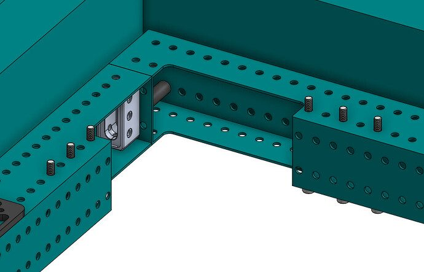
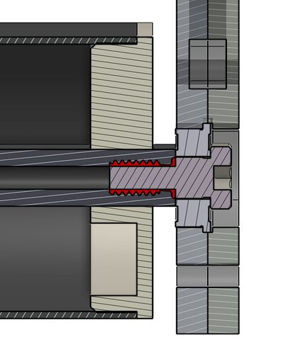
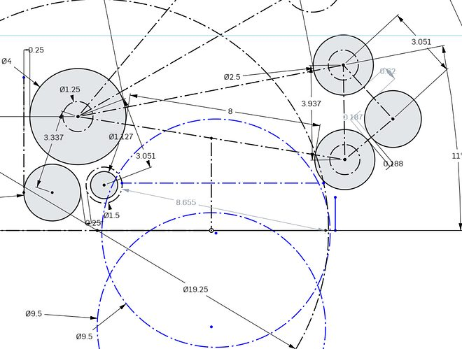

# 2022 · 4414 HighTide — Cutback

EPA rank 17, snapshot EPA 51.81. Provisional reference dossier.

Modular turret scorer with progressively simplified acquisition and interchangeable climb concepts.

## Drivetrain

SDS swerve; modular structure supports repeated revisions.

Coverage: documented synopsis.

## Intake

Pneumatic flex-wheel design evolved to motorized roller pickup; bumper covering selected for ball grip.

Coverage: documented synopsis.

## Transfer

Two sensor-tracked chambers and compliant feed rollers; wrong-color cargo rejected through a slower shot.

Coverage: documented synopsis.

## Scoring

Over-360-degree turret and motorized adjustable hood; high camera mount retains near-goal target view.

Coverage: documented synopsis.

## Endgame

Dual gas-spring telescopes for traversal; separate passive high-bar prototype brought as an alternative, not assumed fielded.

Coverage: documented synopsis.

## Controls

Vision-corrected odometry, moving-shot compensation, intermediate pickup pose and gyro-based climb timing.

Coverage: documented synopsis.

## Changes and versions

- Team reports four broad robot iterations. Removed pneumatics, changed intake contact material and replaced servo hood actuation with a motor.

## Strategic interpretation — analyst inference

Compare whole configurations: the lower-priority climb was designed around the scorer, and the team explicitly considered a faster, lower-scoring endgame when late-cycle output was valuable.

## Limits

- Only published/reviewed configurations are established; further intermediate changes may be undocumented.

Bounded source review; exhaustive intermediate-version history not certified

## Reviewed primary source bundle

- https://youtu.be/eaLhQbCd6_I
- https://www.chiefdelphi.com/t/404398
- https://www.chiefdelphi.com/t/410351

## Season context

Read [the full 2022 game/context chapter](../docs/game_2022.md) before transferring this architecture to another role or season.

## Technical image references

Images are source-associated technical figures or robot views, not dimensionally certified drawings. Follow each source for version and figure context.

2022 team 4414 — source image from post 25 (2022-05-01). Context tags identify the discussion, not a verified component label. [Original source](https://www.chiefdelphi.com/t/404398/25). Source-linked extraction; mechanism identity not individually visually audited

2022 team 4414 — source image from post 25 (2022-05-01). Context tags identify the discussion, not a verified component label. [Original source](https://www.chiefdelphi.com/t/404398/25). Source-linked extraction; mechanism identity not individually visually audited

2022 team 4414 — source image from post 25 (2022-05-01). Context tags identify the discussion, not a verified component label. [Original source](https://www.chiefdelphi.com/t/404398/25). Source-linked extraction; mechanism identity not individually visually audited

## Dated research locators — navigation, not reviewed claims

A tag describes words in the source, not a validated engineering fact. Discussion replies may concern comparison robots.

- 2022-03-02 · Trent · [post 9](https://www.chiefdelphi.com/t/404398/9) · climb
- 2022-03-05 · CelestialMaelstrom · [post 21](https://www.chiefdelphi.com/t/404398/21) · intake
- 2022-04-30 · Robert-violetz · [post 8](https://www.chiefdelphi.com/t/410351/8) · shooter
- 2022-04-30 · _mT · [post 9](https://www.chiefdelphi.com/t/410351/9) · cad
- 2022-04-30 · jjsessa · [post 11](https://www.chiefdelphi.com/t/410351/11) · chain, intake
- 2022-04-30 · JackTervay · [post 24](https://www.chiefdelphi.com/t/404398/24) · chain, intake
- 2022-05-01 · jjsessa · [post 25](https://www.chiefdelphi.com/t/404398/25) · chain, elevator, intake, shooter
- 2022-05-26 · Daniel_Kassab · [post 26](https://www.chiefdelphi.com/t/404398/26) · cad, shooter
- 2022-09-16 · Even · [post 17](https://www.chiefdelphi.com/t/410351/17) · shooter
- 2022-09-16 · LuiTheFly · [post 18](https://www.chiefdelphi.com/t/410351/18) · chain

## Integrated focused technical study

[Construction, reasoning, failure modes and limits](../docs/research_continuation/2022-4414.md). This supplement is a focused interview/source-bundle study, not an exhaustive binder or competition-version certification.
