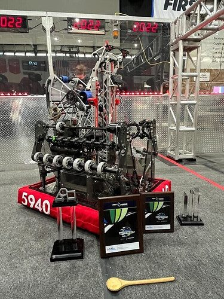

# 2022 · 5940 BREAD — Brioche

EPA rank 18, snapshot EPA 51.78. Provisional reference dossier.

Dual-collector cargo cycling robot; onseason high-bar and offseason traversal configurations must be distinguished.

## Drivetrain

Swerve-family architecture; exact module specification not established in this review.

Coverage: partial / unresolved detail.

## Intake

Single collector at week 1; later opposed wide mecanum collectors supported drive-by pickup.

Coverage: documented synopsis.

## Transfer

Single-sided belts select upward storage or wrong-color passthrough.

Coverage: documented synopsis.

## Scoring

Range launcher; reviewed source establishes moving-shot virtual targeting added between second regional and Worlds. Exact hood/turret geometry remains unresolved.

Coverage: partial / unresolved detail.

## Endgame

Onseason high-bar: an extension-envelope oversight compromised traversal. Reorientation before Worlds did not produce a sufficiently reliable fast traversal. Offseason added belted traversal, static hooks and pneumatic pivot.

Coverage: documented synopsis.

## Controls

Two-button driver workflow; opponent-cargo-only mode was implemented but reportedly never used.

Coverage: documented synopsis.

## Changes and versions

- Onseason: dual intake and moving-shot software added.
- Chezy interview shows a later traversal system, not the original Worlds climb.

## Strategic interpretation — analyst inference

The most useful lesson is the opportunity cost of endgame: a predictable high climb can outperform an unreliable traversal when alliance partners already cover the higher bars. Do not transfer the offseason climb into the Worlds performance explanation.

## Limits

- Only the reviewed published configurations are established; intermediate changes may be undocumented.

Bounded source review; exhaustive intermediate-version history not certified

## Reviewed primary source bundle

- https://youtu.be/GbeIEkqZO9Q
- https://www.chiefdelphi.com/t/412602
- https://github.com/BREAD5940/2022-Onseason

## Season context

Read [the full 2022 game/context chapter](../docs/game_2022.md) before transferring this architecture to another role or season.

## Technical image references

Images are source-associated technical figures or robot views, not dimensionally certified drawings. Follow each source for version and figure context.

2022 team 5940 — source image from post 1 (2022-06-08). Context tags identify the discussion, not a verified component label. [Original source](https://www.chiefdelphi.com/t/412602/1). Source-linked extraction; mechanism identity not individually visually audited

## Dated research locators — navigation, not reviewed claims

A tag describes words in the source, not a validated engineering fact. Discussion replies may concern comparison robots.

- 2022-06-08 · KKrish100 · [post 1](https://www.chiefdelphi.com/t/412602/1) · cad, code
- 2022-06-08 · Alex_Y · [post 3](https://www.chiefdelphi.com/t/412602/3) · cad
- 2022-06-08 · Shayaan · [post 6](https://www.chiefdelphi.com/t/412602/6) · cad, climb
- 2022-06-08 · jtrv · [post 7](https://www.chiefdelphi.com/t/412602/7) · code

## Integrated focused technical study

[Construction, reasoning, failure modes and limits](../docs/research_continuation/2022-5940.md). This supplement is a focused interview/source-bundle study, not an exhaustive binder or competition-version certification.
