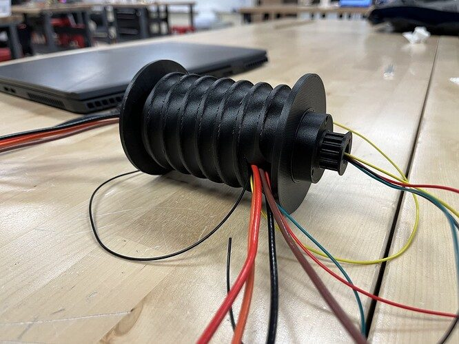
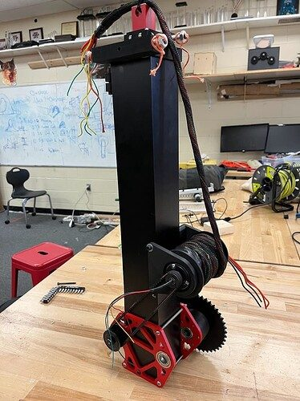

# 2023 · 125 NUTRONs — NUTRONs 2023

EPA rank 31, snapshot EPA 67.6. Provisional reference dossier.

Three-stage telescopic arm with low stow, printed wrist and split translating cube collector.

## Drivetrain

Swerve; exact module version needs code/CAD confirmation.

Coverage: documented synopsis.

## Intake

Two cantilevered rack-and-pinion cube-intake halves leave a center gap for the arm.

Coverage: documented synopsis.

## Transfer

Cross-shaft synchronizes the intake halves; service couplers permit separate removal.

Coverage: documented synopsis.

## Scoring

NEO-powered cascading telescope on a chain-driven shoulder; compact printed wrist and roller claw.

Coverage: documented synopsis.

## Endgame

Not explained in the retrieved interview.

Coverage: documented synopsis.

## Controls

Arm gravity effects require tuning across extension; setup and motion integrated with swerve.

Coverage: documented synopsis.

## Changes and versions

- Traffic-cone orienting collector concept was shelved; team focused on station cones. Interview is week zero, not a final-season configuration.

## Strategic interpretation — analyst inference

The intake gap and telescopic packaging are one integrated decision: moving the arm lower during transit can matter as much as its maximum reach. Shelf loading was an explicit scope reduction.

## Limits

- Interview configuration and reported revisions are documented; full season chronology remains to be audited against the linked releases.

Bounded source review; exhaustive intermediate-version history not certified

## Reviewed primary source bundle

- https://youtu.be/fmK7OAET3F4

## Season context

Read [the full 2023 game/context chapter](../docs/game_2023.md) before transferring this architecture to another role or season.

## Technical image references

Images are source-associated technical figures or robot views, not dimensionally certified drawings. Follow each source for version and figure context.

2023 team 125 — source image from post 7 (2023-08-24). Context tags identify the discussion, not a verified component label. [Original source](https://www.chiefdelphi.com/t/427639/7). Source-linked extraction; mechanism identity not individually visually audited

2023 team 125 — source image from post 7 (2023-08-24). Context tags identify the discussion, not a verified component label. [Original source](https://www.chiefdelphi.com/t/427639/7). Source-linked extraction; mechanism identity not individually visually audited

## Dated research locators — navigation, not reviewed claims

A tag describes words in the source, not a validated engineering fact. Discussion replies may concern comparison robots.

- 2023-02-21 · Tyler_Olds · [post 1](https://www.chiefdelphi.com/t/427639/1) · arm, intake, wrist
- 2023-02-22 · jacob6838 · [post 2](https://www.chiefdelphi.com/t/427639/2) · arm
- 2023-02-23 · Brandon_Holley · [post 3](https://www.chiefdelphi.com/t/427639/3) · arm
- 2023-08-23 · Brandon_Holley · [post 5](https://www.chiefdelphi.com/t/427639/5) · arm
- 2023-08-24 · Brandon_Holley · [post 7](https://www.chiefdelphi.com/t/427639/7) · arm
- 2023-08-25 · Brandon_Holley · [post 9](https://www.chiefdelphi.com/t/427639/9) · intake, wrist
- 2023-08-28 · Brandon_Holley · [post 11](https://www.chiefdelphi.com/t/427639/11) · intake, wrist
- 2023-09-10 · uwee · [post 12](https://www.chiefdelphi.com/t/427639/12) · intake, wrist

## Integrated focused technical study

[Construction, reasoning, failure modes and limits](../docs/research_continuation/2023-125.md). This supplement is a focused interview/source-bundle study, not an exhaustive binder or competition-version certification.
