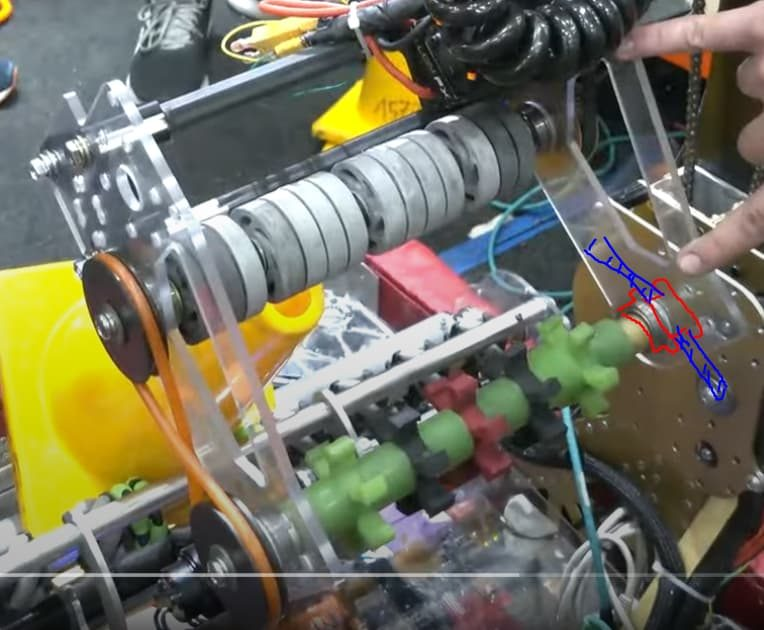

# 2023 · 1577 Steampunk — Jesko

EPA rank 11, snapshot EPA 72.31. Provisional reference dossier.

Pivoting telescopic arm with compact roller gripper and added cone-centering floor intake.

## Intake

Low-pivot floor collector centers tipped cones with mecanum/omni rollers and presents them for handoff.

Coverage: documented synopsis.

## Transfer

Collector rotates the centered cone into a narrow gripper; handoff angle adjusted to match hardware revisions.

Coverage: documented synopsis.

## Scoring

Pivoting, extending arm with low transmission and an absolute encoder measuring actual arm angle beyond gearbox backlash.

Coverage: documented synopsis.

## Drivetrain

Swerve with runtime generated drive-to-point paths.

Coverage: documented synopsis.

## Endgame

Autonomous modes include station traversal, retrieval and balance.

Coverage: documented synopsis.

## Controls

Safe arm waypoints avoid grid collisions; dashboard exposes piece/level selection and adjustable scoring setpoints.

Coverage: documented synopsis.

## Changes and versions

- First event lacked the cone floor intake.
- Earlier concept included a spindexer, which influenced the narrow gripper geometry.
- Team credits Team 95 for floor-intake inspiration.

## Strategic interpretation — analyst inference

Study the way an added acquisition capability fits a pre-existing arm. A centered handoff can preserve a small gripper rather than forcing the entire wrist to become full width.

## Limits

- Intermediate prototype and competition dates are not fully resolved.

Bounded source review; exhaustive intermediate-version history not certified

## Reviewed primary source bundle

- https://youtu.be/OeSR3pGzmSI
- https://www.chiefdelphi.com/t/429960
- https://www.chiefdelphi.com/t/436114

## Season context

Read [the full 2023 game/context chapter](../docs/game_2023.md) before transferring this architecture to another role or season.

## Technical image references

Images are source-associated technical figures or robot views, not dimensionally certified drawings. Follow each source for version and figure context.

2023 team 1577 — source image from post 4 (2023-04-30). Context tags identify the discussion, not a verified component label. [Original source](https://www.chiefdelphi.com/t/436114/4). Source-linked extraction; mechanism identity not individually visually audited

## Dated research locators — navigation, not reviewed claims

A tag describes words in the source, not a validated engineering fact. Discussion replies may concern comparison robots.

- 2023-03-12 · jonathano · [post 2](https://www.chiefdelphi.com/t/429960/2) · arm
- 2023-03-13 · Guy · [post 3](https://www.chiefdelphi.com/t/429960/3) · intake
- 2023-03-14 · 13spangs · [post 4](https://www.chiefdelphi.com/t/429960/4) · arm
- 2023-04-27 · Tyler_Olds · [post 1](https://www.chiefdelphi.com/t/436114/1) · intake
- 2023-04-28 · Guy · [post 2](https://www.chiefdelphi.com/t/436114/2) · intake
- 2023-04-28 · CharlesM479 · [post 3](https://www.chiefdelphi.com/t/436114/3) · bearing, intake
- 2023-04-30 · Guy · [post 4](https://www.chiefdelphi.com/t/436114/4) · bearing, intake
- 2024-01-26 · EmilTheMeal · [post 5](https://www.chiefdelphi.com/t/436114/5) · arm, pivot
- 2024-01-27 · Lidor51 · [post 8](https://www.chiefdelphi.com/t/436114/8) · arm
- 2024-02-01 · Guy · [post 9](https://www.chiefdelphi.com/t/436114/9) · arm
- 2024-02-05 · Guy · [post 11](https://www.chiefdelphi.com/t/436114/11) · arm

## Integrated focused technical study

[Construction, reasoning, failure modes and limits](../docs/research_continuation/2023-1577.md). This supplement is a focused interview/source-bundle study, not an exhaustive binder or competition-version certification.
