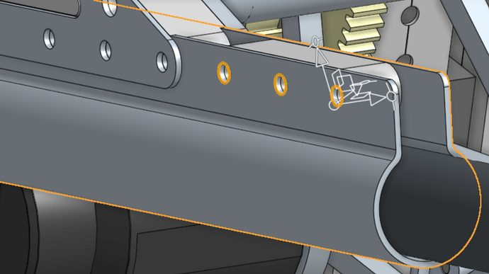
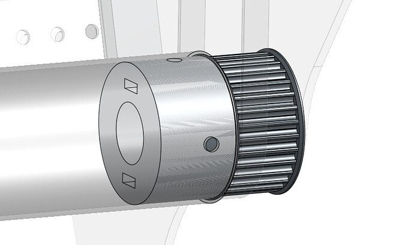

# 2023 · 1678 Citrus Circuits — Tangerine Tumbler

EPA rank 3, snapshot EPA 77.86. Provisional reference dossier.

Low-center-of-gravity pivoting elevator/arm with wristed dual-piece roller intake and integrated forks.

## Intake

Wide roller end effector derived from the Everybot approach. Upper rollers acquire cones; lower jaw handles cubes from a common floor pose.

Coverage: documented synopsis.

## Transfer

Direct grip; remote wrist transmission keeps heavy components low.

Coverage: documented synopsis.

## Scoring

Continuously rigged elevator and pivoting arm, with low-mounted gearboxes.

Coverage: documented synopsis.

## Drivetrain

Robot packaging explicitly prioritizes low center of gravity and resistance to tipping.

Coverage: documented synopsis.

## Endgame

Forks attached to the arm engage the station/partner arrangement; existing superstructure actuators lift the drivebase rather than adding a separate climber.

Coverage: documented synopsis.

## Controls

Coordinated mechanism presets; exact control implementation is available through the code release.

Coverage: documented synopsis.

## Changes and versions

- Team reports roughly seven intake iterations.
- Carbon-fiber intake crossbars broke or lacked stiffness; replaced with aluminum.
- Forks shortened by about four inches to improve alignment and access on both sides.

## Strategic interpretation — analyst inference

A strong example of making endgame support fit an existing scoring mechanism. Evaluate partner geometry and load paths before borrowing the forks.

## Limits

- Seven iterations are reported, but each intermediate geometry is not separately documented here.

Bounded source review; exhaustive intermediate-version history not certified

## Reviewed primary source bundle

- https://youtu.be/r6JDy85dax8
- https://www.chiefdelphi.com/t/437632

## Season context

Read [the full 2023 game/context chapter](../docs/game_2023.md) before transferring this architecture to another role or season.

## Technical image references

Images are source-associated technical figures or robot views, not dimensionally certified drawings. Follow each source for version and figure context.

2023 team 1678 — source image from post 7 (2023-05-28). Context tags identify the discussion, not a verified component label. [Original source](https://www.chiefdelphi.com/t/437632/7). Source-linked extraction; mechanism identity not individually visually audited

2023 team 1678 — source image from post 8 (2023-05-28). Context tags identify the discussion, not a verified component label. [Original source](https://www.chiefdelphi.com/t/437632/8). Source-linked extraction; mechanism identity not individually visually audited

## Dated research locators — navigation, not reviewed claims

A tag describes words in the source, not a validated engineering fact. Discussion replies may concern comparison robots.

- 2023-03-02 · LuiTheFly · [post 14](https://www.chiefdelphi.com/t/428718/14) · intake, pivot
- 2023-03-07 · Rohit_Seshadri · [post 36](https://www.chiefdelphi.com/t/428718/36) · elevator, pivot
- 2023-03-07 · Torrance · [post 37](https://www.chiefdelphi.com/t/428718/37) · arm, pivot
- 2023-03-07 · davepowers · [post 38](https://www.chiefdelphi.com/t/428718/38) · pivot
- 2023-05-27 · Michael_Corsetto · [post 1](https://www.chiefdelphi.com/t/437632/1) · cad, code
- 2023-05-28 · Rohit_Seshadri · [post 3](https://www.chiefdelphi.com/t/437632/3) · elevator
- 2023-05-28 · MatthewL_333 · [post 7](https://www.chiefdelphi.com/t/437632/7) · elevator, pivot
- 2023-05-28 · oguzozgur · [post 8](https://www.chiefdelphi.com/t/437632/8) · bearing, intake
- 2023-05-28 · Peyton_Yeung · [post 10](https://www.chiefdelphi.com/t/437632/10) · intake
- 2023-05-28 · Aaron_Li · [post 11](https://www.chiefdelphi.com/t/437632/11) · intake
- 2023-05-28 · adan_azkul · [post 12](https://www.chiefdelphi.com/t/437632/12) · arm, elevator
- 2023-05-29 · Tyler_S · [post 13](https://www.chiefdelphi.com/t/437632/13) · code
- 2023-05-29 · RoboChair · [post 14](https://www.chiefdelphi.com/t/437632/14) · cad
- 2023-05-29 · Joe_Ross · [post 15](https://www.chiefdelphi.com/t/437632/15) · code
- 2023-05-29 · Torrance · [post 17](https://www.chiefdelphi.com/t/437632/17) · cad
- 2023-05-30 · Guy_With_Dog · [post 20](https://www.chiefdelphi.com/t/437632/20) · elevator
- 2023-05-31 · CelestialMaelstrom · [post 21](https://www.chiefdelphi.com/t/437632/21) · cad
- 2023-05-31 · Michael_Corsetto · [post 23](https://www.chiefdelphi.com/t/437632/23) · arm, chain, code, elevator, wrist
- 2023-05-31 · chrisrin · [post 24](https://www.chiefdelphi.com/t/437632/24) · arm
- 2023-06-01 · Brendan_Rockwell · [post 26](https://www.chiefdelphi.com/t/437632/26) · elevator
- 2023-06-01 · Brendan_Rockwell · [post 27](https://www.chiefdelphi.com/t/437632/27) · arm, elevator
- 2023-06-01 · Rohit_Seshadri · [post 29](https://www.chiefdelphi.com/t/437632/29) · cad
- 2023-06-02 · Brendan_Rockwell · [post 30](https://www.chiefdelphi.com/t/437632/30) · arm, bearing, cad, intake
- 2023-06-02 · Andrew_L · [post 31](https://www.chiefdelphi.com/t/437632/31) · cad
- 2023-06-02 · ElliotS · [post 32](https://www.chiefdelphi.com/t/437632/32) · intake
- 2023-06-02 · Niklas701 · [post 33](https://www.chiefdelphi.com/t/437632/33) · intake
- 2023-06-03 · crueter · [post 35](https://www.chiefdelphi.com/t/437632/35) · autonomous, code
- 2023-06-03 · Yi_Zhang · [post 36](https://www.chiefdelphi.com/t/437632/36) · autonomous, code
- 2023-06-03 · crueter · [post 37](https://www.chiefdelphi.com/t/437632/37) · code
- 2023-06-05 · joemost · [post 38](https://www.chiefdelphi.com/t/437632/38) · code
- 2023-06-05 · Brendan_Rockwell · [post 40](https://www.chiefdelphi.com/t/437632/40) · cad
- 2023-06-10 · superdude311 · [post 43](https://www.chiefdelphi.com/t/437632/43) · intake
- 2023-06-13 · obscurewhale · [post 46](https://www.chiefdelphi.com/t/437632/46) · cad
- 2023-06-14 · Brendan_Rockwell · [post 47](https://www.chiefdelphi.com/t/437632/47) · arm, climb, elevator, intake
- 2023-06-15 · RoboChair · [post 50](https://www.chiefdelphi.com/t/437632/50) · elevator
- 2023-06-15 · obscurewhale · [post 51](https://www.chiefdelphi.com/t/437632/51) · elevator
- 2023-06-15 · Brendan_Rockwell · [post 52](https://www.chiefdelphi.com/t/437632/52) · elevator
- 2023-06-16 · Pedro808 · [post 53](https://www.chiefdelphi.com/t/437632/53) · belt, cad
- 2023-07-14 · Zatack7 · [post 58](https://www.chiefdelphi.com/t/437632/58) · cad
- 2023-07-23 · cadandcookies · [post 63](https://www.chiefdelphi.com/t/437632/63) · elevator
- 2023-07-28 · Brendan_Rockwell · [post 64](https://www.chiefdelphi.com/t/437632/64) · bearing, elevator
- 2023-07-31 · ben_chigi · [post 65](https://www.chiefdelphi.com/t/437632/65) · elevator
- 2023-08-10 · asaphfirst · [post 67](https://www.chiefdelphi.com/t/437632/67) · arm
- 2023-08-10 · RoboChair · [post 68](https://www.chiefdelphi.com/t/437632/68) · arm
- 2023-09-13 · ElliotS · [post 69](https://www.chiefdelphi.com/t/437632/69) · intake
- 2023-09-15 · Emilio · [post 81](https://www.chiefdelphi.com/t/437632/81) · intake
- 2023-09-16 · ElliotS · [post 82](https://www.chiefdelphi.com/t/437632/82) · intake
- 2023-10-08 · joemost · [post 84](https://www.chiefdelphi.com/t/437632/84) · code
- 2023-10-09 · arnara07 · [post 85](https://www.chiefdelphi.com/t/437632/85) · cad, elevator
- 2023-10-09 · asaphfirst · [post 86](https://www.chiefdelphi.com/t/437632/86) · elevator
- 2023-10-10 · Brendan_Rockwell · [post 87](https://www.chiefdelphi.com/t/437632/87) · elevator
- 2023-10-10 · Gordude · [post 88](https://www.chiefdelphi.com/t/437632/88) · elevator
- 2023-10-11 · RoboChair · [post 90](https://www.chiefdelphi.com/t/437632/90) · arm, intake
- 2023-10-11 · truher · [post 91](https://www.chiefdelphi.com/t/437632/91) · belt, elevator
- 2023-10-11 · s-neff · [post 92](https://www.chiefdelphi.com/t/437632/92) · chain, elevator
- 2023-10-11 · s-neff · [post 95](https://www.chiefdelphi.com/t/437632/95) · elevator
- 2023-10-11 · Brendan_Rockwell · [post 96](https://www.chiefdelphi.com/t/437632/96) · belt, cad, elevator
- 2023-10-11 · jjsessa · [post 106](https://www.chiefdelphi.com/t/437632/106) · belt, elevator
- 2023-10-11 · RoboChair · [post 107](https://www.chiefdelphi.com/t/437632/107) · belt
- 2023-10-11 · Yi_Zhang · [post 108](https://www.chiefdelphi.com/t/437632/108) · elevator
- 2023-10-12 · Brendan_Rockwell · [post 112](https://www.chiefdelphi.com/t/437632/112) · elevator
- 2023-10-12 · AlanG · [post 113](https://www.chiefdelphi.com/t/437632/113) · pivot
- 2023-10-12 · RoboChair · [post 114](https://www.chiefdelphi.com/t/437632/114) · cad, pivot
- 2023-10-14 · jjsessa · [post 120](https://www.chiefdelphi.com/t/437632/120) · elevator
- 2023-10-20 · anth · [post 121](https://www.chiefdelphi.com/t/437632/121) · cad, chain, intake
- 2023-10-20 · bcon · [post 124](https://www.chiefdelphi.com/t/437632/124) · bearing, intake
- 2023-10-23 · Brendan_Rockwell · [post 130](https://www.chiefdelphi.com/t/437632/130) · arm, chain, elevator, intake
- 2023-10-23 · BordomBeThyName · [post 134](https://www.chiefdelphi.com/t/437632/134) · cad
- 2023-10-23 · RoboChair · [post 136](https://www.chiefdelphi.com/t/437632/136) · elevator
- 2023-10-23 · BordomBeThyName · [post 137](https://www.chiefdelphi.com/t/437632/137) · arm, cad, pivot
- 2023-10-30 · jtrv · [post 149](https://www.chiefdelphi.com/t/437632/149) · autonomous, elevator, vision
- 2023-11-14 · Aaron_Li · [post 160](https://www.chiefdelphi.com/t/437632/160) · wrist
- 2023-11-14 · BordomBeThyName · [post 161](https://www.chiefdelphi.com/t/437632/161) · intake
- 2023-11-26 · joemost · [post 165](https://www.chiefdelphi.com/t/437632/165) · intake
- 2023-11-27 · superdude311 · [post 166](https://www.chiefdelphi.com/t/437632/166) · intake
- 2023-11-27 · Brendan_Rockwell · [post 167](https://www.chiefdelphi.com/t/437632/167) · bearing
- 2023-11-27 · joemost · [post 170](https://www.chiefdelphi.com/t/437632/170) · code
- 2023-12-07 · RoboChair · [post 176](https://www.chiefdelphi.com/t/437632/176) · elevator
- 2024-01-18 · Aaron_Li · [post 182](https://www.chiefdelphi.com/t/437632/182) · cad, code
- 2024-01-22 · jason614163 · [post 184](https://www.chiefdelphi.com/t/437632/184) · intake
- 2024-01-22 · RoboChair · [post 186](https://www.chiefdelphi.com/t/437632/186) · belt
- 2024-01-22 · J.F · [post 187](https://www.chiefdelphi.com/t/437632/187) · belt, intake
- 2024-01-22 · Peyton_Yeung · [post 191](https://www.chiefdelphi.com/t/437632/191) · belt
- 2024-01-23 · BordomBeThyName · [post 197](https://www.chiefdelphi.com/t/437632/197) · belt
- 2024-01-23 · Yessir · [post 198](https://www.chiefdelphi.com/t/437632/198) · intake, wrist
- 2024-01-23 · RedLeader342 · [post 199](https://www.chiefdelphi.com/t/437632/199) · chain, elevator
- 2024-01-23 · BordomBeThyName · [post 200](https://www.chiefdelphi.com/t/437632/200) · elevator
- 2024-02-05 · Noamarical · [post 204](https://www.chiefdelphi.com/t/437632/204) · intake
- 2024-02-15 · Karrot · [post 209](https://www.chiefdelphi.com/t/437632/209) · cad
- 2024-02-19 · royce_the_giraffe · [post 211](https://www.chiefdelphi.com/t/437632/211) · elevator
- 2024-02-19 · BordomBeThyName · [post 212](https://www.chiefdelphi.com/t/437632/212) · elevator
- 2024-02-27 · royce_the_giraffe · [post 215](https://www.chiefdelphi.com/t/437632/215) · elevator, encoder
- 2024-02-28 · NatPin74 · [post 216](https://www.chiefdelphi.com/t/437632/216) · arm, bearing, elevator, intake, pivot

## Integrated focused technical study

[Construction, reasoning, failure modes and limits](../docs/research_continuation/2023-1678.md). This supplement is a focused interview/source-bundle study, not an exhaustive binder or competition-version certification.
