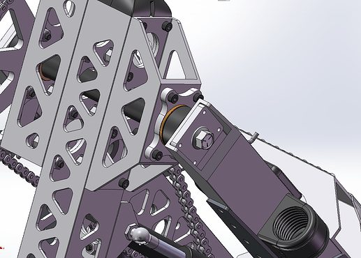
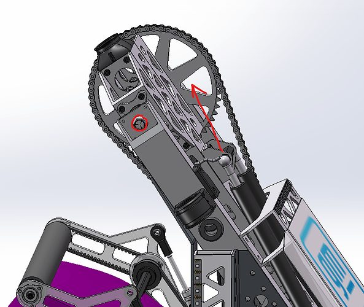
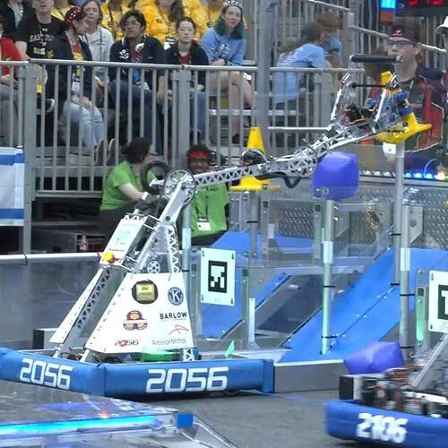

# 2023 · 2056 OP Robotics — UPPERCUT

EPA rank 2, snapshot EPA 83.67. Provisional reference dossier.

Counterbalanced articulated arm and compact dual-piece gripper on swerve.

## Intake

Pneumatic gripper with powered upper roller; cube limit switch and cone beam break.

Coverage: documented synopsis.

## Transfer

Direct acquisition by the end effector avoids a separate floor-to-gripper transfer.

Coverage: documented synopsis.

## Scoring

Low-mounted reduction and chain-driven arm; gas springs reduce the load on the pivot motors.

Coverage: documented synopsis.

## Drivetrain

Team's first competition swerve season; custom control and protected modules. Team reports improved odometry repeatability from Phoenix Pro time synchronization.

Coverage: documented synopsis.

## Endgame

Charge-station balancing; a dedicated endgame mechanism is not established by the interview.

Coverage: partial / unresolved detail.

## Controls

LEDs indicate game-piece selection, faults and autonomous selection.

Coverage: documented synopsis.

## Changes and versions

- Early cone dropping led to gears linking the gripper arms.
- Added guides prevent intake rollers catching on swerve-module edges.
- Practice-robot pivot tube deformation prompted reinforcement plates.

## Strategic interpretation — analyst inference

Useful precedent for reducing handoff complexity while investing in grip retention, mechanical stiffness and repeatable positioning. The arm is only one part of the repeatability story.

## Evidence and limits

- Detailed balance implementation needs corroboration.
- Version dates not fully established.

Bounded source review; exhaustive intermediate-version history not certified

## Reviewed source bundle

- https://youtu.be/IfX5bYZahtg
- https://2056.ca/wp-content/uploads/2023/05/2023_Tech_Binder_OPR2056.pdf
- https://www.chiefdelphi.com/t/437553

## Season context

Read [the full 2023 game/context chapter](../docs/game_2023.md) before transferring this architecture to another role or season.

## Technical image references

Images are source-associated technical figures or robot views, not dimensionally certified drawings. Follow each source for version and figure context.

2023 team 2056 — source image from post 10 (2023-05-25). Context tags identify the discussion, not a verified component label. [Original source](https://www.chiefdelphi.com/t/437553/10). Source-linked extraction; mechanism identity not individually visually audited

2023 team 2056 — source image from post 50 (2025-10-03). Context tags identify the discussion, not a verified component label. [Original source](https://www.chiefdelphi.com/t/437553/50). Source-linked extraction; mechanism identity not individually visually audited

2023 team 2056 — source image from post 1 (2023-04-23). Context tags identify the discussion, not a verified component label. [Original source](https://www.chiefdelphi.com/t/435578/1). Source-linked extraction; mechanism identity not individually visually audited

## Dated research locators — navigation, not reviewed claims

A tag describes words in the source, not a validated engineering fact. Discussion replies may concern comparison robots.

- 2023-04-23 · JohnFogarty · [post 2](https://www.chiefdelphi.com/t/435578/2) · arm
- 2023-05-25 · Is-han-solo · [post 2](https://www.chiefdelphi.com/t/437553/2) · code
- 2023-05-25 · JohnFogarty · [post 3](https://www.chiefdelphi.com/t/437553/3) · autonomous
- 2023-05-25 · Rohit_Seshadri · [post 6](https://www.chiefdelphi.com/t/437553/6) · pivot
- 2023-05-25 · Khalsa · [post 10](https://www.chiefdelphi.com/t/437553/10) · code, pivot
- 2023-05-27 · Khalsa · [post 14](https://www.chiefdelphi.com/t/437553/14) · intake
- 2023-10-05 · Zatack7 · [post 20](https://www.chiefdelphi.com/t/437553/20) · cad
- 2023-10-22 · AlexT321 · [post 25](https://www.chiefdelphi.com/t/437553/25) · arm
- 2023-10-23 · Holtzman · [post 26](https://www.chiefdelphi.com/t/437553/26) · arm, chain, pivot
- 2023-10-24 · Cory_Walters · [post 28](https://www.chiefdelphi.com/t/437553/28) · arm
- 2023-10-25 · Smtopps · [post 29](https://www.chiefdelphi.com/t/437553/29) · cad
- 2023-11-28 · FrcProgrammer · [post 30](https://www.chiefdelphi.com/t/437553/30) · vision
- 2023-11-28 · Holtzman · [post 31](https://www.chiefdelphi.com/t/437553/31) · arm, autonomous, gripper, vision
- 2023-11-28 · Smtopps · [post 32](https://www.chiefdelphi.com/t/437553/32) · autonomous, vision
- 2024-08-25 · Khalsa · [post 39](https://www.chiefdelphi.com/t/437553/39) · intake
- 2025-02-20 · joemost · [post 41](https://www.chiefdelphi.com/t/437553/41) · autonomous
- 2025-02-20 · joemost · [post 45](https://www.chiefdelphi.com/t/437553/45) · code
- 2025-10-03 · ArchdukeTim · [post 49](https://www.chiefdelphi.com/t/437553/49) · arm
- 2025-10-03 · Khalsa · [post 50](https://www.chiefdelphi.com/t/437553/50) · arm, pivot

# 2023-2056: technical mechanisms, design reasoning and revision boundaries

These notes distinguish published construction from team-stated intent and original engineering inference. Selected numerical values are reported source data, not independently reproduced measurements. The recommended tests have not been performed. A binder snapshot does not certify every competition version.

## OPR 2023: low-backlash articulated arm

Version: 2023 articulated arm. [PDF p9](https://2056.ca/wp-content/uploads/2023/05/2023_Tech_Binder_OPR2056.pdf#page=9) · [PDF p11](https://2056.ca/wp-content/uploads/2023/05/2023_Tech_Binder_OPR2056.pdf#page=11) · [PDF p13](https://2056.ca/wp-content/uploads/2023/05/2023_Tech_Binder_OPR2056.pdf#page=13)

**Published construction:** Two driven joints, dead axles, bronze bushings and gas-shock shoulder counterbalance.

**Team-stated reason or evidence boundary:** Fast repeatable motion with motor-side position sensing.

**Engineering analysis — original inference:** An articulated arm can reach floor, station and grid positions without a tall lift, but the endpoint error combines both joint errors. A small shoulder angle error becomes a larger tip error as the arm extends. Reducing backlash at shafts, gears and chains supports motor-side sensing only if elastic deformation remains acceptable. Gas shocks reduce gravitational torque over part of the motion but produce a changing torque with angle. A bronze bushing can be appropriate for high load and limited rotation, while friction and wear must be included in control tuning.

**Proposed validation — not a completed test:** Measure tip repeatability approaching the same pose from both directions, under load and after chain wear.

**Limits:** The binder is a published configuration snapshot, not an independent durability or match-rate test.

## OPR 2023: piece-specific active contacts

Version: 2023 articulated arm. [PDF p15](https://2056.ca/wp-content/uploads/2023/05/2023_Tech_Binder_OPR2056.pdf#page=15) · [PDF p16](https://2056.ca/wp-content/uploads/2023/05/2023_Tech_Binder_OPR2056.pdf#page=16)

**Published construction:** Pneumatic top roller for cubes, synchronized side rollers for cones and piece-specific sensors.

**Team-stated reason or evidence boundary:** Center and hold both pieces while limiting damage.

**Engineering analysis — original inference:** The top roller and side pinch solve different shapes rather than forcing both through one fixed gap. Timing the side mechanism prevents one arm closing first and pushing the cone away. A sensor that reliably detects a cube may not see a cone in the same position, which explains why sensing belongs in the physical design. The control should stop or change the roller command after capture to avoid damaging the soft piece. Compliance reduces impact severity but must not let the frame spread enough to lose the intended contact geometry.

**Proposed validation — not a completed test:** Test skewed cone entry, cube retention during traversal and sensor-triggered transitions with worn or deformed pieces.

**Limits:** The binder is a published configuration snapshot, not an independent durability or match-rate test.

## OPR 2023: base mass supports arm motion

Version: 2023 articulated arm. [PDF p5](https://2056.ca/wp-content/uploads/2023/05/2023_Tech_Binder_OPR2056.pdf#page=5) · [PDF p7](https://2056.ca/wp-content/uploads/2023/05/2023_Tech_Binder_OPR2056.pdf#page=7)

**Published construction:** Low Mk4i base; rear steel ballast and solid bellypan; rigid tower and dead-axle shoulder support.

**Team-stated reason or evidence boundary:** Stable traversal and a stiff arm reference.

**Engineering analysis — original inference:** A lightweight arm does not eliminate its overturning moment. Low ballast and a broad support polygon can permit more aggressive joint motion, while adding driving load and stopping energy. Tower deflection appears as arm error even when both joint encoders are exact. The base, tower and arm should therefore be tested as one structure. The appropriate ballast location depends on the arm’s range and battery placement rather than a generic preference for more robot weight.

**Proposed validation — not a completed test:** Measure wheel unloading and tool-tip motion during combined driving and arm transitions over cable track and platform edges.

**Limits:** The binder is a published configuration snapshot, not an independent durability or match-rate test.

## Selected published parameters

| Component | Source parameter | Locator |
|---|---|---|
| Drive | Mk4i L2; 15 ft/s | [Source p5](https://2056.ca/wp-content/uploads/2023/05/2023_Tech_Binder_OPR2056.pdf#page=5) |
| Arm | 2×50-lbf shoulder gas shocks | [Source p9](https://2056.ca/wp-content/uploads/2023/05/2023_Tech_Binder_OPR2056.pdf#page=9) |
| Shoulder | 133:1 overall; #35 final chain | [Source p11](https://2056.ca/wp-content/uploads/2023/05/2023_Tech_Binder_OPR2056.pdf#page=11) |
| Elbow | 138:1 overall | [Source p13](https://2056.ca/wp-content/uploads/2023/05/2023_Tech_Binder_OPR2056.pdf#page=13) |
| Intake | quarter-inch polycarbonate; pneumatic piece-specific contacts | [Source p16](https://2056.ca/wp-content/uploads/2023/05/2023_Tech_Binder_OPR2056.pdf#page=16) |

Ratios preserve source notation; verify driver/driven order, complete geometry and the actual version in CAD before fabrication. Figure records retain PDF page and crop bounds in `data/mechanism_images.jsonl`. Images may include rejected prototypes or whole-robot photographs; their captions preserve that distinction.
