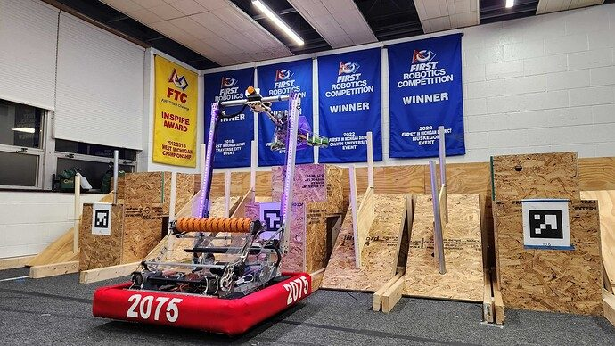
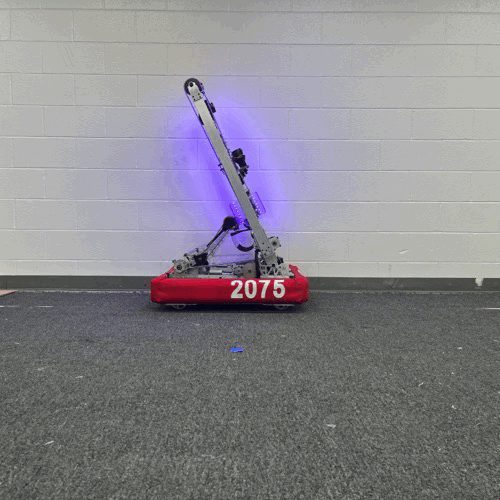

# 2023 · 2075 Enigma Robotics — Cypher

EPA rank 18, snapshot EPA 70.56. Provisional reference dossier.

Two-joint arm and wide floor collector with compliant handoff to a station-capable claw.

## Drivetrain

Swerve; wheel odometry corrected with vision in autonomous.

Coverage: documented synopsis.

## Intake

Beater-bar/roller floor acquisition for both pieces.

Coverage: documented synopsis.

## Transfer

Claw pivot compliance accommodates cones arriving at different lateral positions.

Coverage: documented synopsis.

## Scoring

Shoulder/elbow arm; low backlash is central to repeatable node placement.

Coverage: documented synopsis.

## Endgame

Autonomous programs include balance attempts.

Coverage: documented synopsis.

## Controls

Limelight corrections improve paths over the cable bump; LEDs communicate requested and acquired piece.

Coverage: documented synopsis.

## Changes and versions

- Arm gears and hex joints shimmed and secured to reduce accumulated slop. Vision integrated later; interview says teleop vision correction was not implemented at that point.

## Strategic interpretation — analyst inference

A wide intake transfers its alignment problem downstream unless the handoff or software can accommodate piece position. The yielding claw is an explicit answer to that problem.

## Limits

- Interview configuration and reported revisions are documented; full season chronology remains to be audited against the linked releases.

Bounded source review; exhaustive intermediate-version history not certified

## Reviewed primary source bundle

- https://youtu.be/YCgAOm7wFq4

## Season context

Read [the full 2023 game/context chapter](../docs/game_2023.md) before transferring this architecture to another role or season.

## Technical image references

Images are source-associated technical figures or robot views, not dimensionally certified drawings. Follow each source for version and figure context.

2023 team 2075 — source image from post 1 (2023-03-16). Context tags identify the discussion, not a verified component label. [Original source](https://www.chiefdelphi.com/t/430484/1). Source-linked extraction; mechanism identity not individually visually audited

2023 team 2075 — source image from post 1 (2023-03-16). Context tags identify the discussion, not a verified component label. [Original source](https://www.chiefdelphi.com/t/430484/1). Source-linked extraction; mechanism identity not individually visually audited

## Dated research locators — navigation, not reviewed claims

A tag describes words in the source, not a validated engineering fact. Discussion replies may concern comparison robots.

- 2023-03-20 · Robosquatch76 · [post 3](https://www.chiefdelphi.com/t/430484/3) · prototype
- 2023-04-06 · Quinn_S · [post 5](https://www.chiefdelphi.com/t/430484/5) · autonomous, intake
- 2024-01-06 · Quinn_S · [post 6](https://www.chiefdelphi.com/t/430484/6) · cad, code

## Integrated focused technical study

[Construction, reasoning, failure modes and limits](../docs/research_continuation/2023-2075.md). This supplement is a focused interview/source-bundle study, not an exhaustive binder or competition-version certification.
