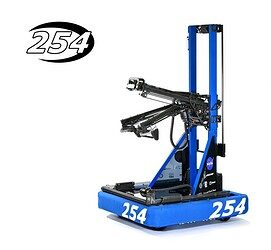
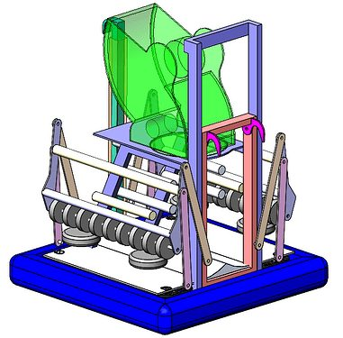
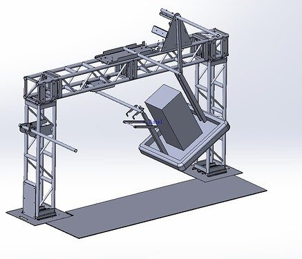
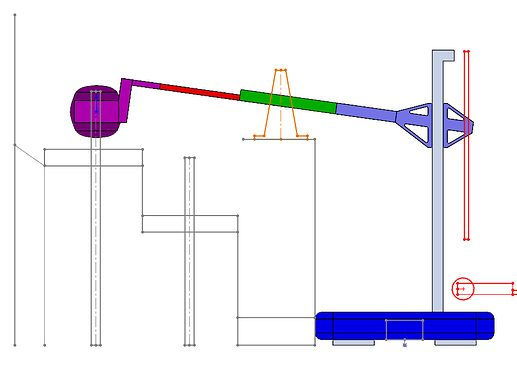

# 2023 · 254 The Cheesy Poofs — BREAKDOWN

EPA rank 5, snapshot EPA 77.18. Provisional reference dossier.

Vertical elevator plus horizontal Laterator, firm roller gripper, auxiliary floor intake and independent forks.

## Intake

Articulating roller gripper retains cones securely; supplementary floor intake guides cubes and supports acquisition.

Coverage: documented synopsis.

## Transfer

Floor intake translates on printed blocks with low-friction tape; handoff geometry is coordinated with the gripper.

Coverage: documented synopsis.

## Scoring

Belt-driven vertical elevator and multi-stage horizontal Laterator separate height from reach.

Coverage: documented synopsis.

## Drivetrain

SDS inverted swerve modules; front rail strengthened after repeated loading impacts.

Coverage: documented synopsis.

## Endgame

Separate translating/articulating forks lift the chassis while respecting the tall superstructure's clearance constraints.

Coverage: documented synopsis.

## Controls

Coordinated scoring poses, autonomous paths and balancing; code and technical binder are public.

Coverage: documented synopsis.

## Changes and versions

- Auxiliary floor roller added after acquisition problems.
- Front frame rail thickened through successive revisions to solid aluminum.
- Elevator bracing strengthened after twisting and impact damage.

## Strategic interpretation — analyst inference

Compare with 1678's integrated forks: similar endgame objective, but different superstructure geometry changes the viable lifting motion. The independent axes simplify placement geometry while increasing structure and service complexity.

## Evidence and limits

- Public binder and Q&A describe revisions, but no claim is made that every shop iteration is enumerated.

Bounded source review; exhaustive intermediate-version history not certified

## Reviewed source bundle

- https://youtu.be/D_-aiikeOH8
- https://media.team254.com/2023/10/90bc07c6-2023-Tech-Binder-V6.pdf
- https://www.chiefdelphi.com/t/443167

## Season context

Read [the full 2023 game/context chapter](../docs/game_2023.md) before transferring this architecture to another role or season.

## Technical image references

Images are source-associated technical figures or robot views, not dimensionally certified drawings. Follow each source for version and figure context.

2023 team 254 — source image from post 1 (2023-10-26). Context tags identify the discussion, not a verified component label. [Original source](https://www.chiefdelphi.com/t/443167/1). Source-linked extraction; mechanism identity not individually visually audited

2023 team 254 — source image from post 2 (2023-09-06). Context tags identify the discussion, not a verified component label. [Original source](https://www.chiefdelphi.com/t/440533/2). Source-linked extraction; mechanism identity not individually visually audited

2023 team 254 — source image from post 2 (2023-09-06). Context tags identify the discussion, not a verified component label. [Original source](https://www.chiefdelphi.com/t/440533/2). Source-linked extraction; mechanism identity not individually visually audited

2023 team 254 — source image from post 2 (2023-09-06). Context tags identify the discussion, not a verified component label. [Original source](https://www.chiefdelphi.com/t/440533/2). Source-linked extraction; mechanism identity not individually visually audited

## Dated research locators — navigation, not reviewed claims

A tag describes words in the source, not a validated engineering fact. Discussion replies may concern comparison robots.

- 2023-09-06 · rlokesh25 · [post 1](https://www.chiefdelphi.com/t/440533/1) · cad
- 2023-09-06 · Torrance · [post 2](https://www.chiefdelphi.com/t/440533/2) · arm, belt, cad, elevator, intake, prototype
- 2023-09-07 · Torrance · [post 3](https://www.chiefdelphi.com/t/440533/3) · cad
- 2023-09-07 · Andrew_L · [post 4](https://www.chiefdelphi.com/t/440533/4) · cad
- 2023-09-08 · awulfing · [post 6](https://www.chiefdelphi.com/t/440533/6) · cad, prototype
- 2023-10-04 · Torrance · [post 6](https://www.chiefdelphi.com/t/441808/6) · autonomous, cad, code
- 2023-10-26 · Torrance · [post 1](https://www.chiefdelphi.com/t/443167/1) · cad, code, intake
- 2023-10-26 · waialua359 · [post 2](https://www.chiefdelphi.com/t/443167/2) · cad
- 2023-10-26 · Eliot · [post 3](https://www.chiefdelphi.com/t/443167/3) · elevator, intake
- 2023-10-26 · Torrance · [post 6](https://www.chiefdelphi.com/t/443167/6) · elevator, encoder, intake
- 2023-10-26 · Torrance · [post 8](https://www.chiefdelphi.com/t/443167/8) · arm, autonomous, elevator, intake
- 2023-10-27 · Torrance · [post 12](https://www.chiefdelphi.com/t/443167/12) · elevator
- 2023-10-27 · Enjsnake · [post 14](https://www.chiefdelphi.com/t/443167/14) · cad
- 2023-10-27 · Chuck117 · [post 15](https://www.chiefdelphi.com/t/443167/15) · elevator
- 2023-10-27 · AbhiJana · [post 30](https://www.chiefdelphi.com/t/443167/30) · chain
- 2023-10-27 · ksiwinski · [post 31](https://www.chiefdelphi.com/t/443167/31) · cad, elevator, intake, prototype
- 2023-10-27 · rafi · [post 32](https://www.chiefdelphi.com/t/443167/32) · elevator
- 2023-10-27 · Torrance · [post 34](https://www.chiefdelphi.com/t/443167/34) · chain, elevator
- 2023-10-27 · Torrance · [post 35](https://www.chiefdelphi.com/t/443167/35) · cad
- 2023-10-27 · Jared_Russell · [post 37](https://www.chiefdelphi.com/t/443167/37) · elevator, intake
- 2023-10-27 · oguzozgur · [post 38](https://www.chiefdelphi.com/t/443167/38) · elevator, intake
- 2023-10-27 · Torrance · [post 39](https://www.chiefdelphi.com/t/443167/39) · bearing, belt, camera, elevator
- 2023-10-27 · Torrance · [post 40](https://www.chiefdelphi.com/t/443167/40) · elevator, intake
- 2023-10-27 · Nuttyman54 · [post 42](https://www.chiefdelphi.com/t/443167/42) · intake
- 2023-10-27 · CelestialMaelstrom · [post 43](https://www.chiefdelphi.com/t/443167/43) · elevator
- 2023-10-27 · CelestialMaelstrom · [post 44](https://www.chiefdelphi.com/t/443167/44) · elevator
- 2023-10-27 · CelestialMaelstrom · [post 45](https://www.chiefdelphi.com/t/443167/45) · bearing, belt
- 2023-10-28 · waialua359 · [post 51](https://www.chiefdelphi.com/t/443167/51) · cad
- 2023-10-28 · Rohit_Seshadri · [post 53](https://www.chiefdelphi.com/t/443167/53) · belt, elevator
- 2023-10-28 · Jared_Russell · [post 55](https://www.chiefdelphi.com/t/443167/55) · cad, code
- 2023-10-28 · Torrance · [post 56](https://www.chiefdelphi.com/t/443167/56) · bearing, elevator
- 2023-10-28 · FerMtz · [post 57](https://www.chiefdelphi.com/t/443167/57) · intake
- 2023-10-28 · waialua359 · [post 60](https://www.chiefdelphi.com/t/443167/60) · cad, code
- 2023-10-28 · Rohit_Seshadri · [post 63](https://www.chiefdelphi.com/t/443167/63) · code, elevator
- 2023-10-29 · arnara07 · [post 64](https://www.chiefdelphi.com/t/443167/64) · arm, elevator
- 2023-10-29 · Rohit_Seshadri · [post 65](https://www.chiefdelphi.com/t/443167/65) · elevator
- 2023-10-29 · Torrance · [post 66](https://www.chiefdelphi.com/t/443167/66) · elevator
- 2023-10-29 · Torrance · [post 68](https://www.chiefdelphi.com/t/443167/68) · bearing, chain, intake
- 2023-10-29 · Torrance · [post 69](https://www.chiefdelphi.com/t/443167/69) · bearing, climb, elevator, pivot
- 2023-10-29 · Ishanlambo · [post 70](https://www.chiefdelphi.com/t/443167/70) · belt
- 2023-10-29 · Dave1998 · [post 73](https://www.chiefdelphi.com/t/443167/73) · autonomous
- 2023-10-29 · CelestialMaelstrom · [post 75](https://www.chiefdelphi.com/t/443167/75) · climb
- 2023-10-29 · QRB · [post 78](https://www.chiefdelphi.com/t/443167/78) · autonomous
- 2023-10-30 · Torrance · [post 80](https://www.chiefdelphi.com/t/443167/80) · elevator, intake
- 2023-10-30 · Gold87 · [post 81](https://www.chiefdelphi.com/t/443167/81) · elevator
- 2023-10-30 · Torrance · [post 82](https://www.chiefdelphi.com/t/443167/82) · elevator
- 2023-10-30 · thefro526 · [post 83](https://www.chiefdelphi.com/t/443167/83) · elevator
- 2023-10-30 · Torrance · [post 84](https://www.chiefdelphi.com/t/443167/84) · bearing, belt, elevator
- 2023-10-30 · Torrance · [post 86](https://www.chiefdelphi.com/t/443167/86) · cad
- 2023-10-30 · Torrance · [post 87](https://www.chiefdelphi.com/t/443167/87) · belt
- 2023-10-30 · Torrance · [post 90](https://www.chiefdelphi.com/t/443167/90) · cad
- 2023-10-30 · Torrance · [post 95](https://www.chiefdelphi.com/t/443167/95) · code
- 2023-10-30 · Cory · [post 100](https://www.chiefdelphi.com/t/443167/100) · arm
- 2023-10-30 · kds1967 · [post 101](https://www.chiefdelphi.com/t/443167/101) · elevator
- 2023-10-31 · Torrance · [post 105](https://www.chiefdelphi.com/t/443167/105) · bearing, encoder, intake
- 2023-10-31 · Torrance · [post 106](https://www.chiefdelphi.com/t/443167/106) · elevator
- 2023-10-31 · anon91718515 · [post 110](https://www.chiefdelphi.com/t/443167/110) · chain
- 2023-10-31 · Pat_Fairbank · [post 114](https://www.chiefdelphi.com/t/443167/114) · chain
- 2023-11-01 · quinn.jar3655 · [post 115](https://www.chiefdelphi.com/t/443167/115) · vision
- 2023-11-01 · jul · [post 117](https://www.chiefdelphi.com/t/443167/117) · code
- 2023-11-02 · Jared_Russell · [post 118](https://www.chiefdelphi.com/t/443167/118) · autonomous, vision
- 2023-11-08 · J.F · [post 135](https://www.chiefdelphi.com/t/443167/135) · elevator
- 2023-11-08 · ksiwinski · [post 137](https://www.chiefdelphi.com/t/443167/137) · elevator
- 2023-11-12 · ZanderConner · [post 141](https://www.chiefdelphi.com/t/443167/141) · cad, elevator, intake
- 2023-11-12 · BrendanManning · [post 145](https://www.chiefdelphi.com/t/443167/145) · arm
- 2023-11-13 · Richstar123 · [post 147](https://www.chiefdelphi.com/t/443167/147) · belt
- 2023-11-21 · oguzozgur · [post 149](https://www.chiefdelphi.com/t/443167/149) · intake
- 2023-11-21 · Torrance · [post 150](https://www.chiefdelphi.com/t/443167/150) · bearing, intake
- 2023-11-24 · barkinvar · [post 152](https://www.chiefdelphi.com/t/443167/152) · intake
- 2023-12-27 · Pizzatc · [post 155](https://www.chiefdelphi.com/t/443167/155) · intake
- 2023-12-28 · Torrance · [post 157](https://www.chiefdelphi.com/t/443167/157) · cad
- 2023-12-29 · Andrew_L · [post 160](https://www.chiefdelphi.com/t/443167/160) · cad
- 2023-12-29 · Torrance · [post 161](https://www.chiefdelphi.com/t/443167/161) · intake
- 2023-12-29 · Torrance · [post 162](https://www.chiefdelphi.com/t/443167/162) · cad
- 2024-01-08 · Andrew_L · [post 167](https://www.chiefdelphi.com/t/443167/167) · code
- 2024-01-19 · Zagar · [post 169](https://www.chiefdelphi.com/t/443167/169) · encoder, intake
- 2024-05-06 · OccamzRazor · [post 11](https://www.chiefdelphi.com/t/440533/11) · cad
- 2024-07-11 · LuiTheFly · [post 172](https://www.chiefdelphi.com/t/443167/172) · intake
- 2024-07-11 · Torrance · [post 173](https://www.chiefdelphi.com/t/443167/173) · intake, shooter
- 2025-03-23 · ConnorG · [post 175](https://www.chiefdelphi.com/t/443167/175) · elevator
- 2025-03-23 · Torrance · [post 176](https://www.chiefdelphi.com/t/443167/176) · elevator
- 2025-04-05 · JoeyD · [post 178](https://www.chiefdelphi.com/t/443167/178) · elevator
- 2025-11-12 · JamesO1086 · [post 179](https://www.chiefdelphi.com/t/443167/179) · intake
- 2025-11-12 · Torrance · [post 180](https://www.chiefdelphi.com/t/443167/180) · bearing

# 2023-254: technical mechanisms, design reasoning and revision boundaries

These notes distinguish published construction from team-stated intent and original engineering inference. Selected numerical values are reported source data, not independently reproduced measurements. The recommended tests have not been performed. A binder snapshot does not certify every competition version.

## BREAKDOWN: independent vertical and lateral extension

Version: BREAKDOWN. [PDF p12](https://media.team254.com/2023/10/90bc07c6-2023-Tech-Binder-V6.pdf#page=12) · [PDF p13](https://media.team254.com/2023/10/90bc07c6-2023-Tech-Binder-V6.pdf#page=13)

**Published construction:** Vertical elevator plus 15° inclined three-stage carbon-fiber laterator; PEEK guidance rollers.

**Team-stated reason or evidence boundary:** Fast reach with low moving mass.

**Engineering analysis — original inference:** Separating vertical and outward motion turns scoring poses into two mostly independent coordinates. That can simplify the end-effector geometry and let the chassis remain farther from the grid, but adds another flexible stage and a collision envelope between stages. Low-mass carbon structures reduce inertia; guidance roller preload and tube alignment determine whether they move freely without excessive play. The laterator’s angle contributes vertical motion as it extends, so the control system still needs a coupled pose model. A reported travel time describes one axis, not a complete pickup-to-placement transition.

**Proposed validation — not a completed test:** Measure coral-equivalent tool-tip error under simultaneous axis motion and chassis acceleration; inspect guidance play and cable drag across the entire stroke.

**Limits:** The PDF required OCR. Page 12 elevator construction was checked visually; other numerical OCR details should be checked in the original before fabrication.

## BREAKDOWN: articulate contacts for cones and cubes

Version: BREAKDOWN. [PDF p8](https://media.team254.com/2023/10/90bc07c6-2023-Tech-Binder-V6.pdf#page=8) · [PDF p15](https://media.team254.com/2023/10/90bc07c6-2023-Tech-Binder-V6.pdf#page=15)

**Published construction:** Articulating roller claw with distinct cube and cone contacts; over-center cone grip.

**Team-stated reason or evidence boundary:** Serve upright cones and cubes without pursuing every floor orientation.

**Engineering analysis — original inference:** A cone and a cube present different contact and centering problems. An articulated claw can open enough for a cube while using a different smaller contact to constrain a cone. Over-center geometry can supply retention without continuous high motor force, provided the piece is located in the intended three-point contact. Choosing not to solve sideways floor cones is an explicit scope decision linked to expected high-level supply; it must not become a universal claim that such pickup has no value. A local event or a disrupted supply plan can change that assumption.

**Proposed validation — not a completed test:** Test each intended piece orientation and define a safe fallback for excluded orientations; measure grip after approach collisions.

**Limits:** The binder is a published configuration snapshot, not an independent durability or match-rate test.

## BREAKDOWN: rack-deployed cube floor pickup

Version: BREAKDOWN. [PDF p16](https://media.team254.com/2023/10/90bc07c6-2023-Tech-Binder-V6.pdf#page=16)

**Published construction:** Rack-and-pinion polycarbonate extension and a small grippy roller feed the main claw.

**Team-stated reason or evidence boundary:** Lightweight, robust access to floor cubes.

**Engineering analysis — original inference:** Linear extension preserves roller height while changing its distance from the chassis, which is useful when a simple pivot would change the pickup geometry too much. A rack cut directly into the side plate reduces part count but concentrates wear and impact load in that plate. The floor mechanism does not solve every piece task; it supplies a known cube path to the articulating claw. That specialization can be efficient when the human-player and game-piece plan makes it sufficient.

**Proposed validation — not a completed test:** Test cube acquisition near walls and with oblique contact; inspect rack alignment and tooth wear after repeated forced retractions.

**Limits:** The binder is a published configuration snapshot, not an independent durability or match-rate test.

## BREAKDOWN: forks change the robot’s balance interface

Version: BREAKDOWN. [PDF p17](https://media.team254.com/2023/10/90bc07c6-2023-Tech-Binder-V6.pdf#page=17)

**Published construction:** Carbon-fiber forks and a sliding carriage react against bumper structure; rope lift.

**Team-stated reason or evidence boundary:** Lift alongside partners and balance quickly.

**Engineering analysis — original inference:** The forks are an alliance interaction mechanism. Their usefulness depends on the partner’s underside, bumper placement and where the combined load settles on the platform. Reacting through bumper wood can counter sag but creates a load path that needs appropriate mounting and repeatability. A mechanism that works under one partner may interfere with another, so compatibility belongs in the selection criteria. This differs fundamentally from a cage or rung climb despite sharing motors, rope and lifting motion.

**Proposed validation — not a completed test:** Test with representative partner geometries, unequal loading and platform tilt; verify the load path through the bumper attachment.

**Limits:** The binder is a published configuration snapshot, not an independent durability or match-rate test.

## BREAKDOWN: collision avoidance and compliant station intake

Version: BREAKDOWN. [PDF p20](https://media.team254.com/2023/10/90bc07c6-2023-Tech-Binder-V6.pdf#page=20) · [PDF p21](https://media.team254.com/2023/10/90bc07c6-2023-Tech-Binder-V6.pdf#page=21)

**Published construction:** Intermediate superstructure states, reduced-precision transitions and a compliant laterator intake mode.

**Team-stated reason or evidence boundary:** Move quickly while avoiding collisions and station impact loads.

**Engineering analysis — original inference:** A Cartesian-looking mechanism still needs a safe sequence through its intermediate states. Requiring every joint to settle precisely at every waypoint wastes time, while removing all intermediate conditions can create a collision. A compliant acquisition mode trades position stiffness for reduced impact, so its transition back to scoring control must be deliberate. Vision and odometry should supply a confidence-aware pose; the mechanical compliance is a complement to that estimate rather than evidence that accurate sensing is unnecessary.

**Proposed validation — not a completed test:** Start transitions from unexpected interrupted states, test a station impact, and verify that the mechanism returns to a known scoring reference.

**Limits:** The binder is a published configuration snapshot, not an independent durability or match-rate test.

## Selected published parameters

| Component | Source parameter | Locator |
|---|---|---|
| Drive | 26×26-in frame; L3; 18 ft/s free | [Source p11](https://media.team254.com/2023/10/90bc07c6-2023-Tech-Binder-V6.pdf#page=11) |
| Elevator | 4.64:1; 24T 5-mm HTD; 41.5-in travel; reported 0.4 s | [Source p12](https://media.team254.com/2023/10/90bc07c6-2023-Tech-Binder-V6.pdf#page=12) |
| Laterator | 3.75:1; 18T 5-mm HTD; 49.875-in travel; reported 0.18 s | [Source p13](https://media.team254.com/2023/10/90bc07c6-2023-Tech-Binder-V6.pdf#page=13) |
| Intake | 3.3:1 deploy; 10T 10DP rack pinion | [Source p16](https://media.team254.com/2023/10/90bc07c6-2023-Tech-Binder-V6.pdf#page=16) |
| Forks | 14.6:1; 1-in rope drum; 6.75-in travel | [Source p17](https://media.team254.com/2023/10/90bc07c6-2023-Tech-Binder-V6.pdf#page=17) |

Ratios preserve source notation; verify driver/driven order, complete geometry and the actual version in CAD before fabrication. Figure records retain PDF page and crop bounds in `data/mechanism_images.jsonl`. Images may include rejected prototypes or whole-robot photographs; their captions preserve that distinction.
