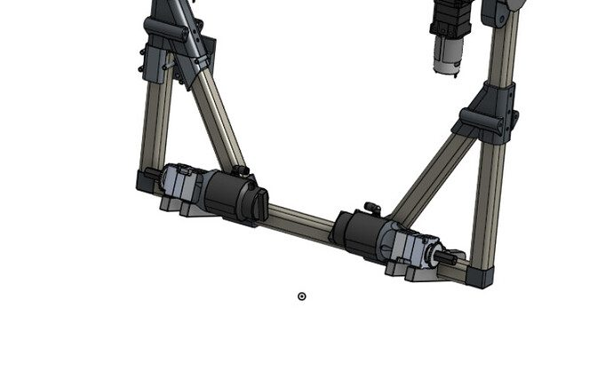

# 2023 · 2767 Stryke Force — Snake Eyes

EPA rank 27, snapshot EPA 68.3. Provisional reference dossier.

Tilting carbon-fiber elevator, roller gripper, separate wide cube intake and custom swerve.

## Drivetrain

Custom lightweight swerve; impact compliance moved from wheel suspension to the mounting structure.

Coverage: documented synopsis.

## Intake

Wide belt collector for cubes; cones use the upper gripper.

Coverage: documented synopsis.

## Transfer

Cube intake presents pieces to powered gripper; escape space avoids trapping an extra piece.

Coverage: documented synopsis.

## Scoring

Carbon-fiber elevator tilts via sector gear to extend effective reach.

Coverage: documented synopsis.

## Endgame

Gyro-based station balance under development in the early-event interview.

Coverage: documented synopsis.

## Controls

Piece sensing, preset motion and autonomous cone/cube programs.

Coverage: documented synopsis.

## Changes and versions

- Gripper evolved from gripping forks/material experiments to rollers. End-effector drive gears broke and were replaced by belts. Later CAD/code release documents the season robot.

## Strategic interpretation — analyst inference

Familiar fabrication methods can justify an elevator choice. The complete lesson includes stiffness, weight, retention and replacement of a failing transmission, rather than just the carbon-fiber material.

## Limits

- Interview configuration and reported revisions are documented; full season chronology remains to be audited against the linked releases.

Bounded source review; exhaustive intermediate-version history not certified

## Reviewed primary source bundle

- https://youtu.be/ngHZf3pnI14

## Season context

Read [the full 2023 game/context chapter](../docs/game_2023.md) before transferring this architecture to another role or season.

## Technical image references

Images are source-associated technical figures or robot views, not dimensionally certified drawings. Follow each source for version and figure context.

2023 team 2767 — source image from post 2 (2023-05-17). Context tags identify the discussion, not a verified component label. [Original source](https://www.chiefdelphi.com/t/437202/2). Source-linked extraction; mechanism identity not individually visually audited

## Dated research locators — navigation, not reviewed claims

A tag describes words in the source, not a validated engineering fact. Discussion replies may concern comparison robots.

- 2023-03-09 · Cory_Walters · [post 3](https://www.chiefdelphi.com/t/429639/3) · camera
- 2023-03-10 · AriMB · [post 4](https://www.chiefdelphi.com/t/429639/4) · arm, elevator
- 2023-03-10 · Sam_Dare · [post 5](https://www.chiefdelphi.com/t/429639/5) · arm, intake
- 2023-03-10 · kgzak · [post 6](https://www.chiefdelphi.com/t/429639/6) · arm
- 2023-05-17 · Sam_Dare · [post 1](https://www.chiefdelphi.com/t/437202/1) · arm, cad, code, elevator, pivot
- 2023-05-17 · ElliotS · [post 2](https://www.chiefdelphi.com/t/437202/2) · arm
- 2023-05-17 · Max_Sherwood · [post 3](https://www.chiefdelphi.com/t/437202/3) · elevator
- 2023-05-17 · kingc95 · [post 4](https://www.chiefdelphi.com/t/437202/4) · arm, elevator
- 2023-05-17 · Mark_Wasserman · [post 9](https://www.chiefdelphi.com/t/437202/9) · camera, elevator
- 2023-05-17 · Landon_K · [post 10](https://www.chiefdelphi.com/t/437202/10) · cad, code, elevator, pivot
- 2023-05-17 · Sam_Dare · [post 11](https://www.chiefdelphi.com/t/437202/11) · cad
- 2023-05-17 · haley_4201 · [post 13](https://www.chiefdelphi.com/t/437202/13) · arm
- 2023-05-17 · Sam_Dare · [post 14](https://www.chiefdelphi.com/t/437202/14) · cad, code, intake
- 2023-05-17 · nmatthes · [post 15](https://www.chiefdelphi.com/t/437202/15) · cad
- 2023-05-17 · KennyS2767 · [post 16](https://www.chiefdelphi.com/t/437202/16) · arm, elevator
- 2023-05-17 · thedudeJose · [post 17](https://www.chiefdelphi.com/t/437202/17) · arm, elevator, pivot
- 2023-05-21 · Sands · [post 22](https://www.chiefdelphi.com/t/437202/22) · arm, intake
- 2023-05-24 · PDunc · [post 23](https://www.chiefdelphi.com/t/437202/23) · arm

## Integrated focused technical study

[Construction, reasoning, failure modes and limits](../docs/research_continuation/2023-2767.md). This supplement is a focused interview/source-bundle study, not an exhaustive binder or competition-version certification.
