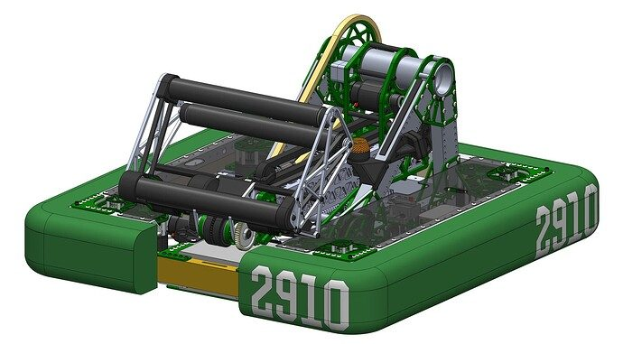
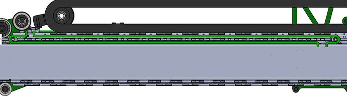
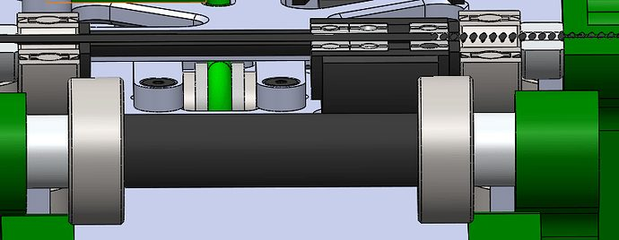
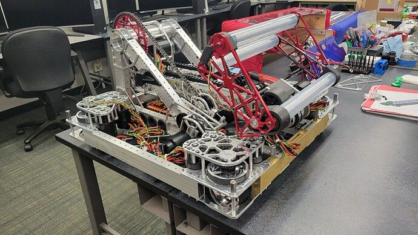
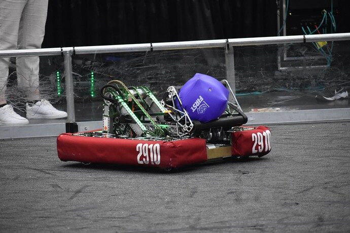

# 2023 · 2910 Jack in the Bot — Phantom

EPA rank 9, snapshot EPA 74.55. Provisional reference dossier.

Compact pivoting telescope and wristed roller end effector on swerve.

## Intake

Dead-axle rollers acquire both pieces; different poses cover upright cones, tipped cones, floor cubes and shelf loading.

Coverage: documented synopsis.

## Transfer

Direct end-effector acquisition with no separate magazine.

Coverage: documented synopsis.

## Scoring

Two-stage telescoping arm, shoulder pivot and wrist provide reach while keeping the stowed package low.

Coverage: documented synopsis.

## Drivetrain

SDS MK4i swerve.

Coverage: documented synopsis.

## Endgame

Interview describes three-piece autonomous plus balance; no special station attachment is established here.

Coverage: documented synopsis.

## Controls

Tuned joint controllers, selectable piece/level presets, home/brake setup buttons and modular waypoint-to-waypoint autonomous sequences.

Coverage: documented synopsis.

## Changes and versions

- Multiple end-effector iterations reported; individual shapes not all distinguished.
- Public release adds CAD and technical binder references for further inspection.

## Strategic interpretation — analyst inference

The transferable lesson is coordinated reach and rapid autonomous iteration. Their extended acquisition reach reduces chassis travel, but depends on accurate joints and consistent homing.

## Limits

- Full season timeline and endgame attachment status require corroboration.

Bounded source review; exhaustive intermediate-version history not certified

## Reviewed primary source bundle

- https://youtu.be/7ETEf__nD1I
- https://www.chiefdelphi.com/t/436653

## Season context

Read [the full 2023 game/context chapter](../docs/game_2023.md) before transferring this architecture to another role or season.

## Technical image references

Images are source-associated technical figures or robot views, not dimensionally certified drawings. Follow each source for version and figure context.

2023 team 2910 — source image from post 1 (2023-05-05). Context tags identify the discussion, not a verified component label. [Original source](https://www.chiefdelphi.com/t/436653/1). Source-linked extraction; mechanism identity not individually visually audited

2023 team 2910 — source image from post 28 (2023-05-06). Context tags identify the discussion, not a verified component label. [Original source](https://www.chiefdelphi.com/t/436653/28). Source-linked extraction; mechanism identity not individually visually audited

2023 team 2910 — source image from post 28 (2023-05-06). Context tags identify the discussion, not a verified component label. [Original source](https://www.chiefdelphi.com/t/436653/28). Source-linked extraction; mechanism identity not individually visually audited

2023 team 2910 — source image from post 109 (2023-07-26). Context tags identify the discussion, not a verified component label. [Original source](https://www.chiefdelphi.com/t/428786/109). Source-linked extraction; mechanism identity not individually visually audited

2023 team 2910 — source image from post 1 (2023-11-04). Context tags identify the discussion, not a verified component label. [Original source](https://www.chiefdelphi.com/t/443663/1). Source-linked extraction; mechanism identity not individually visually audited

## Dated research locators — navigation, not reviewed claims

A tag describes words in the source, not a validated engineering fact. Discussion replies may concern comparison robots.

- 2023-03-03 · Harriam · [post 1](https://www.chiefdelphi.com/t/428786/1) · arm, autonomous
- 2023-03-03 · AngryCalculator · [post 7](https://www.chiefdelphi.com/t/428786/7) · arm, intake
- 2023-03-03 · D_Price · [post 9](https://www.chiefdelphi.com/t/428786/9) · elevator, intake
- 2023-03-03 · Nuttyman54 · [post 20](https://www.chiefdelphi.com/t/428786/20) · arm, chain
- 2023-03-04 · mdurrani834 · [post 27](https://www.chiefdelphi.com/t/428786/27) · camera, vision
- 2023-03-04 · Harriam · [post 28](https://www.chiefdelphi.com/t/428786/28) · vision
- 2023-03-07 · Henry_Mahnke · [post 32](https://www.chiefdelphi.com/t/428786/32) · pivot
- 2023-03-07 · Harriam · [post 33](https://www.chiefdelphi.com/t/428786/33) · arm, pivot, wrist
- 2023-03-16 · suPURDUEperAndy · [post 38](https://www.chiefdelphi.com/t/428786/38) · arm, belt, elevator, wrist
- 2023-03-16 · Harriam · [post 39](https://www.chiefdelphi.com/t/428786/39) · arm, intake, wrist
- 2023-03-16 · suPURDUEperAndy · [post 41](https://www.chiefdelphi.com/t/428786/41) · intake
- 2023-03-16 · cad321 · [post 44](https://www.chiefdelphi.com/t/428786/44) · arm
- 2023-03-20 · SciborgBotanist6076 · [post 47](https://www.chiefdelphi.com/t/428786/47) · arm, cad
- 2023-03-20 · MSU2000 · [post 48](https://www.chiefdelphi.com/t/428786/48) · arm
- 2023-03-20 · Nuttyman54 · [post 49](https://www.chiefdelphi.com/t/428786/49) · arm, cad
- 2023-03-20 · bcon · [post 50](https://www.chiefdelphi.com/t/428786/50) · cad
- 2023-03-21 · josesantos · [post 52](https://www.chiefdelphi.com/t/428786/52) · arm
- 2023-03-21 · AdamHeard · [post 53](https://www.chiefdelphi.com/t/428786/53) · arm
- 2023-03-21 · If-u-like-PinaColoda · [post 54](https://www.chiefdelphi.com/t/428786/54) · arm
- 2023-04-17 · mdurrani834 · [post 59](https://www.chiefdelphi.com/t/428786/59) · vision
- 2023-04-17 · QuinnP2910 · [post 60](https://www.chiefdelphi.com/t/428786/60) · vision
- 2023-04-17 · Nuttyman54 · [post 61](https://www.chiefdelphi.com/t/428786/61) · arm, bearing
- 2023-04-19 · Harriam · [post 69](https://www.chiefdelphi.com/t/428786/69) · arm
- 2023-05-05 · darthvadar · [post 1](https://www.chiefdelphi.com/t/436653/1) · cad
- 2023-05-05 · nuclearnerd · [post 6](https://www.chiefdelphi.com/t/436653/6) · arm
- 2023-05-05 · Nuttyman54 · [post 8](https://www.chiefdelphi.com/t/436653/8) · pivot
- 2023-05-05 · QuinnP2910 · [post 9](https://www.chiefdelphi.com/t/436653/9) · arm, intake
- 2023-05-05 · QuinnP2910 · [post 13](https://www.chiefdelphi.com/t/436653/13) · vision
- 2023-05-05 · Abhi_Prime · [post 14](https://www.chiefdelphi.com/t/436653/14) · arm
- 2023-05-05 · AriMB · [post 17](https://www.chiefdelphi.com/t/436653/17) · arm, chain
- 2023-05-05 · Amicus1 · [post 18](https://www.chiefdelphi.com/t/436653/18) · cad
- 2023-05-05 · Harriam · [post 19](https://www.chiefdelphi.com/t/436653/19) · cad
- 2023-05-05 · QuinnP2910 · [post 21](https://www.chiefdelphi.com/t/436653/21) · camera
- 2023-05-06 · UnofficialForth · [post 23](https://www.chiefdelphi.com/t/436653/23) · code
- 2023-05-06 · QuinnP2910 · [post 24](https://www.chiefdelphi.com/t/436653/24) · code
- 2023-05-06 · tylerhedge · [post 25](https://www.chiefdelphi.com/t/436653/25) · arm, elevator, vision
- 2023-05-06 · Lil_Lavery · [post 27](https://www.chiefdelphi.com/t/436653/27) · cad
- 2023-05-06 · Harriam · [post 28](https://www.chiefdelphi.com/t/436653/28) · arm, bearing, belt, chain
- 2023-05-06 · QuinnP2910 · [post 29](https://www.chiefdelphi.com/t/436653/29) · arm, autonomous, vision
- 2023-05-06 · QuinnP2910 · [post 34](https://www.chiefdelphi.com/t/436653/34) · camera
- 2023-05-07 · thatmattguy · [post 35](https://www.chiefdelphi.com/t/436653/35) · camera
- 2023-05-07 · Basuj · [post 37](https://www.chiefdelphi.com/t/436653/37) · cad, intake
- 2023-05-07 · FerMtz · [post 41](https://www.chiefdelphi.com/t/436653/41) · arm, cad
- 2023-05-07 · Nuttyman54 · [post 42](https://www.chiefdelphi.com/t/436653/42) · arm, bearing
- 2023-05-07 · asaphfirst · [post 43](https://www.chiefdelphi.com/t/436653/43) · intake
- 2023-05-07 · PatrickW · [post 44](https://www.chiefdelphi.com/t/436653/44) · arm, intake
- 2023-05-08 · Dr341 · [post 45](https://www.chiefdelphi.com/t/436653/45) · arm, belt, cad, pivot, wrist
- 2023-05-08 · Nuttyman54 · [post 46](https://www.chiefdelphi.com/t/436653/46) · arm, belt, pivot, wrist
- 2023-05-09 · Skiddy4795 · [post 48](https://www.chiefdelphi.com/t/436653/48) · chain
- 2023-05-09 · suPURDUEperAndy · [post 50](https://www.chiefdelphi.com/t/436653/50) · arm
- 2023-05-09 · Harriam · [post 52](https://www.chiefdelphi.com/t/436653/52) · chain
- 2023-05-09 · EvanMeltz · [post 53](https://www.chiefdelphi.com/t/436653/53) · cad
- 2023-05-09 · PatrickW · [post 55](https://www.chiefdelphi.com/t/436653/55) · cad
- 2023-05-10 · Harriam · [post 58](https://www.chiefdelphi.com/t/436653/58) · chain
- 2023-05-14 · Jimmyy · [post 60](https://www.chiefdelphi.com/t/436653/60) · code
- 2023-05-14 · darthvadar · [post 61](https://www.chiefdelphi.com/t/436653/61) · code
- 2023-05-31 · quinn.jar3655 · [post 62](https://www.chiefdelphi.com/t/436653/62) · autonomous, vision
- 2023-05-31 · QuinnP2910 · [post 63](https://www.chiefdelphi.com/t/436653/63) · arm
- 2023-05-31 · Sam_Dare · [post 64](https://www.chiefdelphi.com/t/436653/64) · arm, pivot
- 2023-06-02 · Nuttyman54 · [post 65](https://www.chiefdelphi.com/t/436653/65) · chain, pivot
- 2023-06-02 · Alex_Y · [post 66](https://www.chiefdelphi.com/t/436653/66) · arm
- 2023-06-02 · Nuttyman54 · [post 67](https://www.chiefdelphi.com/t/436653/67) · arm
- 2023-06-30 · PatrickW · [post 79](https://www.chiefdelphi.com/t/428786/79) · code
- 2023-07-03 · PatrickW · [post 68](https://www.chiefdelphi.com/t/436653/68) · cad
- 2023-07-05 · cgp · [post 69](https://www.chiefdelphi.com/t/436653/69) · cad
- 2023-07-06 · Kartikr27 · [post 93](https://www.chiefdelphi.com/t/428786/93) · arm
- 2023-07-06 · QuinnP2910 · [post 94](https://www.chiefdelphi.com/t/428786/94) · arm
- 2023-07-09 · Xpira · [post 99](https://www.chiefdelphi.com/t/428786/99) · vision
- 2023-07-11 · anihtA · [post 102](https://www.chiefdelphi.com/t/428786/102) · arm, cad, chain
- 2023-07-13 · ZCam_4415 · [post 71](https://www.chiefdelphi.com/t/436653/71) · arm, belt, cad
- 2023-07-13 · Peyton_Yeung · [post 72](https://www.chiefdelphi.com/t/436653/72) · arm, cad
- 2023-07-13 · waialua359 · [post 73](https://www.chiefdelphi.com/t/436653/73) · intake
- 2023-07-13 · PatrickW · [post 74](https://www.chiefdelphi.com/t/436653/74) · intake
- 2023-07-14 · waialua359 · [post 76](https://www.chiefdelphi.com/t/436653/76) · intake
- 2023-07-26 · waialua359 · [post 109](https://www.chiefdelphi.com/t/428786/109) · arm
- 2023-07-28 · PatrickW · [post 82](https://www.chiefdelphi.com/t/436653/82) · cad
- 2023-08-01 · waialua359 · [post 114](https://www.chiefdelphi.com/t/428786/114) · camera
- 2023-08-13 · Amicus1 · [post 84](https://www.chiefdelphi.com/t/436653/84) · encoder, wrist
- 2023-08-13 · PatrickW · [post 85](https://www.chiefdelphi.com/t/436653/85) · arm, wrist
- 2023-08-13 · Amicus1 · [post 86](https://www.chiefdelphi.com/t/436653/86) · wrist
- 2023-08-14 · Nuttyman54 · [post 88](https://www.chiefdelphi.com/t/436653/88) · arm, encoder, wrist
- 2023-10-16 · ZCam_4415 · [post 115](https://www.chiefdelphi.com/t/428786/115) · cad, chain
- 2023-10-16 · ZCam_4415 · [post 117](https://www.chiefdelphi.com/t/428786/117) · cad
- 2023-10-16 · J_Spitzak · [post 89](https://www.chiefdelphi.com/t/436653/89) · cad
- 2023-10-16 · Nuttyman54 · [post 90](https://www.chiefdelphi.com/t/436653/90) · cad
- 2023-10-16 · waialua359 · [post 91](https://www.chiefdelphi.com/t/436653/91) · arm
- 2023-10-16 · caleb7hayes · [post 92](https://www.chiefdelphi.com/t/436653/92) · intake
- 2023-10-17 · Smtopps · [post 93](https://www.chiefdelphi.com/t/436653/93) · intake
- 2023-10-18 · Gordude · [post 94](https://www.chiefdelphi.com/t/436653/94) · arm
- 2023-10-19 · Nuttyman54 · [post 96](https://www.chiefdelphi.com/t/436653/96) · arm, autonomous, intake
- 2023-10-20 · Nuttyman54 · [post 97](https://www.chiefdelphi.com/t/436653/97) · arm, bearing, belt, cad, chain, pivot, wrist
- 2023-10-21 · ElliotS · [post 98](https://www.chiefdelphi.com/t/436653/98) · cad
- 2023-10-22 · Rohit_Seshadri · [post 100](https://www.chiefdelphi.com/t/436653/100) · cad
- 2023-10-23 · DeclanKB · [post 101](https://www.chiefdelphi.com/t/436653/101) · cad
- 2023-10-23 · cad321 · [post 102](https://www.chiefdelphi.com/t/436653/102) · cad
- 2023-10-23 · Nuttyman54 · [post 104](https://www.chiefdelphi.com/t/436653/104) · cad, intake, pivot, wrist
- 2023-10-24 · ElliotS · [post 140](https://www.chiefdelphi.com/t/428786/140) · cad
- 2023-10-24 · waialua359 · [post 141](https://www.chiefdelphi.com/t/428786/141) · arm
- 2023-10-25 · Nuttyman54 · [post 105](https://www.chiefdelphi.com/t/436653/105) · cad, pivot
- 2023-10-29 · Pizzatc · [post 148](https://www.chiefdelphi.com/t/428786/148) · intake
- 2023-10-30 · waialua359 · [post 151](https://www.chiefdelphi.com/t/428786/151) · arm, code, intake
- 2023-11-01 · monpon · [post 152](https://www.chiefdelphi.com/t/428786/152) · camera, vision
- 2023-11-01 · Moschopper · [post 158](https://www.chiefdelphi.com/t/428786/158) · arm, code
- 2023-11-01 · waialua359 · [post 159](https://www.chiefdelphi.com/t/428786/159) · cad, code
- 2023-11-02 · ElliotS · [post 160](https://www.chiefdelphi.com/t/428786/160) · wrist
- 2023-11-02 · ZCam_4415 · [post 161](https://www.chiefdelphi.com/t/428786/161) · arm, belt, wrist
- 2023-11-03 · Prat42 · [post 108](https://www.chiefdelphi.com/t/436653/108) · arm, elevator
- 2023-11-04 · Sudhir · [post 1](https://www.chiefdelphi.com/t/443663/1) · code
- 2023-11-04 · Sudhir · [post 110](https://www.chiefdelphi.com/t/436653/110) · code
- 2023-11-04 · Sudhir · [post 7](https://www.chiefdelphi.com/t/443663/7) · code
- 2023-11-04 · Sudhir · [post 164](https://www.chiefdelphi.com/t/428786/164) · code
- 2023-11-04 · Nuttyman54 · [post 112](https://www.chiefdelphi.com/t/436653/112) · arm, cad, intake
- 2023-11-08 · ie67 · [post 8](https://www.chiefdelphi.com/t/443663/8) · arm
- 2023-11-09 · GalexY · [post 9](https://www.chiefdelphi.com/t/443663/9) · intake
- 2023-11-10 · GalexY · [post 15](https://www.chiefdelphi.com/t/443663/15) · autonomous
- 2023-11-10 · GalexY · [post 16](https://www.chiefdelphi.com/t/443663/16) · code
- 2023-11-10 · Sudhir · [post 17](https://www.chiefdelphi.com/t/443663/17) · code
- 2023-11-10 · GalexY · [post 18](https://www.chiefdelphi.com/t/443663/18) · arm, intake
- 2023-11-15 · noto501 · [post 19](https://www.chiefdelphi.com/t/443663/19) · arm, wrist
- 2023-11-18 · Steven_Carmain · [post 115](https://www.chiefdelphi.com/t/436653/115) · code
- 2023-12-24 · noto501 · [post 22](https://www.chiefdelphi.com/t/443663/22) · vision
- 2023-12-25 · ElliotS · [post 116](https://www.chiefdelphi.com/t/436653/116) · wrist
- 2023-12-28 · Rocky_S · [post 118](https://www.chiefdelphi.com/t/436653/118) · cad
- 2023-12-29 · usbcd36 · [post 24](https://www.chiefdelphi.com/t/443663/24) · arm, code
- 2023-12-29 · Sudhir · [post 25](https://www.chiefdelphi.com/t/443663/25) · code
- 2023-12-29 · Rocky_S · [post 119](https://www.chiefdelphi.com/t/436653/119) · wrist
- 2024-01-09 · Sudhir · [post 123](https://www.chiefdelphi.com/t/436653/123) · cad
- 2024-01-15 · Yigit · [post 125](https://www.chiefdelphi.com/t/436653/125) · pivot
- 2024-01-18 · Nuttyman54 · [post 29](https://www.chiefdelphi.com/t/443663/29) · cad
- 2024-01-29 · J.F · [post 129](https://www.chiefdelphi.com/t/436653/129) · arm
- 2024-01-30 · Oliver_stivers · [post 131](https://www.chiefdelphi.com/t/436653/131) · arm, code
- 2024-01-31 · PatrickW · [post 132](https://www.chiefdelphi.com/t/436653/132) · arm
- 2024-02-11 · Lilly_7072_FRC_FTC · [post 133](https://www.chiefdelphi.com/t/436653/133) · cad
- 2024-03-01 · Rocky_S · [post 139](https://www.chiefdelphi.com/t/436653/139) · pivot
- 2024-03-24 · spidernh · [post 140](https://www.chiefdelphi.com/t/436653/140) · belt
- 2024-04-25 · Nuttyman54 · [post 141](https://www.chiefdelphi.com/t/436653/141) · bearing, belt, cad, elevator
- 2024-04-25 · Jdymkowski · [post 142](https://www.chiefdelphi.com/t/436653/142) · cad
- 2024-04-25 · spidernh · [post 143](https://www.chiefdelphi.com/t/436653/143) · belt
- 2024-04-26 · Nuttyman54 · [post 144](https://www.chiefdelphi.com/t/436653/144) · belt, cad
- 2025-03-27 · Salmon · [post 147](https://www.chiefdelphi.com/t/436653/147) · cad
- 2025-04-22 · jdunston94 · [post 148](https://www.chiefdelphi.com/t/436653/148) · arm

## Integrated focused technical study

[Construction, reasoning, failure modes and limits](../docs/research_continuation/2023-2910.md). This supplement is a focused interview/source-bundle study, not an exhaustive binder or competition-version certification.
