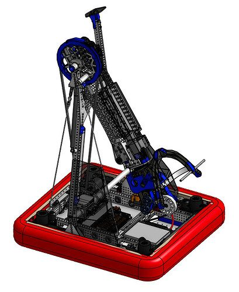

# 2023 · 3005 RoboChargers — AMP

EPA rank 6, snapshot EPA 75.65. Provisional reference dossier.

Light pivoting telescopic arm with a highly articulated dual-piece wrist.

## Intake

Distinct cone and cube contact geometries; wrist orientation permits acquisition of upright and tipped pieces.

Coverage: documented synopsis.

## Transfer

Direct end-effector acquisition avoids a separate transfer.

Coverage: documented synopsis.

## Scoring

Telescoping arm on a braced A-frame. Cable bracing helps resist fore/aft loads without a heavy upper structure.

Coverage: documented synopsis.

## Drivetrain

REV MAXSwerve; team describes the module's lineage from its earlier custom swerve development.

Coverage: documented synopsis.

## Endgame

Charge-station implementation not established in this interview.

Coverage: partial / unresolved detail.

## Controls

Piece mode and LEDs coordinate human-player loading and mechanism presets.

Coverage: documented synopsis.

## Changes and versions

- Team reports eleventh-generation cone intake and fourth-generation cube intake at filming.
- Selected pivoting telescope over a slanted elevator concept for expected mass and speed advantages.

## Strategic interpretation — analyst inference

An important reference for treating the cone and cube interfaces as separate optimization problems even when they share one wrist. The stated prototype counts do not establish eleven competition configurations.

## Limits

- Endgame method needs further evidence.
- Individual prototype geometries not fully enumerated.

Bounded source review; exhaustive intermediate-version history not certified

## Reviewed primary source bundle

- https://youtu.be/_k9of7qRoeY
- https://www.chiefdelphi.com/t/434083

## Season context

Read [the full 2023 game/context chapter](../docs/game_2023.md) before transferring this architecture to another role or season.

## Technical image references

Images are source-associated technical figures or robot views, not dimensionally certified drawings. Follow each source for version and figure context.

2023 team 3005 — source image from post 1 (2023-04-12). Context tags identify the discussion, not a verified component label. [Original source](https://www.chiefdelphi.com/t/434083/1). Source-linked extraction; mechanism identity not individually visually audited

## Dated research locators — navigation, not reviewed claims

A tag describes words in the source, not a validated engineering fact. Discussion replies may concern comparison robots.

- 2023-03-06 · Tyler_Olds · [post 1](https://www.chiefdelphi.com/t/429178/1) · arm, intake, wrist
- 2023-04-12 · Orion.DeYoe · [post 1](https://www.chiefdelphi.com/t/434083/1) · cad
- 2023-04-12 · RaMoore · [post 3](https://www.chiefdelphi.com/t/434083/3) · arm, chain
- 2023-04-13 · quinnlindsey · [post 4](https://www.chiefdelphi.com/t/434083/4) · cad, chain
- 2023-04-13 · Kevin_Leonard · [post 5](https://www.chiefdelphi.com/t/434083/5) · arm
- 2023-04-13 · EricLeifermann · [post 6](https://www.chiefdelphi.com/t/434083/6) · chain
- 2023-04-13 · Steven_Smith · [post 7](https://www.chiefdelphi.com/t/434083/7) · arm, chain
- 2023-04-13 · cadandcookies · [post 8](https://www.chiefdelphi.com/t/434083/8) · chain, intake, wrist
- 2023-04-13 · Kevin_Leonard · [post 9](https://www.chiefdelphi.com/t/434083/9) · chain
- 2023-04-13 · Orion.DeYoe · [post 10](https://www.chiefdelphi.com/t/434083/10) · belt
- 2023-04-13 · suaec · [post 12](https://www.chiefdelphi.com/t/434083/12) · chain

## Integrated focused technical study

[Construction, reasoning, failure modes and limits](../docs/research_continuation/2023-3005.md). This supplement is a focused interview/source-bundle study, not an exhaustive binder or competition-version certification.
