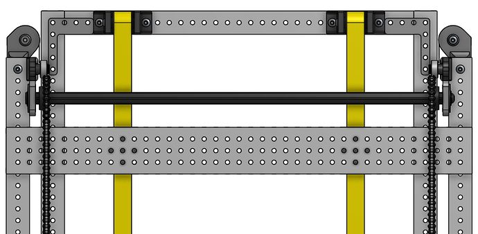
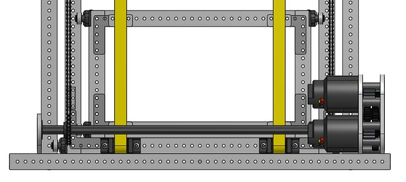

# 2023 · 3467 Windham Windup — Windham Windup 2023

EPA rank 20, snapshot EPA 70.11. Provisional reference dossier.

Small swerve base, two-joint arm and pneumatic wrist/claw; early prototype robot used for software.

## Drivetrain

SDS MK4i; compact base chosen around traffic and station chokepoints.

Coverage: documented synopsis.

## Intake

Pneumatic opening selects cone versus cube compression; rollers remain powered to retain pieces.

Coverage: documented synopsis.

## Transfer

Week-zero collector prototype was not yet installed; proposed four-bar would center cubes and upright cones.

Coverage: documented synopsis.

## Scoring

Shoulder/elbow joints with low gearboxes and MAXSpline transmission.

Coverage: documented synopsis.

## Endgame

Gyro-feedback station balancing.

Coverage: documented synopsis.

## Controls

Profiled joint controllers, PathPlanner autos and separate practice/software robots.

Coverage: documented synopsis.

## Changes and versions

- Day-ten functional prototype enabled early software. At week zero, the claw and proposed intake were still evolving; later Open Alliance posts must govern final configuration.

## Strategic interpretation — analyst inference

A functional early mechanism can buy more controls and driver iteration than a late, elaborate assembly. Do not mistake week-zero plans for the eventual Championship robot.

## Limits

- Interview configuration and reported revisions are documented; full season chronology remains to be audited against the linked releases.

Bounded source review; exhaustive intermediate-version history not certified

## Reviewed primary source bundle

- https://youtu.be/zqoVcHclGuM

## Season context

Read [the full 2023 game/context chapter](../docs/game_2023.md) before transferring this architecture to another role or season.

## Technical image references

Images are source-associated technical figures or robot views, not dimensionally certified drawings. Follow each source for version and figure context.

2023 team 3467 — source image from post 4 (2023-01-04). Context tags identify the discussion, not a verified component label. [Original source](https://www.chiefdelphi.com/t/417264/4). Source-linked extraction; mechanism identity not individually visually audited

2023 team 3467 — source image from post 4 (2023-01-04). Context tags identify the discussion, not a verified component label. [Original source](https://www.chiefdelphi.com/t/417264/4). Source-linked extraction; mechanism identity not individually visually audited

## Dated research locators — navigation, not reviewed claims

A tag describes words in the source, not a validated engineering fact. Discussion replies may concern comparison robots.

- 2022-11-09 · aaryanv · [post 1](https://www.chiefdelphi.com/t/417264/1) · autonomous, bearing, cad, camera, climb, code, intake, shooter, vision
- 2023-01-04 · Kevin_Leonard · [post 4](https://www.chiefdelphi.com/t/417264/4) · code, elevator, shooter, wrist
- 2023-01-05 · Kevin_Leonard · [post 9](https://www.chiefdelphi.com/t/417264/9) · elevator
- 2023-01-09 · Kevin_Leonard · [post 10](https://www.chiefdelphi.com/t/417264/10) · arm, elevator, prototype
- 2023-01-09 · aaryanv · [post 11](https://www.chiefdelphi.com/t/417264/11) · arm, elevator, intake
- 2023-01-10 · EmileH · [post 12](https://www.chiefdelphi.com/t/417264/12) · arm
- 2023-01-10 · andej · [post 14](https://www.chiefdelphi.com/t/417264/14) · arm, code
- 2023-01-10 · EmileH · [post 15](https://www.chiefdelphi.com/t/417264/15) · arm
- 2023-01-10 · Kevin_Leonard · [post 16](https://www.chiefdelphi.com/t/417264/16) · arm, autonomous, encoder
- 2023-01-10 · Kevin_Leonard · [post 19](https://www.chiefdelphi.com/t/417264/19) · arm
- 2023-01-10 · SonofBeans · [post 22](https://www.chiefdelphi.com/t/417264/22) · arm
- 2023-01-10 · Kevin_Leonard · [post 24](https://www.chiefdelphi.com/t/417264/24) · cad
- 2023-01-11 · aaryanv · [post 25](https://www.chiefdelphi.com/t/417264/25) · arm, cad, chain, encoder, intake
- 2023-01-11 · JohnFogarty · [post 28](https://www.chiefdelphi.com/t/417264/28) · arm, encoder, pivot
- 2023-01-11 · Kevin_Leonard · [post 30](https://www.chiefdelphi.com/t/417264/30) · arm, encoder
- 2023-01-12 · Kevin_Leonard · [post 31](https://www.chiefdelphi.com/t/417264/31) · arm, intake
- 2023-01-12 · Skiddy4795 · [post 35](https://www.chiefdelphi.com/t/417264/35) · arm
- 2023-01-12 · AriMB · [post 41](https://www.chiefdelphi.com/t/417264/41) · arm
- 2023-01-13 · brennan-macaig · [post 45](https://www.chiefdelphi.com/t/417264/45) · arm, chain, encoder
- 2023-01-14 · Burbozo3467 · [post 47](https://www.chiefdelphi.com/t/417264/47) · arm, cad, code, prototype
- 2023-01-14 · apanteli23 · [post 48](https://www.chiefdelphi.com/t/417264/48) · arm, camera, code, encoder, prototype, vision
- 2023-01-14 · Tinnittin · [post 49](https://www.chiefdelphi.com/t/417264/49) · arm, pivot
- 2023-01-15 · aaryanv · [post 50](https://www.chiefdelphi.com/t/417264/50) · arm, prototype
- 2023-01-15 · EmileH · [post 51](https://www.chiefdelphi.com/t/417264/51) · arm, code, prototype, wrist
- 2023-01-15 · Tinnittin · [post 54](https://www.chiefdelphi.com/t/417264/54) · arm, code, wrist
- 2023-01-15 · aaryanv · [post 55](https://www.chiefdelphi.com/t/417264/55) · arm, cad, prototype, wrist
- 2023-01-15 · Connor_McBride · [post 56](https://www.chiefdelphi.com/t/417264/56) · intake
- 2023-01-16 · andej · [post 57](https://www.chiefdelphi.com/t/417264/57) · arm
- 2023-01-17 · BrendanB · [post 59](https://www.chiefdelphi.com/t/417264/59) · arm, cad, prototype
- 2023-01-17 · Kevin_Leonard · [post 60](https://www.chiefdelphi.com/t/417264/60) · pivot
- 2023-01-17 · JohnSchneider · [post 61](https://www.chiefdelphi.com/t/417264/61) · climb
- 2023-01-17 · aaryanv · [post 62](https://www.chiefdelphi.com/t/417264/62) · arm, prototype
- 2023-01-19 · aaryanv · [post 63](https://www.chiefdelphi.com/t/417264/63) · intake
- 2023-01-20 · MrRiedemanJACC · [post 64](https://www.chiefdelphi.com/t/417264/64) · arm
- 2023-01-20 · aaryanv · [post 65](https://www.chiefdelphi.com/t/417264/65) · arm
- 2023-01-20 · vargoose84 · [post 66](https://www.chiefdelphi.com/t/417264/66) · prototype
- 2023-01-20 · paulonis · [post 67](https://www.chiefdelphi.com/t/417264/67) · arm
- 2023-01-20 · MrRiedemanJACC · [post 69](https://www.chiefdelphi.com/t/417264/69) · arm
- 2023-01-20 · Kevin_Leonard · [post 70](https://www.chiefdelphi.com/t/417264/70) · arm
- 2023-01-20 · aaryanv · [post 72](https://www.chiefdelphi.com/t/417264/72) · prototype
- 2023-01-20 · Kevin_Leonard · [post 73](https://www.chiefdelphi.com/t/417264/73) · arm, cad, pivot
- 2023-01-21 · itwasntjustaphasemom · [post 74](https://www.chiefdelphi.com/t/417264/74) · arm
- 2023-01-21 · jacob6838 · [post 75](https://www.chiefdelphi.com/t/417264/75) · arm, climb, pivot
- 2023-01-21 · MrRiedemanJACC · [post 77](https://www.chiefdelphi.com/t/417264/77) · intake, prototype
- 2023-01-24 · Kevin_Leonard · [post 80](https://www.chiefdelphi.com/t/417264/80) · cad, wrist
- 2023-01-24 · BrendanB · [post 82](https://www.chiefdelphi.com/t/417264/82) · arm
- 2023-01-29 · aaryanv · [post 84](https://www.chiefdelphi.com/t/417264/84) · arm, wrist
- 2023-01-30 · Kevin_Leonard · [post 88](https://www.chiefdelphi.com/t/417264/88) · prototype
- 2023-01-31 · Kevin_Leonard · [post 92](https://www.chiefdelphi.com/t/417264/92) · arm, wrist
- 2023-01-31 · BrendanB · [post 93](https://www.chiefdelphi.com/t/417264/93) · bearing
- 2023-02-02 · aaryanv · [post 100](https://www.chiefdelphi.com/t/417264/100) · arm, chain, encoder
- 2023-02-02 · hpeyerl · [post 101](https://www.chiefdelphi.com/t/417264/101) · encoder
- 2023-02-02 · aaryanv · [post 102](https://www.chiefdelphi.com/t/417264/102) · cad
- 2023-02-03 · joemost · [post 104](https://www.chiefdelphi.com/t/417264/104) · cad
- 2023-02-03 · JamesCH95 · [post 107](https://www.chiefdelphi.com/t/417264/107) · chain
- 2023-02-03 · EmileH · [post 108](https://www.chiefdelphi.com/t/417264/108) · cad
- 2023-02-05 · EmileH · [post 110](https://www.chiefdelphi.com/t/417264/110) · arm, code, wrist
- 2023-02-07 · Kevin_Leonard · [post 113](https://www.chiefdelphi.com/t/417264/113) · arm
- 2023-02-07 · howlongismyname · [post 116](https://www.chiefdelphi.com/t/417264/116) · arm
- 2023-02-07 · Kevin_Leonard · [post 117](https://www.chiefdelphi.com/t/417264/117) · cad
- 2023-02-11 · aaryanv · [post 122](https://www.chiefdelphi.com/t/417264/122) · cad
- 2023-02-13 · BrendanB · [post 123](https://www.chiefdelphi.com/t/417264/123) · autonomous, wrist
- 2023-02-14 · aaryanv · [post 129](https://www.chiefdelphi.com/t/417264/129) · cad
- 2023-02-14 · FredK · [post 130](https://www.chiefdelphi.com/t/417264/130) · cad
- 2023-02-14 · Kevin_Leonard · [post 131](https://www.chiefdelphi.com/t/417264/131) · arm
- 2023-02-15 · Kevin_Leonard · [post 132](https://www.chiefdelphi.com/t/417264/132) · code
- 2023-02-16 · aaryanv · [post 134](https://www.chiefdelphi.com/t/417264/134) · arm
- 2023-02-16 · wgorgen · [post 136](https://www.chiefdelphi.com/t/417264/136) · arm, chain
- 2023-02-16 · BrendanB · [post 137](https://www.chiefdelphi.com/t/417264/137) · arm, chain
- 2023-02-16 · BrendanB · [post 138](https://www.chiefdelphi.com/t/417264/138) · arm
- 2023-02-16 · wgorgen · [post 140](https://www.chiefdelphi.com/t/417264/140) · arm
- 2023-02-17 · TrevorC · [post 143](https://www.chiefdelphi.com/t/417264/143) · arm, bearing, belt, camera, chain, intake, vision, wrist
- 2023-02-20 · FredK · [post 159](https://www.chiefdelphi.com/t/417264/159) · arm
- 2023-02-20 · cody29158 · [post 166](https://www.chiefdelphi.com/t/417264/166) · arm
- 2023-02-22 · aaryanv · [post 173](https://www.chiefdelphi.com/t/417264/173) · autonomous
- 2023-02-24 · Kevin_Leonard · [post 179](https://www.chiefdelphi.com/t/417264/179) · cad, intake
- 2023-02-28 · Tyler_Olds · [post 1](https://www.chiefdelphi.com/t/428452/1) · arm, intake, wrist
- 2023-02-28 · Tyler_Olds · [post 182](https://www.chiefdelphi.com/t/417264/182) · intake
- 2023-02-28 · Kevin_Leonard · [post 2](https://www.chiefdelphi.com/t/428452/2) · intake
- 2023-03-05 · aaryanv · [post 189](https://www.chiefdelphi.com/t/417264/189) · arm, encoder
- 2023-03-05 · Kevin_Leonard · [post 190](https://www.chiefdelphi.com/t/417264/190) · autonomous
- 2023-03-05 · apanteli23 · [post 191](https://www.chiefdelphi.com/t/417264/191) · arm, autonomous, chain, code, encoder, intake, vision, wrist
- 2023-03-05 · EmileH · [post 192](https://www.chiefdelphi.com/t/417264/192) · autonomous
- 2023-03-13 · JohnFogarty · [post 197](https://www.chiefdelphi.com/t/417264/197) · arm, intake
- 2023-03-16 · Kevin_Leonard · [post 198](https://www.chiefdelphi.com/t/417264/198) · intake
- 2023-03-16 · JohnFogarty · [post 199](https://www.chiefdelphi.com/t/417264/199) · arm, intake
- 2023-03-17 · Kevin_Leonard · [post 202](https://www.chiefdelphi.com/t/417264/202) · shooter
- 2023-03-17 · Burbozo3467 · [post 204](https://www.chiefdelphi.com/t/417264/204) · intake
- 2023-03-21 · Kevin_Leonard · [post 206](https://www.chiefdelphi.com/t/417264/206) · arm, autonomous, bearing, code
- 2023-03-22 · Kevin_Leonard · [post 208](https://www.chiefdelphi.com/t/417264/208) · shooter
- 2023-03-22 · brennan-macaig · [post 210](https://www.chiefdelphi.com/t/417264/210) · autonomous
- 2023-03-27 · Kevin_Leonard · [post 214](https://www.chiefdelphi.com/t/417264/214) · autonomous, belt
- 2023-03-28 · EmileH · [post 215](https://www.chiefdelphi.com/t/417264/215) · camera
- 2023-04-03 · ro1046 · [post 219](https://www.chiefdelphi.com/t/417264/219) · shooter
- 2023-04-10 · aaryanv · [post 221](https://www.chiefdelphi.com/t/417264/221) · arm, shooter
- 2023-04-13 · Kevin_Leonard · [post 223](https://www.chiefdelphi.com/t/417264/223) · wrist
- 2023-05-04 · aaryanv · [post 226](https://www.chiefdelphi.com/t/417264/226) · arm, autonomous, elevator, shooter
- 2023-05-04 · Conrad_599 · [post 228](https://www.chiefdelphi.com/t/417264/228) · intake
- 2023-05-05 · Kevin_Leonard · [post 231](https://www.chiefdelphi.com/t/417264/231) · autonomous
- 2023-05-10 · Kevin_Leonard · [post 232](https://www.chiefdelphi.com/t/417264/232) · autonomous
- 2024-01-05 · CyberClone · [post 235](https://www.chiefdelphi.com/t/417264/235) · cad, wrist
- 2024-01-05 · Kevin_Leonard · [post 237](https://www.chiefdelphi.com/t/417264/237) · arm

## Integrated focused technical study

[Construction, reasoning, failure modes and limits](../docs/research_continuation/2023-3467.md). This supplement is a focused interview/source-bundle study, not an exhaustive binder or competition-version certification.
