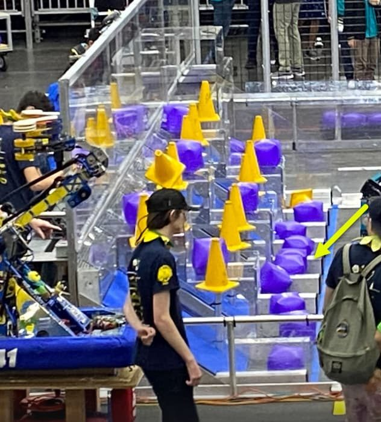
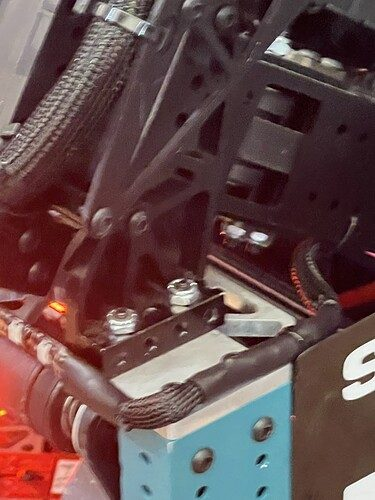
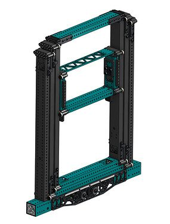

# 2023 · 4414 HighTide — Tsunami

EPA rank 22, snapshot EPA 68.73. Provisional reference dossier.

High-speed swerve, belt elevator, virtual nonparallel four-bar and later cube collector.

## Drivetrain

Custom SDS MK4i top plates add a second drive motor per module: twelve swerve motors total.

Coverage: documented synopsis.

## Intake

Roller claw handles cones and cubes; later wide cube collector improves acquisition speed.

Coverage: documented synopsis.

## Transfer

Cube collector hands through the wide elevator opening.

Coverage: documented synopsis.

## Scoring

Belt-driven elevator and chained virtual four-bar control placement orientation.

Coverage: documented synopsis.

## Endgame

No separate lifting mechanism described; team allocated extra motors to drive performance.

Coverage: documented synopsis.

## Controls

Three Limelights, dynamic drive-to-node trajectories, 27-button grid selector and piece sensors.

Coverage: documented synopsis.

## Changes and versions

- Cube intake added after initial architecture. Sensor-driven automatic stow reduces operator steps after acquisition/release.

## Strategic interpretation — analyst inference

The strategic package prioritizes reduced travel and alignment time. Distinguish quoted theoretical drivetrain speed from a measured average cycle speed; the latter also includes loading and scoring.

## Limits

- Interview configuration and reported revisions are documented; full season chronology remains to be audited against the linked releases.

Bounded source review; exhaustive intermediate-version history not certified

## Reviewed primary source bundle

- https://youtu.be/URZEkOANGHQ

## Season context

Read [the full 2023 game/context chapter](../docs/game_2023.md) before transferring this architecture to another role or season.

## Technical image references

Images are source-associated technical figures or robot views, not dimensionally certified drawings. Follow each source for version and figure context.

2023 team 4414 — source image from post 126 (2023-04-28). Context tags identify the discussion, not a verified component label. [Original source](https://www.chiefdelphi.com/t/428584/126). Source-linked extraction; mechanism identity not individually visually audited

2023 team 4414 — source image from post 134 (2023-06-15). Context tags identify the discussion, not a verified component label. [Original source](https://www.chiefdelphi.com/t/428584/134). Source-linked extraction; mechanism identity not individually visually audited

2023 team 4414 — source image from post 155 (2023-06-29). Context tags identify the discussion, not a verified component label. [Original source](https://www.chiefdelphi.com/t/428584/155). Source-linked extraction; mechanism identity not individually visually audited

## Dated research locators — navigation, not reviewed claims

A tag describes words in the source, not a validated engineering fact. Discussion replies may concern comparison robots.

- 2023-03-01 · Kadirozbay · [post 2](https://www.chiefdelphi.com/t/428584/2) · intake
- 2023-03-28 · jjsessa · [post 37](https://www.chiefdelphi.com/t/428584/37) · elevator
- 2023-04-17 · Emerson1706 · [post 58](https://www.chiefdelphi.com/t/428584/58) · arm, wrist
- 2023-04-19 · joshtrattler · [post 70](https://www.chiefdelphi.com/t/428584/70) · hopper
- 2023-04-23 · EHutson · [post 74](https://www.chiefdelphi.com/t/428584/74) · cad
- 2023-04-25 · KennySandon · [post 91](https://www.chiefdelphi.com/t/428584/91) · arm, elevator, intake, pivot
- 2023-04-25 · Rohit_Seshadri · [post 102](https://www.chiefdelphi.com/t/428584/102) · arm, pivot
- 2023-04-25 · jedgar6 · [post 105](https://www.chiefdelphi.com/t/428584/105) · arm, elevator, intake, pivot
- 2023-04-26 · waxton · [post 108](https://www.chiefdelphi.com/t/428584/108) · arm
- 2023-04-26 · KennySandon · [post 111](https://www.chiefdelphi.com/t/428584/111) · arm
- 2023-04-27 · Rally · [post 123](https://www.chiefdelphi.com/t/428584/123) · elevator
- 2023-04-28 · mswhite60 · [post 126](https://www.chiefdelphi.com/t/428584/126) · hopper
- 2023-06-13 · CarlosA · [post 132](https://www.chiefdelphi.com/t/428584/132) · belt, elevator
- 2023-06-15 · ElliotS · [post 133](https://www.chiefdelphi.com/t/428584/133) · belt, cad
- 2023-06-15 · Pizzatc · [post 134](https://www.chiefdelphi.com/t/428584/134) · elevator
- 2023-06-29 · jjsessa · [post 150](https://www.chiefdelphi.com/t/428584/150) · cad, code
- 2023-06-29 · jjsessa · [post 155](https://www.chiefdelphi.com/t/428584/155) · bearing, belt, chain, elevator, intake
- 2023-06-29 · EvanMeltz · [post 159](https://www.chiefdelphi.com/t/428584/159) · elevator
- 2023-06-29 · Rohit_Seshadri · [post 164](https://www.chiefdelphi.com/t/428584/164) · belt
- 2023-06-29 · jjsessa · [post 165](https://www.chiefdelphi.com/t/428584/165) · belt
- 2023-06-29 · jjsessa · [post 167](https://www.chiefdelphi.com/t/428584/167) · belt
- 2023-06-30 · Kevinhoang · [post 169](https://www.chiefdelphi.com/t/428584/169) · bearing
- 2023-06-30 · jjsessa · [post 170](https://www.chiefdelphi.com/t/428584/170) · bearing
- 2023-06-30 · jjsessa · [post 174](https://www.chiefdelphi.com/t/428584/174) · belt
- 2023-06-30 · MaxShankland · [post 176](https://www.chiefdelphi.com/t/428584/176) · belt
- 2023-07-02 · jjsessa · [post 177](https://www.chiefdelphi.com/t/428584/177) · elevator
- 2023-07-02 · zach_boyer · [post 180](https://www.chiefdelphi.com/t/428584/180) · elevator
- 2023-07-29 · GIB · [post 185](https://www.chiefdelphi.com/t/428584/185) · cad
- 2023-07-29 · Pizzatc · [post 186](https://www.chiefdelphi.com/t/428584/186) · cad
- 2023-07-29 · jjsessa · [post 187](https://www.chiefdelphi.com/t/428584/187) · elevator
- 2023-08-24 · Robotics_701 · [post 192](https://www.chiefdelphi.com/t/428584/192) · belt, elevator
- 2023-09-02 · hochstetjac33 · [post 206](https://www.chiefdelphi.com/t/428584/206) · elevator
- 2023-10-01 · thefro526 · [post 210](https://www.chiefdelphi.com/t/428584/210) · camera
- 2023-10-02 · jjsessa · [post 212](https://www.chiefdelphi.com/t/428584/212) · arm, elevator, intake, wrist
- 2023-11-07 · MatthewL_333 · [post 214](https://www.chiefdelphi.com/t/428584/214) · cad, intake, shooter
- 2023-11-08 · MichealSorento · [post 217](https://www.chiefdelphi.com/t/428584/217) · intake
- 2023-11-08 · jjsessa · [post 219](https://www.chiefdelphi.com/t/428584/219) · cad, intake
- 2023-11-08 · jedgar6 · [post 220](https://www.chiefdelphi.com/t/428584/220) · arm, belt
- 2023-11-08 · jjsessa · [post 222](https://www.chiefdelphi.com/t/428584/222) · arm, elevator, intake, pivot
- 2023-11-08 · jedgar6 · [post 223](https://www.chiefdelphi.com/t/428584/223) · intake
- 2023-11-08 · jjsessa · [post 225](https://www.chiefdelphi.com/t/428584/225) · intake
- 2023-11-09 · half_ton_hero · [post 235](https://www.chiefdelphi.com/t/428584/235) · elevator
- 2023-11-09 · mochihammer · [post 238](https://www.chiefdelphi.com/t/428584/238) · elevator
- 2023-11-13 · Smtopps · [post 240](https://www.chiefdelphi.com/t/428584/240) · chain, intake
- 2023-11-13 · jjsessa · [post 243](https://www.chiefdelphi.com/t/428584/243) · intake, pivot
- 2023-11-13 · suPURDUEperAndy · [post 244](https://www.chiefdelphi.com/t/428584/244) · chain
- 2023-11-13 · jjsessa · [post 245](https://www.chiefdelphi.com/t/428584/245) · chain
- 2023-11-15 · Smtopps · [post 246](https://www.chiefdelphi.com/t/428584/246) · bearing, intake
- 2023-11-15 · jjsessa · [post 247](https://www.chiefdelphi.com/t/428584/247) · bearing, chain, intake
- 2023-11-29 · Retep · [post 248](https://www.chiefdelphi.com/t/428584/248) · elevator
- 2023-12-13 · jjsessa · [post 250](https://www.chiefdelphi.com/t/428584/250) · belt, code, elevator
- 2023-12-13 · hochstetjac33 · [post 252](https://www.chiefdelphi.com/t/428584/252) · elevator
- 2024-10-23 · Suyog9609 · [post 258](https://www.chiefdelphi.com/t/428584/258) · code, elevator
- 2024-10-23 · jjsessa · [post 259](https://www.chiefdelphi.com/t/428584/259) · elevator, encoder
- 2024-10-24 · Suyog9609 · [post 263](https://www.chiefdelphi.com/t/428584/263) · elevator
- 2024-11-18 · charlesw · [post 264](https://www.chiefdelphi.com/t/428584/264) · belt
- 2024-11-18 · David_IsMe · [post 265](https://www.chiefdelphi.com/t/428584/265) · belt
- 2025-01-26 · Smtopps · [post 266](https://www.chiefdelphi.com/t/428584/266) · belt
- 2025-01-27 · jjsessa · [post 267](https://www.chiefdelphi.com/t/428584/267) · belt
- 2025-01-27 · JoshuaJ1710 · [post 268](https://www.chiefdelphi.com/t/428584/268) · belt

## Integrated focused technical study

[Construction, reasoning, failure modes and limits](../docs/research_continuation/2023-4414.md). This supplement is a focused interview/source-bundle study, not an exhaustive binder or competition-version certification.
