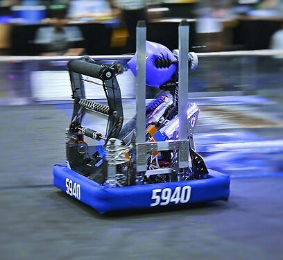
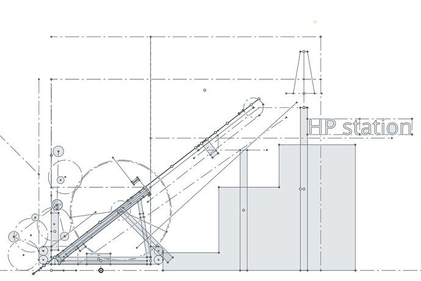
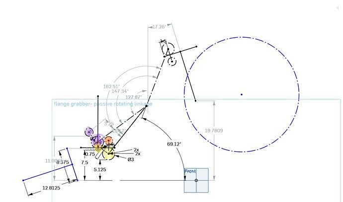

# 2023 · 5940 BREAD — Pain d'Epi

EPA rank 7, snapshot EPA 75.09. Provisional reference dossier.

Rear full-width acquisition, internally rigged elevator, pivoting arm and translating/rotating station forks.

## Intake

Rear floor intake vectors cubes; compliant pivoting cone pickup reorients tipped cones for the gripper.

Coverage: documented synopsis.

## Transfer

Compliant cone handoff avoids adding an actively controlled orientation axis.

Coverage: documented synopsis.

## Scoring

Two-stage elevator with overextending carriage and internally routed Dyneema; pivoting arm carries the gripper.

Coverage: documented synopsis.

## Drivetrain

Swerve platform; exact module choice should be checked in released CAD.

Coverage: documented synopsis.

## Endgame

Spring-deployed forks translate and rotate through a cam/string arrangement, lifting the front before rotating the chassis.

Coverage: documented synopsis.

## Controls

AprilTag pose estimation from three cameras on an Orange Pi 5; retroreflective vision refines cone alignment and checks node occupancy.

Coverage: documented synopsis.

## Changes and versions

- Angled-elevator alpha robot preceded later architecture.
- Elevator gearing increased as placement-speed limits became clearer.
- Interview also discusses later offseason vision changes; these are not labeled Championship configuration.

## Strategic interpretation — analyst inference

Useful for acquisition on the opposite side from scoring and for separating coarse localization from final-placement sensing. The compliant handoff is a geometric solution to an orientation problem.

## Limits

- Interview was filmed after the main season; late-season versus offseason details require care.

Bounded source review; exhaustive intermediate-version history not certified

## Reviewed primary source bundle

- https://youtu.be/merzyA-beto
- https://www.chiefdelphi.com/t/445374

## Season context

Read [the full 2023 game/context chapter](../docs/game_2023.md) before transferring this architecture to another role or season.

## Technical image references

Images are source-associated technical figures or robot views, not dimensionally certified drawings. Follow each source for version and figure context.

2023 team 5940 — source image from post 1 (2023-12-05). Context tags identify the discussion, not a verified component label. [Original source](https://www.chiefdelphi.com/t/445374/1). Source-linked extraction; mechanism identity not individually visually audited

2023 team 5940 — source image from post 9 (2023-12-06). Context tags identify the discussion, not a verified component label. [Original source](https://www.chiefdelphi.com/t/445374/9). Source-linked extraction; mechanism identity not individually visually audited

2023 team 5940 — source image from post 9 (2023-12-06). Context tags identify the discussion, not a verified component label. [Original source](https://www.chiefdelphi.com/t/445374/9). Source-linked extraction; mechanism identity not individually visually audited

## Dated research locators — navigation, not reviewed claims

A tag describes words in the source, not a validated engineering fact. Discussion replies may concern comparison robots.

- 2023-12-05 · KKrish100 · [post 1](https://www.chiefdelphi.com/t/445374/1) · cad, code
- 2023-12-05 · CyberClone · [post 7](https://www.chiefdelphi.com/t/445374/7) · wrist
- 2023-12-06 · trevor_h · [post 9](https://www.chiefdelphi.com/t/445374/9) · cad, intake, pivot
- 2023-12-08 · KKrish100 · [post 13](https://www.chiefdelphi.com/t/445374/13) · belt, elevator
- 2023-12-08 · Shayaan · [post 15](https://www.chiefdelphi.com/t/445374/15) · arm, cad, elevator
- 2023-12-09 · 2930notjorde · [post 16](https://www.chiefdelphi.com/t/445374/16) · cad
- 2023-12-09 · Ismail · [post 18](https://www.chiefdelphi.com/t/445374/18) · belt, cad, chain, elevator
- 2023-12-13 · Brayton97 · [post 19](https://www.chiefdelphi.com/t/445374/19) · bearing, elevator
- 2023-12-13 · Daniel1464 · [post 20](https://www.chiefdelphi.com/t/445374/20) · code
- 2023-12-13 · jonahb55 · [post 21](https://www.chiefdelphi.com/t/445374/21) · code
- 2023-12-13 · Michael_Corsetto · [post 22](https://www.chiefdelphi.com/t/445374/22) · cad
- 2023-12-13 · KKrish100 · [post 25](https://www.chiefdelphi.com/t/445374/25) · autonomous, code, vision
- 2023-12-13 · AllenGregoryIV · [post 26](https://www.chiefdelphi.com/t/445374/26) · code
- 2023-12-13 · Daniel1464 · [post 28](https://www.chiefdelphi.com/t/445374/28) · code
- 2023-12-14 · Shayaan · [post 31](https://www.chiefdelphi.com/t/445374/31) · arm, belt, chain, elevator, intake
- 2023-12-14 · Shayaan · [post 32](https://www.chiefdelphi.com/t/445374/32) · bearing, elevator
- 2023-12-16 · FerMtz · [post 33](https://www.chiefdelphi.com/t/445374/33) · arm
- 2023-12-16 · Griffin · [post 35](https://www.chiefdelphi.com/t/445374/35) · arm, belt
- 2023-12-16 · Andrew_L · [post 36](https://www.chiefdelphi.com/t/445374/36) · arm
- 2023-12-16 · Griffin · [post 37](https://www.chiefdelphi.com/t/445374/37) · arm
- 2023-12-16 · AdamHeard · [post 38](https://www.chiefdelphi.com/t/445374/38) · rotor
- 2023-12-17 · Griffin · [post 43](https://www.chiefdelphi.com/t/445374/43) · arm, elevator
- 2023-12-17 · s-neff · [post 46](https://www.chiefdelphi.com/t/445374/46) · arm, rebuild
- 2023-12-17 · Max5940 · [post 47](https://www.chiefdelphi.com/t/445374/47) · bearing, cad, elevator
- 2023-12-17 · Max5940 · [post 49](https://www.chiefdelphi.com/t/445374/49) · arm, belt, encoder
- 2023-12-31 · Rombutan · [post 53](https://www.chiefdelphi.com/t/445374/53) · cad
- 2024-01-21 · GearFox · [post 54](https://www.chiefdelphi.com/t/445374/54) · code

## Integrated focused technical study

[Construction, reasoning, failure modes and limits](../docs/research_continuation/2023-5940.md). This supplement is a focused interview/source-bundle study, not an exhaustive binder or competition-version certification.
