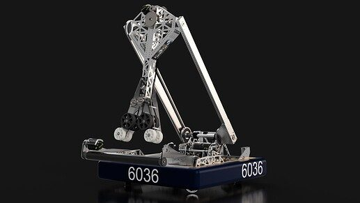
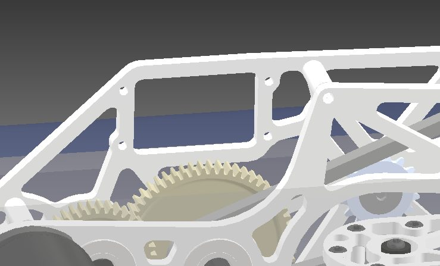
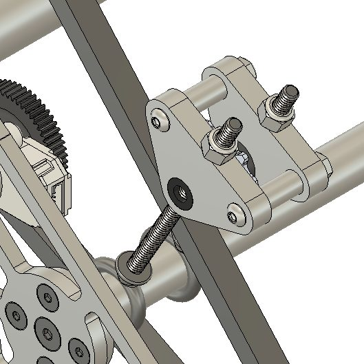

# 2023 · 6036 Peninsula Robotics — Dum-E

EPA rank 10, snapshot EPA 73.68. Provisional reference dossier.

Pass-through two-joint arm, direct station gripper and later full-width cube floor intake.

## Intake

Wide cube collector with compliant centering guides. Floor cone acquisition deliberately omitted in favor of reliable double-substation cycles.

Coverage: documented synopsis.

## Transfer

Floor cube intake hands to the arm; duct-taped compliant strap guides replaced stiffer materials that trapped or damaged cubes.

Coverage: documented synopsis.

## Scoring

Both arm-joint transmissions mounted low; gripper roller drive counterbalances the distal joint.

Coverage: documented synopsis.

## Drivetrain

Swerve integrated with autonomous placement.

Coverage: documented synopsis.

## Endgame

Charge-station method is not covered by the retrieved walkthrough.

Coverage: documented synopsis.

## Controls

Two AprilTag cameras and a 27-node selector automate community placement; pre-match dashboard checks module configuration and running software threads.

Coverage: documented synopsis.

## Changes and versions

- Cube floor intake added after early competition/testing.
- Guide materials iterated from rigid shaft and other compliant candidates to the final strap arrangement.

## Strategic interpretation — analyst inference

A useful explicit omission: floor cones were rejected because alignment cost and defense exposure outweighed their expected benefit for this team's cycles. This is strategic simplification with a stated operational basis.

## Limits

- Endgame details and full configuration chronology remain incomplete.

Bounded source review; exhaustive intermediate-version history not certified

## Reviewed primary source bundle

- https://youtu.be/eQnNk1OwPT0
- https://www.chiefdelphi.com/t/436345

## Season context

Read [the full 2023 game/context chapter](../docs/game_2023.md) before transferring this architecture to another role or season.

## Technical image references

Images are source-associated technical figures or robot views, not dimensionally certified drawings. Follow each source for version and figure context.

2023 team 6036 — source image from post 1 (2023-04-30). Context tags identify the discussion, not a verified component label. [Original source](https://www.chiefdelphi.com/t/436345/1). Source-linked extraction; mechanism identity not individually visually audited

2023 team 6036 — source image from post 9 (2023-06-12). Context tags identify the discussion, not a verified component label. [Original source](https://www.chiefdelphi.com/t/436345/9). Source-linked extraction; mechanism identity not individually visually audited

2023 team 6036 — source image from post 13 (2023-11-16). Context tags identify the discussion, not a verified component label. [Original source](https://www.chiefdelphi.com/t/436345/13). Source-linked extraction; mechanism identity not individually visually audited

## Dated research locators — navigation, not reviewed claims

A tag describes words in the source, not a validated engineering fact. Discussion replies may concern comparison robots.

- 2023-04-30 · Rohit_Seshadri · [post 1](https://www.chiefdelphi.com/t/436345/1) · cad
- 2023-05-23 · Tyler_Olds · [post 1](https://www.chiefdelphi.com/t/437504/1) · arm, intake
- 2023-06-12 · Cbrosch0 · [post 9](https://www.chiefdelphi.com/t/436345/9) · intake
- 2023-06-12 · Rohit_Seshadri · [post 10](https://www.chiefdelphi.com/t/436345/10) · camera
- 2023-11-16 · Rohit_Seshadri · [post 11](https://www.chiefdelphi.com/t/436345/11) · cad
- 2023-11-16 · ythan · [post 12](https://www.chiefdelphi.com/t/436345/12) · intake
- 2023-11-16 · Rohit_Seshadri · [post 13](https://www.chiefdelphi.com/t/436345/13) · arm, chain, intake

## Integrated focused technical study

[Construction, reasoning, failure modes and limits](../docs/research_continuation/2023-6036.md). This supplement is a focused interview/source-bundle study, not an exhaustive binder or competition-version certification.
