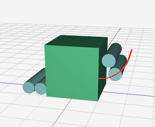

# 2024 · 1678 Citrus Circuits — Epsilon

EPA rank 1, snapshot EPA 58.05. Provisional reference dossier.

Over-bumper collector, selectable note paths, low shooting pivot and elevator for amp/trap.

## Drivetrain

Swerve; package balances wide acquisition with alternate scoring paths.

Coverage: documented synopsis.

## Intake

Full-width deployed intake, with replaceable side assemblies and printed funnel blocks.

Coverage: documented synopsis.

## Transfer

Two beam breaks track the note; staging leaves the choice between shooter and amp path open.

Coverage: documented synopsis.

## Scoring

Pivoted flywheel shooter; elevated alternate path handles amp/trap notes.

Coverage: documented synopsis.

## Endgame

Elevator presents the trap note; full hanger details need separate verification.

Coverage: documented synopsis.

## Controls

Two cameras/two Orange Pis, odometry-error fusion, shooting-on-move autonomous and missed-note fallback.

Coverage: documented synopsis.

## Changes and versions

- Quick five-note alpha; unsuccessful three-pivot beta; final simpler architecture. After first event, bent intake plates led to compliant polycarbonate/5052 construction.

## Strategic interpretation — analyst inference

Late binding of the scoring destination reduces coordination failures when a partner changes plans. The rebuild history also shows why early autonomous success does not validate every later architectural addition.

## Limits

- Configuration description is tied to the cited interview; not a claim that every unreported shop revision is known.

Bounded source review; exhaustive intermediate-version history not certified

## Reviewed primary source bundle

- https://youtu.be/wmNuuUsm9GY

## Season context

Read [the full 2024 game/context chapter](../docs/game_2024.md) before transferring this architecture to another role or season.

## Technical image references

Images are source-associated technical figures or robot views, not dimensionally certified drawings. Follow each source for version and figure context.

2024 team 1678 — source image from post 61 (2024-01-13). Context tags identify the discussion, not a verified component label. [Original source](https://www.chiefdelphi.com/t/449823/61). Source-linked extraction; mechanism identity not individually visually audited

## Dated research locators — navigation, not reviewed claims

A tag describes words in the source, not a validated engineering fact. Discussion replies may concern comparison robots.

- 2024-01-13 · Akash_Rastogi · [post 10](https://www.chiefdelphi.com/t/449823/10) · autonomous
- 2024-01-13 · Peter_Johnson · [post 13](https://www.chiefdelphi.com/t/449823/13) · intake, pivot, shooter
- 2024-01-13 · Akash_Rastogi · [post 19](https://www.chiefdelphi.com/t/449823/19) · cad
- 2024-01-13 · CyberClone · [post 27](https://www.chiefdelphi.com/t/449823/27) · shooter
- 2024-01-13 · MysticEagle52 · [post 48](https://www.chiefdelphi.com/t/449823/48) · intake
- 2024-01-13 · GenericUsername · [post 61](https://www.chiefdelphi.com/t/449823/61) · intake, shooter
- 2024-01-13 · UnofficialForth · [post 62](https://www.chiefdelphi.com/t/449823/62) · shooter
- 2024-01-13 · Randomness57 · [post 68](https://www.chiefdelphi.com/t/449823/68) · autonomous
- 2024-01-13 · Steven_Carmain · [post 73](https://www.chiefdelphi.com/t/449823/73) · climb
- 2024-01-14 · Max_Morehead · [post 84](https://www.chiefdelphi.com/t/449823/84) · climb
- 2024-01-15 · Aidan1 · [post 89](https://www.chiefdelphi.com/t/449823/89) · collector, shooter
- 2024-01-15 · Aidan1 · [post 90](https://www.chiefdelphi.com/t/449823/90) · shooter
- 2024-01-15 · CIM · [post 94](https://www.chiefdelphi.com/t/449823/94) · shooter
- 2024-01-15 · Tyler_S · [post 95](https://www.chiefdelphi.com/t/449823/95) · shooter
- 2024-01-17 · waxton · [post 98](https://www.chiefdelphi.com/t/449823/98) · shooter

## Integrated focused technical study

[Construction, reasoning, failure modes and limits](../docs/research_continuation/2024-1678.md). This supplement is a focused interview/source-bundle study, not an exhaustive binder or competition-version certification.
