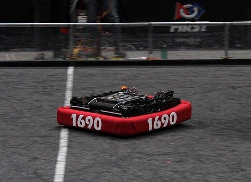
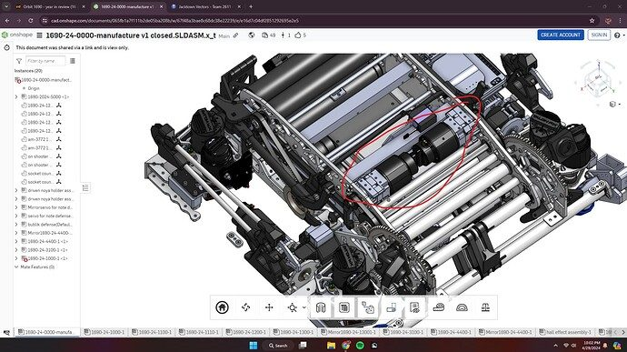
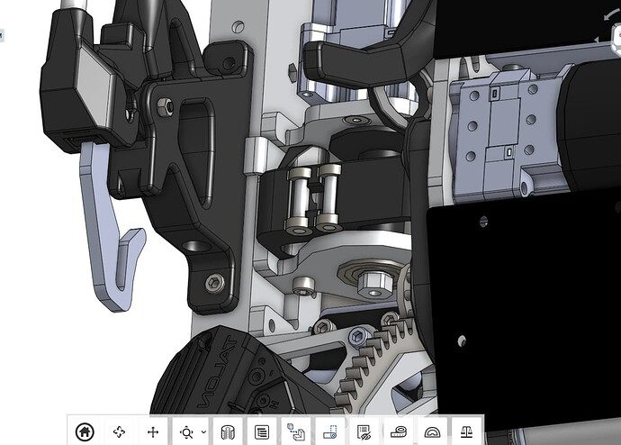
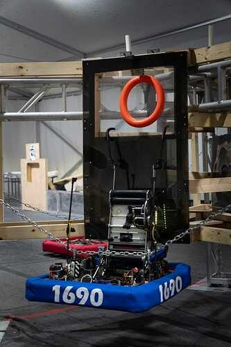
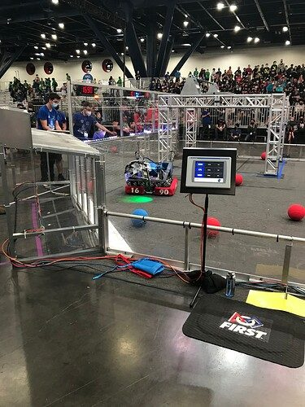
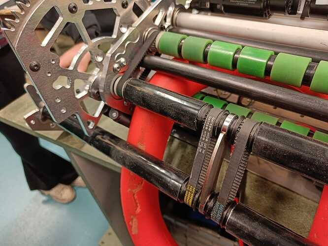

# 2024 · 1690 Orbit — Doppler

EPA rank 6, snapshot EPA 53.63. Provisional reference dossier.

Very low stow, full-width protected intake and four-roller cannon; endgame added around the core scorer.

## Drivetrain

Custom swerve top plates allow shooter stow between modules, below one foot per team interview.

Coverage: documented synopsis.

## Intake

Under-bumper intake; powered centering wheels added before Worlds.

Coverage: documented synopsis.

## Transfer

Intake/trigger transmission remains concentric with the shooter pivot, permitting feeding at many angles.

Coverage: documented synopsis.

## Scoring

Four horizontal contact rollers stabilize a narrowed note. Rack-and-pinion pivot draws inspiration from 971's 2017 turret.

Coverage: documented synopsis.

## Endgame

Light hook-deploy linkage, winches and passive spring/servo trap-door fingers reuse the main shooter.

Coverage: documented synopsis.

## Controls

Fast sensor loop, slip/collision-aware localization, note-search auto recovery, tilt/roll-aware climb coordination.

Coverage: documented synopsis.

## Changes and versions

- Rubber coating ballooned at speed; switched to vulcanized rollers. Trapped notes caused two losses; added a servo-raised deflector. Centering wheels added before Champs.

## Strategic interpretation — analyst inference

This is an explicit hierarchy: protect speaker/amp cycle performance first and fit climbing/trap around it. The compact package succeeds because the controls handle narrowed-note flight and changing robot pose.

## Limits

- Configuration description is tied to the cited interview; not a claim that every unreported shop revision is known.

Bounded source review; exhaustive intermediate-version history not certified

## Reviewed primary source bundle

- https://youtu.be/jB7OqueRYf0

## Season context

Read [the full 2024 game/context chapter](../docs/game_2024.md) before transferring this architecture to another role or season.

## Technical image references

Images are source-associated technical figures or robot views, not dimensionally certified drawings. Follow each source for version and figure context.

2024 team 1690 — source image from post 1 (2024-04-29). Context tags identify the discussion, not a verified component label. [Original source](https://www.chiefdelphi.com/t/464838/1). Source-linked extraction; mechanism identity not individually visually audited

2024 team 1690 — source image from post 29 (2024-04-30). Context tags identify the discussion, not a verified component label. [Original source](https://www.chiefdelphi.com/t/464838/29). Source-linked extraction; mechanism identity not individually visually audited

2024 team 1690 — source image from post 57 (2024-05-01). Context tags identify the discussion, not a verified component label. [Original source](https://www.chiefdelphi.com/t/464838/57). Source-linked extraction; mechanism identity not individually visually audited

2024 team 1690 — source image from post 1 (2024-02-19). Context tags identify the discussion, not a verified component label. [Original source](https://www.chiefdelphi.com/t/455350/1). Source-linked extraction; mechanism identity not individually visually audited

2024 team 1690 — source image from post 23 (2024-02-20). Context tags identify the discussion, not a verified component label. [Original source](https://www.chiefdelphi.com/t/455350/23). Source-linked extraction; mechanism identity not individually visually audited

2024 team 1690 — source image from post 34 (2024-02-20). Context tags identify the discussion, not a verified component label. [Original source](https://www.chiefdelphi.com/t/455350/34). Source-linked extraction; mechanism identity not individually visually audited

## Dated research locators — navigation, not reviewed claims

A tag describes words in the source, not a validated engineering fact. Discussion replies may concern comparison robots.

- 2024-02-19 · Dave1998 · [post 19](https://www.chiefdelphi.com/t/455350/19) · vision
- 2024-02-20 · e172 · [post 23](https://www.chiefdelphi.com/t/455350/23) · shooter
- 2024-02-20 · NickNguyen · [post 25](https://www.chiefdelphi.com/t/455350/25) · shooter
- 2024-02-20 · Omer_Prag · [post 28](https://www.chiefdelphi.com/t/455350/28) · camera, intake, shooter
- 2024-02-20 · Korny · [post 30](https://www.chiefdelphi.com/t/455350/30) · climb
- 2024-02-20 · Korny · [post 31](https://www.chiefdelphi.com/t/455350/31) · intake, shooter
- 2024-02-20 · justin.chau · [post 32](https://www.chiefdelphi.com/t/455350/32) · intake
- 2024-02-20 · Korny · [post 34](https://www.chiefdelphi.com/t/455350/34) · intake
- 2024-02-20 · hadar_b · [post 38](https://www.chiefdelphi.com/t/455350/38) · cad
- 2024-02-20 · AsanshayG · [post 47](https://www.chiefdelphi.com/t/455350/47) · intake
- 2024-02-21 · Max_Morehead · [post 52](https://www.chiefdelphi.com/t/455350/52) · shooter
- 2024-02-21 · Tomker · [post 60](https://www.chiefdelphi.com/t/455350/60) · arm, intake
- 2024-02-22 · OhFear · [post 62](https://www.chiefdelphi.com/t/455350/62) · intake
- 2024-02-22 · Yonas · [post 65](https://www.chiefdelphi.com/t/455350/65) · intake
- 2024-02-22 · lar · [post 66](https://www.chiefdelphi.com/t/455350/66) · climb
- 2024-02-23 · JoshuaJ1710 · [post 67](https://www.chiefdelphi.com/t/455350/67) · intake, shooter
- 2024-02-23 · ElliotS · [post 68](https://www.chiefdelphi.com/t/455350/68) · climb
- 2024-02-24 · Korny · [post 72](https://www.chiefdelphi.com/t/455350/72) · climb
- 2024-02-28 · Omer_Prag · [post 79](https://www.chiefdelphi.com/t/455350/79) · intake
- 2024-03-11 · lnex1357 · [post 91](https://www.chiefdelphi.com/t/455350/91) · climb
- 2024-03-11 · Korny · [post 92](https://www.chiefdelphi.com/t/455350/92) · climb
- 2024-03-15 · AsanshayG · [post 94](https://www.chiefdelphi.com/t/455350/94) · climb, shooter
- 2024-03-17 · TORG · [post 96](https://www.chiefdelphi.com/t/455350/96) · chain
- 2024-03-19 · Miracle_GO · [post 98](https://www.chiefdelphi.com/t/455350/98) · cad
- 2024-03-19 · Joshuayang7 · [post 99](https://www.chiefdelphi.com/t/455350/99) · shooter
- 2024-03-19 · Korny · [post 100](https://www.chiefdelphi.com/t/455350/100) · cad
- 2024-03-20 · Yessir · [post 101](https://www.chiefdelphi.com/t/455350/101) · intake, shooter
- 2024-03-22 · Jay_Lin · [post 104](https://www.chiefdelphi.com/t/455350/104) · intake, shooter
- 2024-03-24 · Korny · [post 106](https://www.chiefdelphi.com/t/455350/106) · intake
- 2024-04-01 · Betaloop · [post 109](https://www.chiefdelphi.com/t/455350/109) · cad
- 2024-04-02 · JesusRetes · [post 110](https://www.chiefdelphi.com/t/455350/110) · intake
- 2024-04-02 · Aaron_Li · [post 111](https://www.chiefdelphi.com/t/455350/111) · arm, intake
- 2024-04-03 · Tomker · [post 113](https://www.chiefdelphi.com/t/455350/113) · arm, intake
- 2024-04-03 · Tomker · [post 114](https://www.chiefdelphi.com/t/455350/114) · arm, intake, pivot, shooter
- 2024-04-21 · xuan-no.1 · [post 131](https://www.chiefdelphi.com/t/455350/131) · cad
- 2024-04-21 · MichealSorento · [post 133](https://www.chiefdelphi.com/t/455350/133) · shooter
- 2024-04-21 · kornblau · [post 135](https://www.chiefdelphi.com/t/455350/135) · shooter
- 2024-04-21 · Dave1998 · [post 136](https://www.chiefdelphi.com/t/455350/136) · code
- 2024-04-21 · AmitSucher · [post 137](https://www.chiefdelphi.com/t/455350/137) · shooter
- 2024-04-21 · BJC · [post 138](https://www.chiefdelphi.com/t/455350/138) · shooter
- 2024-04-21 · jjsessa · [post 139](https://www.chiefdelphi.com/t/455350/139) · shooter
- 2024-04-21 · kornblau · [post 142](https://www.chiefdelphi.com/t/455350/142) · camera
- 2024-04-21 · kornblau · [post 143](https://www.chiefdelphi.com/t/455350/143) · shooter
- 2024-04-21 · Amicus1 · [post 144](https://www.chiefdelphi.com/t/455350/144) · autonomous
- 2024-04-21 · Michael_Corsetto · [post 145](https://www.chiefdelphi.com/t/455350/145) · code
- 2024-04-21 · kornblau · [post 149](https://www.chiefdelphi.com/t/455350/149) · cad, code
- 2024-04-21 · cheesydoof · [post 150](https://www.chiefdelphi.com/t/455350/150) · code
- 2024-04-21 · jdaming · [post 153](https://www.chiefdelphi.com/t/455350/153) · code
- 2024-04-22 · kornblau · [post 168](https://www.chiefdelphi.com/t/455350/168) · code
- 2024-04-22 · Jared_Russell · [post 176](https://www.chiefdelphi.com/t/455350/176) · vision
- 2024-04-22 · yesiconcur · [post 180](https://www.chiefdelphi.com/t/455350/180) · vision
- 2024-04-22 · Omer_Prag · [post 181](https://www.chiefdelphi.com/t/455350/181) · vision
- 2024-04-22 · Omer_Prag · [post 184](https://www.chiefdelphi.com/t/455350/184) · camera
- 2024-04-22 · Omer_Prag · [post 185](https://www.chiefdelphi.com/t/455350/185) · camera, intake
- 2024-04-23 · yesiconcur · [post 189](https://www.chiefdelphi.com/t/455350/189) · code, vision
- 2024-04-23 · Smtopps · [post 201](https://www.chiefdelphi.com/t/455350/201) · shooter
- 2024-04-23 · theworkshope · [post 202](https://www.chiefdelphi.com/t/455350/202) · cad
- 2024-04-23 · Omer_Prag · [post 203](https://www.chiefdelphi.com/t/455350/203) · vision
- 2024-04-23 · Omer_Prag · [post 205](https://www.chiefdelphi.com/t/455350/205) · intake
- 2024-04-23 · Wihy · [post 213](https://www.chiefdelphi.com/t/455350/213) · code
- 2024-04-23 · Technoton1 · [post 216](https://www.chiefdelphi.com/t/455350/216) · cad
- 2024-04-23 · yesiconcur · [post 218](https://www.chiefdelphi.com/t/455350/218) · intake
- 2024-04-23 · Omer_Prag · [post 219](https://www.chiefdelphi.com/t/455350/219) · code, intake
- 2024-04-24 · Cake · [post 224](https://www.chiefdelphi.com/t/455350/224) · code
- 2024-04-24 · ZCam_4415 · [post 225](https://www.chiefdelphi.com/t/455350/225) · cad
- 2024-04-24 · kornblau · [post 227](https://www.chiefdelphi.com/t/455350/227) · cad
- 2024-04-25 · GronkBaby · [post 235](https://www.chiefdelphi.com/t/455350/235) · shooter
- 2024-04-25 · hadar_b · [post 237](https://www.chiefdelphi.com/t/455350/237) · cad
- 2024-04-25 · GronkBaby · [post 239](https://www.chiefdelphi.com/t/455350/239) · camera, intake
- 2024-04-25 · Naumann · [post 241](https://www.chiefdelphi.com/t/455350/241) · camera, intake
- 2024-04-25 · AngleSideAngle · [post 242](https://www.chiefdelphi.com/t/455350/242) · shooter
- 2024-04-25 · GronkBaby · [post 243](https://www.chiefdelphi.com/t/455350/243) · shooter
- 2024-04-25 · Max_Morehead · [post 244](https://www.chiefdelphi.com/t/455350/244) · code, intake
- 2024-04-25 · Dave1998 · [post 247](https://www.chiefdelphi.com/t/455350/247) · arm, shooter
- 2024-04-25 · Naumann · [post 248](https://www.chiefdelphi.com/t/455350/248) · code, intake, shooter
- 2024-04-25 · essanders · [post 249](https://www.chiefdelphi.com/t/455350/249) · code, shooter
- 2024-04-25 · levyishai · [post 250](https://www.chiefdelphi.com/t/455350/250) · shooter
- 2024-04-28 · Nathan1 · [post 252](https://www.chiefdelphi.com/t/455350/252) · cad
- 2024-04-28 · Korny · [post 253](https://www.chiefdelphi.com/t/455350/253) · code, prototype
- 2024-04-28 · Korny · [post 257](https://www.chiefdelphi.com/t/455350/257) · intake, prototype, shooter
- 2024-04-29 · RockyXRQ · [post 258](https://www.chiefdelphi.com/t/455350/258) · shooter
- 2024-04-29 · Korny · [post 260](https://www.chiefdelphi.com/t/455350/260) · shooter
- 2024-04-29 · Alongo · [post 1](https://www.chiefdelphi.com/t/464838/1) · cad
- 2024-04-29 · chicenbokner01 · [post 261](https://www.chiefdelphi.com/t/455350/261) · cad, code, prototype
- 2024-04-29 · kornblau · [post 7](https://www.chiefdelphi.com/t/464838/7) · intake, shooter
- 2024-04-29 · Akash_Rastogi · [post 10](https://www.chiefdelphi.com/t/464838/10) · cad, encoder
- 2024-04-29 · AsanshayG · [post 12](https://www.chiefdelphi.com/t/464838/12) · cad
- 2024-04-29 · Alongo · [post 16](https://www.chiefdelphi.com/t/464838/16) · encoder, pivot
- 2024-04-29 · PatrickW · [post 18](https://www.chiefdelphi.com/t/464838/18) · cad
- 2024-04-29 · CYO · [post 19](https://www.chiefdelphi.com/t/464838/19) · code
- 2024-04-29 · Noam6738 · [post 21](https://www.chiefdelphi.com/t/464838/21) · cad, shooter
- 2024-04-29 · Korny · [post 28](https://www.chiefdelphi.com/t/464838/28) · climb
- 2024-04-30 · Eric1 · [post 29](https://www.chiefdelphi.com/t/464838/29) · shooter
- 2024-04-30 · iddo · [post 31](https://www.chiefdelphi.com/t/464838/31) · intake, shooter
- 2024-04-30 · Waffle_Attack · [post 33](https://www.chiefdelphi.com/t/464838/33) · code
- 2024-04-30 · kornblau · [post 34](https://www.chiefdelphi.com/t/464838/34) · code
- 2024-04-30 · justin2974 · [post 35](https://www.chiefdelphi.com/t/464838/35) · code
- 2024-04-30 · justin2974 · [post 37](https://www.chiefdelphi.com/t/464838/37) · code
- 2024-04-30 · owenmurt · [post 38](https://www.chiefdelphi.com/t/464838/38) · code
- 2024-04-30 · Rezq · [post 39](https://www.chiefdelphi.com/t/464838/39) · cad, code
- 2024-04-30 · anonymous9 · [post 41](https://www.chiefdelphi.com/t/464838/41) · code
- 2024-04-30 · bathtubed · [post 46](https://www.chiefdelphi.com/t/464838/46) · code
- 2024-04-30 · anonymous9 · [post 48](https://www.chiefdelphi.com/t/464838/48) · code
- 2024-04-30 · OhFear · [post 50](https://www.chiefdelphi.com/t/464838/50) · cad
- 2024-04-30 · AmitSucher · [post 275](https://www.chiefdelphi.com/t/455350/275) · vision
- 2024-04-30 · kornblau · [post 276](https://www.chiefdelphi.com/t/455350/276) · code, vision
- 2024-04-30 · kornblau · [post 278](https://www.chiefdelphi.com/t/455350/278) · code
- 2024-04-30 · HarbringerOfAuroras · [post 279](https://www.chiefdelphi.com/t/455350/279) · vision
- 2024-05-01 · SaltySkittles · [post 281](https://www.chiefdelphi.com/t/455350/281) · camera
- 2024-05-01 · Omer_Prag · [post 283](https://www.chiefdelphi.com/t/455350/283) · camera, intake, shooter
- 2024-05-01 · itamar4590 · [post 51](https://www.chiefdelphi.com/t/464838/51) · encoder
- 2024-05-01 · Shani1 · [post 286](https://www.chiefdelphi.com/t/455350/286) · code
- 2024-05-01 · Omer_Prag · [post 287](https://www.chiefdelphi.com/t/455350/287) · code
- 2024-05-01 · Alongo · [post 55](https://www.chiefdelphi.com/t/464838/55) · encoder
- 2024-05-01 · Schmools · [post 63](https://www.chiefdelphi.com/t/464838/63) · pivot, shooter
- 2024-05-05 · itamar4590 · [post 69](https://www.chiefdelphi.com/t/464838/69) · shooter
- 2024-05-15 · MoMachine · [post 70](https://www.chiefdelphi.com/t/464838/70) · cad
- 2024-05-15 · Korny · [post 71](https://www.chiefdelphi.com/t/464838/71) · shooter
- 2024-05-16 · Geoffrey8814 · [post 72](https://www.chiefdelphi.com/t/464838/72) · camera, vision
- 2024-05-16 · Gavin0 · [post 290](https://www.chiefdelphi.com/t/455350/290) · camera
- 2024-05-16 · Omer_Prag · [post 291](https://www.chiefdelphi.com/t/455350/291) · camera, climb
- 2024-05-20 · ZCam_4415 · [post 76](https://www.chiefdelphi.com/t/464838/76) · intake
- 2024-05-21 · JohnFogarty · [post 79](https://www.chiefdelphi.com/t/464838/79) · belt
- 2024-05-22 · MSU2000 · [post 295](https://www.chiefdelphi.com/t/455350/295) · cad, chain, intake, pivot, shooter
- 2024-05-23 · Korny · [post 296](https://www.chiefdelphi.com/t/455350/296) · chain, pivot, shooter
- 2024-05-24 · MSU2000 · [post 297](https://www.chiefdelphi.com/t/455350/297) · shooter
- 2024-05-24 · oguzozgur · [post 298](https://www.chiefdelphi.com/t/455350/298) · cad, indexer, intake
- 2024-05-24 · Korny · [post 299](https://www.chiefdelphi.com/t/455350/299) · autonomous, shooter
- 2024-05-27 · kornblau · [post 301](https://www.chiefdelphi.com/t/455350/301) · intake
- 2024-05-27 · MoMachine · [post 83](https://www.chiefdelphi.com/t/464838/83) · pivot, shooter
- 2024-05-30 · Tal_Moshel · [post 304](https://www.chiefdelphi.com/t/455350/304) · autonomous, code
- 2024-05-30 · Omer_Prag · [post 306](https://www.chiefdelphi.com/t/455350/306) · code
- 2024-05-30 · Omer_Prag · [post 307](https://www.chiefdelphi.com/t/455350/307) · code
- 2024-05-31 · atsekhan · [post 309](https://www.chiefdelphi.com/t/455350/309) · code
- 2024-06-02 · Omer_Prag · [post 311](https://www.chiefdelphi.com/t/455350/311) · camera
- 2024-06-02 · atsekhan · [post 312](https://www.chiefdelphi.com/t/455350/312) · camera
- 2024-06-09 · MSU2000 · [post 85](https://www.chiefdelphi.com/t/464838/85) · pivot, shooter
- 2024-06-10 · kornblau · [post 88](https://www.chiefdelphi.com/t/464838/88) · shooter
- 2024-07-02 · noah_howard · [post 91](https://www.chiefdelphi.com/t/464838/91) · bearing, pivot
- 2024-07-04 · Alongo · [post 92](https://www.chiefdelphi.com/t/464838/92) · arm, bearing, cad, pivot, shooter
- 2024-07-07 · Naumann · [post 94](https://www.chiefdelphi.com/t/464838/94) · arm, code, encoder, pivot
- 2024-08-08 · akshaymarvaniya · [post 96](https://www.chiefdelphi.com/t/464838/96) · cad, intake
- 2024-08-08 · Korny · [post 97](https://www.chiefdelphi.com/t/464838/97) · intake
- 2024-08-10 · Funguy · [post 321](https://www.chiefdelphi.com/t/455350/321) · arm, cad, intake
- 2024-08-10 · Naumann · [post 322](https://www.chiefdelphi.com/t/455350/322) · arm, intake, shooter
- 2024-08-12 · Korny · [post 99](https://www.chiefdelphi.com/t/464838/99) · climb
- 2024-09-09 · MSU2000 · [post 100](https://www.chiefdelphi.com/t/464838/100) · shooter
- 2024-09-19 · Alongo · [post 101](https://www.chiefdelphi.com/t/464838/101) · belt, shooter
- 2024-09-20 · MSU2000 · [post 102](https://www.chiefdelphi.com/t/464838/102) · belt, intake, shooter
- 2024-10-30 · Naumann · [post 104](https://www.chiefdelphi.com/t/464838/104) · intake, shooter
- 2024-10-30 · MSU2000 · [post 105](https://www.chiefdelphi.com/t/464838/105) · intake
- 2024-11-13 · paul_5190 · [post 107](https://www.chiefdelphi.com/t/464838/107) · cad, intake
- 2024-11-13 · MSU2000 · [post 109](https://www.chiefdelphi.com/t/464838/109) · cad, intake
- 2024-12-04 · Mehmet1 · [post 326](https://www.chiefdelphi.com/t/455350/326) · code, intake
- 2024-12-04 · Omer_Prag · [post 327](https://www.chiefdelphi.com/t/455350/327) · code, intake
- 2024-12-04 · LaviRZ · [post 328](https://www.chiefdelphi.com/t/455350/328) · code
- 2024-12-10 · paul_5190 · [post 115](https://www.chiefdelphi.com/t/464838/115) · shooter
- 2025-01-15 · NafnafBeanz · [post 116](https://www.chiefdelphi.com/t/464838/116) · arm
- 2025-02-19 · Alongo · [post 117](https://www.chiefdelphi.com/t/464838/117) · arm, cad, pivot, shooter
- 2025-02-24 · paul_5190 · [post 119](https://www.chiefdelphi.com/t/464838/119) · cad
- 2025-06-07 · Parin-4237 · [post 120](https://www.chiefdelphi.com/t/464838/120) · cad
- 2025-06-20 · DaveBlunts · [post 121](https://www.chiefdelphi.com/t/464838/121) · cad

## Integrated focused technical study

[Construction, reasoning, failure modes and limits](../docs/research_continuation/2024-1690.md). This supplement is a focused interview/source-bundle study, not an exhaustive binder or competition-version certification.
