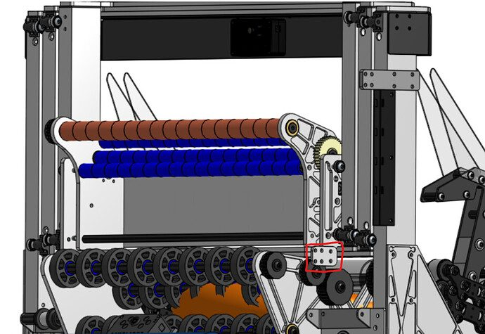

# 2024 · 1706 Ratchet Rockers — Riot

EPA rank 11, snapshot EPA 51.28. Provisional reference dossier.

Two-sided acquisition, differential-speed fixed-heading shooter and elevator amp/trap carriage.

## Drivetrain

Beta Thrifty swerve; beltless module architecture.

Coverage: documented synopsis.

## Intake

Front and rear intake; extra leading roller reaches notes against the wall.

Coverage: documented synopsis.

## Transfer

Shooter normally stages the note; reverse/feed sequence redirects it into the scoring carriage.

Coverage: documented synopsis.

## Scoring

Independent left/right wheel speed adds flight-stabilizing spin; pivoted launcher.

Coverage: documented synopsis.

## Endgame

Climb supports elevator/carriage trap delivery; exact hook transmission is not explained in this walkthrough.

Coverage: documented synopsis.

## Controls

Three Limelights, full-field pose, selectable autonomous orders; note tracking used selectively.

Coverage: documented synopsis.

## Changes and versions

- Added differential wheel speeds after long-range notes dived. Added wall-acquisition roller. At Champs, favored faster odometry-based acquisition over slower note tracking in some autos.

## Strategic interpretation — analyst inference

Explicit turret alternative: dual-sided pickup can recover much of the cleanup-cycle benefit with a simpler transfer. Sensors are chosen by time-to-complete, not by their availability.

## Limits

- Only source-established configurations and changes are described; intermediate revisions may remain unresolved.

Bounded source review; exhaustive intermediate-version history not certified

## Reviewed primary source bundle

- https://youtu.be/C-kz6RLoH24

## Season context

Read [the full 2024 game/context chapter](../docs/game_2024.md) before transferring this architecture to another role or season.

## Technical image references

Images are source-associated technical figures or robot views, not dimensionally certified drawings. Follow each source for version and figure context.

2024 team 1706 — source image from post 6 (2024-06-03). Context tags identify the discussion, not a verified component label. [Original source](https://www.chiefdelphi.com/t/467163/6). Source-linked extraction; mechanism identity not individually visually audited

## Dated research locators — navigation, not reviewed claims

A tag describes words in the source, not a validated engineering fact. Discussion replies may concern comparison robots.

- 2024-03-05 · Akash_Rastogi · [post 5](https://www.chiefdelphi.com/t/457440/5) · climb
- 2024-03-05 · Emerson1706 · [post 6](https://www.chiefdelphi.com/t/457440/6) · climb
- 2024-03-05 · ChiefK33f · [post 7](https://www.chiefdelphi.com/t/457440/7) · elevator
- 2024-03-06 · Skyehawk · [post 9](https://www.chiefdelphi.com/t/457440/9) · intake
- 2024-06-03 · Emerson1706 · [post 1](https://www.chiefdelphi.com/t/467163/1) · cad
- 2024-06-03 · ArdaTurkmen · [post 2](https://www.chiefdelphi.com/t/467163/2) · cad, code, elevator, shooter
- 2024-06-03 · Emerson1706 · [post 3](https://www.chiefdelphi.com/t/467163/3) · elevator, shooter
- 2024-06-03 · ArdaTurkmen · [post 6](https://www.chiefdelphi.com/t/467163/6) · elevator
- 2024-06-03 · Emerson1706 · [post 9](https://www.chiefdelphi.com/t/467163/9) · belt, chain, elevator
- 2024-06-03 · Emerson1706 · [post 12](https://www.chiefdelphi.com/t/467163/12) · shooter
- 2024-06-03 · Britt · [post 14](https://www.chiefdelphi.com/t/467163/14) · elevator
- 2024-08-08 · ollieollieollie · [post 17](https://www.chiefdelphi.com/t/467163/17) · cad, elevator
- 2024-08-08 · Emerson1706 · [post 18](https://www.chiefdelphi.com/t/467163/18) · bearing, belt, elevator
- 2025-01-03 · Emerson1706 · [post 19](https://www.chiefdelphi.com/t/467163/19) · cad, code, elevator, encoder

## Integrated focused technical study

[Construction, reasoning, failure modes and limits](../docs/research_continuation/2024-1706.md). This supplement is a focused interview/source-bundle study, not an exhaustive binder or competition-version certification.
