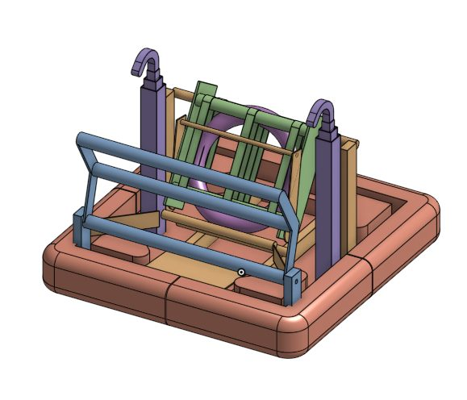
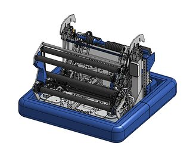

# 2024 · 1778 Chill Out — Zappy Feet

EPA rank 24, snapshot EPA 46.73. Provisional reference dossier.

Minimal-roller deployed pickup and shooter with mechanically linked amp bar; redundant climbers.

## Drivetrain

Swerve platform.

Coverage: documented synopsis.

## Intake

Four-roller over-bumper collector kept light for rapid retract.

Coverage: documented synopsis.

## Transfer

Indexer stores the note and doubles as the amp delivery path.

Coverage: documented synopsis.

## Scoring

Independent top/bottom launcher, asymmetric wheel count and virtual-four-bar amp guide.

Coverage: documented synopsis.

## Endgame

Two motors per climber; team reports continuing to climb with one entire climber removed.

Coverage: documented synopsis.

## Controls

Source-loading fallback, heading presets, shot lock/reacquire and tested autonomous routines.

Coverage: documented synopsis.

## Changes and versions

- One climber removed for repairs at Bonney Lake; redundant side preserved endgame. Core design intentionally limits additional actuators.

## Strategic interpretation — analyst inference

A useful reliability case: redundancy protects an actual scoring function, and source loading remains possible after intake loss. Assess the mass/electrical cost against the specific failure it survives.

## Limits

- Intermediate undocumented changes are not inferred; specifications and plans retain their source context.

Bounded source review; exhaustive intermediate-version history not certified

## Reviewed primary source bundle

- https://youtu.be/EEC-2XpqYQ0
- https://www.chiefdelphi.com/t/466727

## Season context

Read [the full 2024 game/context chapter](../docs/game_2024.md) before transferring this architecture to another role or season.

## Technical image references

Images are source-associated technical figures or robot views, not dimensionally certified drawings. Follow each source for version and figure context.

2024 team 1778 — source image from post 5 (2024-06-02). Context tags identify the discussion, not a verified component label. [Original source](https://www.chiefdelphi.com/t/466727/5). Source-linked extraction; mechanism identity not individually visually audited

2024 team 1778 — source image from post 5 (2024-06-02). Context tags identify the discussion, not a verified component label. [Original source](https://www.chiefdelphi.com/t/466727/5). Source-linked extraction; mechanism identity not individually visually audited

## Dated research locators — navigation, not reviewed claims

A tag describes words in the source, not a validated engineering fact. Discussion replies may concern comparison robots.

- 2024-05-22 · ApolloG · [post 1](https://www.chiefdelphi.com/t/466727/1) · cad, code
- 2024-06-01 · MSU2000 · [post 2](https://www.chiefdelphi.com/t/466727/2) · intake, shooter
- 2024-06-02 · ApolloG · [post 3](https://www.chiefdelphi.com/t/466727/3) · intake, prototype, shooter
- 2024-06-02 · ApolloG · [post 5](https://www.chiefdelphi.com/t/466727/5) · shooter

## Integrated focused technical study

[Construction, reasoning, failure modes and limits](../docs/research_continuation/2024-1778.md). This supplement is a focused interview/source-bundle study, not an exhaustive binder or competition-version certification.
