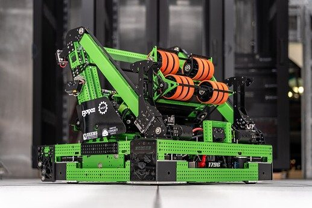
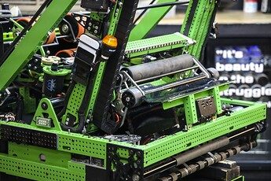

# 2024 · 1796 RoboTigers — Encore

EPA rank 7, snapshot EPA 52.99. Provisional reference dossier.

Under-bumper collector with central routing, independent shooter and elevator amp/trap scorer.

## Drivetrain

Kraken-powered SDS modules; bolted replaceable frame rails.

Coverage: documented synopsis.

## Intake

Nearly full-width roller intake with centering wedges; printed supports maintain belt tension.

Coverage: documented synopsis.

## Transfer

Central elevator/carriage can receive a note or return it to the rear shooter.

Coverage: documented synopsis.

## Scoring

Differential-speed launcher with belt-driven pivot; three-stage internally belted elevator serves amp/trap.

Coverage: documented synopsis.

## Endgame

Independent belt-driven telescoping sides; magnetic homing sensors.

Coverage: documented synopsis.

## Controls

Four Limelights supply pose estimates; distance determines shooter angle.

Coverage: documented synopsis.

## Changes and versions

- Moved from welded frame to replaceable rails after impact experience. Belt-based shooter pivot chosen to reduce slack; internal elevator rigging preserves rear pass-through.

## Strategic interpretation — analyst inference

Common structural mounting plate lets the team replace a drive frame without redesigning every mechanism. Routing flexibility is purchased with additional independent mechanisms and a more involved handoff.

## Limits

- Only source-established configurations and changes are described; intermediate revisions may remain unresolved.

Bounded source review; exhaustive intermediate-version history not certified

## Reviewed primary source bundle

- https://youtu.be/BTC9HzUGt04

## Season context

Read [the full 2024 game/context chapter](../docs/game_2024.md) before transferring this architecture to another role or season.

## Technical image references

Images are source-associated technical figures or robot views, not dimensionally certified drawings. Follow each source for version and figure context.

2024 team 1796 — source image from post 1 (2024-03-06). Context tags identify the discussion, not a verified component label. [Original source](https://www.chiefdelphi.com/t/457510/1). Source-linked extraction; mechanism identity not individually visually audited

2024 team 1796 — source image from post 1 (2024-03-06). Context tags identify the discussion, not a verified component label. [Original source](https://www.chiefdelphi.com/t/457510/1). Source-linked extraction; mechanism identity not individually visually audited

## Dated research locators — navigation, not reviewed claims

A tag describes words in the source, not a validated engineering fact. Discussion replies may concern comparison robots.

- 2024-03-06 · Giankyle8739 · [post 6](https://www.chiefdelphi.com/t/457510/6) · intake, shooter
- 2024-03-06 · RoboTigers1796 · [post 9](https://www.chiefdelphi.com/t/457510/9) · elevator

## Integrated focused technical study

[Construction, reasoning, failure modes and limits](../docs/research_continuation/2024-1796.md). This supplement is a focused interview/source-bundle study, not an exhaustive binder or competition-version certification.
