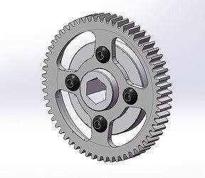
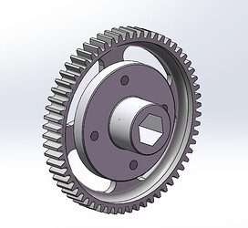

# 2024 · 2056 OP Robotics — LOW-KEY

EPA rank 5, snapshot EPA 53.7. Provisional reference dossier.

Protected collector and one pivoting shooter handle speaker/amp; pneumatic zero-time chain climb.

## Drivetrain

Swerve motor orientation widens the under-bumper intake.

Coverage: documented synopsis.

## Intake

Under-bumper urethane rollers and lateral rollers protect pickup hardware inside the perimeter.

Coverage: documented synopsis.

## Transfer

Sushi rollers feed directly into the launcher; double-sided belts simplify opposing rotations.

Coverage: documented synopsis.

## Scoring

Top/bottom launcher on a high-travel pivot; team reports tuned compression and high release poses against tall defenders.

Coverage: documented synopsis.

## Endgame

Pneumatic hooks are supported while enabled and drop as power ends; separate hook positions accommodate solo or partner climbs.

Coverage: documented synopsis.

## Controls

Note detection, tag-relative aiming, single-driver controls and tactile/LED readiness signals.

Coverage: documented synopsis.

## Changes and versions

- Pre-provincials interview emphasizes autonomous refinement; later binder and Worlds interview must be consulted for final details.

## Strategic interpretation — analyst inference

Compare endgame time cost against scoring opportunity. The climber's pneumatic capacity and disable behavior are enabling details; a generic hook is not an equivalent architecture.

## Evidence and limits

- Configuration description is tied to the cited interview; not a claim that every unreported shop revision is known.

Bounded source review; exhaustive intermediate-version history not certified

## Reviewed source bundle

- https://youtu.be/IZindhVMrX0
- https://2056.ca/wp-content/uploads/2024/05/OPR24-2056-Technical-Binder.pdf

## Season context

Read [the full 2024 game/context chapter](../docs/game_2024.md) before transferring this architecture to another role or season.

## Technical image references

Images are source-associated technical figures or robot views, not dimensionally certified drawings. Follow each source for version and figure context.

2024 team 2056 — source image from post 21 (2024-05-11). Context tags identify the discussion, not a verified component label. [Original source](https://www.chiefdelphi.com/t/465867/21). Source-linked extraction; mechanism identity not individually visually audited

2024 team 2056 — source image from post 21 (2024-05-11). Context tags identify the discussion, not a verified component label. [Original source](https://www.chiefdelphi.com/t/465867/21). Source-linked extraction; mechanism identity not individually visually audited

## Dated research locators — navigation, not reviewed claims

A tag describes words in the source, not a validated engineering fact. Discussion replies may concern comparison robots.

- 2024-05-10 · Khalsa · [post 1](https://www.chiefdelphi.com/t/465867/1) · cad
- 2024-05-10 · taiga · [post 12](https://www.chiefdelphi.com/t/465867/12) · cad
- 2024-05-10 · BordomBeThyName · [post 20](https://www.chiefdelphi.com/t/465867/20) · cad
- 2024-05-11 · Khalsa · [post 21](https://www.chiefdelphi.com/t/465867/21) · arm
- 2024-05-13 · Khalsa · [post 27](https://www.chiefdelphi.com/t/465867/27) · cad, climb
- 2024-05-16 · Nessie · [post 30](https://www.chiefdelphi.com/t/465867/30) · cad
- 2024-05-22 · Khalsa · [post 33](https://www.chiefdelphi.com/t/465867/33) · cad
- 2024-05-29 · Khalsa · [post 37](https://www.chiefdelphi.com/t/465867/37) · arm, shooter
- 2024-05-29 · waialua359 · [post 38](https://www.chiefdelphi.com/t/465867/38) · cad
- 2024-05-31 · superdude311 · [post 39](https://www.chiefdelphi.com/t/465867/39) · belt, shooter
- 2024-06-13 · AmitSucher · [post 44](https://www.chiefdelphi.com/t/465867/44) · arm
- 2024-06-13 · Khalsa · [post 46](https://www.chiefdelphi.com/t/465867/46) · arm, pivot
- 2024-06-30 · Khalsa · [post 48](https://www.chiefdelphi.com/t/465867/48) · arm, vision
- 2024-07-14 · 8bit · [post 50](https://www.chiefdelphi.com/t/465867/50) · intake
- 2024-07-14 · Khalsa · [post 51](https://www.chiefdelphi.com/t/465867/51) · intake, shooter
- 2024-07-16 · Khalsa · [post 53](https://www.chiefdelphi.com/t/465867/53) · intake
- 2024-07-23 · Reis · [post 55](https://www.chiefdelphi.com/t/465867/55) · arm
- 2024-07-23 · Kaleb_Dodd · [post 56](https://www.chiefdelphi.com/t/465867/56) · arm
- 2024-07-23 · Holtzman · [post 58](https://www.chiefdelphi.com/t/465867/58) · arm, camera, shooter
- 2024-07-31 · PatMcN · [post 59](https://www.chiefdelphi.com/t/465867/59) · arm, encoder
- 2024-07-31 · Holtzman · [post 60](https://www.chiefdelphi.com/t/465867/60) · arm, encoder
- 2024-07-31 · nuclearnerd · [post 61](https://www.chiefdelphi.com/t/465867/61) · encoder
- 2024-07-31 · Michael_Corsetto · [post 62](https://www.chiefdelphi.com/t/465867/62) · arm
- 2024-08-21 · GalDotan · [post 65](https://www.chiefdelphi.com/t/465867/65) · intake
- 2024-08-21 · Khalsa · [post 66](https://www.chiefdelphi.com/t/465867/66) · intake
- 2024-10-21 · BrianAtlanta · [post 69](https://www.chiefdelphi.com/t/465867/69) · camera
- 2024-10-22 · pevvvvvvvvv · [post 70](https://www.chiefdelphi.com/t/465867/70) · arm, autonomous, chain, intake, shooter
- 2024-10-25 · Khalsa · [post 73](https://www.chiefdelphi.com/t/465867/73) · encoder
- 2024-11-29 · Holtzman · [post 77](https://www.chiefdelphi.com/t/465867/77) · arm
- 2024-11-30 · Khalsa · [post 80](https://www.chiefdelphi.com/t/465867/80) · arm, belt, chain
- 2024-12-16 · Khalsa · [post 81](https://www.chiefdelphi.com/t/465867/81) · cad
- 2025-07-23 · sa123123sa · [post 89](https://www.chiefdelphi.com/t/465867/89) · cad
- 2025-07-23 · superdude311 · [post 90](https://www.chiefdelphi.com/t/465867/90) · cad
- 2025-12-11 · Suyog9609 · [post 91](https://www.chiefdelphi.com/t/465867/91) · arm, chain
- 2026-02-08 · Khalsa · [post 95](https://www.chiefdelphi.com/t/465867/95) · cad

# 2024-2056: technical mechanisms, design reasoning and revision boundaries

These notes distinguish published construction from team-stated intent and original engineering inference. Selected numerical values are reported source data, not independently reproduced measurements. The recommended tests have not been performed. A binder snapshot does not certify every competition version.

## OPR 2024: chassis and module geometry create the intake path

Version: 2024 pivoting shooter. [PDF p4](https://2056.ca/wp-content/uploads/2024/05/OPR24-2056-Technical-Binder.pdf#page=4) · [PDF p6](https://2056.ca/wp-content/uploads/2024/05/OPR24-2056-Technical-Binder.pdf#page=6) · [PDF p8](https://2056.ca/wp-content/uploads/2024/05/OPR24-2056-Technical-Binder.pdf#page=8)

**Published construction:** Modified front module clearance; under-bumper conveyor; post-Newmarket aluminum side plates and added bracing.

**Team-stated reason or evidence boundary:** Wide pickup, consistent centering and impact rigidity.

**Engineering analysis — original inference:** An under-bumper path consumes the same volume as frame rails and module motors, so module orientation and mounting plates are part of the intake design. Increasing plate rigidity preserves compression but can transmit more collision load elsewhere. The documented event boundary should be retained: the stronger side plates and bracing were a precautionary update rather than necessarily the initial robot. Intake width is useful only if the full path can move off-center notes without trapping them at a module or frame corner.

**Proposed validation — not a completed test:** Test side pickup and corner impacts, then compare roller alignment and chassis squareness before and after the update.

**Limits:** The binder is a published configuration snapshot, not an independent durability or match-rate test.

## OPR 2024: pre-compression, differential spin and revised release angle

Version: 2024 pivoting shooter. [PDF p11](https://2056.ca/wp-content/uploads/2024/05/OPR24-2056-Technical-Binder.pdf#page=11) · [PDF p13](https://2056.ca/wp-content/uploads/2024/05/OPR24-2056-Technical-Binder.pdf#page=13) · [PDF p14](https://2056.ca/wp-content/uploads/2024/05/OPR24-2056-Technical-Binder.pdf#page=14)

**Published construction:** Pre-compression contacts, independent left/right drives, low-backlash pivot; flywheels later tipped down 6°.

**Team-stated reason or evidence boundary:** Consistent feed and greater useful shot range.

**Engineering analysis — original inference:** A flexible note can enter the same nominal wheel gap in different shapes. Pre-compression aims to control that shape before final acceleration. Independent side speeds then create spin, while mechanically linked upper/lower contacts preserve another aspect of consistency. A six-degree structural change alters the reachable trajectory envelope even if the control software is unchanged. Distinguish output speed, compression and release geometry when diagnosing misses: increasing RPM cannot necessarily compensate for a deformed or inconsistently presented note.

**Proposed validation — not a completed test:** Compare shot distributions before and after the geometric revision with the same notes, recording entry deformation and wheel recovery.

**Limits:** The binder is a published configuration snapshot, not an independent durability or match-rate test.

## OPR 2024: pneumatic lift and an explicitly different disable behavior

Version: 2024 pivoting shooter. [PDF p16](https://2056.ca/wp-content/uploads/2024/05/OPR24-2056-Technical-Binder.pdf#page=16)

**Published construction:** Dual pneumatic cylinders and revised double hook; single-acting valve retracts on loss of power.

**Team-stated reason or evidence boundary:** Fast hanging and compatibility with a partner-loaded chain.

**Engineering analysis — original inference:** A pneumatic climber stores energy before the lift, reducing the need for a large electric winch during the final action. Available force depends on regulated pressure, piston area and the retracting-side rod area, while repeated actions consume finite stored air. The hook geometry must accommodate a chain already displaced by a partner. The described valve behavior is specific to this plumbing and control configuration; it should not become a generic assumption about all solenoids or an instruction to rely on an untested after-buzzer action.

**Proposed validation — not a completed test:** Test force and timing at the lowest expected pressure, including partner chain displacement and the actual disabled valve state.

**Limits:** The binder is a published configuration snapshot, not an independent durability or match-rate test.

## OPR 2024: adapt autonomous to whether a note is actually present

Version: 2024 pivoting shooter. [PDF p20](https://2056.ca/wp-content/uploads/2024/05/OPR24-2056-Technical-Binder.pdf#page=20)

**Published construction:** Game-piece camera, drive-to-point correction, missing-note diversion and velocity-compensated aiming.

**Team-stated reason or evidence boundary:** Avoid wasting autonomous time on absent or displaced notes.

**Engineering analysis — original inference:** An intake with a large acquisition envelope becomes more useful when the path can correct toward the observed note. The controller must decide early enough that a failed attempt does not consume the rest of autonomous. A missing-note branch is a strategy choice tied to contested supply and partner routes, not simply a vision feature. The shot system also depends on current robot velocity and a stable angle reference. Database recommendations should include these feedback assumptions alongside the mechanical pickup.

**Proposed validation — not a completed test:** Displace or remove expected notes and test diversion timing, partner-route safety and the resulting end pose.

**Limits:** The binder is a published configuration snapshot, not an independent durability or match-rate test.

## Selected published parameters

| Component | Source parameter | Locator |
|---|---|---|
| Intake | ~1/8-in carpet compression; ~1/4-in conveyor compression | [Source p8](https://2056.ca/wp-content/uploads/2024/05/OPR24-2056-Technical-Binder.pdf#page=8) |
| Pivot | ~107:1 overall | [Source p11](https://2056.ca/wp-content/uploads/2024/05/OPR24-2056-Technical-Binder.pdf#page=11) |
| Shooter | 5/8-in launch compression; team lists left/right 8000/4000 RPM | [Source p14](https://2056.ca/wp-content/uploads/2024/05/OPR24-2056-Technical-Binder.pdf#page=14) |
| Climb | two 1.5-in-bore, 10-in-stroke cylinders; reported ~200-lbf combined retraction | [Source p16](https://2056.ca/wp-content/uploads/2024/05/OPR24-2056-Technical-Binder.pdf#page=16) |

Ratios preserve source notation; verify driver/driven order, complete geometry and the actual version in CAD before fabrication. Figure records retain PDF page and crop bounds in `data/mechanism_images.jsonl`. Images may include rejected prototypes or whole-robot photographs; their captions preserve that distinction.
