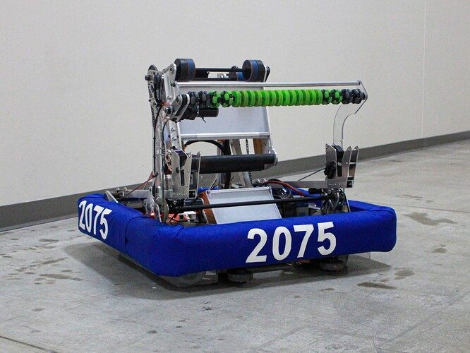
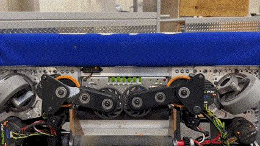
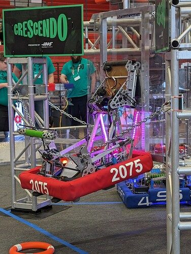

# 2024 · 2075 Enigma Robotics — Masquerade

EPA rank 23, snapshot EPA 46.81. Provisional reference dossier.

Hybrid under/over-bumper pickup and a shared shooting/climbing pivot.

## Drivetrain

Swerve; compact protected under-bumper approach.

Coverage: documented synopsis.

## Intake

Spring-out friction-driven collectors compress the note through limited bumper clearance; supplementary over-bumper intake.

Coverage: documented synopsis.

## Transfer

Sensor-tracked conveyor feeds a staged launcher.

Coverage: documented synopsis.

## Scoring

Pivoted launcher with matched wheel arrangement and revised output power for range.

Coverage: documented synopsis.

## Endgame

Ratcheting hooks capture chain; shooter wheels react against stage; flexible fingers open trap.

Coverage: documented synopsis.

## Controls

Front note-detection and rear target camera; distance-based speed/angle maps and automated note states.

Coverage: documented synopsis.

## Changes and versions

- Timing-pulley intake prototype changed to inline friction drive for packaging. Launcher power increased after range limitations.

## Strategic interpretation — analyst inference

The friction drive is a packaging response, not a universal transmission preference. Shared launch/climb actuation also makes the reaction geometry and ratchet behavior central to trap reliability.

## Limits

- Intermediate undocumented changes are not inferred; specifications and plans retain their source context.

Bounded source review; exhaustive intermediate-version history not certified

## Reviewed primary source bundle

- https://youtu.be/DEHi3v9PK90
- https://www.chiefdelphi.com/t/456972

## Season context

Read [the full 2024 game/context chapter](../docs/game_2024.md) before transferring this architecture to another role or season.

## Technical image references

Images are source-associated technical figures or robot views, not dimensionally certified drawings. Follow each source for version and figure context.

2024 team 2075 — source image from post 1 (2024-03-02). Context tags identify the discussion, not a verified component label. [Original source](https://www.chiefdelphi.com/t/456972/1). Source-linked extraction; mechanism identity not individually visually audited

2024 team 2075 — source image from post 1 (2024-03-02). Context tags identify the discussion, not a verified component label. [Original source](https://www.chiefdelphi.com/t/456972/1). Source-linked extraction; mechanism identity not individually visually audited

2024 team 2075 — source image from post 5 (2024-03-29). Context tags identify the discussion, not a verified component label. [Original source](https://www.chiefdelphi.com/t/456972/5). Source-linked extraction; mechanism identity not individually visually audited

## Dated research locators — navigation, not reviewed claims

A tag describes words in the source, not a validated engineering fact. Discussion replies may concern comparison robots.

- 2024-03-02 · Quinn_S · [post 1](https://www.chiefdelphi.com/t/456972/1) · intake
- 2024-03-29 · Robosquatch76 · [post 5](https://www.chiefdelphi.com/t/456972/5) · climb, intake, vision
- 2024-04-04 · Robosquatch76 · [post 7](https://www.chiefdelphi.com/t/456972/7) · autonomous

## Integrated focused technical study

[Construction, reasoning, failure modes and limits](../docs/research_continuation/2024-2075.md). This supplement is a focused interview/source-bundle study, not an exhaustive binder or competition-version certification.
