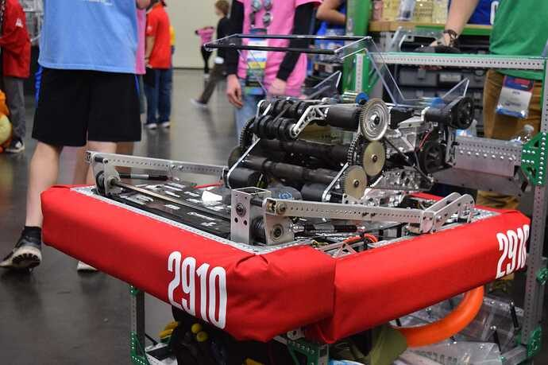
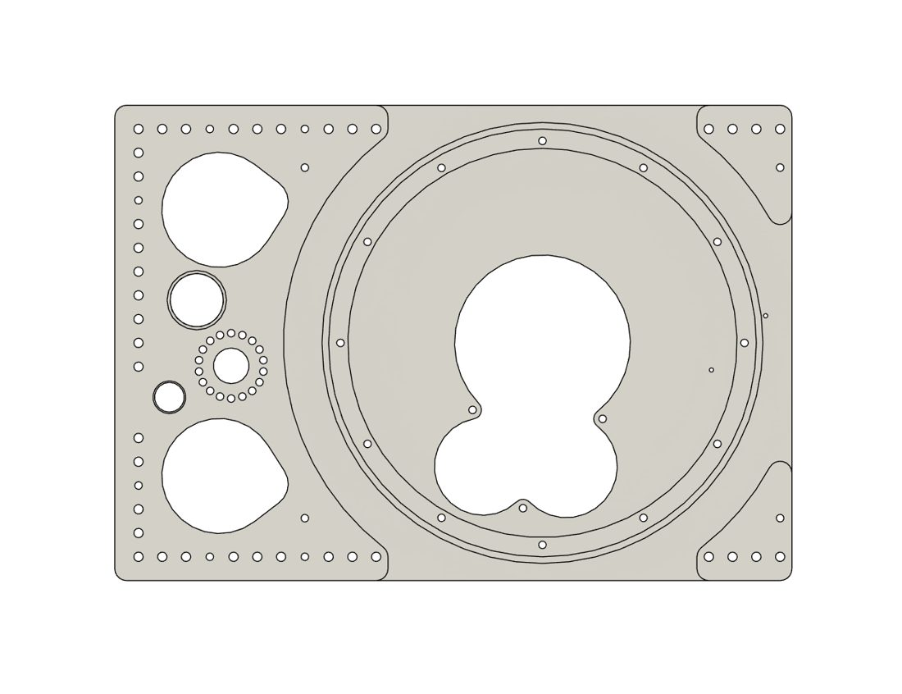
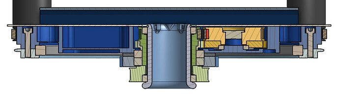
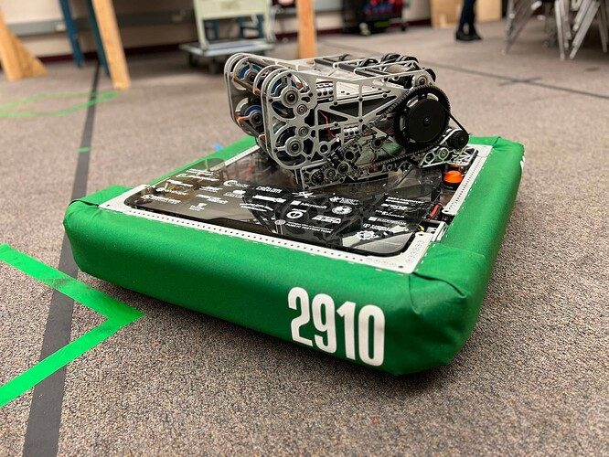
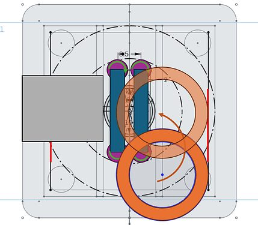
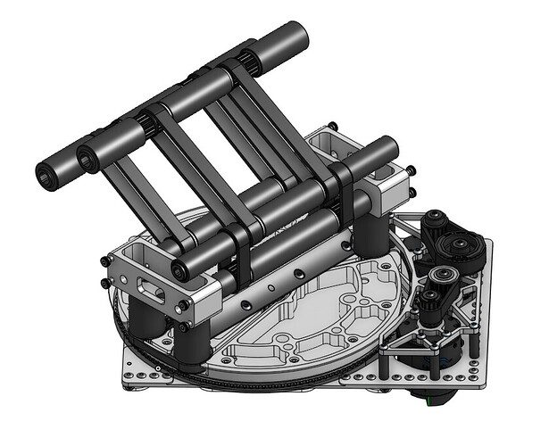

# 2024 · 2910 Jack in the Bot — Typhoon

EPA rank 13, snapshot EPA 50.25. Provisional reference dossier.

Compact turret with omnidirectional note feed and lightweight auxiliary endgame.

## Drivetrain

Narrow SDS modules create room for the note path; module standoffs help define the feeder cage.

Coverage: documented synopsis.

## Intake

Under-bumper intake feeds four vertical rollers.

Coverage: documented synopsis.

## Transfer

Rotating rollers draw the note around the cage into the turret at different headings.

Coverage: documented synopsis.

## Scoring

Continuously aiming turret; lightweight amp bar guides an upward shot.

Coverage: documented synopsis.

## Endgame

Late-added light climber uses a worm drive to resist backdrive.

Coverage: documented synopsis.

## Controls

Turret-mounted Limelight requires moving-camera pose transforms; superstructure states coordinate mechanisms.

Coverage: documented synopsis.

## Changes and versions

- Conceptual feed prototype validated before detailed design. Climber added after prioritizing the main scoring architecture.

## Strategic interpretation — analyst inference

A turret is useful only if its feed remains viable across turret headings. Narrow modules and a shared cage are enabling packaging choices, not incidental component preferences.

## Limits

- Only source-established configurations and changes are described; intermediate revisions may remain unresolved.

Bounded source review; exhaustive intermediate-version history not certified

## Reviewed primary source bundle

- https://youtu.be/AefyOa_38F8

## Season context

Read [the full 2024 game/context chapter](../docs/game_2024.md) before transferring this architecture to another role or season.

## Technical image references

Images are source-associated technical figures or robot views, not dimensionally certified drawings. Follow each source for version and figure context.

2024 team 2910 — source image from post 1 (2024-06-03). Context tags identify the discussion, not a verified component label. [Original source](https://www.chiefdelphi.com/t/467192/1). Source-linked extraction; mechanism identity not individually visually audited

2024 team 2910 — source image from post 30 (2024-06-05). Context tags identify the discussion, not a verified component label. [Original source](https://www.chiefdelphi.com/t/467192/30). Source-linked extraction; mechanism identity not individually visually audited

2024 team 2910 — source image from post 31 (2024-06-05). Context tags identify the discussion, not a verified component label. [Original source](https://www.chiefdelphi.com/t/467192/31). Source-linked extraction; mechanism identity not individually visually audited

2024 team 2910 — source image from post 1 (2024-03-01). Context tags identify the discussion, not a verified component label. [Original source](https://www.chiefdelphi.com/t/456845/1). Source-linked extraction; mechanism identity not individually visually audited

2024 team 2910 — source image from post 33 (2024-04-12). Context tags identify the discussion, not a verified component label. [Original source](https://www.chiefdelphi.com/t/456845/33). Source-linked extraction; mechanism identity not individually visually audited

2024 team 2910 — source image from post 33 (2024-04-12). Context tags identify the discussion, not a verified component label. [Original source](https://www.chiefdelphi.com/t/456845/33). Source-linked extraction; mechanism identity not individually visually audited

## Dated research locators — navigation, not reviewed claims

A tag describes words in the source, not a validated engineering fact. Discussion replies may concern comparison robots.

- 2024-03-01 · YanaiL · [post 6](https://www.chiefdelphi.com/t/456845/6) · climb
- 2024-03-01 · Nessie · [post 7](https://www.chiefdelphi.com/t/456845/7) · camera, shooter
- 2024-03-01 · Nuttyman54 · [post 9](https://www.chiefdelphi.com/t/456845/9) · climb, shooter
- 2024-03-04 · Ethan_Reed · [post 12](https://www.chiefdelphi.com/t/456845/12) · chain
- 2024-03-04 · Rohit_Seshadri · [post 13](https://www.chiefdelphi.com/t/456845/13) · intake
- 2024-03-06 · Sudhir · [post 15](https://www.chiefdelphi.com/t/456845/15) · intake
- 2024-03-11 · ElliotS · [post 16](https://www.chiefdelphi.com/t/456845/16) · intake
- 2024-03-11 · Nuttyman54 · [post 17](https://www.chiefdelphi.com/t/456845/17) · intake
- 2024-03-16 · Rocky_S · [post 19](https://www.chiefdelphi.com/t/456845/19) · shooter
- 2024-03-16 · PatrickW · [post 20](https://www.chiefdelphi.com/t/456845/20) · shooter
- 2024-03-18 · sticky_1629 · [post 22](https://www.chiefdelphi.com/t/456845/22) · camera, vision
- 2024-03-18 · Oliver_stivers · [post 24](https://www.chiefdelphi.com/t/456845/24) · shooter
- 2024-03-18 · Oliver_stivers · [post 25](https://www.chiefdelphi.com/t/456845/25) · intake
- 2024-03-18 · Oliver_stivers · [post 26](https://www.chiefdelphi.com/t/456845/26) · shooter
- 2024-03-18 · Nuttyman54 · [post 27](https://www.chiefdelphi.com/t/456845/27) · camera, shooter, vision
- 2024-03-19 · Rocky_S · [post 29](https://www.chiefdelphi.com/t/456845/29) · shooter
- 2024-03-19 · PatrickW · [post 30](https://www.chiefdelphi.com/t/456845/30) · shooter
- 2024-04-12 · Nuttyman54 · [post 33](https://www.chiefdelphi.com/t/456845/33) · chain, intake, prototype, shooter, spindexer
- 2024-04-12 · Revision0 · [post 35](https://www.chiefdelphi.com/t/456845/35) · prototype
- 2024-04-13 · Rohit_Seshadri · [post 36](https://www.chiefdelphi.com/t/456845/36) · shooter
- 2024-04-13 · Sudhir · [post 37](https://www.chiefdelphi.com/t/456845/37) · climb, pivot
- 2024-04-14 · rstockton429 · [post 39](https://www.chiefdelphi.com/t/456845/39) · cad, intake
- 2024-04-15 · KH987 · [post 44](https://www.chiefdelphi.com/t/456845/44) · autonomous, cad
- 2024-04-15 · Matthew1727 · [post 47](https://www.chiefdelphi.com/t/456845/47) · intake
- 2024-04-16 · ZCam_4415 · [post 55](https://www.chiefdelphi.com/t/456845/55) · cad
- 2024-04-16 · Rohit_Seshadri · [post 63](https://www.chiefdelphi.com/t/456845/63) · bearing
- 2024-04-16 · PatrickW · [post 64](https://www.chiefdelphi.com/t/456845/64) · bearing
- 2024-04-16 · CyberClone · [post 67](https://www.chiefdelphi.com/t/456845/67) · bearing
- 2024-04-16 · PatrickW · [post 68](https://www.chiefdelphi.com/t/456845/68) · chain
- 2024-04-27 · Aaron_Li · [post 73](https://www.chiefdelphi.com/t/456845/73) · code
- 2024-05-14 · td402 · [post 74](https://www.chiefdelphi.com/t/456845/74) · cad
- 2024-06-03 · Sudhir · [post 1](https://www.chiefdelphi.com/t/467192/1) · cad, code
- 2024-06-03 · Sudhir · [post 2](https://www.chiefdelphi.com/t/467192/2) · climb, rebuild
- 2024-06-04 · Sudhir · [post 81](https://www.chiefdelphi.com/t/456845/81) · cad, climb, code, rebuild
- 2024-06-04 · BordomBeThyName · [post 15](https://www.chiefdelphi.com/t/467192/15) · spindexer
- 2024-06-04 · Pizzatc · [post 16](https://www.chiefdelphi.com/t/467192/16) · rebuild
- 2024-06-04 · Sudhir · [post 17](https://www.chiefdelphi.com/t/467192/17) · intake, spindexer
- 2024-06-04 · Nuttyman54 · [post 18](https://www.chiefdelphi.com/t/467192/18) · shooter, spindexer
- 2024-06-04 · ZCam_4415 · [post 19](https://www.chiefdelphi.com/t/467192/19) · cad
- 2024-06-04 · Pizzatc · [post 20](https://www.chiefdelphi.com/t/467192/20) · cad
- 2024-06-04 · ZCam_4415 · [post 21](https://www.chiefdelphi.com/t/467192/21) · cad
- 2024-06-04 · JohnFogarty · [post 22](https://www.chiefdelphi.com/t/467192/22) · arm, intake
- 2024-06-04 · Nuttyman54 · [post 26](https://www.chiefdelphi.com/t/467192/26) · cad, prototype, shooter, spindexer
- 2024-06-05 · waialua359 · [post 28](https://www.chiefdelphi.com/t/467192/28) · cad, code
- 2024-06-05 · Ethan0120 · [post 29](https://www.chiefdelphi.com/t/467192/29) · chain
- 2024-06-05 · Ethan0120 · [post 30](https://www.chiefdelphi.com/t/467192/30) · shooter
- 2024-06-05 · Nuttyman54 · [post 31](https://www.chiefdelphi.com/t/467192/31) · belt, shooter
- 2024-06-06 · Nuttyman54 · [post 34](https://www.chiefdelphi.com/t/467192/34) · encoder
- 2024-06-10 · Ethan0120 · [post 43](https://www.chiefdelphi.com/t/467192/43) · shooter
- 2024-06-10 · PatrickW · [post 44](https://www.chiefdelphi.com/t/467192/44) · shooter
- 2024-06-10 · ZCam_4415 · [post 47](https://www.chiefdelphi.com/t/467192/47) · cad
- 2024-06-11 · Ethan0120 · [post 60](https://www.chiefdelphi.com/t/467192/60) · shooter
- 2024-06-11 · kingbrandon14 · [post 61](https://www.chiefdelphi.com/t/467192/61) · intake, shooter
- 2024-06-11 · bcon · [post 63](https://www.chiefdelphi.com/t/467192/63) · belt
- 2024-06-12 · Ethan0120 · [post 70](https://www.chiefdelphi.com/t/467192/70) · shooter
- 2024-06-12 · kingbrandon14 · [post 72](https://www.chiefdelphi.com/t/467192/72) · intake
- 2024-06-13 · Nuttyman54 · [post 74](https://www.chiefdelphi.com/t/467192/74) · shooter
- 2024-06-14 · MSU2000 · [post 75](https://www.chiefdelphi.com/t/467192/75) · intake
- 2024-06-14 · Nuttyman54 · [post 76](https://www.chiefdelphi.com/t/467192/76) · intake
- 2024-06-21 · waialua359 · [post 77](https://www.chiefdelphi.com/t/467192/77) · bearing
- 2024-06-21 · waialua359 · [post 79](https://www.chiefdelphi.com/t/467192/79) · chain, climb, intake, shooter
- 2024-07-13 · ZCam_4415 · [post 96](https://www.chiefdelphi.com/t/467192/96) · intake
- 2024-07-16 · waialua359 · [post 98](https://www.chiefdelphi.com/t/467192/98) · shooter
- 2024-07-19 · ZCam_4415 · [post 99](https://www.chiefdelphi.com/t/467192/99) · intake
- 2024-07-25 · ZCam_4415 · [post 100](https://www.chiefdelphi.com/t/467192/100) · belt, cad, shooter
- 2024-07-26 · Sudhir · [post 101](https://www.chiefdelphi.com/t/467192/101) · belt, cad
- 2024-07-26 · Pizzatc · [post 104](https://www.chiefdelphi.com/t/467192/104) · cad
- 2024-08-01 · kingbrandon14 · [post 108](https://www.chiefdelphi.com/t/467192/108) · shooter
- 2024-08-01 · waialua359 · [post 109](https://www.chiefdelphi.com/t/467192/109) · shooter
- 2024-08-02 · ZCam_4415 · [post 111](https://www.chiefdelphi.com/t/467192/111) · intake, shooter
- 2024-08-12 · ZCam_4415 · [post 116](https://www.chiefdelphi.com/t/467192/116) · intake
- 2024-08-14 · waialua359 · [post 120](https://www.chiefdelphi.com/t/467192/120) · shooter
- 2024-08-14 · PatrickW · [post 121](https://www.chiefdelphi.com/t/467192/121) · intake
- 2024-08-14 · waialua359 · [post 122](https://www.chiefdelphi.com/t/467192/122) · code
- 2024-08-14 · ZCam_4415 · [post 123](https://www.chiefdelphi.com/t/467192/123) · cad
- 2024-08-14 · waialua359 · [post 124](https://www.chiefdelphi.com/t/467192/124) · cad
- 2024-08-21 · waialua359 · [post 133](https://www.chiefdelphi.com/t/467192/133) · intake, shooter
- 2024-08-21 · PatrickW · [post 134](https://www.chiefdelphi.com/t/467192/134) · code, intake, shooter
- 2024-08-21 · ZCam_4415 · [post 135](https://www.chiefdelphi.com/t/467192/135) · intake
- 2024-08-21 · ZCam_4415 · [post 136](https://www.chiefdelphi.com/t/467192/136) · intake
- 2024-08-22 · waialua359 · [post 138](https://www.chiefdelphi.com/t/467192/138) · intake, shooter
- 2024-09-02 · ZCam_4415 · [post 139](https://www.chiefdelphi.com/t/467192/139) · cad, shooter
- 2024-09-05 · BrianAtlanta · [post 141](https://www.chiefdelphi.com/t/467192/141) · chain
- 2024-09-05 · waialua359 · [post 142](https://www.chiefdelphi.com/t/467192/142) · intake
- 2024-09-06 · ZCam_4415 · [post 143](https://www.chiefdelphi.com/t/467192/143) · cad
- 2024-09-11 · ZCam_4415 · [post 145](https://www.chiefdelphi.com/t/467192/145) · vision
- 2024-09-18 · ZCam_4415 · [post 146](https://www.chiefdelphi.com/t/467192/146) · intake, shooter
- 2024-09-18 · anihtA · [post 147](https://www.chiefdelphi.com/t/467192/147) · cad
- 2024-09-18 · waialua359 · [post 149](https://www.chiefdelphi.com/t/467192/149) · climb, code, shooter
- 2024-09-25 · ZCam_4415 · [post 157](https://www.chiefdelphi.com/t/467192/157) · intake, shooter
- 2024-09-30 · suPURDUEperAndy · [post 160](https://www.chiefdelphi.com/t/467192/160) · chain
- 2024-09-30 · waialua359 · [post 161](https://www.chiefdelphi.com/t/467192/161) · chain
- 2024-10-08 · ZCam_4415 · [post 165](https://www.chiefdelphi.com/t/467192/165) · belt, intake
- 2024-10-08 · Nuttyman54 · [post 166](https://www.chiefdelphi.com/t/467192/166) · intake
- 2024-10-14 · waialua359 · [post 167](https://www.chiefdelphi.com/t/467192/167) · shooter

## Integrated focused technical study

[Construction, reasoning, failure modes and limits](../docs/research_continuation/2024-2910.md). This supplement is a focused interview/source-bundle study, not an exhaustive binder or competition-version certification.
