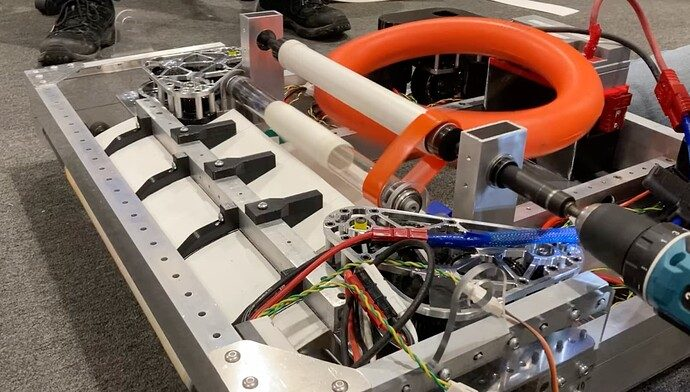

# 2024 · 2974 Walton Robotics — Shosty

EPA rank 25, snapshot EPA 46.46. Provisional reference dossier.

Protected pickup and short transfer into a pivoting shooter; winch climb and trap developed later.

## Drivetrain

SDS MK4i: Kraken drive, Falcon steering.

Coverage: documented synopsis.

## Intake

Under-bumper intake; carbon rollers replaced early polycarbonate; spare assembly rebuilt after impact damage.

Coverage: documented synopsis.

## Transfer

Curved guides and powered roller replace slower, note-damaging conveyor concepts.

Coverage: documented synopsis.

## Scoring

Top/bottom launcher with increasingly stiff pivot support and external position sensing.

Coverage: documented synopsis.

## Endgame

Winch hooks, compliant guides and later stabilizer/trap-door work; early shooter-as-climber proposal was superseded.

Coverage: documented synopsis.

## Controls

Choreo/PathPlanner, characterization, procedural autos, state-machine logs and added See3CAM before DCMP.

Coverage: documented synopsis.

## Changes and versions

- March: damper added to reduce settling; pivot ratio and belts changed before DCMP. Worlds logs diagnosed belt skipping. GRITS intake damage required emergency structural support.

## Strategic interpretation — analyst inference

Especially valuable PCH chronology: mechanical settling time was a cycle-time bottleneck; logs distinguished encoder disagreement from a simple aiming-tuning problem. The mic'd match is operational evidence, not a technical walkthrough.

## Limits

- Intermediate undocumented changes are not inferred; specifications and plans retain their source context.

Bounded source review; exhaustive intermediate-version history not certified

## Reviewed primary source bundle

- https://www.chiefdelphi.com/t/452466
- https://youtu.be/w0AFxJFMOqg

## Season context

Read [the full 2024 game/context chapter](../docs/game_2024.md) before transferring this architecture to another role or season.

## Technical image references

Images are source-associated technical figures or robot views, not dimensionally certified drawings. Follow each source for version and figure context.

2024 team 2974 — source image from post 9 (2024-02-18). Context tags identify the discussion, not a verified component label. [Original source](https://www.chiefdelphi.com/t/452466/9). Source-linked extraction; mechanism identity not individually visually audited

## Dated research locators — navigation, not reviewed claims

A tag describes words in the source, not a validated engineering fact. Discussion replies may concern comparison robots.

- 2024-01-29 · madelinep · [post 1](https://www.chiefdelphi.com/t/452466/1) · cad, code
- 2024-01-29 · madelinep · [post 2](https://www.chiefdelphi.com/t/452466/2) · belt, cad, camera, chain, intake, prototype, shooter
- 2024-01-29 · madelinep · [post 3](https://www.chiefdelphi.com/t/452466/3) · arm, cad, climb, hopper, intake, launcher, pivot, prototype, shooter, wrist
- 2024-02-04 · madelinep · [post 5](https://www.chiefdelphi.com/t/452466/5) · intake, shooter
- 2024-02-08 · philosophermurr · [post 6](https://www.chiefdelphi.com/t/452466/6) · arm, autonomous, code, encoder, shooter, vision
- 2024-02-11 · madelinep · [post 7](https://www.chiefdelphi.com/t/452466/7) · cad, intake, pivot, shooter
- 2024-02-13 · VishruthT24 · [post 8](https://www.chiefdelphi.com/t/452466/8) · intake
- 2024-02-18 · madelinep · [post 9](https://www.chiefdelphi.com/t/452466/9) · belt, cad, chain, climb, intake, pivot, shooter
- 2024-02-20 · madelinep · [post 10](https://www.chiefdelphi.com/t/452466/10) · intake, shooter
- 2024-02-23 · philosophermurr · [post 11](https://www.chiefdelphi.com/t/452466/11) · intake, shooter
- 2024-02-25 · madelinep · [post 12](https://www.chiefdelphi.com/t/452466/12) · belt, intake, pivot, shooter
- 2024-03-01 · philosophermurr · [post 14](https://www.chiefdelphi.com/t/452466/14) · intake
- 2024-03-03 · madelinep · [post 15](https://www.chiefdelphi.com/t/452466/15) · belt, cad, chain, intake, pivot, shooter
- 2024-03-06 · philosophermurr · [post 17](https://www.chiefdelphi.com/t/452466/17) · shooter
- 2024-03-10 · madelinep · [post 18](https://www.chiefdelphi.com/t/452466/18) · cad, intake, shooter
- 2024-03-13 · VishruthT24 · [post 19](https://www.chiefdelphi.com/t/452466/19) · autonomous
- 2024-03-17 · grac · [post 20](https://www.chiefdelphi.com/t/452466/20) · arm
- 2024-03-17 · madelinep · [post 21](https://www.chiefdelphi.com/t/452466/21) · intake, pivot, shooter
- 2024-03-26 · grac · [post 23](https://www.chiefdelphi.com/t/452466/23) · camera, code, shooter
- 2024-03-26 · Potatoes3 · [post 24](https://www.chiefdelphi.com/t/452466/24) · code, vision
- 2024-03-26 · philosophermurr · [post 25](https://www.chiefdelphi.com/t/452466/25) · camera
- 2024-03-26 · madelinep · [post 26](https://www.chiefdelphi.com/t/452466/26) · camera, shooter
- 2024-03-31 · madelinep · [post 27](https://www.chiefdelphi.com/t/452466/27) · arm, belt, camera, climb, intake, pivot, shooter
- 2024-04-09 · madelinep · [post 28](https://www.chiefdelphi.com/t/452466/28) · intake, pivot, shooter
- 2024-05-07 · philosophermurr · [post 32](https://www.chiefdelphi.com/t/452466/32) · arm, belt, pivot
- 2024-10-04 · SHMKPK · [post 33](https://www.chiefdelphi.com/t/452466/33) · cad
- 2024-10-24 · DerekSpevak · [post 35](https://www.chiefdelphi.com/t/452466/35) · autonomous, code, intake

## Integrated focused technical study

[Construction, reasoning, failure modes and limits](../docs/research_continuation/2024-2974.md). This supplement is a focused interview/source-bundle study, not an exhaustive binder or competition-version certification.

Source correction: w0AFxJFMOqg is match/driver audio, not a technical interview. Use the team build thread for construction evidence.
